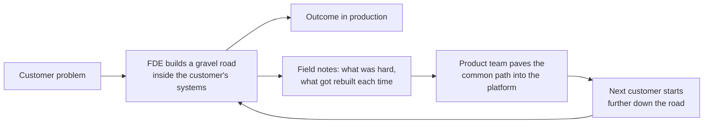
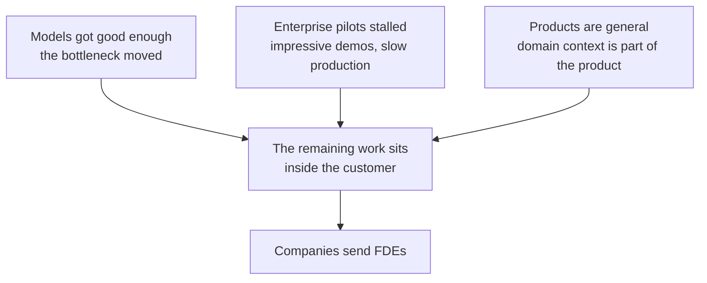
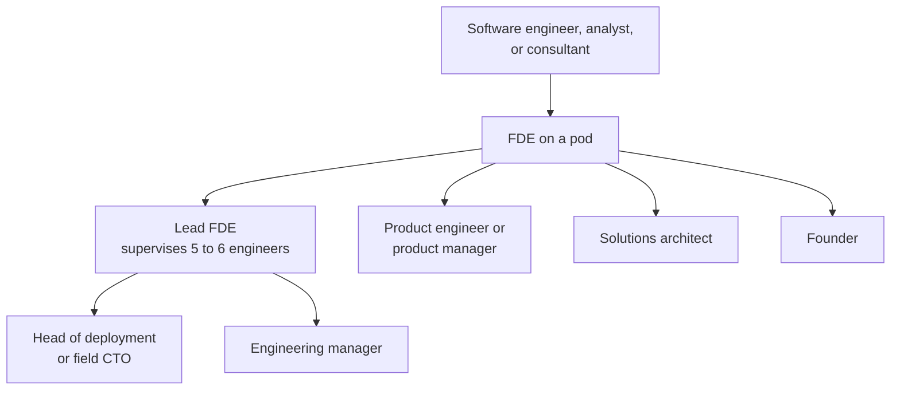
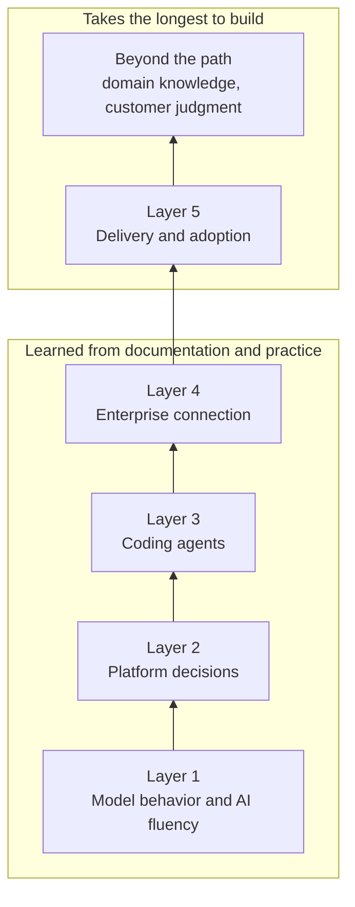
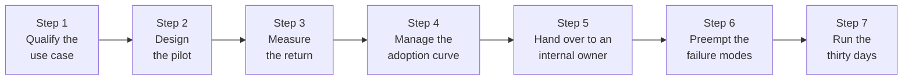
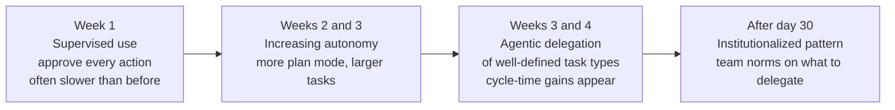
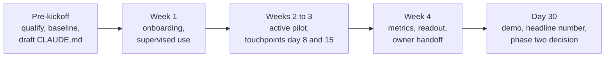

A bank buys access to a frontier model. The demo impresses, the contract is signed, and six months later almost nothing is in production. The model is not the problem:

- The data sits in four systems nobody fully understands.
- Security has not approved any agent that can write to anything.
- Developers still use the tool as a faster autocomplete.
- Nobody measured anything before the pilot, so nobody can say whether it saved a single hour.

To fix problems like these, companies now send in a **forward deployed engineer**, or **FDE**. Lightcast, a labor market analytics firm, counted fewer than 200 United States job postings with that title in 2023, about 1,200 in 2025, and more than 7,300 in the first nine months of 2026. Treat the market numbers in this post as signals, not precise counts: they come from labor data and press reports.

Still, that speed raises three questions. What is the job, really? Will it still exist in five years? And what would it take for a developer, a business analyst, a project manager, or a tester to do it? The definition comes first, because you cannot judge a job you cannot define.

## What a forward deployed engineer does

### Many capabilities for one customer

Palantir, which invented the role, defines it with one flip. A product engineer builds one capability for many customers. A forward deployed engineer builds many capabilities for one customer.

That flip puts the engineer at the customer site, as the military's forward deployed troops are stationed near the action, not at headquarters. Bob McGrew, an early Palantir executive, says the FDE sits there to fill the gap between what the product does and what the customer needs.

The FDE fills that gap with **production code**: not a sales proof of concept or a slide about what to build, but working software in the customer's real systems, on real data, under real security rules. First Round, which has helped many startups hire for the role, calls the best FDEs "compulsive builders".

But building is not the whole week. Job ads for builder-type FDE roles advertise 70 to 90 percent of time coding. Gergely Orosz, reading a Google FDE job posting in 2026, estimated 25 percent coding, 50 percent integration and plumbing, and 25 percent meetings. Most people are probably nearer the second. So the hard part is making the code run, and be used, inside someone else's organization. That second half, being used, was in the role from its first day.

### A builder and an adopter, first as a pair

Palantir created the role in the early 2010s out of necessity. Its first customers, intelligence and defense agencies, could not describe their problems openly. So engineers with clearance had to work inside their buildings, on the real problem.

The role came as a pair, with code names from the NATO phonetic alphabet:

- The **Delta**, the forward deployed engineer, built the system.
- The **Echo**, the deployment strategist, made sure it was adopted.

The Echo was often no software engineer, but a former military officer, clinician, or forensic accountant who knew why three teams would refuse a technically perfect pipeline. The modern FDE is often expected to carry both halves alone.

Until around 2016, Palantir had more forward deployed engineers than conventional software engineers. That looked strange for a software company, and outsiders called it glorified consulting. Were they right?

### A feedback loop that makes the role more than consulting

The answer to the consulting charge is what happens to the field work afterwards. Palantir alumni say the FDE builds a **gravel road**: the minimum path that gets one customer to a real outcome, fast and a bit ugly. When the same road gets built at three or four customers, the product team paves it into a **paved highway**, a reusable platform feature the next customer gets for free. The diagram shows this loop.

Without that loop, an FDE is a contractor and the team is professional services with a trendier title. With it, every deployment improves the product, which is why investors accept the model's lower early margins.

The loop answers the consulting charge. It does not explain why, a decade later, so many other companies copied it.

## Why AI spread the role beyond Palantir

For a decade the FDE was mostly a Palantir oddity. Three things changed that, and the diagram shows that all three point the same way.

**The bottleneck moved.** A frontier model can read a legacy codebase, draft a migration, and write the tests. It cannot know which of the bank's four customer databases is the real one, get a security exception, or persuade forty developers to change how they work. [When Code Is Cheap](/blogs/blog/when_code_is_cheap/) argues that when code gets cheap, the expensive parts become judgment, context, and verification.

**Pilots stalled at scale.** A widely quoted 2025 MIT report claimed that about 95 percent of enterprise generative AI pilots showed no measurable business impact. Whatever the exact figure, every vendor saw impressive demos and slow production.

**The products are general.** A model or an agent framework does nothing for a specific bank until someone wires it in. By hiring FDEs per industry, OpenAI and Anthropic admit that domain context is part of the product.

So companies send FDEs because the models are strong, not weak: the better the model, the more of the remaining work sits inside the customer. If that is true, the demand should last. Does it?

## Why the work will outlast the title

A hot title is not a lasting job, so the claim needs a test, starting with the money.

### What the money and the hiring show

The posting counts in the introduction are rough, but the growth is real, and so is the pay: Lightcast puts the median advertised salary for these postings at about $195,000, more than three times the median for all US postings. The budgets are real too. The table lists what four groups committed in 2026 alone.

| Who | What they committed | How they are building capacity |
|---|---|---|
| Amazon Web Services | One billion dollars for a new FDE organization | Hundreds of engineers from inside and outside Amazon, with thousands planned |
| OpenAI | More than four billion dollars of initial investment in a deployment business | Hiring directly and buying Tomoro, a consultancy with about 150 deployment specialists |
| Anthropic | One hundred million dollars for the Claude Frontier Academy | Training 10,000 engineers who already work at its customers and partners, by the end of 2027 |
| Accenture and Google Cloud | A joint 1,000-person FDE workforce | Retraining experienced software engineers in 30 to 90 days |

The table hides three strategies: AWS builds its own army, OpenAI buys a consultancy, and Anthropic trains engineers who work for someone else. For an IT services company, the last one is an invitation. And the services companies are hiring: Lightcast counted more FDE postings in 2026 from Deloitte and Accenture than from Google.

But money and hiring can follow hype. The stronger evidence is in the work itself.

### What keeps the work in demand

Three features of the work suggest it will outlast the hype.

- **The last mile never goes away.** Every enterprise has its own data, legacy systems, regulators, and politics. Better models shrink the integration code, not the need for what Steve Corfield of Anthropic called "an engineer who can understand how the business works and also build the system that changes it."
- **The bottleneck keeps moving the same way.** The more coding agents take over, the larger the share of work that needs judgment and context. AI does not replace this job. It creates more of it.
- **It builds on existing skills.** Lightcast estimates the FDE role shares roughly half its skills with software engineering, so supply can grow by retraining. Roles staffed by conversion tend to last.

None of this promises that every job with the title is that work.

### What could still shrink the role

Five risks make some caution fair.

**The title is inflating.** Many postings now call implementation, configuration, or customer support work "forward deployed". Palantir alumni are blunt: configuring a product is not forward deployed engineering. Without the feedback loop, it is services work with a new label.

**The consulting trap is real.** It closes when FDEs are measured on billable hours and leave their code in customer-specific repositories the product team never sees. The venture firm a16z, which coined the phrase "trading margin for moat", is clear that the trade only works if the service work is designed to feed the product.

One founder playbook gives a warning sign of that trap: more than 40 percent of recent engineering hires are FDEs, and their code sits in customer-specific repositories untouched for 90 days.

**The returns are not proven yet.** CNBC noted in October 2026 that FDE projects so far show productivity gains in company case studies, but no independently verified financial returns.

**The work is hard on people.** First-person accounts describe three to four days a week at the customer, and some engineers avoid the role because of the travel and the pressure.

**There is also a quiet paradox.** A vendor spends millions training humans to deploy a technology that promises to do more of the work itself. Will the judgment and adoption parts grow faster than the automatable parts shrink? So far they have.

So the work has reasons to stay, and the title has reasons to blur.

### What the title becomes next

The likeliest outcome is that the title fades while the work stays. DevOps went the same way: a movement became a job title, got inflated, and settled into a family of roles, because the underlying work was permanent.

Expect the same here: variants such as Applied AI Engineer or Deployment Engineer, a core of true FDEs at vendors and large integrators, and many more roles with forward deployed work as one part of the job. The work is shifting too: an analysis of about a thousand 2026 postings found the most-listed skills are no longer just Python and SQL but customer discovery, problem decomposition, and product judgment.

If forward deployed work becomes one part of many jobs, how does it differ from the jobs a company already has?

## How the FDE differs from the roles around it

The FDE overlaps with the people who talk to customers, write code, analyze requirements, and test, which is why the role confuses people. The table sets each familiar role beside the FDE.

| Role | What they hand over | What the FDE does differently |
|---|---|---|
| **Developer** | Features in a shared product | Builds inside one customer's systems and owns the outcome, not just the ticket |
| **Business analyst** (BA) | Requirements, process maps, user stories | Turns the requirement into working software in the same week, and tests it against real data |
| **Project manager** (PM) | A plan delivered on time, budget, and scope | Is accountable for a business result, not for the plan |
| **Product manager** | A roadmap and priorities | Does discovery by building inside the customer |
| **Tester** (QA) | Test plans, defects, a quality signal | Designs evaluations for non-deterministic AI output and owns the verification, not just the reporting |
| **Solutions architect** | A reference architecture and design advice | Stays to build it, and lives with the consequences of the design |
| **Sales engineer** (presales) | Demos and proofs of concept | Starts where the sale ends and writes code that must survive production |
| **Consultant** | Recommendations or delivered scope | Is paid to solve the problem, not to execute the statement of work |
| **BrSE** (bridge engineer between an offshore team and a Japanese client) | Translated, clarified requirements | Bridges business and technology by building, not only by translating |
| **DevOps or platform engineer** | Pipelines, infrastructure, reliability | Applies the same skills under one customer's security and approval rules |

**Only the FDE answers for the customer's business outcome.** A project manager owns the plan, a developer the code, a tester the defects, a consultant the scope. The FDE owns "is this actually working and being used".

To own that, the FDE may do several of these jobs in one week: a discovery workshop like a BA, an integration like a developer, an evaluation like a tester, a results presentation like a PM. That breadth rewards generalists and punishes people who want deep focus. It also means almost nobody starts a career as an FDE. So where do FDEs come from?

## How people move into the role and out of it

### How each role gets in

People arrive from one of the roles in the table above, each with some of the skills. The next table shows the gap and a first step for each.

| Coming from | What you are probably missing | A good first step |
|---|---|---|
| Developer | Customer conversations, business framing, presenting to executives | Volunteer for the next customer-facing pilot, and own the readout (the closing report to the customer's executives) |
| Business analyst | Enough coding to build and debug agents, evaluation design | Prototype your next requirement with a coding agent instead of documenting it |
| Project manager | Hands-on technical depth, the credibility badge of the role | Pair with an engineer on a pilot and own the success criteria; or move toward the Echo half of the role |
| Tester | Building production features, customer-facing work | Specialize in evaluating AI output, the part most teams do badly |
| Solutions architect or presales | Staying through production, owning messy details | Stay with one account past signature and deliver the first production use case yourself |
| Consultant | Production engineering, product feedback habits | Build, do not recommend: deliver a working system and write up what should become reusable |
| BrSE | Building autonomously, owning outcomes rather than communication | Hand the team a working draft of what the client describes, not a specification |
| DevOps or platform engineer | Business discovery and adoption work | Lead the configuration and governance of an AI rollout, then take on the use case work around it |

Read down the last column: most first steps swap what your role usually hands over (a spec, a plan, a demo, a recommendation) for a working result at a real customer.

Behind the eight rows there are only two roads. The developer's looks easier, because this is first an engineering role. But the developer's gap is the human side, and nothing shortens that. The CEO of one AWS consulting partner said "the hardest thing to teach is the customer EQ, without question," and added that "there is no compression algorithm for experience."

The BA or PM has the human side and must earn technical credibility, and coding agents have shortened that road a great deal. Someone with strong domain knowledge and enough engineering judgment can now build systems that needed a full team a few years ago.

Both roads matter, because supply is the real limit on the market. "Experienced FDEs cannot simply be recruited at the scale clients need," as Accenture's FDE lead put it. So the opportunity is largest for people who already have half the skills. And where does the role lead after that?

### Where FDEs go next

An FDE collects first-hand knowledge of what breaks at real customers, and other teams want it. The diagram shows where FDEs go; a **pod** is a small deployment team.

The lead branch is how supply grows: an executive recruiter quoted by CNBC suggested that FDEs with ten to fifteen successful deployments have the judgment to lead teams of five or six less experienced engineers.

The side branches spend the same knowledge elsewhere. A former FDE in product engineering designs APIs that are easy to integrate, having suffered through ones that are not. A founder has seen earlier than anyone which problems repeat across customers. And moving back is not a failure: a BA who spent a year building now writes requirements that come with prototypes.

The roads in and out differ. The knowledge in the middle is the same for everyone.

## What an FDE needs to know, from model to organization

Whichever road you take, you arrive at the same knowledge stack; only your gaps differ. Anthropic's partner training path, the [Claude Forward Deployed Engineer learning path](https://anthropic-partners.skilljar.com/path/claude-fde), lists ten topics. The examples here use Claude for that reason, but the ideas apply to any model provider. The topics fall into five layers, plus a few pieces the path assumes you already have. The diagram shows the order, from the model up to the organization.

Retraining programs can cover the lower layers in weeks. The top takes the longest and is what makes the role valuable. The table says what each layer holds and why the customer needs it.

| Layer | What to know | Why the customer needs it |
|---|---|---|
| 1. Model behavior and AI fluency | How a model predicts text and how far instructions steer it; how people delegate to AI and judge its output | So you can explain failures and teach people to use AI well |
| 2. Platform decisions | Entry point, features, model, and context; the API, its limits and administration | So the deployment is set up right before anyone writes a prompt |
| 3. Coding agents | Expert daily use, including **plan mode** (the agent proposes a plan before changing any file) and **CLAUDE.md** (the project memory file the agent reads at the start of every session) | So you can lead developer adoption from experience |
| 4. Enterprise connection | **MCP** servers (a standard way to connect an agent to tools and data), **agent skills** (packaged customer know-how), security, and **evals** (test sets and graders that show whether the system is good enough) | So the AI can reach real systems safely and you can prove it works |
| 5. Delivery and adoption | Qualification, pilots, return on investment, the adoption curve, internal owners, rollout phases | So the result is measurable and survives after you leave |
| Beyond the path | Domain knowledge, customer judgment, writing and presenting | So the people with the budget trust you and act on the results |

Read the right column again: every layer answers something the customer will ask. One of those questions is "how do you know it works?", and the answer must be data, not anecdotes.

I do not go deeper into the lower layers, because two companion posts do. [From Request to Running System](/blogs/blog/from_request_to_running_system/) covers the decisions that decide whether an AI solution survives in an enterprise. [From Prototype to Production](/blogs/blog/from_prototype_to_production/) walks a developer from the first API call to a system a regulated customer can audit. That leaves layer 5 and the judgment beyond it: how an engagement is actually run.

## How an FDE delivers in thirty days

Knowing the technology is the entry ticket; the delivery method makes an engagement succeed. Anthropic teaches partners a 30-day activation playbook for coding-agent rollouts, and it fits any AI deployment. The diagram shows its seven steps.

The steps run roughly in order, so I walk through them that way, with worked examples from Anthropic's course.

### Choosing a use case and locking the pilot

Step 1, **qualify the use case**, asks one question: is the gain **marginal** or **structural**? A marginal gain means the same work gets done faster, as with autocomplete. A structural gain means the unit of work changes: a job that needed a team of four for six weeks now needs two developers for two weeks. Only structural gains produce a story that survives an executive readout.

Economic history explains why. In ["The Dynamo and the Computer"](https://econpapers.repec.org/RePEc:aea:aecrev:v:80:y:1990:i:2:p:355-61), the economist Paul David describes factories that swapped steam engines for electric motors but kept their old layout. They gained little until they reorganized work around the new technology. A coding agent used as a faster autocomplete is the motor in the old layout.

A structural gain is still not enough. The task must also recur often enough to generate data in thirty days, have a baseline you can capture before day one, and belong to a team ready to change its workflow.

In the worked example, a team proposed adding unit tests to a codebase already at 82 percent coverage, or a Java to Spring Boot migration it had been scoping for eight months. The migration qualifies, the tests are marginal, and running both dilutes the result.

Step 2, **design the pilot**, then fixes that choice so it can be judged. "A pilot that can't be evaluated is not a pilot." The **cohort** is the people who already own the target work, not volunteers. The **scope** is locked: not "code modernization" but "Java to Spring Boot migration of the authentication service". The last design decision is the success criteria, and they need a number from before the pilot.

### Measuring before day one

Step 3, **measure the return**, begins with the **baseline**: the value of a metric measured before the pilot starts. "What you don't measure before day one you can't prove at day thirty." A baseline reconstructed later is always contested, because sponsors remember the past the way they want the pilot to look.

Two or three baselines are enough, such as cycle time from ticket to merge. Each gets a target that is a number: "25 percent reduction in PR cycle time" is a claim; "PR cycle time improved" is not. (PR means pull request.)

The closing readout then leads with one headline number and one business translation. In the worked example, PR cycle time fell from 8.2 to 5.4 days. The translation turns "cycle time dropped 34 percent" into "the team can ship about 1.5 times the features in the same sprint", which is the sentence a chief information officer repeats.

Between the baseline and the readout, though, the numbers do not climb in a straight line.

### Coaching through the dip and the plateau

Step 4, **manage the adoption curve**, exists because an FDE who treats adoption like a normal software rollout will intervene at the wrong moments. The diagram shows the four stages a team passes through.

Two moments on that curve mislead people. The first is the **week one dip**: velocity falls before it rises, because people are learning a new way of working, not a new button. Do not intervene on velocity in week one.

The second is the **plateau**. After the dip, many developers find one or two patterns that work and stop experimenting. "Plateau is not adoption." In the worked example, cycle time is flat at day sixteen while daily usage holds at a steady 45 minutes. That is the time to act.

How to act depends on the cause. A developer who cannot get the agent to do what they want has a technical problem, and needs help now. A developer who uses the agent as a faster autocomplete has a workflow design problem. That is the old factory layout again, and the fix is coaching on what they delegate, not on how they prompt.

The coaching lasts thirty days. Then the FDE leaves, and something else must keep the deployment working.

### Handing over to a named owner

Step 5, **hand over to an internal owner**, answers that. "Every deployment needs someone whose job is to keep it working." The **internal owner** is a named person inside the customer who maintains the project memory files, runs weekly office hours, onboards new developers, and escalates blockers.

The owner inherits the CLAUDE.md files, and a generic file produces a generic agent. "The quality of a deployment 90 days after you leave is determined by the quality of the CLAUDE.md you hand over."

The handover happens in the office hours: the FDE leads the first session, the owner co-facilitates the second, and the owner runs the third while the FDE observes. Handoff is not a meeting about ownership. It is doing the job while still supported.

That leaves two steps, and both look at the pilot as a whole.

### Running the thirty days as a rhythm

Step 6, **preempt the failure modes**, is mostly a look back. The course names six failure modes, none of them technical, and almost every one is an earlier step, skipped, such as no baseline, no named owner, or a readout with no business number. So most of the prevention is doing each step on time.

Step 7, **run the thirty days**, puts the steps on a calendar. The thirty days are a rhythm with exit conditions, not a task list: each phase ends with one thing that must be true before the next starts. The diagram shows the phases.

The exit conditions are what the diagram leaves out:

- **Pre-kickoff** ends when the baseline is captured.
- **Week one** ends when everyone is installed and working in supervised use.
- **Weeks two and three** hold touchpoints on day 8 and day 15 to review usage, and end with the internal owner named by day 15.
- **Week four** ends when the readout reaches the customer's sponsor 48 hours before the showcase, not during it.
- **Day thirty** is the showcase: a live demo on real code, the headline number, and the decision on phase two, the wider rollout.

None of the playbook is about the model. All of it decides whether the model's value reaches the business.

## What stays when the title changes

That is also what stays when the title changes. The model can write the code. Someone still has to know which code is worth writing, connect it to the right systems, prove that it helped, and leave behind a team that keeps it working.

That person needs an engineer's hands, an analyst's curiosity, a project manager's discipline about measurement, and a consultant's comfort in someone else's building. The title may change. The job, I think, is here for as long as businesses differ, which is to say for good.

So do not wait for the title. Find your row in the first-step table and take that step on your next project.

## Glossary

**Agent skills**: packaged know-how (instructions, scripts, reference files) that an agent loads only when a task needs it.

**AI fluency**: the human ability to work with AI effectively, efficiently, ethically, and safely.

**Baseline**: the value of a metric measured before a pilot starts, used as the "before" in any return-on-investment claim.

**CLAUDE.md**: the project memory file a coding agent reads at the start of every session; the place where team conventions and domain context live.

**Delta and Echo**: Palantir's code names for the forward deployed engineer (Delta) and the deployment strategist who handles domain and organizational adoption (Echo).

**Evals**: test sets and graders that measure whether an AI system's output is good enough and whether it changed after an update.

**Forward deployed engineer (FDE)**: a software engineer who works inside one customer at a time, builds what that customer needs to get value from a general product, and feeds the lessons back to the product.

**Gravel road and paved highway**: the quick, customer-specific solution an FDE builds (gravel road), and the reusable product feature it becomes once the pattern repeats (paved highway).

**Internal owner**: a named person inside the customer who owns the deployment after the FDE leaves. They maintain project memory files, run office hours, and onboard newcomers.

**Marginal gain and structural gain**: a marginal gain does the same work faster; a structural gain changes the unit of work, such as a four-person, six-week job becoming a two-person, two-week job.

**MCP (Model Context Protocol)**: an open standard for connecting AI agents to tools and data through servers with defined capabilities.

**Plan mode**: a coding agent mode in which the agent proposes a plan for approval before changing any files.

**Plateau**: the stage after initial adoption where developers stop experimenting and usage stabilizes below its potential.

**Supervised use and agentic delegation**: the two ends of the adoption curve, from approving every agent action to handing off whole task types with light oversight.

**Week one dip**: the temporary drop in developer velocity in the first week of a coding-agent rollout, caused by learning a new way of working.

## References

**Training and vendor programs**

- Anthropic Partner Academy, ["Claude Forward Deployed Engineer" learning path](https://anthropic-partners.skilljar.com/path/claude-fde), including "Delivery Methodology" and "Driving Enterprise Adoption of Claude". The training path behind the five knowledge layers and the 30-day playbook in this post.
- AWS Partner Network blog, ["Introducing Forward Deployed Engineering for Partners"](https://aws.amazon.com/blogs/apn/introducing-forward-deployed-engineering-for-partners-winning-the-future-of-enterprise-ai). How AWS is extending its FDE model to consulting partners.
- Anthropic, ["Forward Deployed Engineer, Applied AI" job posting](https://builtin.com/job/forward-deployed-engineer/7698230) (via Built In). Lists "MCP servers, sub-agents, and agent skills" among the deliverables.
- Palantir, ["Forward Deployed Software Engineer" job posting](https://jobs.lever.co/palantir/dab396d4-2f14-4796-aac0-0d82883dccf0). Describes the role's responsibilities as close to those of a startup CTO.

**Market reporting**

- CNBC, ["AWS, Anthropic race to deploy specialized engineers to prove AI payoff"](https://www.cnbc.com/2026/10/15/aws-anthropic-racing-to-deploy-army-of-specialized-ai-engineers.html), 15 October 2026. The source of the Lightcast figures in this post (posting counts, salary, the companies posting the most, and the skills shared with software engineering), the quotes from Steve Corfield of Anthropic, Accenture's FDE lead, and the AWS partner CEO, the lack of independently verified returns, and the recruiter's view that ten to fifteen deployments prepare an FDE to lead a pod.
- CNBC, ["Anthropic to invest $100 million to train AI engineer talent"](https://www.cnbc.com/2026/10/02/anthropic-to-invest-100-million-to-train-ai-engineer-talent.html), 2 October 2026. The Claude Frontier Academy, its funding, and its goal of 10,000 trained engineers.
- Business Insider, ["Job postings for this tech job have grown over 700% in the last year"](https://www.businessinsider.com/forward-deployed-engineer-jobs-in-demand-2026-5), May 2026. The year-over-year jump in FDE postings.
- The New Stack, ["AWS just put $1 billion into forward deployed engineers"](https://thenewstack.io/aws-forward-deployed-engineering), 30 June 2026. The launch and scale of AWS's FDE organization.
- MIT Project NANDA, "The GenAI Divide: State of AI in Business 2025". The source of the widely quoted, and disputed, figure that about 95 percent of enterprise generative AI pilots showed no measurable impact.
- Perspective AI, ["2026 FDE Hiring Trends: What 1,000 Job Posts Reveal"](https://getperspective.ai/blog/2026-fde-hiring-trends-what-1000-job-posts-reveal). The shift in listed skills toward customer discovery, problem decomposition, and product judgment.

**How the role works**

- Joe Schmidt, a16z, ["Trading Margin for Moat: Why the Forward Deployed Engineer Is the Hottest Job in Startups"](https://a16z.com/services-led-growth), 4 June 2025. Argues that services work can build a moat only if it is designed to feed the product.
- First Round Review, ["So You Want to Hire a Forward Deployed Engineer"](https://review.firstround.com/so-you-want-to-hire-a-forward-deployed-engineer). Hiring advice for startups, including the description of the best FDEs as "compulsive builders".
- Gergely Orosz, The Pragmatic Engineer, "What are Forward Deployed Engineers, and why are they so in demand?", 12 August 2025. A deep dive into the role and its Palantir origins, including how many Deltas Palantir employed and how FDEs differ from solutions architects.
- Gergely Orosz, The Pragmatic Engineer, ["The Pulse: Forward deployed engineering heats up again"](https://blog.pragmaticengineer.com/the-pulse-forward-deployed-engineering-heats-up-again/), 24 May 2026. Reads a Google Cloud FDE job ad and estimates the week at about 25 percent coding, 50 percent integration and plumbing, and 25 percent meetings.
- Palantir blog, ["Dev versus Delta: Demystifying engineering roles at Palantir"](https://blog.palantir.com/dev-versus-delta-demystifying-engineering-roles-at-palantir-ad44c2a6e87), April 2019. Palantir's own account of how its product engineers and forward deployed engineers differ.
- WIRED, ["What Does Palantir Actually Do?"](https://www.wired.com/story/palantir-what-the-company-does). Background on Palantir's business, why its engineers worked inside customer organizations, and where the "forward deployed" name comes from.
- Per Aspera, ["How to Build Your 1st Forward Deployed Engineering Team"](https://peraspera.us/forward-deployed). The source of the gravel-road metaphor and Bob McGrew's definition of the role.
- Diogo Silva Santos, ["A Comprehensive Analysis of Palantir's Forward Deployed Engineering Model"](https://medium.com/activated-thinker/a-comprehensive-analysis-of-palantirs-forward-deployed-engineering-model-4502a036b5e4). An outside analysis of Palantir's forward deployed engineering model, used here as background on the role's origins.
- Perspective AI, ["How to Build a Forward-Deployed Engineering Function: A 2026 Founder's Playbook"](https://getperspective.ai/blog/how-to-build-forward-deployed-engineering-function-founder-playbook-2026). Practical advice for founders, including the 40 percent warning sign for an accidental consultancy.
- The Forward Deployed, ["What Is a Forward Deployed Engineer? The Job Explained"](https://www.theforwarddeployed.io/the-job). What an FDE week looks like: days on site, the gap between advertised and real coding time, and why people stay or leave.
- David Arnoux, ["What Is a Forward Deployed Engineer? Role and Origin"](https://www.heyarnoux.com/blog/forward-deployed-engineer), September 2026. The role's origin at Palantir and how it spread.
- Szymon Paluch, ["Forward Deployed AI Engineer: The Job, the Work and Who Hires"](https://szymonpaluch.com/blog/posts/forward-deployed-ai-engineer). The AI-specific variant of the role and the companies hiring for it.
- Wikipedia, ["Forward deployed engineer"](https://en.wikipedia.org/wiki/Forward_deployed_engineer). An overview of the role, including the travel and pressure that make some engineers avoid it.

**Older history this post leans on**

- Paul David, ["The Dynamo and the Computer: An Historical Perspective on the Modern Productivity Paradox"](https://econpapers.repec.org/RePEc:aea:aecrev:v:80:y:1990:i:2:p:355-61), American Economic Review, 1990. Compares the slow payoff of electrification with that of computers: the gains came only after work was reorganized around the new technology.
- Wikipedia, ["Productivity paradox"](https://en.wikipedia.org/wiki/Productivity_paradox). Covers the lag between a new technology and its productivity gains, and the time needed to reorganize around it; lists David's paper among its sources.
