A bank buys access to a frontier model. The demo impresses, the contract is signed, and six months later almost nothing is in production. The model is not the problem:

- The data sits in four systems nobody fully understands.
- Security has not approved any agent that can write to anything.
- Developers still use the tool as a faster autocomplete.
- Nobody measured anything before the pilot, so nobody can say whether it saved a single hour.

Companies now send in a **forward deployed engineer**, or **FDE**. In 2023 the United States had fewer than 200 job postings with that title. The first nine months of 2026 had more than 7,300, and Amazon Web Services, OpenAI, and Anthropic have each committed large sums to FDE capacity.

That speed raises three questions. What is it, really? Will it still exist in five years? And what would it take for a developer, a business analyst, a project manager, or a tester to do it? The definition comes first, because you cannot judge a job you cannot define.

Two companion posts cover nearby ground. [From Request to Running System](/blogs/blog/from_request_to_running_system/) covers the decisions that decide whether an AI solution survives in an enterprise. [From Prototype to Production](/blogs/blog/from_prototype_to_production/) walks a developer from the first API call to a system a regulated customer can audit.

Like them, this post uses Claude for its examples, because Anthropic has published a detailed training path and a concrete delivery method for the role. The ideas apply to any model provider. The market numbers come from labor data firms and press reports dated in the references; treat them as signals, not precise counts.

## What a forward deployed engineer is

### One customer, many capabilities

Palantir, which invented the role, defines it with one flip. A product engineer builds one capability for many customers. A forward deployed engineer builds many capabilities for one customer.

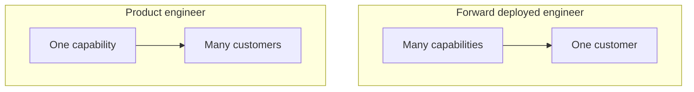

Bob McGrew, an early Palantir executive and later chief research officer at OpenAI, says an FDE sits at the customer site and fills the gap between what the product does and what the customer needs. The word "deployed" is literal: the military's forward deployed troops are stationed near the action, not at headquarters.

What sets the FDE apart from other customer-facing people is production code: not a sales proof of concept or a slide about what to build, but working software in the customer's real systems, on real data, under real security rules. First Round, which has helped many startups hire for the role, calls the best FDEs "compulsive builders". Palantir's job description compares the job to a startup CTO's: small team, end-to-end ownership, high stakes.

Building is not the whole week, though. Job ads for builder-type FDE roles advertise 70 to 90 percent of time coding. Gergely Orosz, reading a Google FDE job posting in 2026, estimated 25 percent coding, 50 percent integration and plumbing, and 25 percent meetings and customer hand-holding. Most people are probably nearer the second. The hard part is making the code run, and be used, inside someone else's organization.

### Where the role came from: Delta and Echo

Palantir created the role in the early 2010s out of necessity. Its first customers, intelligence and defense agencies, could not describe their problems openly, so normal product discovery (interviews, written requirements) was impossible. Engineers with clearance had to work inside their buildings, on the real problem.

The role came as a pair, with code names from the NATO phonetic alphabet:

- The **Delta**, the forward deployed engineer, built the system.
- The **Echo**, the deployment strategist, made sure it was adopted.

The Echo was often no software engineer, but a former military officer, clinician, or forensic accountant who knew how the institution really worked: which departments distrusted each other, which data was politically untouchable, and why three teams would refuse a technically perfect pipeline. The modern FDE is often expected to carry both halves alone.

Until around 2016, Palantir had more forward deployed engineers than conventional software engineers. When it launched its Foundry platform and standardized its product, many FDEs moved into core engineering, but the deployment function stayed. Outsiders long called this glorified consulting, since a real software company should not need so many people on site. Palantir's later market value quieted them.

### The gravel road: why it is not consulting

The real answer to the consulting charge is the feedback loop into the product. Palantir alumni say the FDE builds a **gravel road**: the minimum path that gets one customer to a real outcome, fast and a bit ugly but true. When the same road gets built at three or four customers, the product team paves it into a **paved highway**, a reusable platform feature the next customer gets for free.

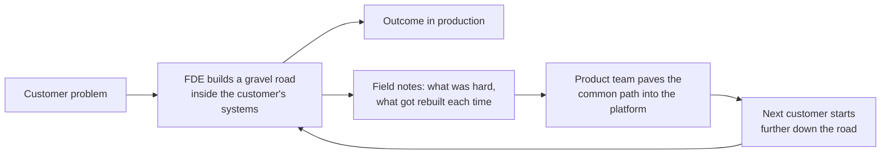

Without that loop, an FDE is a contractor and the team is professional services with a trendier title. With it, every deployment improves the product, which is why investors accept the model's lower early margins.

## Why AI turned a Palantir habit into an industry pattern

For a decade the FDE was mostly a Palantir oddity. Three things changed that, and all three point the same way.

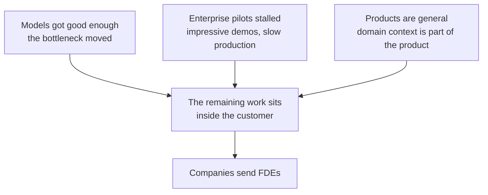

**The bottleneck moved.** A frontier model can read a legacy codebase, draft a migration, and write the tests. It cannot know which of the bank's four customer databases is the real one, get a security exception, or persuade forty developers to change how they work. [When Code Is Cheap](/blogs/blog/when_code_is_cheap/) argues that when code gets cheap, the expensive parts become judgment, context, and verification. The FDE supplies those at the customer.

**Pilots stalled at scale.** A widely quoted 2025 MIT report claimed that about 95 percent of enterprise generative AI pilots showed no measurable business impact. Whatever the exact figure, every vendor saw impressive demos and slow production. By October 2026 CNBC reported investors growing impatient with companies spending billions on AI without visible business outcomes.

**The products are general**, which is partly why pilots stalled. **MCP**, the Model Context Protocol, is a standard way for an AI agent to connect to tools and data. But a model, an agent framework, or MCP does nothing for a specific bank until someone wires it in. By hiring FDEs per industry (healthcare, legal, financial services), OpenAI and Anthropic admit that domain context is part of the product.

So companies send FDEs because the models are strong, not weak: the better the model, the more of the remaining work sits inside the customer. That is also the first test of whether the job will last.

## A lasting job or a passing title?

If the hard part happens at the customer, demand for people who work there should last. But a hot title is not a lasting job.

### What the numbers and the money say

The growth is real, even if the counts are rough. The posting counts in the introduction come from Lightcast, a labor market analytics firm. Its 2025 figure, about 1,200, shows most of the jump came in a single year. The median advertised salary over that period was about $195,000, more than three times the median for all US postings.

The money is real too. In 2026 alone:

| Who | What they committed | How they are building capacity |
|---|---|---|
| Amazon Web Services | One billion dollars to a new FDE organization, launched in June 2026 | Starting with hundreds of engineers drawn from inside Amazon and outside, with thousands planned |
| OpenAI | A deployment business with more than four billion dollars of initial investment | Hiring directly and acquiring Tomoro, an applied AI consultancy that brought about 150 deployment specialists |
| Anthropic | One hundred million dollars for the Claude Frontier Academy | Training 10,000 engineers who already work at its customers and partners by the end of 2027 |
| Accenture and Google Cloud | A joint 1,000-person FDE workforce | Retraining experienced software engineers in 30 to 90 days |

The table hides three strategies: AWS builds its own army, OpenAI buys a consultancy and builds a deployment business, and Anthropic trains engineers who work for someone else. For an IT services company, Anthropic's model is an invitation; the other two are, at least partly, competition.

Anthropic's academy even renames the role: its graduates are "Frontier Deployed Engineers", same initials, new first word. The first cohorts come from Accenture, Bain, Capgemini, Commonwealth Bank of Australia, Deloitte, McKinsey, Morgan Stanley, and Novo Nordisk, so five of the eight sell consulting or IT services. The program is modeled on medical residency:

1. A simulated enterprise deployment and a graded assessment.
2. Supervised casework.
3. Twelve weeks of mentorship on real projects.

The first credentials are expected in early 2027.

Hiring tells the same story. The companies posting the most FDE jobs in 2026 were not AI labs: Lightcast counted more from Deloitte and Accenture than from Google, with KPMG close behind. Consulting and IT services have decided this is the shape of their next decade.

### Why the work is likely to last

Four features of the work suggest it will outlast the hype.

**The last mile never goes away.** Every enterprise has its own data, legacy systems, regulators, and politics. Better models shrink the integration code, not the need for someone who understands the business and has the authority to change it. Steve Corfield, Anthropic's global head of business development and partnerships, called the scarce skill "an engineer who can understand how the business works and also build the system that changes it." That holds as long as businesses differ.

**Cheap code moves value toward context.** The more coding agents take over, the larger the share of work that needs judgment and context. AI does not replace this job. It creates more of it.

**The role has a track record.** Palantir has run it through several technology cycles since the early 2010s.

**It builds on existing skills.** Lightcast estimates the FDE role shares roughly half its skills with software engineering, so supply can grow by retraining, as Accenture, AWS, and Anthropic are doing. Roles staffed by conversion tend to last. Roles that need a rare new species tend to collapse when the hype fades.

### Why some caution is fair

None of this means every job with the title is that work.

**The title is inflating.** Many postings now call implementation, configuration, or customer support work "forward deployed". Palantir alumni are blunt: configuring a product is not forward deployed engineering, which means discovering new things in the customer's context and feeding them back to the product. Expect the title to split into variants such as Applied AI Engineer, Deployment Engineer, or Forward Deployed AI Engineer, some of them ordinary services jobs with a new label.

**The consulting trap is real.** If FDEs are measured on billable hours, report to sales, and leave their code in customer-specific repositories the product team never sees, the company has a services business that will never reach software margins. a16z (the venture firm Andreessen Horowitz), which coined the phrase "trading margin for moat", is clear that the trade only works if the service work is designed to feed the product.

The trap often starts with pay. a16z and practitioners both argue that tying FDE pay to bookings produces bad behavior. Measure FDEs on time to value, adoption, retention, and how much field work becomes reusable product. One founder playbook gives a warning sign: are more than 40 percent of your recent engineering hires FDEs, with code sitting in customer-specific repositories untouched for 90 days? Then you are building a consultancy by accident.

The tension is older than AI. In the 1960s IBM bundled systems engineering with its mainframes, including on-the-job help for the customer's staff. In 1969, as [Wikipedia's history of IBM](https://en.wikipedia.org/wiki/History_of_IBM) describes, it unbundled software and services from hardware and began charging separately for most systems engineering work. Priced on its own, field work had to pay for itself. The FDE question is the same: is the field work paying for a better product, or is it a services business of its own?

**The returns are not proven yet.** CNBC noted in October 2026 that FDE projects so far show productivity gains in company case studies, such as some engineering tasks at a mortgage lender running up to six times faster, but no independently verified financial returns. If the AI investment cycle cools, deployment teams could shrink with it.

**The work is hard on people.** Postings commonly require heavy travel; first-person accounts describe three to four days a week at the customer. Wikipedia's entry on the role notes that some engineers find it undesirable because of the travel and the pressure to solve customer problems quickly. Those who love the customer's building thrive. Those who only tolerate it as a career step often leave within a year.

**There is also a quiet paradox.** A vendor spends millions training humans to deploy a technology that promises to do more of the work itself. Some FDE tasks, such as integration glue and boilerplate configuration, will be automated. Will the judgment and adoption parts grow faster than the automatable parts shrink? So far they have.

### Where the role is heading

The likeliest outcome is that the title fades while the work stays. DevOps went the same way: a movement became a job title, got inflated, and settled into a family of roles (platform engineer, site reliability engineer, DevOps engineer), because the underlying work was permanent. The variants listed above are the start of that family. Expect a core of true FDEs at vendors and large integrators, and many more roles with forward deployed work as one part of the job.

The work is shifting too. An analysis of about a thousand 2026 postings found the most-listed skills are no longer just Python and SQL but customer discovery, problem decomposition, and product judgment. The role is becoming customer-facing research: finding out what AI can do for a business by trying it inside that business.

The growth path already has a shape:

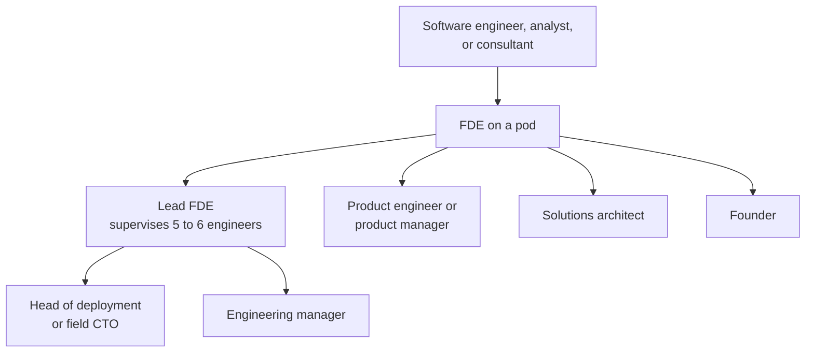

An executive recruiter quoted by CNBC suggested that FDEs with ten to fifteen successful deployments have the judgment to lead teams of five or six less experienced engineers. So supply scales not by finding thousands of unicorns, but by experienced FDEs multiplying through pods.

The founder route is well worn too. An FDE sees, earlier than anyone, which problems repeat across customers and which customers would pay to solve them. Many of today's applied AI startups were started by people who did exactly this job.

## How the FDE differs from the roles you already have

If the title fades but the work stays, where does that work sit among the people a company already employs? The FDE overlaps with those who talk to customers, write code, analyze requirements, and test, which is why the role confuses people. The table compares them on the questions that matter most.

| Role | Who is the work really for | What do they hand over at the end | Do they write production code | Where do they spend their time | How is success judged | What the FDE does differently |
|---|---|---|---|---|---|---|
| **Developer** (product engineer) | Many customers through one product | Features in a shared product | Yes, in the product codebase | With the product team | Features shipped, quality, velocity | Builds inside one customer's systems and owns the outcome, not just the ticket |
| **Business analyst** (BA) | The project team and the client | Requirements, process maps, user stories | No | Workshops with the client, documents | Clear, complete, agreed requirements | Turns the requirement into working software in the same week, and tests it against real data |
| **Project manager** (PM) | The client sponsor and the delivery team | A plan delivered on time, budget, and scope | No | Planning, reporting, risk meetings | On time, on budget, within scope | Is accountable for a business result, not for the plan, and changes the scope when the result demands it |
| **Product manager** | The users of one product | A roadmap and priorities | Rarely | Discovery, analytics, roadmap | Adoption, retention, revenue | Does discovery by building inside the customer, and feeds the findings to the product manager |
| **Tester** (QA) | The delivery team | Test plans, defects, a quality signal | Test code, not product code | Test environments | Defects found before release | Designs evaluations for non-deterministic AI output and owns the verification, not just the reporting |
| **Solutions architect** | The customer, before and after the sale | A reference architecture and design advice | Rarely | Design sessions, reviews | A sound design the customer accepts | Stays to build it, and lives with the consequences of the design |
| **Sales engineer** (presales) | The deal | Demos, proofs of concept, answers to technical questions | Demo code | Sales meetings | Deals won | Starts where the sale ends and writes code that must survive production, not just a demo |
| **Consultant** | The client, under a statement of work | Recommendations or delivered scope | Sometimes | At the client | Scope delivered, client satisfied | Is paid to solve the problem, not to execute the statement of work, and brings reusable lessons back to a product |
| **BrSE** (bridge engineer between an offshore team and a Japanese client) | The client and the offshore team | Translated, clarified requirements and coordination | Sometimes | Between client and team | Smooth communication, few misunderstandings | Bridges business and technology by building, not only by translating, and carries the same "close to the client" instinct further |
| **DevOps or platform engineer** | Internal engineering teams | Pipelines, infrastructure, reliability | Infrastructure code | Internal platforms | Uptime, deployment speed | Applies the same skills inside a customer's environment, with that customer's security and approval rules |

**Only the FDE answers for the customer's business outcome.** The FDE owns "is this actually working and being used". No other row owns that completely, as the diagram shows.

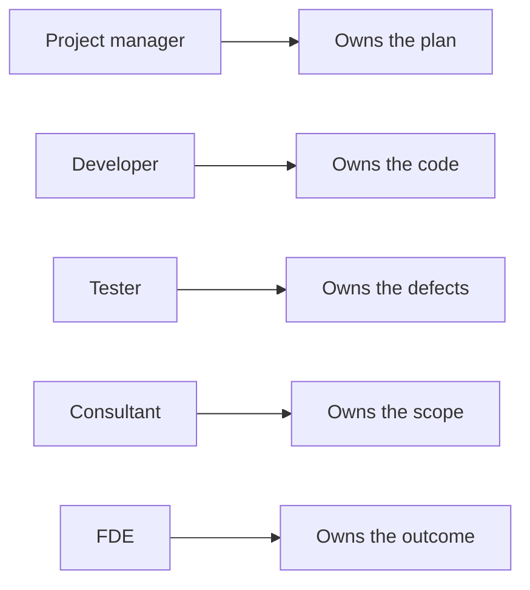

**The FDE does several of these jobs at once, in compressed form.** In one week an FDE may run a discovery workshop like a BA, write an integration like a developer, design an evaluation like a tester, and present results to an executive like a PM. That breadth is the role's attraction and its biggest risk: it rewards generalists and punishes people who want deep focus.

## Moving into the role, and out of it

The FDE mixes all those roles, so almost nobody starts a career as one. People arrive from one of the roles above, and some later leave for another.

### Into the role

Each starting role brings strengths and gaps:

| Coming from | What you already have | What you are probably missing | A good first step |
|---|---|---|---|
| Developer | Production coding, debugging, systems thinking | Customer conversations, business framing, presenting results to executives, tolerance for ambiguity | Volunteer for the next customer-facing integration or pilot, and own the readout, not just the code |
| Business analyst | Domain knowledge, discovery, requirements, stakeholder trust | Enough coding to build and debug agents and integrations, evaluation design | Learn to build small agents and MCP connectors with a coding agent; prototype your next requirement instead of documenting it |
| Project manager | Stakeholder management, planning, risk, executive communication | Hands-on technical depth, which is the credibility badge of the role | Pair with an engineer on a pilot and take ownership of the success criteria and ROI measurement, then build technical skill steadily; or move toward the Echo half of the role |
| Tester | Verification mindset, edge cases, test automation | Building production features, customer-facing work | Specialize in evaluation of AI output (test sets, graders, regression checks), the part of AI delivery most teams do badly |
| Solutions architect or presales | Customer credibility, architecture, demos | Staying through production, owning messy implementation details | Ask to stay with one account past signature and deliver the first production use case yourself |
| Consultant | Client handling, structured problem solving, domain range | Production engineering, product feedback habits | Build, do not recommend: deliver a working system on your next engagement and write up what should become reusable |
| BrSE | Living between client and team, translation of intent, domain | Building autonomously, owning outcomes rather than communication | Use coding agents to prototype what the client describes during the meeting, then hand the team a working draft instead of a specification |
| DevOps or platform engineer | Environments, security, automation, reliability | Business discovery and adoption work | Lead the deployment configuration and governance of an AI rollout, then take on the use case work around it |

Read down the last column: most first steps swap what your role usually hands over (a spec, a plan, a demo, a recommendation) for a working result at a real customer.

The starting roles fall onto two roads, shown in the diagram.

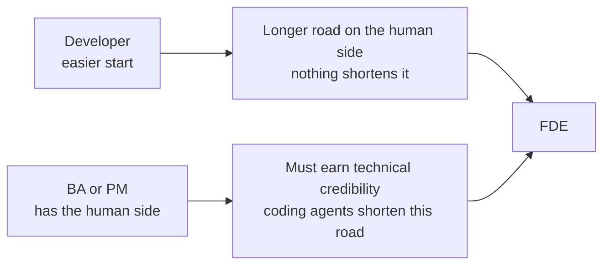

The developer's conversion is easiest on paper, because this is first an engineering role: Palantir's FDEs passed the same technical interview as its product engineers. The hardest skill to teach is the opposite one. The CEO of one AWS consulting partner said "the hardest thing to teach is the customer EQ, without question," and added that "there is no compression algorithm for experience."

Coding agents have narrowed the technical gap a great deal. Someone with strong domain knowledge and enough engineering judgment can now build systems that needed a full team a few years ago. So the developer's head start may be shrinking.

Supply is the real constraint on the whole market. "Experienced FDEs cannot simply be recruited at the scale clients need," as Accenture's FDE lead put it. The opportunity is largest for people with half the skills already: experienced developers who can learn the customer side, and experienced analysts and bridge engineers who can learn to build with coding agents.

### Out of the role

The growth-path chart above shows where FDEs go next, but not why those teams want them. The reason is always first-hand knowledge of what breaks at real customers. Each next role spends it differently:

- **On design.** An FDE back in **product engineering** designs APIs that are easy to integrate, having suffered through ones that are not. Palantir's early FDEs made this move.
- **On judgment.** An FDE who becomes a **product manager** has done years of discovery by building, and knows which feature requests are real and which are the customer's guess at a solution.
- **On breadth.** A **solutions architect** or **field CTO** keeps the customer focus but trades daily building for reach across many accounts.
- **On staffing.** An **engineering manager** or **head of deployment** has led pods under pressure, and usually knows how to staff and measure a deployment team without falling into the consulting trap.
- **On a company.** Founders build on the repeating problems described earlier.

Moving back is not a failure either. A developer who returns to a product team after two years as an FDE is a better developer. A BA who spent a year building is a far more useful BA, because their requirements now come with prototypes.

## What you need to know, from model to organization

Whichever road you take, you arrive at the same knowledge stack; only your gaps differ. Anthropic's partner training path, the [Claude Forward Deployed Engineer learning path](https://anthropic-partners.skilljar.com/path/claude-fde), lists ten topics. They make a good skeleton, with a few pieces added that the path assumes you already have. They fall into five layers, from the model up to the organization, and the order matters, as the diagram shows.

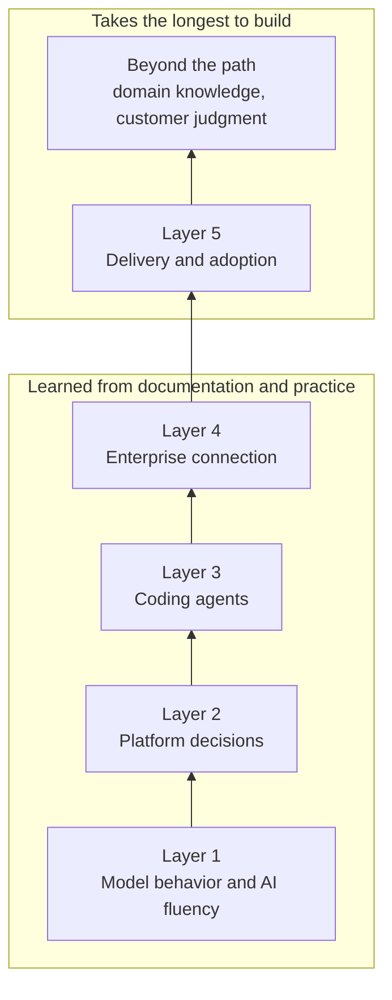

Retraining programs can cover the lower layers in weeks. The top layer, with domain knowledge and customer judgment, is what makes the role valuable. The table says why the customer needs each layer.

| Layer | What to know | Why the customer needs it |
|---|---|---|
| 1. Model behavior and AI fluency | The four properties of models, and the 4D framework | So you can explain failures and teach people to use AI well |
| 2. Platform decisions | Entry point, features, model, context; the API and agent loop; limits and administration | So the deployment is set up right before anyone writes a prompt |
| 3. Coding agents | Plan mode, context management, CLAUDE.md, commands, skills, hooks, headless runs, verification | So you can lead developer adoption from experience |
| 4. Enterprise connection | MCP servers, agent skills, integration, security, evals | So the AI can reach real systems safely and you can prove it works |
| 5. Delivery and adoption | Qualification, pilots, ROI, adoption curve, internal owners, rollout phases | So the result is measurable and survives after you leave |
| Beyond the path | Domain knowledge, customer judgment, writing and presenting | So the people with the budget trust you and act on the results |

### Layer 1. How models actually behave

To explain why the agent did something strange, you need a working mental model of the machine. Anthropic frames it as four properties:

- **Next-token prediction**: the model writes text one piece at a time, choosing likely continuations, so it can sound confident and still be wrong.
- **Knowledge**: broad, but frozen at a training date and uneven in depth.
- **Working memory**: the model sees only its context window, and quality drops when that window is crowded with irrelevant material.
- **Steerability**: instructions, examples, and structure change behavior a great deal, but not without limit.

When two collide, for example when a long conversation pushes an important instruction out of focus, you get the failures customers complain about. An FDE should look at a bad output and name the property that caused it and the fix.

The human side is **AI fluency**, taught as four competencies, the **4D framework**:

- **Delegation**: deciding what to hand to the AI and what to keep.
- **Description**: explaining the task clearly enough.
- **Discernment**: judging whether the output is any good.
- **Diligence**: taking responsibility for what you ship, and being honest about how AI was used.

These sound soft, but you will teach them to forty developers at a customer in week one.

### Layer 2. The platform and its decisions

On top of the model sits the platform. At every customer an FDE makes four decisions quickly:

- The **entry point**: chat product, coding agent, API, or cloud marketplace.
- The **capability features** to switch on: tools, search, code execution, files, memory.
- The **model**: a large one for hard reasoning, a small fast one for volume.
- The **context**: what the model needs to know and how it gets there.

These choices set the quality ceiling before anyone writes a prompt.

Below them sits the API, with three things to know:

- The message format and the **agent loop**: the model asks for a tool, the application runs it and returns the result, and this repeats until the task is done.
- The built-in tools.
- The operational limits (rate limits, workspaces, spend controls) an enterprise administrator asks about on day one.

### Layer 3. Coding agents in daily practice

Most enterprise AI deployments today start with developers, so an FDE must be an expert user of a coding agent such as Claude Code, not someone who has only tried it. You should be able to:

- Run long sessions without losing the plot, managing context by compaction and rewinding.
- Agree on a plan in **plan mode** before any file changes.
- Write a good **CLAUDE.md**, the project memory file the agent reads at the start of every session.
- Package repeatable work as commands and skills, with **hooks** that enforce rules automatically.
- Run the agent headless in CI pipelines.
- Above all, verify the agent's work instead of trusting it.

The playbook below depends on this: you cannot coach a team out of a usage plateau you have not been through yourself.

### Layer 4. Connecting to the enterprise

This is where the "forward deployed" part becomes concrete. MCP, introduced earlier, lets you expose a customer's systems, such as a ticketing tool, a document store, or an internal API, to an agent through a standard server, with clear tool definitions and permissions. **Agent skills** let you package a customer's know-how, such as how their team writes a migration plan or reviews a contract, as folders of instructions and scripts the agent loads only when relevant. Anthropic's FDE job postings literally list "MCP servers, sub-agents, and agent skills" as deliverables.

The training path assumes the classic integration knowledge around this: APIs and data formats, identity and single sign-on, network and data residency rules, logging and audit trails, and enough security understanding to get an agent approved by a skeptical security team.

Add **evals**: test sets and graders that tell you whether the system is good enough, and whether it got worse after a change. Customers will ask "how do you know it works?" and the answer must be data, not anecdotes.

### Layer 5. Delivery and adoption

The last two topics are not technical, and they separate an FDE from a skilled engineer. **Delivery methodology** covers one engagement: the seven steps of the playbook below. **Enterprise adoption** covers the whole organization: phases of rollout, governance, a center of excellence, and the communication that makes people actually change how they work.

### Beyond the training path

Three more things matter, and none comes from a training path.

**Domain knowledge.** An FDE in banking who understands reconciliation, or one in manufacturing who understands production planning, is worth several who do not.

**Customer judgment.** Reading a room, saying no to a sponsor without losing them, noticing that the real blocker is a department head who feels threatened. This is the "customer EQ" quoted earlier.

**Writing and presenting.** An FDE's work ends in a readout to an executive. If you cannot turn "PR cycle time dropped 34 percent" into a sentence a CIO will repeat in a board meeting, the work does not land.

## The 30-day delivery playbook

Knowing the technology is the entry ticket; the delivery method makes an engagement succeed. Anthropic teaches partners a 30-day activation playbook for coding-agent rollouts. It is a concrete picture of what an FDE does at a customer, and it fits any AI deployment. The diagram shows its seven steps, each explained below with a worked example from the course.

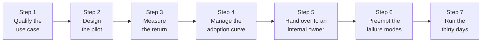

### Step 1. Qualify the use case

Not every use case deserves a pilot. First ask whether it produces a **marginal gain** or a **structural gain**.

- Marginal: the same work gets done faster (autocomplete, boilerplate, inline documentation). It helps adoption but is hard to isolate in a month.
- Structural: the unit of work changes. A job that needed a team of four for six weeks now needs two developers for two weeks.

Only structural gains produce a story that survives an executive readout.

Economic history explains why. In 1990 the economist Paul David compared the computer with the electric dynamo. Factories that swapped steam engines for electric motors but kept their old layout gained little. The payoff came only after they reorganized work around the new technology, which took many years. His paper, ["The Dynamo and the Computer"](https://econpapers.repec.org/RePEc:aea:aecrev:v:80:y:1990:i:2:p:355-61), makes the argument. A coding agent used as a faster autocomplete is the motor in the old layout. A structural gain is the reorganized factory.

Three engagement patterns reliably produce structural gains with coding agents:

- **code modernization**: upgrading or translating a legacy stack.
- **new feature builds**: the whole loop from scaffolding to review.
- **code migration**: between frameworks, clouds, or architectures.

Each candidate is then scored on four criteria:

- **Volume**: the task recurs often enough to generate data in thirty days.
- **Complexity**: it takes a senior engineer weeks, not a junior an afternoon.
- **Measurability**: you can capture a baseline before day one.
- **Readiness**: the team will change its workflow, not just try a tool.

The diagram puts the two checks in order.

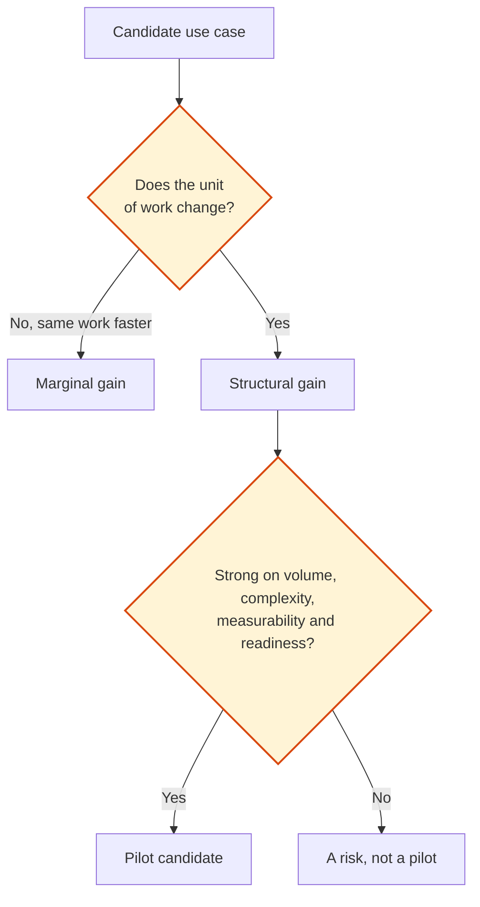

A use case strong on complexity but weak on measurability is not a pilot candidate; it is a risk. In the worked example, a team proposed adding unit tests to a codebase already at 82 percent coverage, or a Java to Spring Boot migration it had been scoping for eight months. The migration qualifies, the tests are marginal, and running both dilutes the result.

The engagement mode matters too. A two-day training event produces adoption signals but no return-on-investment data: no baseline, no owner, no measurement period. Evidence comes from a 30 to 45 day program with setup, a defined use case, a midpoint check around day 20 to 25, and a closing readout presented by the customer's internal owner.

### Step 2. Design the pilot

"A pilot that can't be evaluated is not a pilot." Four design decisions follow.

The **cohort** is chosen by who owns the work, not by enthusiasm. Volunteers and early adopters give glowing feedback that does not represent the typical developer. People who already own the target work give before-and-after data that can be traced to the tool. In the worked example, a C++ to Rust migration, that meant the eight developers who owned the backlog, not fifteen from mixed teams, and not all forty-five in an awareness group.

The **scope** is precise and locked: not "code modernization" but "Java to Spring Boot migration of the authentication service". New ideas that appear mid-pilot go on a list for phase two.

The **duration** follows the task cycle: at least two complete ticket-to-merge cycles per developer, which for most migration work is 25 to 30 days.

**Success criteria** exist before day one:

- A baseline metric.
- A target threshold ("25 percent reduction in PR cycle time" is a claim; "PR cycle time improved" is not).
- A measurement method using existing tools such as git and the ticket system, not self-reporting.
- A named assessment date.

### Step 3. Measure the return

The baseline is the criterion teams skip. "What you don't measure before day one you can't prove at day thirty." A baseline reconstructed after the pilot starts is always contested, because sponsors remember the past as better or worse depending on what they want the pilot to show. Two or three baselines are enough: cycle time from ticket to merge for the target work, hours spent on that task category, and a developer satisfaction score.

Metrics fall into four groups:

- Developer productivity.
- Code quality, to show speed did not cost quality.
- Usage and adoption, to show adoption is real, not just on paper.
- Sentiment, a leading indicator for expansion.

The readout leads with one headline number and one business translation. In the worked example, PR cycle time fell from 8.2 to 5.4 days, satisfaction rose from 6.2 to 7.8, and lines of code per developer rose 55 percent. Cycle time is the headline, satisfaction is supporting evidence, and lines of code is misleading and stays out of the headline.

The translation turns "cycle time dropped 34 percent" into "the team can ship about 1.5 times the features in the same sprint", which is the sentence the CIO repeats.

### Step 4. Manage the adoption curve

Adoption does not move in a straight line, so neither do the numbers. An FDE who treats it like a normal software rollout will intervene at the wrong moments. The curve has four stages, shown in the diagram: **supervised use**, **increasing autonomy**, **agentic delegation**, and an **institutionalized pattern**.

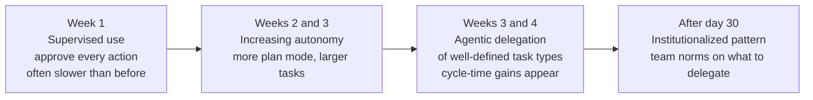

Two dynamics are specific to AI:

- The **week one dip**: velocity falls before it rises, because people are learning a new way of working, not a new button. Do not intervene on velocity in week one.
- The **plateau**: after the dip, many developers find one or two patterns that work and stop experimenting. Usage looks healthy but the ceiling stays low. "Plateau is not adoption." The fix is a structured second-level session and coaching on delegation patterns.

The diagram shows the test for when to step in.

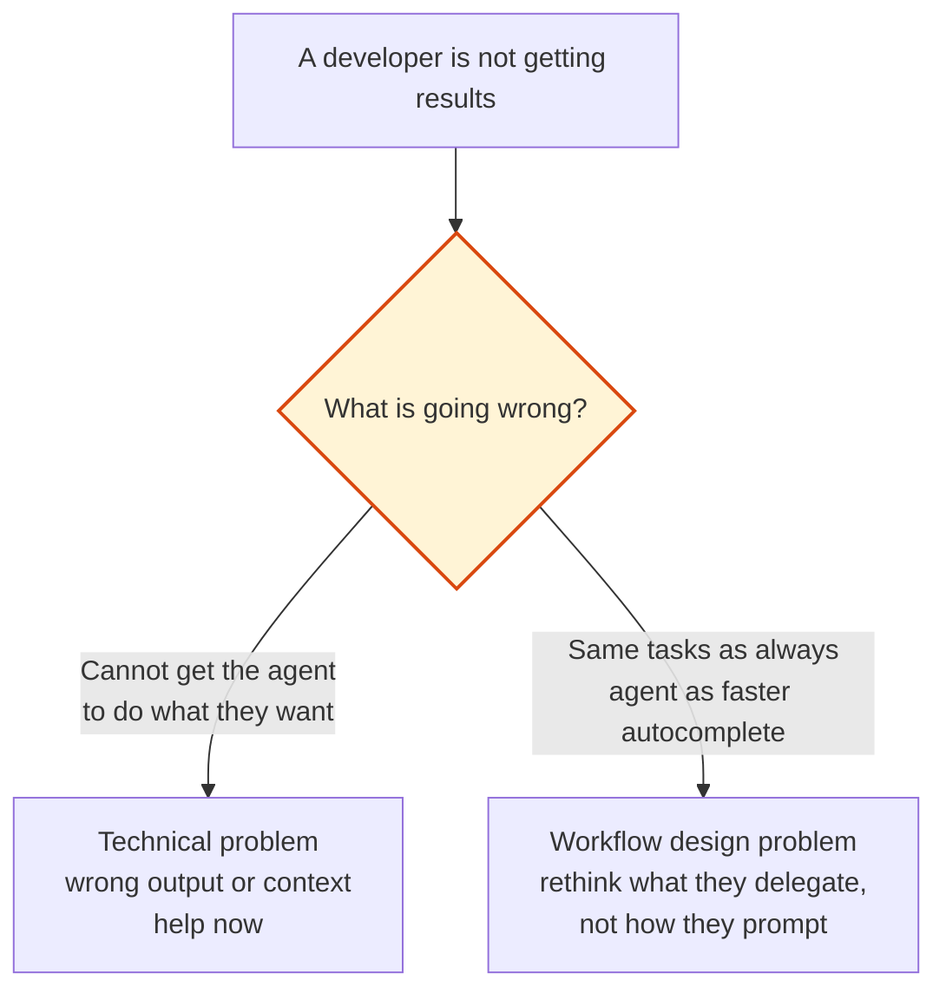

The second branch is the old factory layout again. In the worked example, cycle time is flat at day sixteen, daily usage is a steady 45 minutes, and prompting patterns are unchanged. That is the plateau signature, and exactly the time to act.

At organization scale the same shape is called the **productivity J-curve**: performance dips during the learning period before it climbs above the old level. It is the lag David described, compressed into months. Leaders who expect it and say so in advance keep the sponsorship alive through the dip.

### Step 5. Hand over to a named internal owner

Sponsorship carries the pilot through thirty days. After the FDE leaves, something else must. "Every deployment needs someone whose job is to keep it working." That is the **internal owner**, a named person inside the customer, with four duties:

- Maintaining the project memory files as the codebase changes.
- Running weekly office hours.
- Onboarding new developers.
- Escalating blockers.

The owner is not the team's help desk; if they become the only expert, the deployment is fragile.

The best candidates are senior enough to shape team norms, technical enough to write good project instructions, and motivated rather than assigned: the role is formal, but the person should want it. They usually reveal themselves by engaging deeply mid-pilot. The most technically advanced developer is often the wrong choice, because their habits may not generalize.

The owner inherits three artifacts:

- An organization-level CLAUDE.md with company conventions.
- At least one repository-level CLAUDE.md for the pilot project.
- A catalog of at least three to five documented custom commands.

CLAUDE.md is not documentation. It is institutional memory the agent reads every session, and a generic file produces a generic agent. "The quality of a deployment 90 days after you leave is determined by the quality of the CLAUDE.md you hand over."

### Step 6. Preempt the failure modes

Six failure modes appear again and again. None is technical, and almost every row is one of the steps above, skipped:

| Failure | What it looks like | How to prevent it |
|---|---|---|
| No baseline captured | The readout has no "before" number and the renewal cannot land | Run a baseline sprint in the week before kickoff; treat it as non-negotiable |
| No internal owner named | Usage collapses 30 to 60 days after the engagement ends | Name the owner by day 15 and start handoff preparation mid-pilot |
| Use case too marginal | High usage, flat metrics, executive support evaporates | Run the structural versus marginal check before scoping |
| Stuck in supervised mode | Developers say the tool is slow or not useful | Weekly usage review and workflow coaching for stalled developers |
| Project memory not maintained | The agent drifts back to generic behavior and trust erodes | Make a weekly review of CLAUDE.md a named responsibility of the internal owner |
| Readout not tied to business | Usage charts and testimonials, no business number; talk turns to cost | Agree on the executive narrative with the sponsor in week one |

### Step 7. Run the thirty days

The thirty days are a rhythm with exit conditions, not a task list: each phase ends with one thing that must be true before the next starts. The diagram below shows the phases. The list adds each exit condition and what the diagram leaves out.

- **Pre-kickoff discovery** also confirms the cohort. It ends when the baseline is captured.
- **Week one** holds the first office hours on day three or four. It ends when everyone is installed, connected to the approved configuration, and working in supervised mode.
- **Weeks two and three** have touchpoints with the **center of excellence**, a small team that sets standards, shares patterns, and supports other teams. They review usage and agree on one concrete coaching action per stalled developer. These weeks end with the internal owner named by day 15.
- **Week four** ends when the readout reaches the sponsor 48 hours before the showcase, not during it.
- **Day thirty** is the showcase, in three ten-minute parts: a live demo by two or three developers on real code (rough edges are the point), the metrics with the headline first and any missed criteria named before the sponsor asks, and phase two. If the sponsor cannot attend, reschedule.

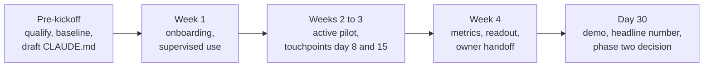

The handoff is simple and effective: the owner takes over the office hours one session at a time, as the diagram shows.

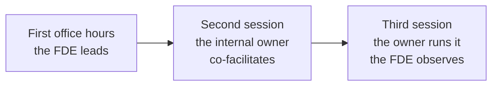

Handoff is not a meeting about ownership. It is doing the job while still supported.

### Scaling beyond one pilot

One successful pilot is the start, not the end. At organization scale, the rollout moves through three phases:

1. **Activation** sets up the technical foundation and organizational readiness.
2. **Acceleration** scales impact through governance and the center of excellence.
3. **Expansion** takes the proven approach to more advanced capabilities and new use cases.

Programs such as **networks of internal experts** and **train-the-trainer** spread the skills without the FDE in every room. Three principles hold it together:

- Leaders explain why the organization is adopting AI.
- The culture treats experiments and early failures as learning.
- Wins are shared systematically so other teams can copy them.

None of the playbook is about the model. All of it decides whether the model's value reaches the business.

## The job behind the title

The forward deployed engineer is what happens when a general technology meets specific businesses at speed. The model can write the code. Someone still has to know which code is worth writing, connect it to the right systems, prove that it helped, and leave behind a team that keeps it working.

That person needs an engineer's hands, an analyst's curiosity, a project manager's discipline about measurement, and a consultant's comfort in someone else's building. The title may change. The job, I think, is here for as long as businesses differ, which is to say for good.

## Glossary

**4D framework**: four AI fluency competencies: Delegation, Description, Discernment, Diligence.

**Agent loop**: the cycle in which a model requests a tool, the application runs it and returns the result, and the model continues until the task is done.

**Agent skills**: packaged know-how (instructions, scripts, reference files) that an agent loads only when a task needs it.

**AI fluency**: the human ability to work with AI effectively, efficiently, ethically, and safely.

**Baseline**: the value of a metric measured before a pilot starts, used as the "before" in any return-on-investment claim.

**Center of excellence**: a small internal team that sets standards, shares patterns, and supports other teams during an AI rollout.

**CLAUDE.md**: the project memory file a coding agent reads at the start of every session; the place where team conventions and domain context live.

**Delta and Echo**: Palantir's code names for the forward deployed engineer (Delta) and the deployment strategist who handles domain and organizational adoption (Echo).

**Evals**: test sets and graders that measure whether an AI system's output is good enough and whether it changed after an update.

**Forward deployed engineer (FDE)**: a software engineer who works inside one customer at a time, builds what that customer needs to get value from a general product, and feeds the lessons back to the product.

**Gravel road and paved highway**: the quick, customer-specific solution an FDE builds (gravel road), and the reusable product feature it becomes once the pattern repeats (paved highway).

**Hooks**: rules attached to a coding agent's actions that run automatically, for example blocking writes to certain files or running tests after edits.

**Internal owner**: a named person inside the customer who owns the deployment after the FDE leaves. They maintain project memory files, run office hours, and onboard newcomers.

**Marginal gain and structural gain**: a marginal gain does the same work faster; a structural gain changes the unit of work, such as a four-person, six-week job becoming a two-person, two-week job.

**MCP (Model Context Protocol)**: an open standard for connecting AI agents to tools and data through servers with defined capabilities.

**Plan mode**: a coding agent mode in which the agent proposes a plan for approval before changing any files.

**Plateau**: the stage after initial adoption where developers stop experimenting and usage stabilizes below its potential.

**Productivity J-curve**: the pattern where performance dips while people learn a new way of working, then rises above the previous level.

**Supervised use and agentic delegation**: the two ends of the adoption curve, from approving every agent action to handing off whole task types with light oversight.

**Week one dip**: the temporary drop in developer velocity in the first week of a coding-agent rollout, caused by learning a new way of working.

## References

**Training and vendor programs**

- Anthropic Partner Academy, ["Claude Forward Deployed Engineer" learning path](https://anthropic-partners.skilljar.com/path/claude-fde), including "Delivery Methodology" and "Driving Enterprise Adoption of Claude". The training path behind the five knowledge layers and the 30-day playbook in this post.
- AWS Partner Network blog, ["Introducing Forward Deployed Engineering for Partners"](https://aws.amazon.com/blogs/apn/introducing-forward-deployed-engineering-for-partners-winning-the-future-of-enterprise-ai). How AWS is extending its FDE model to consulting partners.
- Anthropic, ["Forward Deployed Engineer, Applied AI" job posting](https://builtin.com/job/forward-deployed-engineer/7698230) (via Built In). Lists "MCP servers, sub-agents, and agent skills" among the deliverables.
- Palantir, ["Forward Deployed Software Engineer" job posting](https://jobs.lever.co/palantir/dab396d4-2f14-4796-aac0-0d82883dccf0). Describes the role's responsibilities as close to those of a startup CTO.

**Market reporting**

- CNBC, ["AWS, Anthropic race to deploy specialized engineers to prove AI payoff"](https://www.cnbc.com/2026/10/15/aws-anthropic-racing-to-deploy-army-of-specialized-ai-engineers.html), 15 October 2026. The source of the Lightcast figures in this post (posting counts, salary, the companies posting the most, and the skills shared with software engineering), the quotes from Steve Corfield of Anthropic, Accenture's FDE lead, and the AWS partner CEO, investor impatience with AI spending, the mortgage-lender case study, and the recruiter's view that ten to fifteen deployments prepare an FDE to lead a pod.
- CNBC, ["Anthropic to invest $100 million to train AI engineer talent"](https://www.cnbc.com/2026/10/02/anthropic-to-invest-100-million-to-train-ai-engineer-talent.html), 2 October 2026. The Claude Frontier Academy, its funding, and its goal of 10,000 trained engineers.
- Business Insider, ["Job postings for this tech job have grown over 700% in the last year"](https://www.businessinsider.com/forward-deployed-engineer-jobs-in-demand-2026-5), May 2026. The year-over-year jump in FDE postings.
- The New Stack, ["AWS just put $1 billion into forward deployed engineers"](https://thenewstack.io/aws-forward-deployed-engineering), 30 June 2026. The launch and scale of AWS's FDE organization.
- MIT Project NANDA, "The GenAI Divide: State of AI in Business 2025". The source of the widely quoted, and disputed, figure that about 95 percent of enterprise generative AI pilots showed no measurable impact.
- Perspective AI, ["2026 FDE Hiring Trends: What 1,000 Job Posts Reveal"](https://getperspective.ai/blog/2026-fde-hiring-trends-what-1000-job-posts-reveal). The shift in listed skills toward customer discovery, problem decomposition, and product judgment.

**How the role works**

- Joe Schmidt, a16z, ["Trading Margin for Moat: Why the Forward Deployed Engineer Is the Hottest Job in Startups"](https://a16z.com/services-led-growth), 4 June 2025. Argues that services work can build a moat only if it is designed to feed the product.
- First Round Review, ["So You Want to Hire a Forward Deployed Engineer"](https://review.firstround.com/so-you-want-to-hire-a-forward-deployed-engineer). Hiring advice for startups, including the description of the best FDEs as "compulsive builders".
- Gergely Orosz, The Pragmatic Engineer, "What are Forward Deployed Engineers, and why are they so in demand?", 12 August 2025. A deep dive into the role and its Palantir origins, including how many Deltas Palantir employed and how FDEs differ from solutions architects.
- Gergely Orosz, The Pragmatic Engineer, ["The Pulse: Forward deployed engineering heats up again"](https://blog.pragmaticengineer.com/the-pulse-forward-deployed-engineering-heats-up-again/), 24 May 2026. Reads a Google Cloud FDE job ad and estimates the week at about 25 percent coding, 50 percent integration and plumbing, and 25 percent meetings.
- Palantir blog, ["Dev versus Delta: Demystifying engineering roles at Palantir"](https://blog.palantir.com/dev-versus-delta-demystifying-engineering-roles-at-palantir-ad44c2a6e87), April 2019. Palantir's own account of how its product engineers and forward deployed engineers differ.
- WIRED, ["What Does Palantir Actually Do?"](https://www.wired.com/story/palantir-what-the-company-does). Background on Palantir's business, why its engineers worked inside customer organizations, and where the "forward deployed" name comes from.
- Per Aspera, ["How to Build Your 1st Forward Deployed Engineering Team"](https://peraspera.us/forward-deployed). The source of the gravel-road metaphor and Bob McGrew's definition of the role.
- Diogo Silva Santos, ["A Comprehensive Analysis of Palantir's Forward Deployed Engineering Model"](https://medium.com/activated-thinker/a-comprehensive-analysis-of-palantirs-forward-deployed-engineering-model-4502a036b5e4). An outside analysis of Palantir's forward deployed engineering model, used here as background on the role's origins.
- Perspective AI, ["How to Build a Forward-Deployed Engineering Function: A 2026 Founder's Playbook"](https://getperspective.ai/blog/how-to-build-forward-deployed-engineering-function-founder-playbook-2026). Practical advice for founders, including the 40 percent warning sign for an accidental consultancy.
- The Forward Deployed, ["What Is a Forward Deployed Engineer? The Job Explained"](https://www.theforwarddeployed.io/the-job). What an FDE week looks like: days on site, the gap between advertised and real coding time, and why people stay or leave.
- David Arnoux, ["What Is a Forward Deployed Engineer? Role and Origin"](https://www.heyarnoux.com/blog/forward-deployed-engineer), September 2026. The role's origin at Palantir and how it spread.
- Szymon Paluch, ["Forward Deployed AI Engineer: The Job, the Work and Who Hires"](https://szymonpaluch.com/blog/posts/forward-deployed-ai-engineer). The AI-specific variant of the role and the companies hiring for it.
- Wikipedia, ["Forward deployed engineer"](https://en.wikipedia.org/wiki/Forward_deployed_engineer). An overview of the role, including the travel and pressure that make some engineers avoid it.

**Older history this post leans on**

- Wikipedia, ["History of IBM"](https://en.wikipedia.org/wiki/History_of_IBM). Includes IBM's 1969 decision to unbundle software and services, such as systems engineering, from its hardware prices.
- Paul David, ["The Dynamo and the Computer: An Historical Perspective on the Modern Productivity Paradox"](https://econpapers.repec.org/RePEc:aea:aecrev:v:80:y:1990:i:2:p:355-61), American Economic Review, 1990. Compares the slow payoff of electrification with that of computers: the gains came only after work was reorganized around the new technology.
- Wikipedia, ["Productivity paradox"](https://en.wikipedia.org/wiki/Productivity_paradox). Covers the lag between a new technology and its productivity gains, and the time needed to reorganize around it; lists David's paper among its sources.
