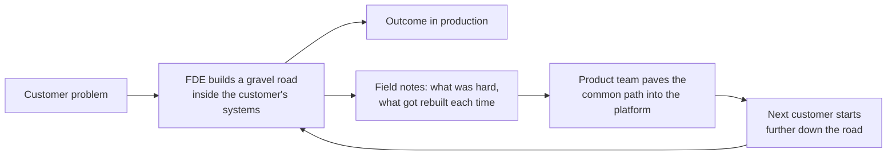
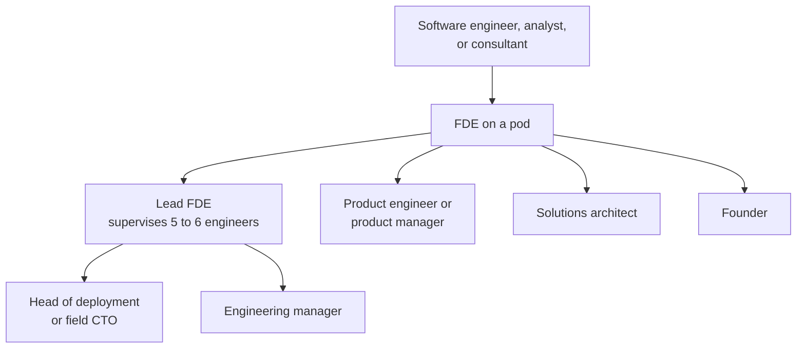
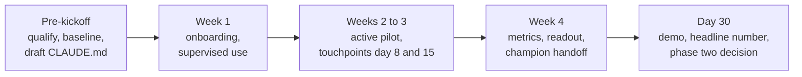

A bank buys access to a frontier model. The demo was impressive, the contract is signed, and six months later almost nothing is in production. The model is not the problem. The problem is that the bank's data sits in four systems nobody fully understands, the security team has not approved any agent that can write to anything, the developers are still using the tool as a faster autocomplete, and nobody can say whether the pilot saved a single hour because nobody measured anything before it started.

The person companies now send into that situation has a name: the **forward deployed engineer**, or **FDE**. In 2023 there were fewer than 200 job postings in the United States with that title. In the first nine months of 2026 there were more than 7,300. Amazon Web Services has committed a billion dollars to its own FDE organisation, OpenAI has built a deployment business around the role, and Anthropic is paying to train ten thousand of them inside its partners. When a job title moves that fast, it is worth asking what it actually is, whether it will still exist in five years, and what it would take for someone who is a developer, a business analyst, a project manager, or a tester today to do it.

This post tries to answer those questions in seven parts. The first explains what the role is and why it appeared. The second asks whether it is a trend or a stable job. The third compares it with the roles most software organisations already have. The fourth looks at how people move into the role and out of it. The fifth lists what you need to know. The sixth walks through the delivery playbook an FDE runs at a customer, and the seventh collects the things I found interesting along the way. Each part ends with a recap, and a glossary and references close the post.

As in my earlier posts, [From Request to Running System](/blogs/blog/from_request_to_running_system/) and [From Prototype to Production](/blogs/blog/from_prototype_to_production/), I use Claude for the examples, because Anthropic has published a detailed training path for the role and a delivery method I can describe concretely. The ideas apply to any model provider. The market numbers come from labour data firms and press reports dated in the references; treat them as signals, not as precise counts.

---

## Part 1. What an FDE is and why the role appeared

### One customer, many capabilities

The shortest definition comes from Palantir, the company that invented the role. A product engineer builds one capability for many customers. A forward deployed engineer builds many capabilities for one customer. Everything else about the job follows from that inversion.

Bob McGrew, an early Palantir executive who later became chief research officer at OpenAI, puts it in practical terms: an FDE is someone who sits at the customer site and fills the gap between what the product does and what the customer needs. The word "deployed" is literal. The name borrows from the military idea of forward deployed troops, stationed close to where the action is rather than back at headquarters.

What makes the FDE different from the many other people who work with customers is that the FDE writes production code. Not a proof of concept for a sales meeting, not a slide that describes what the customer should build, but working software inside the customer's real systems, against the customer's real data, under the customer's real security rules. First Round, which has helped many startups hire for the role, describes the best FDEs as "compulsive builders". Palantir's own job description says the responsibilities look similar to those of a startup CTO: small team, end-to-end ownership, high stakes.

### Where it came from: Delta and Echo

Palantir created the role in the early 2010s out of necessity. Its first customers were intelligence and defence agencies that could not describe their problems openly. Normal product discovery, where you interview customers and write requirements, was impossible. The only way to learn what they needed was to put engineers inside their buildings, with clearance, working on the real problem.

Internally, Palantir gave the role a code name from the NATO phonetic alphabet. A forward deployed engineer was a **Delta**. Delta usually worked alongside an **Echo**, whom Palantir called a deployment strategist. The Echo was often not a software engineer at all: a former military officer, a former clinician, a former forensic accountant. The Echo understood how the institution really worked, which departments distrusted each other, which data was politically untouchable, and why three teams would refuse to use a technically perfect pipeline. The Delta built the system; the Echo made sure it was adopted. The pairing matters, because the modern FDE is often expected to carry both halves alone.

The model was central to Palantir for a long time. Until around 2016, the company had more forward deployed engineers than conventional software engineers. When it launched its Foundry platform and began standardising its product, many FDEs moved into core engineering, but the deployment function stayed.

For years, outsiders dismissed this as glorified consulting. A real software company, the argument went, should not need so many people on site. Palantir's later market value changed the conversation, and the AI wave turned the model from a Palantir peculiarity into an industry pattern.

### The gravel road and the paved highway

The part of the model that separates an FDE from a contractor is the feedback loop back into the product. Palantir alumni describe it as building a **gravel road**: the minimum path that gets one customer to a real outcome, fast and a bit ugly but true. When the same gravel road gets built at three or four customers, the product team paves it into a **paved highway**, a reusable feature of the platform, so the next customer gets it for free.

Without that loop, an FDE team is just a professional services team with a trendier title. With it, every deployment makes the product better, which is why investors are willing to accept the lower margins the model brings in the early years.

### Why AI made the role explode

Three things happened at once.

First, the models became good enough that the bottleneck moved. A frontier model can read a legacy codebase, draft a migration, and write the tests. What it cannot do on its own is know which of the customer's four customer databases is the real one, get an exception from the security team, or persuade forty developers to change how they work. My earlier post [When Code Is Cheap](/blogs/blog/when_code_is_cheap/) argued that when writing code gets cheap, the expensive parts become judgment, context, and verification. The FDE is the person who supplies those parts at the customer.

Second, enterprise AI pilots stalled at scale. A widely quoted 2025 MIT report claimed that about 95 percent of enterprise generative AI pilots showed no measurable business impact. Whatever the exact figure, every vendor saw the same pattern: impressive demos, slow production. By October 2026 CNBC was reporting that investors were growing impatient with companies spending billions on AI without visible business outcomes.

Third, the products themselves are general. A model, an agent framework, or a protocol such as **MCP** (the Model Context Protocol, a standard way for an AI agent to connect to tools and data) does nothing for a specific bank until someone wires it into that bank. When OpenAI and Anthropic hire FDEs per industry, for healthcare or legal or financial services, they are admitting that domain context is part of the product.

### Recap of Part 1

An FDE is a software engineer who works inside one customer at a time and builds whatever that customer needs to get real value from a general product, then brings the lessons back so the product improves. The role came from Palantir, where engineers called Deltas worked beside domain strategists called Echoes. It exploded with AI because the models got good enough that the hard part became integration, adoption, and proof of value, which only happens at the customer.

---

## Part 2. Trend or stable job?

### What the numbers say

The growth is real, even if the exact percentages vary by source. Lightcast, a labour market analytics firm, counted fewer than 200 US FDE postings in 2023, about 1,200 in 2025, and more than 7,300 in the first nine months of 2026. The median advertised salary over that period was about $195,000, up 40 percent from 2023 and more than three times the median for all US postings. Indeed's index showed postings in April 2026 about 729 percent higher than a year earlier. Searches for the term on Google went from about 18,000 a month in September 2025 to about 165,000 in August 2026.

The money behind the role is also real. In 2026 alone:

| Who | What they committed | How they are building capacity |
|---|---|---|
| Amazon Web Services | One billion dollars to a new FDE organisation, launched in June 2026 | Starting with hundreds of engineers drawn from inside Amazon and outside, with thousands planned |
| OpenAI | A deployment business with more than four billion dollars of initial investment | Hiring directly and acquiring Tomoro, an applied AI consultancy that brought about 150 deployment specialists |
| Anthropic | One hundred million dollars for the Claude Frontier Academy | Training 10,000 engineers who already work at its customers and partners by the end of 2027 |
| Accenture and Google Cloud | A joint 1,000-person FDE workforce | Retraining experienced software engineers in 30 to 90 days |

One detail is easy to miss. The biggest posters of FDE jobs in 2026 were not AI labs. Lightcast counted 872 FDE postings from Deloitte and 688 from Accenture in the first nine months, ahead of Google with 499 and KPMG with 447. The consulting and IT services industry has decided that this is the shape of its next decade of work.

### Why I think the work is stable

A hot title is not the same as a lasting job. Here is the case that the underlying work is durable.

The last mile never goes away. Every enterprise has its own data, its own legacy systems, its own regulators, and its own politics. Better models shrink the amount of code needed to integrate, but they do not remove the need for someone who understands the business and has the authority to change it. Anthropic's head of business development described the scarce skill as "an engineer who can understand how the business works and also build the system that changes it." That description will be true as long as businesses are different from each other.

Cheap code moves value toward context. As agents write more of the software, the work that remains human is exactly the work FDEs do: deciding what to build, connecting it to the right data, checking that it is correct, and getting people to use it. The FDE is not a job that AI replaces; it is a job that AI creates more of.

The role has a twenty-year track record. Palantir has run it since the early 2010s through several technology cycles. It is not an invention of the current hype.

It builds on an existing skill base. Lightcast estimates that FDE shares roughly half its skills with software engineering. That means the supply can grow by retraining, which is what Accenture, AWS, and Anthropic are all doing. Roles that can be staffed by conversion tend to last; roles that need a rare new species tend to collapse when the hype fades.

### Why some caution is fair

There are real reasons for scepticism.

The title is inflating. Plenty of postings now call implementation, configuration, or customer support work "forward deployed". Palantir alumni are blunt that configuring a product for a customer is not forward deployed engineering; the role requires discovering new things in the customer's context and feeding them back to the product. Expect the title to fragment into variants such as Applied AI Engineer, Deployment Engineer, or Forward Deployed AI Engineer, and expect some of them to be ordinary services jobs with a new label.

The consulting trap is real. If FDEs are measured on billable hours, report to the sales organisation, and leave their code in customer-specific repositories that the product team never sees, the company has built a services business with software margins it will never reach. a16z, which coined the phrase "trading margin for moat", is clear that the trade only works if the services motion is designed to feed the product.

The returns are not proven yet. CNBC noted in October 2026 that the evidence from FDE projects so far shows productivity gains in company case studies, such as some engineering tasks at a mortgage lender running up to six times faster, but not independently verified financial returns. If the AI investment cycle cools, deployment teams could shrink with it.

The work is hard on people. Postings commonly require heavy travel, and first-person accounts describe three to four days a week at the customer. Wikipedia's entry notes that some engineers consider the role undesirable because of the travel and the pressure to solve customer problems quickly. People who love being in the customer's building thrive; people who tolerate it as a career step often leave within a year.

There is also a quiet paradox. A vendor is spending millions to train humans to deploy a technology whose commercial promise is that it will do more of the work itself. Some of today's FDE tasks, such as writing integration glue and boilerplate configuration, will be automated. The question is whether the judgment and adoption parts grow faster than the automatable parts shrink. So far they have.

### My read, and how the role grows

My view is that the title may not last but the work will. The best comparison is DevOps. The word started as a movement, became a job title, got inflated, and then settled into a family of roles (platform engineer, site reliability engineer, DevOps engineer) because the underlying work was permanent. I expect the same here: a core of true FDEs at vendors and large integrators, and a much wider set of roles that include forward deployed work as one part of the job.

The growth path inside the role already has a shape:

An executive recruiter quoted by CNBC suggested that FDEs who have completed ten to fifteen successful deployments have the judgment to lead teams of five or six less experienced engineers. That is how the supply scales: not by finding thousands of unicorns, but by letting experienced FDEs multiply through pods. The founder route is also well worn. An FDE sees, earlier than anyone, which problems repeat across customers and which customers would pay to have them solved. Many of today's applied AI startups were started by people who did exactly this job.

### Recap of Part 2

Postings, salaries, and investment all point in the same direction, and the biggest hirers are now consulting and IT services firms, not just AI labs. The underlying work is durable because enterprise context never becomes generic and cheap code makes context more valuable. The risks are title inflation, the consulting trap, unproven returns, and burnout from travel. Expect the title to fragment while the work stays, the way DevOps did.

---

## Part 3. How the FDE compares with the roles you already have

Most software organisations already have people who talk to customers, people who write code, people who analyse requirements, and people who test. The FDE overlaps with all of them, which is why it confuses people. The table below compares the roles on the questions that matter most.

| Role | Who is the work really for | What do they hand over at the end | Do they write production code | Where do they spend their time | How is success judged | What the FDE does differently |
|---|---|---|---|---|---|---|
| **Developer** (product engineer) | Many customers through one product | Features in a shared product | Yes, in the product codebase | With the product team | Features shipped, quality, velocity | Builds inside one customer's systems and owns the outcome, not just the ticket |
| **Business analyst** (BA) | The project team and the client | Requirements, process maps, user stories | No | Workshops with the client, documents | Clear, complete, agreed requirements | Turns the requirement into working software in the same week, and tests it against real data |
| **Project manager** (PM) | The client sponsor and the delivery team | A plan delivered on time, budget, and scope | No | Planning, reporting, risk meetings | On time, on budget, within scope | Is accountable for a business result, not for the plan, and changes the scope when the result demands it |
| **Product manager** | The users of one product | A roadmap and priorities | Rarely | Discovery, analytics, roadmap | Adoption, retention, revenue | Does discovery by building inside the customer, and feeds the findings to the product manager |
| **Tester** (QA) | The delivery team | Test plans, defects, a quality signal | Test code, not product code | Test environments | Defects found before release | Designs evaluations for non-deterministic AI output and owns the verification, not just the reporting |
| **Solutions architect** | The customer, before and after the sale | A reference architecture and design advice | Rarely | Design sessions, reviews | A sound design the customer accepts | Stays to build it, and lives with the consequences of the design |
| **Sales engineer** (presales) | The deal | Demos, proofs of concept, answers to technical questions | Demo code | Sales meetings | Deals won | Starts where the sale ends and writes code that must survive production, not just a demo |
| **Consultant** | The client, under a statement of work | Recommendations or delivered scope | Sometimes | At the client | Scope delivered, client satisfied | Is paid to solve the problem, not to execute the statement of work, and brings reusable lessons back to a product |
| **BrSE** (bridge engineer between an offshore team and a Japanese client) | The client and the offshore team | Translated, clarified requirements and coordination | Sometimes | Between client and team | Smooth communication, few misunderstandings | Bridges business and technology by building, not only by translating, and carries the same "close to the client" instinct further |
| **DevOps or platform engineer** | Internal engineering teams | Pipelines, infrastructure, reliability | Infrastructure code | Internal platforms | Uptime, deployment speed | Applies the same skills inside a customer's environment, with that customer's security and approval rules |

Two patterns stand out. First, the FDE's unit of accountability is the customer's business outcome, which no other row on the table owns completely. The PM owns the plan, the developer owns the code, the tester owns the defects, the consultant owns the scope. The FDE owns "is this actually working and being used". Second, the FDE does several of these jobs in compressed form at once. In a single week an FDE may run a discovery workshop like a BA, write an integration like a developer, design an evaluation like a tester, and present results to an executive like a PM. That breadth is the attraction of the role and also its biggest risk: it rewards generalists and punishes people who want deep focus.

### Recap of Part 3

The FDE overlaps with every traditional role but owns something none of them owns alone: whether the customer gets a working, adopted, measurable result. It compresses the BA, developer, tester, architect, and PM jobs into one person or a small pod, for one customer at a time.

---

## Part 4. Moving into the role, and moving out of it

### Into the role

Nobody starts as an FDE. People arrive from adjacent roles, and each brings strengths and gaps. The table below is a practical map.

| Coming from | What you already have | What you are probably missing | A good first step |
|---|---|---|---|
| Developer | Production coding, debugging, systems thinking | Customer conversations, business framing, presenting results to executives, tolerance for ambiguity | Volunteer for the next customer-facing integration or pilot, and own the readout, not just the code |
| Business analyst | Domain knowledge, discovery, requirements, stakeholder trust | Enough coding to build and debug agents and integrations, evaluation design | Learn to build small agents and MCP connectors with a coding agent; prototype your next requirement instead of documenting it |
| Project manager | Stakeholder management, planning, risk, executive communication | Hands-on technical depth, which is the credibility badge of the role | Pair with an engineer on a pilot and take ownership of the success criteria and ROI measurement, then build technical skill steadily; or move toward the Echo half of the role |
| Tester | Verification mindset, edge cases, test automation | Building production features, customer-facing work | Specialise in evaluation of AI output (test sets, graders, regression checks), the part of AI delivery most teams do badly |
| Solutions architect or presales | Customer credibility, architecture, demos | Staying through production, owning messy implementation details | Ask to stay with one account past signature and deliver the first production use case yourself |
| Consultant | Client handling, structured problem solving, domain range | Production engineering, product feedback habits | Build, do not recommend: deliver a working system on your next engagement and write up what should become reusable |
| BrSE | Living between client and team, translation of intent, domain | Building autonomously, owning outcomes rather than communication | Use coding agents to prototype what the client describes during the meeting, then hand the team a working draft instead of a specification |
| DevOps or platform engineer | Environments, security, automation, reliability | Business discovery and adoption work | Lead the deployment configuration and governance of an AI rollout, then take on the use case work around it |

The conversion that is easiest on paper is the developer, because the role is first an engineering role; Palantir's FDEs passed the same technical interview as its product engineers. The conversion that is hardest to teach is the opposite skill. The CEO of one AWS consulting partner said "the hardest thing to teach is the customer EQ, without question," and added that "there is no compression algorithm for experience." So a developer has an easier start but a longer road on the human side, while a BA or PM has the human side but must earn technical credibility. Coding agents have narrowed that second gap a great deal: someone with strong domain knowledge and enough engineering judgment can now build working systems that would have needed a full team a few years ago.

### Out of the role

The reverse moves are just as interesting, because they show what the role is good for as a career.

An FDE who moves back into **product engineering** brings something product teams rarely have: a felt sense of what breaks in real customer environments. They design APIs that are easy to integrate because they have suffered through ones that are not. Palantir's early FDEs migrating into core engineering when Foundry launched is the classic example.

An FDE who becomes a **product manager** has done years of discovery by building. They know which feature requests are real and which are the customer's guess at a solution.

An FDE who becomes a **solutions architect** or **field CTO** keeps the customer focus but trades daily building for breadth across many accounts.

An FDE who becomes an **engineering manager** or **head of deployment** has already led pods under pressure, and usually knows how to staff and measure a deployment team without falling into the consulting trap.

An FDE who becomes a **founder** has the rarest asset of all: a list of problems that several large customers have and would pay to have solved.

Some people also move back to the roles they came from, and that is not a failure. A developer who spent two years as an FDE and returns to a product team is a better developer. A BA who spent a year building is a far more useful BA, because their requirements now come with prototypes.

### Recap of Part 4

Every adjacent role has a path into FDE work. Developers bring the engineering core and must grow customer judgment; BAs, PMs, consultants, and BrSEs bring the customer side and must earn technical credibility, which coding agents now make faster. Out of the role, FDEs make strong product engineers, product managers, architects, managers, and founders, because they have seen what real customers actually need.

---

## Part 5. What you need to know to become an FDE

Anthropic's own training path for the role lists ten topics. They make a good skeleton for the knowledge stack, and I add the pieces the path assumes you already have. I group them in five layers, from the model up to the organisation.

### Layer 1. How models actually behave

Before you can explain to a customer why the agent did something strange, you need a working mental model of the machine. Anthropic frames it as four properties. **Next token prediction**: the model generates text one piece at a time, choosing likely continuations, which is why it can sound confident and still be wrong. **Knowledge**: what the model learned in training is broad but frozen at a date and uneven in depth. **Working memory**: the model only sees what is in its context window right now, and quality drops when that window is crowded with irrelevant material. **Steerability**: instructions, examples, and structure change behaviour a great deal, but not without limit. When two of these collide, for example a long conversation pushing an important instruction out of focus, you get the failures customers complain about. An FDE should be able to look at a bad output and say which property caused it and which fix applies.

The human side of the same layer is **AI fluency**. Anthropic teaches it as four competencies, the **4D framework**: **Delegation** (deciding what to hand to the AI and what to keep), **Description** (explaining the task clearly enough), **Discernment** (judging whether the output is any good), and **Diligence** (taking responsibility for what you ship and being honest about how AI was used). These sound soft, but they are exactly what you will be teaching forty developers at a customer in week one.

### Layer 2. The platform and its decisions

An FDE needs to know the platform well enough to make four decisions quickly at every customer: the **entry point** (chat product, coding agent, API, or cloud marketplace), the **capability features** to switch on (tools, search, code execution, files, memory), the **model** (a large model for hard reasoning, a small fast one for volume), and the **context** (what the model needs to know and how it gets there). These four choices set the quality ceiling before anyone writes a prompt.

Below that sits the API itself: the message format, the **agent loop** in which the model asks for a tool, the application runs it and returns the result, and the loop repeats until the task is done, the built-in tools, and the operational limits such as rate limits, workspaces, and spend controls that an enterprise administrator will ask about on day one.

### Layer 3. Coding agents in daily practice

Most enterprise AI deployments today start with developers, so an FDE must be an expert user of a coding agent such as Claude Code, not just a person who has tried it. That means knowing how to run long sessions without the agent losing the plot; using **plan mode** to get an agreed plan before any file changes; managing context through compaction and rewinding; writing a good **CLAUDE.md**, the project memory file the agent reads at the start of every session; packaging repeatable work as commands and skills; adding **hooks** that enforce rules automatically; running the agent headless in CI pipelines; and verifying the agent's work instead of trusting it. The delivery method in Part 6 depends on all of this: you cannot coach a team out of a usage plateau if you have not been through it yourself.

### Layer 4. Connecting to the enterprise

This is where the "forward deployed" part becomes concrete. **MCP** lets you expose a customer's systems (a ticketing tool, a document store, an internal API) to an agent through a standard server, with clear tool definitions and permissions. **Agent skills** let you package a customer's know-how, such as how their team writes a migration plan or reviews a contract, as folders of instructions and scripts the agent loads only when relevant. Anthropic's FDE job postings literally list "MCP servers, sub-agents, and agent skills" as deliverables.

Around this sits the classic integration knowledge the training path assumes: APIs and data formats, identity and single sign-on, network and data residency rules, logging and audit trails, and enough security understanding to get an agent approved by a sceptical security team. Add **evals**: test sets and graders that tell you whether the system is good enough, and whether it got worse after a change. Customers will ask "how do you know it works?" and the answer must be data, not anecdotes.

### Layer 5. Delivery and adoption

The last two topics in the path are not technical at all, and they are what separate an FDE from a skilled engineer. **Delivery methodology** covers how to qualify a use case, design a pilot, measure return on investment, manage the adoption curve, enable a champion, and avoid the common failure modes. **Enterprise adoption** covers the organisation-wide view: phases of rollout, governance, a centre of excellence, and the communication that makes people actually change how they work. Part 6 describes both in detail.

### What the path does not teach but the job demands

Three more things matter, and none of them comes from a training path.

Domain knowledge. An FDE in banking who understands reconciliation, or an FDE in manufacturing who understands production planning, is worth several who do not. Per-industry FDE postings at the labs show the market agrees.

Customer judgment. Reading a room, saying no to a sponsor without losing them, noticing that the real blocker is a department head who feels threatened. This is the "customer EQ" that every hiring manager says is hardest to find.

Writing and presenting. An FDE's work ends in a readout to an executive. If you cannot turn "PR cycle time dropped 34 percent" into a sentence a CIO will repeat in a board meeting, the work does not land.

| Layer | What to know | Why the customer needs it |
|---|---|---|
| 1. Model behaviour and AI fluency | The four properties of models, and the 4D framework | So you can explain failures and teach people to use AI well |
| 2. Platform decisions | Entry point, features, model, context; the API and agent loop; limits and administration | So the deployment is set up right before anyone writes a prompt |
| 3. Coding agents | Plan mode, context management, CLAUDE.md, commands, skills, hooks, headless runs, verification | So you can lead developer adoption from experience |
| 4. Enterprise connection | MCP servers, agent skills, integration, security, evals | So the AI can reach real systems safely and you can prove it works |
| 5. Delivery and adoption | Qualification, pilots, ROI, adoption curve, champions, rollout phases | So the result is measurable and survives after you leave |
| Beyond the path | Domain knowledge, customer judgment, writing and presenting | So the people with the budget trust you and act on the results |

### Recap of Part 5

The knowledge stack runs from how models behave, through the platform and coding agents, to connecting with enterprise systems, and finally to delivery and adoption. The first four layers can be learned from documentation and practice. The last layer, together with domain knowledge and customer judgment, is what makes the role valuable and what takes the longest to build.

---

## Part 6. The FDE's delivery playbook

Knowing the technology is the entry ticket. What makes an engagement succeed is the delivery method. Anthropic teaches partners a 30-day activation playbook for coding agent rollouts in seven steps, and it is a good, concrete picture of what an FDE actually does at a customer. It also maps well to any AI deployment, not just coding agents.

### Step 1. Qualify the use case

Not every use case deserves a pilot. The first question is whether it produces a **marginal gain** or a **structural gain**. A marginal gain means the same work gets done faster: autocomplete, boilerplate, inline documentation. It helps adoption but is hard to isolate in a month. A structural gain means the unit of work changes: a job that needed a team of four for six weeks now needs two developers for two weeks. Only structural gains produce a story that survives an executive readout.

Three engagement patterns reliably produce structural gains with coding agents: **code modernisation** (upgrading or translating a legacy stack), **new feature builds** run through the whole loop from scaffolding to review, and **code migration** between frameworks, clouds, or architectures.

Each candidate is then scored on four criteria. **Volume**: the task recurs often enough to generate data in thirty days. **Complexity**: it takes a senior engineer weeks, not a junior an afternoon. **Measurability**: you can capture a baseline before day one. **Readiness**: the team is willing to change its workflow, not just try a tool. A use case strong on complexity but weak on measurability is not a pilot candidate; it is a risk. In the worked example, a team proposed adding unit tests to a codebase already at 82 percent coverage, or a Java to Spring Boot migration they had been scoping for eight months. The migration qualifies; the tests are marginal; running both together dilutes the result.

The engagement mode matters too. A two-day training event produces adoption signals but no return-on-investment data, because there is no baseline, no owner, and no measurement period. A 30 to 45 day program with setup, a defined use case, a midpoint check around day 20 to 25, and a closing readout presented by the customer's own champion produces evidence.

### Step 2. Design the pilot

"A pilot that can't be evaluated is not a pilot." Four design decisions follow.

The **cohort** is chosen by ownership, not enthusiasm. Volunteers and early adopters generate glowing feedback that does not represent the typical developer. The right cohort is the people who already own the work the use case targets, because their before-and-after data is attributable. In the worked example, the right choice for a C++ to Rust migration was the eight developers who owned that backlog, not fifteen from mixed teams, and not all forty-five in an awareness group.

The **scope** is precise: not "code modernisation" but "Java to Spring Boot migration of the authentication service". The **duration** follows the task cycle: long enough for at least two complete ticket-to-merge cycles per developer, which for most migration work is 25 to 30 days. And the scope is locked: new ideas that appear mid-pilot go on a list for phase two.

**Success criteria** exist before day one: a baseline metric, a target threshold ("25 percent reduction in PR cycle time" is a claim; "PR cycle time improved" is not), a measurement method using existing tools such as git and the ticket system rather than self-reporting, and a named assessment date.

### Step 3. Measure the return

"What you don't measure before day one you can't prove at day thirty." A baseline reconstructed after the pilot starts is always contested, because sponsors remember the past as better or worse depending on what they want the pilot to show. Two or three baselines are enough: cycle time from ticket to merge for the target work, hours spent on that task category, and a developer satisfaction score.

Metrics are tracked in four groups: developer productivity, code quality (to show speed did not cost quality), usage and adoption (to show adoption is real, not nominal), and sentiment (a leading indicator for expansion). The readout leads with one headline number and one business translation. In the worked example, PR cycle time fell from 8.2 to 5.4 days, satisfaction rose from 6.2 to 7.8, and lines of code per developer rose 55 percent. The headline is cycle time. Satisfaction is supporting evidence. Lines of code is misleading and should not be in the headline at all. The translation turns "cycle time dropped 34 percent" into "the team can ship about 1.4 times the features in the same sprint", which is the sentence the CIO repeats.

### Step 4. Manage the adoption curve

Adoption of an AI tool is not a straight line, and an FDE who treats it like a normal software rollout will intervene at the wrong moments. The curve has four stages: **supervised use** in week one, where developers approve every action and are often slower than before; **increasing autonomy** in weeks two and three, with more plan mode and larger tasks; **agentic delegation** for well-defined task types in weeks three and four, where the cycle-time gains appear; and an **institutionalised pattern** after day thirty, where the team has its own norms about what to delegate.

Two dynamics are specific to AI. The **week one dip**: velocity falls before it rises, because people are learning a new way of working, not a new button. Do not intervene on velocity in week one. And the **plateau**: after the dip, many developers find one or two patterns that work and stop experimenting, so usage looks healthy but the ceiling stays low. "Plateau is not adoption." The fix is a structured second-level session and coaching on delegation patterns.

The test for when to step in is simple. If a developer cannot get the agent to do what they want (wrong output, context problems), that is a technical problem: help now. If they are doing the same tasks as always and the agent is just a faster autocomplete, that is a workflow design problem: rethink what they delegate, not how they prompt. In the worked example, flat cycle time at day sixteen with steady 45-minute daily usage and unchanged prompting patterns is the plateau signature, and day sixteen is exactly the time to act.

The same shape appears at organisation scale, where it is called the **productivity J-curve**: performance dips during the learning period before it climbs above the old level. Leaders who expect it and say so in advance keep the sponsorship alive through the dip.

### Step 5. Enable a champion

"Every deployment needs someone whose job is to keep it working." The **champion** is a named person inside the customer with a defined role: maintaining the project memory files as the codebase changes, running weekly office hours, onboarding new developers, and escalating blockers. The champion is not the team's help desk; if they become the only expert, the deployment is fragile. The best candidates are senior enough to shape team norms, technical enough to write good project instructions, and motivated rather than assigned, and they usually reveal themselves by engaging deeply in the middle of the pilot. The most technically advanced developer is often not the right choice, because their habits may not generalise.

The champion inherits three artefacts: an organisation-level CLAUDE.md with company conventions, at least one repository-level CLAUDE.md for the pilot project, and a catalogue of at least three to five documented custom commands. The point I liked most: CLAUDE.md is not documentation; it is institutional memory the agent reads every session. A generic file produces a generic agent. "The quality of a deployment 90 days after you leave is determined by the quality of the CLAUDE.md you hand over."

### Step 6. Preempt the failure modes

Six failure modes appear again and again, and none of them is technical:

| Failure | What it looks like | How to prevent it |
|---|---|---|
| No baseline captured | The readout has no "before" number and the renewal cannot land | Run a baseline sprint in the week before kickoff; treat it as non-negotiable |
| No champion identified | Usage collapses 30 to 60 days after the engagement ends | Name the champion by day 15 and start handoff preparation mid-pilot |
| Use case too marginal | High usage, flat metrics, executive support evaporates | Run the structural versus marginal check before scoping |
| Stuck in supervised mode | Developers say the tool is slow or not useful | Weekly usage review and workflow coaching for stalled developers |
| Project memory not maintained | The agent drifts back to generic behaviour and trust erodes | Make a weekly review of CLAUDE.md a named champion responsibility |
| Readout not tied to business | Usage charts and testimonials, no business number; talk turns to cost | Agree the executive narrative with the sponsor in week one |

### Step 7. Run the thirty days

The thirty days are not a task list but a rhythm with exit conditions. **Pre-kickoff discovery** qualifies the use case, confirms the cohort, captures the baseline, and drafts the project memory file. **Week one** is an onboarding sprint: everyone installed, connected to the approved configuration, working in supervised mode, with the first office hours on day three or four. **Weeks two and three** are the active pilot, with centre-of-excellence touchpoints on day 8 and day 15 that review usage and agree one concrete coaching action per stalled developer. **Week four** compiles metrics, drafts the readout, and completes the champion handoff; the readout goes to the sponsor 48 hours before the showcase, not during it. **Day thirty** is the showcase: ten minutes of live demo by two or three developers on real code (rough edges are the point), ten minutes of metrics with the headline first and any missed criteria named before the sponsor asks, and ten minutes on what phase two looks like. If the sponsor cannot attend, reschedule.

The handoff mechanism is elegant. The first office hours session is led by the FDE. From the second session, the champion co-facilitates. By the third, the champion runs it and the FDE observes. Handoff is not a meeting about ownership; it is doing the job while still supported.

### Scaling beyond one pilot

A single successful pilot is the start, not the end. At organisation scale, the rollout moves through three phases: **activation**, which sets up the technical foundation and organisational readiness; **acceleration**, which scales impact through governance and a **centre of excellence** (a small team that sets standards, shares patterns, and supports other teams); and **expansion**, which takes the proven approach to more advanced capabilities and new use cases. Programs such as **champions networks** and **train-the-trainer** spread the skills without the FDE in every room. Three principles hold it together: leaders explain why the organisation is adopting AI, the culture treats experiments and early failures as learning, and wins are shared systematically so other teams can copy them.

### Recap of Part 6

The playbook qualifies use cases for structural gain, designs pilots with owner cohorts and success criteria locked in advance, captures baselines before day one, reads the adoption curve and intervenes at the plateau, hands over to a named champion with strong project memory files, and preempts six non-technical failure modes. At scale, the same logic becomes activation, acceleration, and expansion. None of it is about the model; all of it decides whether the model's value reaches the business.

---

## Part 7. Other things I found interesting

The rename. Anthropic's academy calls its graduates "Frontier Deployed Engineers", keeping the FDE initials but changing the first word. The first cohorts come from Accenture, Bain, Capgemini, Commonwealth Bank of Australia, Deloitte, McKinsey, Morgan Stanley, and Novo Nordisk, so five of the eight sell consulting or IT services. The program is modelled on medical residency: a simulated enterprise deployment with a graded assessment, then supervised casework, then twelve weeks of mentorship while working on real projects, with the first credentials expected in early 2027.

Three different strategies. AWS is building its own army, OpenAI is buying a consultancy and building a deployment business, and Anthropic is training engineers who work for someone else. Each says something about how the company sees its relationship with integrators. For an IT services company, Anthropic's model is an invitation; the AWS and OpenAI models are, at least partly, competition.

What the week really looks like. Job ads for builder-type FDE roles advertise 70 to 90 percent of time coding. Gergely Orosz, decoding a Google FDE posting in 2026, estimated something closer to 25 percent coding, 50 percent integration and plumbing, and 25 percent meetings and customer hand-holding. The truth for most people is probably nearer the second.

FDEs should not carry a sales quota. Both a16z and practitioners argue that tying FDE pay to bookings produces bad behaviour. FDEs should be measured on time to value, adoption, retention, and how much of their field work becomes reusable product. One founder playbook suggests a warning sign: if more than 40 percent of your recent engineering hires are FDEs and their code sits in customer-specific repositories untouched for 90 days, you are building a consultancy by accident.

The FDE as a research role. An analysis of about a thousand 2026 postings found that the most-listed skills are no longer just Python and SQL but customer discovery, problem decomposition, and product judgment. The role is quietly becoming customer-facing research: finding out what AI can do for a business by trying it inside that business.

The supply problem is the real constraint. "Experienced FDEs cannot simply be recruited at the scale clients need," as Accenture's FDE lead put it. That is why everyone is retraining rather than hiring, and why the practical opportunity is largest for people who already have half the skills: experienced developers who can learn the customer side, and experienced analysts and bridge engineers who can learn to build with coding agents.

### Recap of Part 7

The market is splitting into vendors who build their own FDE armies and vendors who train partners. Real FDE weeks contain more plumbing and meetings than job ads admit. The healthiest FDE functions are measured on outcomes and productisation, not billable hours or bookings. The binding constraint is experienced people, which makes conversion from adjacent roles the main source of supply.

---

## Closing

The forward deployed engineer is what happens when a general technology meets specific businesses at speed. The model can write the code; someone still has to know which code is worth writing, connect it to the right systems, prove that it helped, and leave behind a team that keeps it working. That person needs an engineer's hands, an analyst's curiosity, a project manager's discipline about measurement, and a consultant's comfort in someone else's building. The title may change. The job, I think, is here for as long as businesses are different from each other, which is to say for good.

---

## Glossary

**Agent loop**: the cycle in which a model requests a tool, the application runs it and returns the result, and the model continues until the task is done.

**Agent skills**: packaged know-how (instructions, scripts, reference files) that an agent loads only when a task needs it.

**AI fluency**: the human ability to work with AI effectively, efficiently, ethically, and safely.

**4D framework**: four AI fluency competencies: Delegation, Description, Discernment, Diligence.

**Baseline**: the value of a metric measured before a pilot starts, used as the "before" in any return-on-investment claim.

**Centre of excellence**: a small internal team that sets standards, shares patterns, and supports other teams during an AI rollout.

**Champion**: a named person inside the customer who owns the deployment after the FDE leaves: maintaining project memory files, running office hours, onboarding newcomers.

**CLAUDE.md**: the project memory file a coding agent reads at the start of every session; the place where team conventions and domain context live.

**Delta and Echo**: Palantir's code names for the forward deployed engineer (Delta) and the deployment strategist who handles domain and organisational adoption (Echo).

**Evals**: test sets and graders that measure whether an AI system's output is good enough and whether it changed after an update.

**Forward deployed engineer (FDE)**: a software engineer who works inside one customer at a time, builds what that customer needs to get value from a general product, and feeds the lessons back to the product.

**Gravel road and paved highway**: the quick, customer-specific solution an FDE builds (gravel road), and the reusable product feature it becomes once the pattern repeats (paved highway).

**Hooks**: rules attached to a coding agent's actions that run automatically, for example blocking writes to certain files or running tests after edits.

**Marginal gain and structural gain**: a marginal gain does the same work faster; a structural gain changes the unit of work, such as a four-person, six-week job becoming a two-person, two-week job.

**MCP (Model Context Protocol)**: an open standard for connecting AI agents to tools and data through servers with defined capabilities.

**Plan mode**: a coding agent mode in which the agent proposes a plan for approval before changing any files.

**Plateau**: the stage after initial adoption where developers stop experimenting and usage stabilises below its potential.

**Productivity J-curve**: the pattern where performance dips while people learn a new way of working, then rises above the previous level.

**Supervised use and agentic delegation**: the two ends of the adoption curve, from approving every agent action to handing off whole task types with light oversight.

**Week one dip**: the temporary drop in developer velocity in the first week of a coding agent rollout, caused by learning a new interaction model.

---

## References

- Anthropic Partner Academy, "Claude Forward Deployed Engineer" learning path, including "Delivery Methodology" and "Driving Enterprise Adoption of Claude": https://anthropic-partners.skilljar.com/path/claude-fde
- CNBC, "AWS, Anthropic race to deploy specialized engineers to prove AI payoff", 15 October 2026: https://www.cnbc.com/2026/10/15/aws-anthropic-racing-to-deploy-army-of-specialized-ai-engineers.html
- CNBC, "Anthropic to invest $100 million to train AI engineer talent", 2 October 2026: https://www.cnbc.com/2026/10/02/anthropic-to-invest-100-million-to-train-ai-engineer-talent.html
- Business Insider, "Job postings for this tech job have grown over 700% in the last year", May 2026: https://www.businessinsider.com/forward-deployed-engineer-jobs-in-demand-2026-5
- The New Stack, "AWS just put $1 billion into forward deployed engineers", 30 June 2026: https://thenewstack.io/aws-forward-deployed-engineering
- AWS Partner Network blog, "Introducing Forward Deployed Engineering for Partners": https://aws.amazon.com/blogs/apn/introducing-forward-deployed-engineering-for-partners-winning-the-future-of-enterprise-ai
- Joe Schmidt, a16z, "Trading Margin for Moat: Why the Forward Deployed Engineer Is the Hottest Job in Startups", 4 June 2025: https://a16z.com/services-led-growth
- First Round Review, "So You Want to Hire a Forward Deployed Engineer": https://review.firstround.com/so-you-want-to-hire-a-forward-deployed-engineer
- Gergely Orosz, The Pragmatic Engineer, "What are Forward Deployed Engineers, and why are they so in demand?", 12 August 2025
- Palantir blog, "Dev versus Delta: Demystifying engineering roles at Palantir", April 2019: https://blog.palantir.com/dev-versus-delta-demystifying-engineering-roles-at-palantir-ad44c2a6e87
- Palantir, "Forward Deployed Software Engineer" job posting: https://jobs.lever.co/palantir/dab396d4-2f14-4796-aac0-0d82883dccf0
- WIRED, "What Does Palantir Actually Do?": https://www.wired.com/story/palantir-what-the-company-does
- Per Aspera, "How to Build Your 1st Forward Deployed Engineering Team" (gravel road, Bob McGrew definition): https://peraspera.us/forward-deployed
- Diogo Silva Santos, "A Comprehensive Analysis of Palantir's Forward Deployed Engineering Model": https://medium.com/activated-thinker/a-comprehensive-analysis-of-palantirs-forward-deployed-engineering-model-4502a036b5e4
- Anthropic, "Forward Deployed Engineer, Applied AI" job posting (via Built In): https://builtin.com/job/forward-deployed-engineer/7698230
- Perspective AI, "2026 FDE Hiring Trends: What 1,000 Job Posts Reveal": https://getperspective.ai/blog/2026-fde-hiring-trends-what-1000-job-posts-reveal
- Perspective AI, "How to Build a Forward-Deployed Engineering Function: A 2026 Founder's Playbook": https://getperspective.ai/blog/how-to-build-forward-deployed-engineering-function-founder-playbook-2026
- The Forward Deployed, "What Is a Forward Deployed Engineer? The Job Explained": https://www.theforwarddeployed.io/the-job
- David Arnoux, "What Is a Forward Deployed Engineer? Role and Origin", September 2026: https://www.heyarnoux.com/blog/forward-deployed-engineer
- Szymon Paluch, "Forward Deployed AI Engineer: The Job, the Work and Who Hires": https://szymonpaluch.com/blog/posts/forward-deployed-ai-engineer
- Wikipedia, "Forward deployed engineer": https://en.wikipedia.org/wiki/Forward_deployed_engineer
