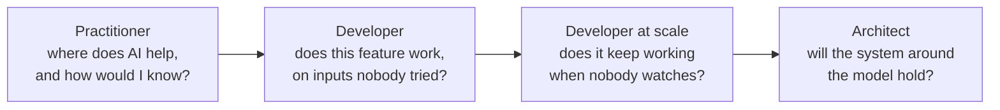
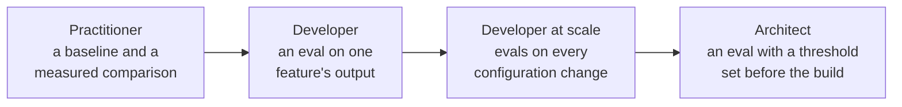

Most people meet AI at work as **practitioners**: they use it in their own delivery work and judge where it helps. The good ones get asked to build with it, and become **developers**. The good developers get asked to design whole systems around it, and become **architects**. Each move feels like more of the same job. It is not. The habits that served one role do not answer the next role's question.

Four posts on this blog cover that path. Each one is long, because each one is a working reference. This post is the map: it reads them as one path through three roles, and says where to go for the detail.

The diagram shows the three roles and the question each one answers. The developer's role takes two posts, because building a feature and keeping it working at scale are different jobs.

**At each role, the work moves from judging, to building, to designing, and what you answer for grows.** The practitioner answers for one decision. The developer answers for code that runs without them. The architect answers for a system other people must approve and live with.

You can read the four posts in that order, or jump to the role you are in. Each section below starts with the question that role answers, then says what changes for the person, then gives the sections to read.

## Judging where AI helps, as a practitioner

The path starts before any code, with someone who wants to use AI in their work. An agent can build a first version in minutes, so the hard part is no longer the build. The question is **where does AI help this work, what will it cost to own, and how would I know it worked?**

The shift at this role is from trying a tool to judging it. [When Code Is Cheap](/blogs/blog/when_code_is_cheap/) takes Fred Brooks's line from 1986, that the hard part of software is deciding what to build, and turns it into eleven questions to ask before and after saying yes. Its rule: when code is cheap, pay for what stayed expensive, which is deciding, owning, checking, and understanding.

The questions come in five groups, in the order a decision meets them. The table points to each group.

| If the question is | Read |
| --- | --- |
| Is there a real problem, does it need AI, and what shape fits? | [Before you say yes](/blogs/blog/when_code_is_cheap/#before-you-say-yes): questions 1 to 4, from the problem to the decisions that are hard to undo |
| What will it cost to own, not only to build? | [Counting the cost of owning it](/blogs/blog/when_code_is_cheap/#counting-the-cost-of-owning-it): question 5, cost per good outcome |
| How do we pilot it, and how will we know it worked? | [Running the pilot and measuring it](/blogs/blog/when_code_is_cheap/#running-the-pilot-and-measuring-it): questions 6 and 7, the hardest step first and a measured comparison |
| How much may it do alone, and how do we keep it safe? | [Controlling risk: authority and safety](/blogs/blog/when_code_is_cheap/#controlling-risk-authority-and-safety): questions 8 and 9, risk tiers and least privilege |
| Who checks it, and how does it stay good? | [Controlling quality: checking and drift](/blogs/blog/when_code_is_cheap/#controlling-quality-checking-and-drift): questions 10 and 11, review capacity and drift |
| How do the answers change with the kind of delivery work? | [Applying the questions to five kinds of delivery work](/blogs/blog/when_code_is_cheap/#applying-the-questions-to-five-kinds-of-delivery-work): who keeps the saved hour in each kind of deal |

For a five-minute version, [All eleven questions on one page](/blogs/blog/when_code_is_cheap/#all-eleven-questions-on-one-page) holds the whole post in one table. Those questions say whether to build, but not how. Once the answer is yes, someone has to make it hold up on inputs nobody tried.

## Building it as a developer

The developer takes the practitioner's yes and turns it into code that runs without anyone reading each answer. That job has two stages. First one feature has to work. Then, if it succeeds, it has to keep working at a scale no one person can watch.

### Making one feature work in production

The first question is narrow: **does this call do what I meant, every time, on inputs I never tried?** The shift is from chatting with a model to writing code that uses one. In a chat you read the answer and adjust. In a program nobody reads the answer, so the output has to hold up on its own.

The habit that carries this stage is in [From Prototype to Production](/blogs/blog/from_prototype_to_production/): diagnose what is missing before you add more words, and test what must hold, not the exact text. The post follows a build as it grows, so its sections answer the problems in the order they appear.

| If the problem is | Read |
| --- | --- |
| The same prompt gives different answers, and tests flicker | [Understanding how a model behaves](/blogs/blog/from_prototype_to_production/#understanding-how-a-model-behaves): tokens, sampling, tiers, and request shapes |
| A prompt that worked breaks on a new input | [Making one call reliable](/blogs/blog/from_prototype_to_production/#making-one-call-reliable): diagnose the failure, add the fewest examples, enforce the format in the API |
| The model picks the wrong tool, or the tool loop fails validation | [Giving the model tools](/blogs/blog/from_prototype_to_production/#giving-the-model-tools): the pairing rule, descriptions that tell tools apart, streamed tool calls |
| An agent gets worse after a fixed number of turns | [Keeping context inside its budget](/blogs/blog/from_prototype_to_production/#keeping-context-inside-its-budget): pruning, compaction, caching, retrieval, batches |
| You are not sure you need an agent | [Choose an agent only when the path is unknown](/blogs/blog/from_prototype_to_production/#choose-an-agent-only-when-the-path-is-unknown): one test, and three ways to wire the loop |
| A coding agent must be safe on a team's repository | [Working through a coding agent](/blogs/blog/from_prototype_to_production/#working-through-a-coding-agent): permission modes, the CLAUDE.md instruction file and hooks, plugins, credentials |
| It works on your machine and must prove itself in production | [Proving it works in production](/blogs/blog/from_prototype_to_production/#proving-it-works-in-production): the design document, evals, retries, cost, and the security boundary |
| It must be reused, reviewed, and deployed for a customer | [Shipping it for reuse and audit](/blogs/blog/from_prototype_to_production/#shipping-it-for-reuse-and-audit): accelerators, platform choice, pinned versions, trust boundaries |

That post ends with one feature that runs and passed review, with one person still checking it closely. Then the feature succeeds, and that person cannot keep up.

### Keeping it working when nobody watches

Success multiplies runs: more teams, more agents, more jobs at night. The question changes to **does it keep working when nobody is watching each run?** The developer who read every output is now the slowest part of the system.

The shift is from doing the checks to writing them. [From Production to Scale](/blogs/blog/from_production_to_scale/) puts it in one line: at scale, a person stops working inside the loop and writes its checks instead. Its sections follow a running system as it grows into a fleet, every session and job running at once.

| If the problem is | Read |
| --- | --- |
| One person has more work than one session can hold | [Running more work than one person can watch](/blogs/blog/from_production_to_scale/#running-more-work-than-one-person-can-watch): worktrees, when a subagent helps, managed agents |
| Every mistake still reaches a person first | [Letting each run check its own work](/blogs/blog/from_production_to_scale/#letting-each-run-check-its-own-work): a one-command check, protected tests, reading the diff |
| A change to the agent's instructions breaks something nobody noticed | [Testing the configuration like code](/blogs/blog/from_production_to_scale/#testing-the-configuration-like-code): evals on every configuration change, one per incident |
| A rule in the instructions is followed only most of the time | [Turning rules from advice into gates](/blogs/blog/from_production_to_scale/#turning-rules-from-advice-into-gates): hooks, approval gates, managed settings |
| The agent should help ship, but never ship alone | [Shipping through the pipeline up to the production gate](/blogs/blog/from_production_to_scale/#shipping-through-the-pipeline-up-to-the-production-gate): read-only jobs first, deploy tools per environment, review without self-approval |
| Incidents wait for someone to wake up | [Letting monitoring start the next loop](/blogs/blog/from_production_to_scale/#letting-monitoring-start-the-next-loop): control bands, alert levels, findings written as plans |
| The bill grows with every run | [Keeping cost flat as the fleet grows](/blogs/blog/from_production_to_scale/#keeping-cost-flat-as-the-fleet-grows): the smallest passing model, effort, what each request resends, defaults before caps |

Both developer posts take the system's shape as given. But someone chose what the model owns, which route the data takes, and what the system must prove before anyone wrote code. That someone is the architect.

## Designing the system around it, as an architect

The architect meets the work at a stakeholder's first sentence, before any code exists. The question is **will everything around the model hold:** the request, the design, the security review, and the team that runs it a year later?

The shift at this role is from building things to making decisions that others must approve and live with. The model can usually do the task. What fails is the request nobody translated, the rule handed to the model that belonged to a database, or the decision nobody wrote down. [From Request to Running System](/blogs/blog/from_request_to_running_system/) follows a project from that first sentence to a team running the system alone.

Its sections come in the order a project meets them. Use the table to find the decision on your desk.

| If the decision is | Read |
| --- | --- |
| What the stakeholder actually asked for, and whether it fits the budget | [Understanding the request before designing anything](/blogs/blog/from_request_to_running_system/#understanding-the-request-before-designing-anything): the translation table, the model's four properties, a verdict instead of a promise |
| How anyone will know the system is right | [Deciding how to judge it before building it](/blogs/blog/from_request_to_running_system/#deciding-how-to-judge-it-before-building-it): the eval before the code, every change through it |
| What the model owns, and whether it needs an agent | [Designing what the model owns and how the work flows](/blogs/blog/from_request_to_running_system/#designing-what-the-model-owns-and-how-the-work-flows): the ownership split, call versus workflow versus agent, reference architectures |
| Which model, what context, and which route | [Choosing the model, the context, and the way in](/blogs/blog/from_request_to_running_system/#choosing-the-model-the-context-and-the-way-in): tiers per step, context as a working set, entry points and routes, reversal cost |
| Whether it survives real volume and the security review | [Making it hold up in production](/blogs/blog/from_request_to_running_system/#making-it-hold-up-in-production): the slow tail, reliability layers, integration from the server outward |
| Whether it stays safe, fair, and accountable | [Keeping it safe, fair, and accountable](/blogs/blog/from_request_to_running_system/#keeping-it-safe-fair-and-accountable): the layer stack, guardrails that fail closed, review by stakes, compliance evidence |
| How it stays on course after launch | [Running it after launch](/blogs/blog/from_request_to_running_system/#running-it-after-launch): experiments, the feedback loop, decision records, proof of value |
| How a team runs it without the architect | [Handing it to the team](/blogs/blog/from_request_to_running_system/#handing-it-to-the-team): shared defaults, staged rollout, runbooks |

The architect's questions sound new, but many are the practitioner's questions asked again, with more at stake. The practitioner asked what shape the work should take. The architect draws that shape and defends it. One habit runs through all three roles.

## Deciding how you will judge it, in every role

The questions grow with each role, but the first move stays the same. **Before you build, decide how you will judge the result.** What grows is what the check covers: a project's business result for the practitioner, one feature's output and then a fleet's configuration for the developer, and a whole system's acceptance for the architect.

The diagram shows the same habit in each role.

Each post puts that habit first, in its own words. The table shows where.

| Role | Where the check comes first |
| --- | --- |
| Practitioner | [What is the problem, before AI?](/blogs/blog/when_code_is_cheap/#1-what-is-the-problem-before-ai) records the baseline, and [How will we know it worked?](/blogs/blog/when_code_is_cheap/#7-how-will-we-know-it-worked) measures against it |
| Developer | [Write the decisions down first](/blogs/blog/from_prototype_to_production/#write-the-decisions-down-first), then [turn the success criteria into a score](/blogs/blog/from_prototype_to_production/#turn-the-success-criteria-into-a-score) |
| Developer at scale | [Rerun the evals whenever the configuration changes](/blogs/blog/from_production_to_scale/#rerun-the-evals-whenever-the-configuration-changes), and [turn every incident into an eval](/blogs/blog/from_production_to_scale/#turn-every-incident-into-an-eval) |
| Architect | [Writing the eval before the code](/blogs/blog/from_request_to_running_system/#writing-the-eval-before-the-code), with the threshold set before the run |

So the path is less a change of skill than a change of reach. A practitioner who measured a baseline before trying a tool already holds the habit the developer and the architect need. They only point it at something larger.

**Lesson: each role answers a bigger question, but the first move never changes: decide how you will judge it before you build it.**

So what can you do this week? Find the role you are in, and take the question of the role after it. Write down that role's first artifact for the project on your desk: for a practitioner moving to developer, a one-page design document with success criteria; for a developer moving to architect, a translation table of what the stakeholder said, what it implies, and what nobody has confirmed. The post for that role shows how.
