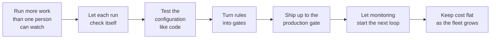
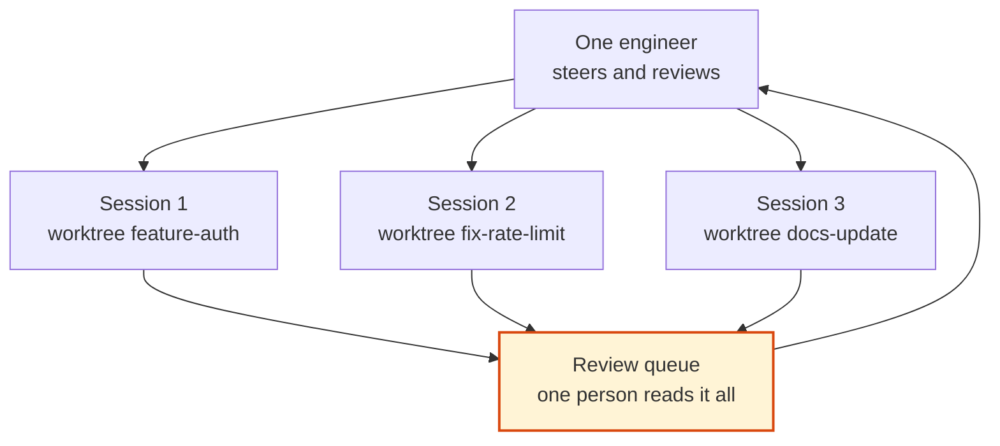
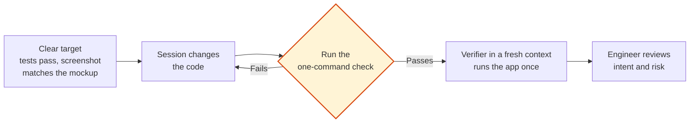
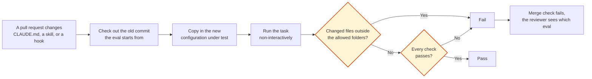
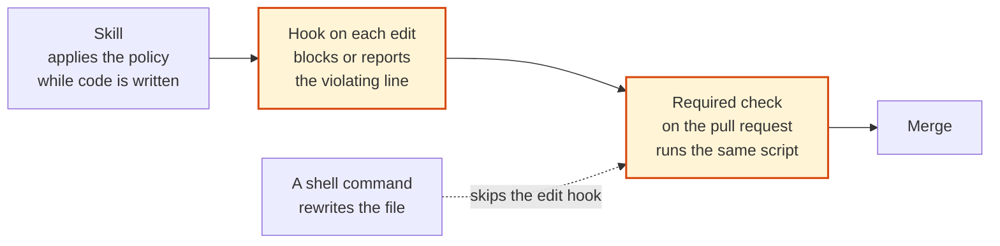
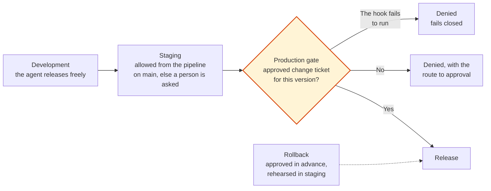
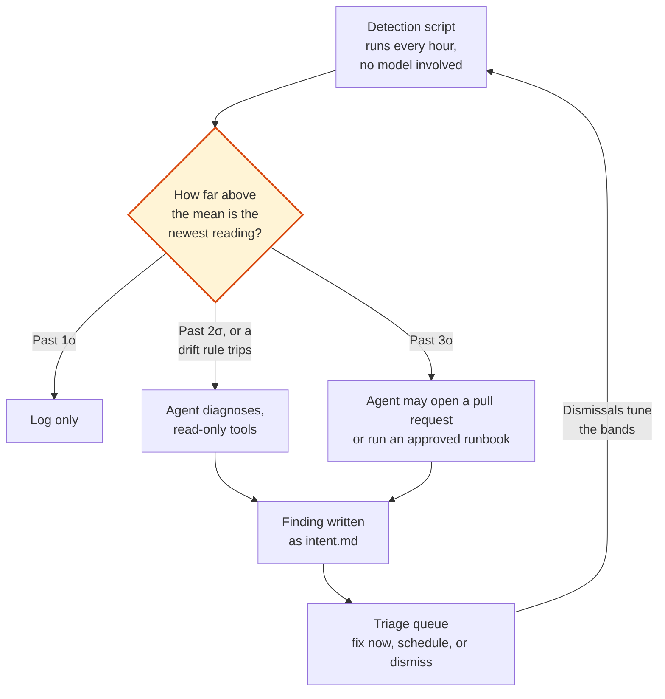
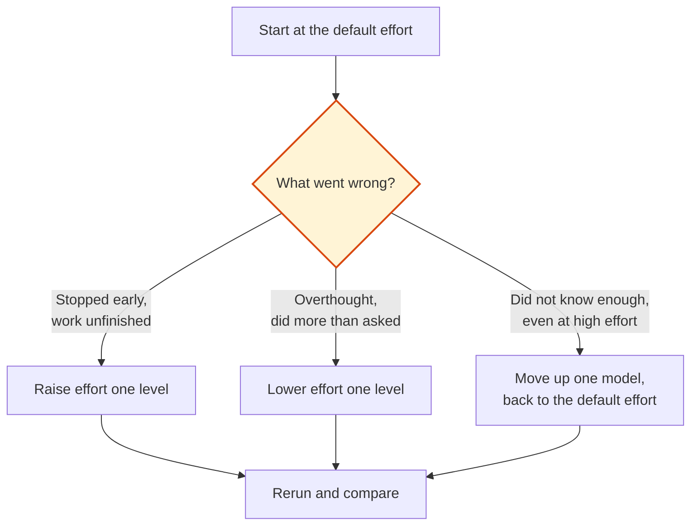

A feature that passes the checks a team runs before launch has a new problem a few months later: it worked. More teams use it, more agents run it, and more runs happen at night with nobody at the keyboard. The person who used to read every output, start every job, and approve every step cannot keep up.

That person is now the slowest part of the system. Adding agents does not help, because each one hands the same person more to read.

The trouble sits in the **loop**: give an agent a task, let it run, check the result, decide the next step. Today a person does the checking and the deciding, by hand, every time. So scale is not mainly a question of servers. **At scale, a person stops working inside the loop and writes its checks instead.** The checks run every time. The person reads only what they send back.

This post follows that move from the developer's side. It starts where [From Prototype to Production](/blogs/blog/from_prototype_to_production/) ends, with one feature that runs and passed review, and it points back to that post instead of repeating it. The architect's side of running a system after launch is in [From Request to Running System](/blogs/blog/from_request_to_running_system/).

I write it around Claude and Claude Code, Anthropic's command-line coding agent, because Anthropic's developer training documents these patterns in detail. Most examples come from that training. Its companies are fictional: the numbers from its recorded demos are measured runs, and its stories are worked cases, not reports of real events. Product names and limits change often, so check current documentation before you build.

The diagram shows the seven steps, in the order a running system grows into a **fleet**: every session, pipeline job, and triggered agent running at once.

Each step begins where the one before it hit a limit, and the first limit is attention.

## Running more work than one person can watch

The first sign of scale is that one engineer has more work in progress than one session can hold. The fix is to run several streams at once. The catch is that every stream ends on the same person's desk. **The number of streams is set by review, not by compute.**

### Give each parallel session its own worktree

A **parallel session** is a second full Claude Code instance working a separate task. Sessions know nothing about each other. The engineer steering them is the only thing they share.

Two sessions in one folder fight over the same files. So each one gets its own **worktree**: a separate checkout of the repository on its own branch. One terminal runs `claude --worktree feature-auth`, another runs `claude --worktree fix-rate-limit`, and neither can overwrite the other's changes.

The diagram shows the shape. Look at where the arrows end.

Every arrow ends at the same review queue. So the ceiling is how many streams one person can review properly, not how many the machine can run. [When Code Is Cheap](/blogs/blog/when_code_is_cheap/) makes the same point about who checks the output: review hours must be planned like any other capacity.

So split the work so tasks touch different files. Tasks that share files run in one session, one after another. Start with two or three sessions, and add one only while review keeps up.

### Delegate to a subagent only when the result is all you need

Inside one session, a **subagent** runs a scoped job in its own context window and returns only a summary. So one question decides when to use it: does the in-between work matter to you?

If you only need the result, delegate. Research is the classic case. "Where is the token validated?" may take dozens of file reads, and the main session needs one line back. Code review is another. A reviewer in a fresh context has not watched the code being written, so it does not share the author's assumptions.

If you need to see and react to the steps, keep the work in the main session. Three common uses fail. The first adds nothing, and the other two hide the steps you need:

- **Expert personas.** "You are a Kubernetes expert" adds nothing the main session does not already know.
- **Sequential pipelines.** One subagent reproduces a bug, the next debugs it, a third fixes it. Each step depends on what the last one found, and the findings get lost in the handoffs.
- **Test runners.** A subagent that reports "tests failed" hides the output you need to fix them.

A subagent that is worth having still needs four things. A description that tells the main session when to launch it and what to ask for. An output format in its system prompt, which gives it a natural place to stop. A section in that format for obstacles it hit, so the main session does not rediscover a workaround. And only the tools its job needs: read-only for research, no edit rights for a reviewer.

### Hand the longest loops to a managed runtime

Some loops outgrow a session altogether, and once they run unattended for hours, nobody watches them at all. They work across many tools, write files, keep state, and must survive a dropped connection. Running that loop on your own server means owning its sandbox, its state, and its recovery.

A **managed agent** hands that loop to the provider. You define the agent once (model, system prompt, tools), give it an environment (a sandbox with the packages and network rules it needs), and start a run, which the API calls a session. Then you send events in and read events out.

The provider stores each run's history, so a client that drops can fetch what it missed and carry on. From Prototype to Production compared this option with writing the loop yourself.

So more sessions, more subagents, and longer loops all raise output, and none of them raises review. What can each run check before a person sees it?

## Letting each run check its own work

A run that cannot check itself sends every mistake to a person. A run that can check itself sends only the ones its check could not fix. **Give every run a way to verify its own work, and the reviewer stops being the first test.**

### Give the session a check it can run itself

The check has to be one command, with a clear pass and fail. If checking the work today takes three commands and some knowledge of the environment, wrap them in one command such as `make test` that exits non-zero on failure. Then list each command in CLAUDE.md, the instruction file every Claude Code session reads at the start, with an example of a healthy output.

Next, state the target as something checkable: "all tests in `test_status.py` pass," or "the endpoint returns 200 with the new field." For interface work, give the session a browser or screenshot tool and the design mockup to match. Two or three rounds of build, screenshot, compare is normal.

The diagram shows the loop this creates, and the one step outside it.

The loop and the verifier are different things. The loop runs as often as the work needs. The **verifier** is the fresh-context reviewer from the subagent advice above, run once after the session thinks it is done.

### Protect the check from the code it checks

A check the session can edit is not a check. An agent asked to make a test pass can also make it pass by changing the test. So the loop needs one more rule.

For a bug fix, write the failing test first. Ask the session to reproduce the bug as a test, confirm it fails for the expected reason, and commit it. Only then ask for the fix, with a **hook** (your own script that runs at a fixed point in the session) that blocks edits to test files during the fix. A test that existed before the fix, and that the agent could not rewrite, is proof the bug is gone.

### Check the run in proportion to how little you watched

Even a self-checked run ends with a summary, and a summary is the run's own account of itself. The trap is a tidy summary over a diff that touched a file nobody expected. So the engineer's own check grows with how little of the run they saw.

A short session you watched needs a glance. An overnight run needs a real check:

- Read the diff first. Look at the files in the plan, then for anything outside it.
- Confirm the tests ran, from the hook's output, not from the summary's claim.
- For a headless run (one started from a script with `claude -p`, nobody at the terminal), read its JSON result and exit code, not its prose.
- For anything that matters, ask a fresh session for a cold review of the changed code.

That last step is the verifier again, pointed at work nobody saw being done.

So each run now arrives already checked against its own target. But all runs read the same CLAUDE.md, skills (instruction files a session loads when a task needs them), and hooks. What checks the configuration that steers them?

## Testing the configuration like code

A single line in CLAUDE.md changes the behavior of every session that reads it. So does a skill, a hook, or a tool description. That gives the configuration the widest reach of any code in the repository. **Configuration that steers every run deserves the regression tests that ordinary code gets.**

### Rerun the evals whenever the configuration changes

From Request to Running System gates every prompt and model change on an **eval**. Configuration is the change it left out. An eval here is a real task plus the checks that define an acceptable result. Collect 20 to 50 tasks from recent work, each with its accepted outcome. Write each one down as a prompt, the folders it may change, and its checks: tests pass, lint is clean, behavior is unchanged, policy is followed.

Then run the suite in CI (continuous integration, the pipeline that builds and tests every change), on a schedule and on every change to CLAUDE.md, skills, or hooks. The diagram shows one eval's run. Note the two ways it can fail.

Those two failure checks make the suite trustworthy. Each eval starts from the commit just before the real past task it was copied from, so the agent works on the code as it stood then. And the run fails if it touched anything outside its allowed folders, so the agent cannot pass by rewriting the Makefile or the checks. The check scripts themselves run from a copy taken before the agent starts, so the agent cannot edit them either.

The value shows on a change that looks safe. In a worked case from the course, a team trims CLAUDE.md to fit on one page and drops the line saying not to log request or response bodies. It looks redundant, because a skill and a hook already keep fields tagged as personal data out of the logs.

The suite runs because CLAUDE.md changed. One eval asks for debug logging on a claim-status endpoint, and this time the session logs the whole response. The personal-data check still passes, because no field in the response is tagged. But a free-text field holds a customer's name and phone number, and a second check that looks for whole response bodies in the logs fails. The line goes back in before the merge.

So the dropped line was not redundant: the tags covered fields, and only the line covered free text.

The same suite measures gains, not only losses, because tool descriptions are configuration too. In one of the course's recorded demos, a team merged four overlapping tools, each returning one fact about a project, into one tool with a parameter, and rewrote the descriptions. Same model, same 30 test questions: the number answered with the right tool calls rose from 14 to 26. So a description rewrite deserves the same eval run as a model change.

### Turn every incident into an eval

A suite built once goes stale. As models improve, every setup passes the old cases, so they stop showing a difference. The suite needs new cases, and the best source is production.

The rule is simple: every production incident leaves an eval behind, written by the team that owned the incident. The eval replays the request that caused the incident, from the commit before it, and fails if the mistake comes back. Then the same class of incident should stop repeating, and a falling repeat rate is the sign the suite is working.

So the configuration is now under test. But an eval only samples 20 to 50 tasks, and it sees a broken rule only after a session has broken it. What stops a live session from breaking the rule in the first place?

## Turning rules from advice into gates

An eval sees a broken rule after the fact, because to a session an instruction is only a request. It follows the request most of the time, and at scale "most of the time" means a steady trickle of violations. **A rule that must hold every time needs a gate: a check that runs every time and can stop the action.**

### Back every must-hold rule with a hook

From Prototype to Production drew the line between a convention and a guardrail: a rule in CLAUDE.md is followed most of the time, a hook every time it fires. A skill sits on the convention side. It makes a policy likely, because it loads the policy while the code is written. A hook is what turns the policy into a gate.

The plainest case is "done." An instruction in CLAUDE.md asks the session to run the tests before reporting a task complete. A **stop hook**, which runs when the session tries to end its turn, enforces it: it runs the tests and refuses to let the turn end on a failure.

At scale, three details decide whether a hook really holds. First, the hook script's exit code. Exit 2 blocks the action and sends the reason back to the session. Exit 1 feels like an error but does not block: the action runs anyway. A guardrail that exits 1 is a log line, not a gate.

Second, a hook can rewrite instead of refuse. A pre-tool hook can return a changed input, for example a shell command with a live secret replaced by a placeholder. The command still runs, but the secret never leaves the machine. The rewrite replaces the whole input, so it must copy back the fields it does not change.

Third, every hook has a blind spot. A hook that runs after an edit cannot undo it, though its message lets the session fix the line. And a hook on the edit tools does not fire when a shell command rewrites the file. The diagram shows how the layers cover each other's gaps.

So the same check script runs in two places: at the edit, where it is fast and scoped to one file, and on the pull request, where it catches anything that reached the branch another way.

### Let a gate ask or wait, and name the way through

Some gates should not just allow or block. They should ask, or wait for someone else's approval. A release gate, a hook on the release tool, is the clearest case. In development it allows. In staging, a pipeline run on the main branch is allowed outright, and a session someone is driving gets asked. In production it looks for an approved change ticket for that exact version, and blocks until one exists.

A block that only says "denied" stalls the run. So every block names the route to approval: "Open a change ticket for this version, wait for the release manager to approve it, then call release again with the ticket number." The session can pass that on, and the person knows exactly what to do.

Two cautions keep such a gate honest. In a non-interactive run nobody can answer an "ask," so it becomes a denial, which is why staging allows the pipeline outright. And the gate only works if the agent has no way to write to the records it reads, such as the change tickets.

### Lock the gates where nobody can switch them off

A hook in the project's settings holds only while each engineer leaves it on. One engineer with a local override can switch it off. So the rules that must hold for everyone go into the enterprise managed settings that From Prototype to Production described, which an administrator deploys and nobody can override.

A locked-down setup for a regulated team does at least these jobs:

- Deny reads of secrets and block network calls through tools, while pre-approving the safe inner work (build, test, lint) so the deny list does not become a stream of approval prompts.
- Turn on the operating-system sandbox and refuse to start without it, because a tool-level deny on web fetches does not stop a shell command from reaching the network.
- Keep credential files such as SSH keys and cloud keys unreadable from sandboxed commands, and strip named secrets from their environment.
- Let only managed hooks run, so the release gate cannot be bypassed by a project file.
- Allow tools, plugins, and MCP servers only from the organization's approved list.
- Refuse to start on a version below the one the organization assessed.

Each deny removes some capability, so treat such a setup as a starting point, tuned to the data the repository holds.

Managed settings can also fix the permission mode, which sets what the agent may do without asking. Of the six modes in From Prototype to Production, two fit unattended work. Do-not-ask runs reads and pre-approved tools and denies anything that would prompt, so a pipeline never hangs on a question. Auto judges intent, not correctness, so pair it with the stop hook from "Back every must-hold rule with a hook."

So the gates now hold inside every session, for everyone. But a session on a laptop is not where most work ships. How far can the pipeline itself be trusted?

## Shipping through the pipeline up to the production gate

A laptop session is watched at least once. A pipeline job starts on an event, with nobody watching at all. That raises the stakes of every earlier step. **The agent may act up to the production gate and cannot pass it.** The one thing it may do in production on its own is roll back, because a person approved that procedure in advance.

### Start the pipeline with read-only judgment

Pipelines already run scripts. What they lack is judgment: why did the build break, is this test flaky, what goes in the changelog. Those jobs used to wait for a person, and they are where the agent starts.

The order matters. First, read-only jobs: run the agent non-interactively with `claude -p` to triage a failed build or draft release notes. Then write jobs behind the existing gates: fix lint, update generated docs, address a review comment. Anything the agent writes arrives as a pull request, through branch protection (the repository rules that require review before a merge), with no route to push to the main branch.

Whatever the job, it runs in a container with a network policy and short-lived credentials. By default it holds no production credentials at all. So how does an agent with no production credentials deploy anything?

### Give each environment its own deploy tools

It deploys through tools, exposed through MCP (the Model Context Protocol, a standard way for a server to offer tools to any client): release, status, and rollback. The design choice that makes this safe is one MCP server per environment, each with its own access key.

Why separate servers? A permission rule that allows an MCP tool names the server and the tool, not the tool's arguments. So "release to staging" and "release to production" can only be told apart if they live on different servers. The staging job then holds only the staging key, and the other servers refuse it.

The diagram shows the three environments. Note that rollback reaches production without passing the gate, and release does not.

In production, release is left off the list of tools that may run without asking. So the release gate from the previous section is the only thing that can say yes. If that hook crashes or never runs, nothing says yes, and the release is denied. That is **failing closed**, the rule From Request to Running System traces to Saltzer and Schroeder. It is the opposite of the exit-1 trap, where a broken check lets the action through.

Rollback stays on the list, because it is a **runbook**: a written procedure approved in advance. That makes it the path to rehearse most, as one command the agent can run, exercised regularly in staging.

### Keep the approval with a person who did not write the code

Automated review ranks findings, but it never approves. Approval stays with a code owner, a person named as responsible for that part of the code, who did not write it. The review's job is to tell that person where to look, so their attention moves up a level: does the change do what the plan intended, and is the risk acceptable?

The review policy lives in a file at the repository root, often called `REVIEW.md`. It names the review passes (bugs, security, and compliance with the plan), says what counts as important and what is a nit (a minor style comment), caps the nits, and lists what to skip. When a finding repeats, its correction goes into CLAUDE.md, so the next session avoids the mistake.

A pass that reads the plan catches what a diff alone cannot. In one course case, a pull request added a status panel to a customer portal that fetched new data on every render. Nothing in the diff looked wrong. But the plan file committed with the task said the panel must cache, because the system behind it allows 50 requests a second. The compliance pass read the plan and flagged it.

So the review earned its place by reading what the reviewer of a diff would not have open. One gap remains when an agent opens pull requests under an app's name, as Anthropic's Slack agent does. Branch protection stops a pull request's author from approving it, and the author is now the app. So the person who asked for the change could approve their own request.

The fix is two required approvals, so at least one approver is someone other than the requester. Also dismiss approvals when new commits arrive, or the agent can push after a person has approved.

So the pipeline now ships up to production and stops there. After the release, the system is live with nobody watching. Who notices when it breaks?

## Letting monitoring start the next loop

So far every loop starts from a person or a code event. Nothing yet starts one from what production does: an alert still wakes someone, and a ticket still waits for someone to pick it up. **The last step is to let a signal from production start the agent, while a person triages what it finds.** This is the feedback loop from From Request to Running System, with the agent doing the first diagnosis.

### Let rarer readings unlock more action

A trigger that fires on every blip buries the team in noise. A trigger that waits for disaster fires too late. That problem is a century old.

In a 1924 memo at Western Electric, a year before its engineers became Bell Telephone Laboratories, [Walter Shewhart](https://en.wikipedia.org/wiki/Walter_A._Shewhart) drew the first control chart. His point was that a process always varies by chance, and only variation outside its normal range has a cause worth chasing.

A **control band** applies that idea to a metric. Take the mean of the last 30 days of hourly readings, and measure how far readings usually stray from it: the standard deviation, or **σ**. The 1σ line is the mean plus one σ, the 2σ line the mean plus two, and so on.

Chance alone crosses each line now and then. If a steady metric's readings follow a bell curve, then at 720 hourly readings a month (30 days of 24), about four a day land more than 1σ above the mean, about 16 a month more than 2σ above, and about one a month more than 3σ above.

So each line unlocks a little more. A reading past 1σ is only logged: at four a day, acting on it would be noise. A reading past 2σ starts a read-only diagnosis, cheap enough to waste 16 times a month. Only a reading past 3σ, which chance reaches about once a month, lets the agent act, and then only through a pull request or an approved runbook.

A spike is not the only danger. A slow drift may never cross 3σ. The [Western Electric rules](https://en.wikipedia.org/wiki/Western_Electric_rules), from a 1956 quality-control handbook, include drift rules that catch it: flag four of the last five readings past the 1σ line, or eight in a row above the mean. A drift counts as a 2σ reading.

The diagram shows the alert levels a team writes in version-controlled config. Note that the model appears only after a plain script has sorted the reading.

So detection stays deterministic: a short script, version-controlled and unit-tested, with no model in it. And the loop tunes itself. Each finding a person dismisses as noise is a reason to adjust that metric's band, so the same blip stops waking the agent.

### Write the finding as a plan, not a fix

What the agent produces matters as much as when it starts. A fix pushed in the middle of the night skips every gate built so far. So the agent writes its diagnosis as **intent.md**, a short problem statement in four parts: the anomaly and its evidence, the outcome it proposes, the systems affected, and the open questions. These are the parts a person would write to propose new work.

From there the finding goes through the same pipeline as anything else. A person triages the queue: fix now, schedule, or dismiss. A fix goes through review. And the incident leaves an eval behind, as in "Turn every incident into an eval."

A worked case from the course shows why the agent writes a plan even when it can fix the symptom. The rollback is safe, but the real question is one only a person can answer.

**Example · A cache set to zero**

An insurer's customer portal shows claim status and caches each answer for 60 seconds. A release at 13:52 sets the cache to zero. Every page view now reaches the older claims system behind it, which allows 50 requests a second, and it starts refusing requests.

At 14:00 the hourly check reads the status endpoint's error rate at 1.9 percent. The 30-day mean is 0.2 percent, and σ is 0.02 percentage points. So the reading sits about 85σ above the mean, far past the 3σ line, and the agent may take one of two routes: open a pull request, or run an approved runbook.

A release went out minutes before the breach, so the agent runs the rollback runbook at 14:02. The earlier version is live again at 14:04. Then it writes intent.md: the problem with its numbers, the release that caused it, the constraint that status may be up to 60 seconds old, and one open question: who asked for live status, and is 60 seconds too slow for them?

The fix goes through review like any other change. The incident leaves an eval that asks a session to make the panel "feel live" and fails if the cache is gone.

So the agent acted only through a rehearsed route, and the real decision, what "live" should mean, went back to a person.

The same work can also arrive in a chat channel instead of from a script. An agent with its own identity in the on-call channel picks up each alert, posts what broke and a proposed fix in the alert's thread, and drafts the postmortem once the incident closes. Where no rollback runbook has been approved in advance, it waits for the on-call engineer to approve the rollback in that thread.

Now the loop starts itself. But a loop that runs without anyone starting it also spends money without anyone noticing.

## Keeping cost flat as the fleet grows

Every earlier step adds runs: parallel sessions, evals on every configuration change, agents in CI, agents woken by monitoring. While one team uses a feature, the bill is small. Across a fleet, a small waste per run multiplies by every run. **At scale, cost is set by what every run does by default: the model it starts on, what it resends each turn, and the settings nobody changes.**

### Start on the smallest model and tune effort before moving up

From Prototype to Production starts on the balanced tier and steps down for high-volume work. For a fleet, make the bottom the starting point of the search. The course's rule is to run 20 to 30 real examples through the smallest tier first, and stop at the cheapest model whose output you would ship. At volume, every step up is multiplied by every run.

**Effort**, the request setting From Prototype to Production introduced, is the second dial. It sets how hard the model works on a task, not what it knows. Too low, and it stops early with unfinished work, which costs a second request. Too high, and it overthinks, finds tasks you never assigned, and takes longer. The diagram shows which dial to turn.

So change the model only when more effort did not fix the problem. And when you change models, start again at the default effort, because the same level name means a different amount of work on a different model. When a new model ships, rerun the tasks: it may do the same work at a lower effort, for less.

### Stop paying for the same tokens on every turn

The second default is what each request resends. An agent that uses tools sends everything again on every request: the tool definitions, the system prompt, the question, and every tool result so far. So its cost grows with each call. In one recorded demo, an agent's first request carried 606 input tokens, and its 37th carried 47,905, almost all of it the 36 earlier tool calls and their results.

Prompt caching cuts the part that never changes. From Prototype to Production gave the prices and the conditions for a cache hit. One trap matters once you track spend across a fleet: with caching on, the input-token count leaves out the cached part, so the true total adds the cache reads and writes to it. Watch all three counts, or a cache that silently stopped working looks like a cheaper month.

**Programmatic tool calling** cuts the part that grows. The model writes a short script that calls your tools, the script runs in a code-execution container, and only what the script prints reaches the model. The tool results stay with the script.

The difference is large when lookups do not depend on each other. One demo asked which of 40 engineers were under 70 percent utilization in a month. That took 41 tool calls: one to list the engineers and one per engineer.

The ordinary tool loop sent 42 requests to the model and about 1.1 million input tokens in total, for $2.29. The scripted run sent 3 requests and about 28,000 input tokens, for under 7 cents, plus separately billed execution time.

It helps little when the model must reason over each result before the next call. And independent calls save clock time as well as tokens: the loop answers every call in one message, as From Prototype to Production described, and runs the read-only ones at once. In another demo, a job-site check with three independent lookups went from 19.9 seconds to 10.8, measured from question to answer.

### Change the defaults before you raise a cap

The last default is the one nobody changes. From Request to Running System set the spend posture before rollout: the default model, effort guidance, and caps. At fleet scale, the default is the lever, because most people never touch the model picker. If the default is the most capable model at a high effort, that expensive setup is what most usage runs on.

That makes a request to raise a spend cap a reason to look, not an automatic yes. In a worked case from the course's admin lessons, a platform team hit its monthly cap in the second month and asked for more. The review showed most of that spend was the most capable model writing routine pull-request summaries.

The default model was lowered for the role the team's members hold, and the cap was left alone. The next month the team ran under its cap, with the same volume of work. So the review asks one question before a cap moves: is a setting wasting the spend, or was the cap set below what the work needs? Change the setting in the first case, and re-base the cap only in the second.

**Lesson: at scale, the person stops working inside the loop and writes its checks.** Parallel streams are bounded by review, runs check themselves, evals test the configuration, hooks hold the rules, the pipeline stops at production, monitoring starts the next loop, and defaults keep the bill flat. The person writes those checks and reads what they send back.

So what can you do this week? Write down every check you did by hand on agent output in the last five days. Take the one you did most often, and turn it into a hook or an eval that runs without you.

## Glossary

The terms used in this post, in alphabetical order.

| Term | Meaning |
| --- | --- |
| Auto mode | A permission mode in which a classifier, a second model, stops actions that go beyond the request. It judges intent, not correctness |
| Branch protection | Repository rules that require review and passing checks before a change can merge |
| CI | Continuous integration: the pipeline that builds and tests every change |
| CLAUDE.md | The instruction file every Claude Code session reads at the start |
| Code owner | A person named as responsible for part of the code, whose approval a merge needs |
| Control band | A range around a metric's normal level, measured in σ from its recent mean. A reading far outside it suggests a real change, not chance |
| Do-not-ask mode | A permission mode for unattended runs: reads and pre-approved tools run, and anything that would prompt is denied |
| Effort | A request setting for how hard a model works on a task: how many tokens, tool calls, and checks it spends. It does not change what the model knows |
| Eval | A real task plus the checks that define an acceptable result, run automatically to compare setups |
| Fail closed | A gate that blocks the action when the gate itself fails to run |
| Fleet | Every session, pipeline job, and triggered agent running at once |
| Gate | A check that runs every time and can stop the action |
| Headless run | A run started from a script, such as `claude -p`, with nobody at the terminal |
| Hook | Your own script that runs at a fixed point in the agent's loop, every time it fires, and can block, rewrite, or report an action |
| intent.md | A short problem statement an agent writes instead of pushing a fix: anomaly and evidence, proposed outcome, systems affected, open questions |
| Loop | The cycle of giving an agent a task, letting it run, checking the result, and deciding the next step |
| Managed agent | An agent loop run on the provider's infrastructure: you define the agent and its environment, start a run, and exchange events |
| MCP | Model Context Protocol: a standard way for a server to offer tools to any client |
| Parallel session | A separate full coding-agent instance working its own task at the same time as others |
| Programmatic tool calling | The model writes a script that calls your tools in a container, so only the script's printout reaches the model |
| Runbook | A written procedure approved in advance, such as a rollback, that an agent may run |
| σ (sigma) | Standard deviation: how far readings usually stray from their mean |
| Skill | An instruction file a session loads when a task needs it |
| Stop hook | A hook that runs when the agent tries to end its turn, and can refuse until a condition holds, such as passing tests |
| Subagent | A helper inside one session that works in its own context window and returns only a summary |
| Verifier | A subagent that checks finished work once, in a fresh context, so the author's assumptions do not shape the verdict |
| Western Electric rules | Rules from a 1956 quality-control handbook that flag patterns, such as a slow drift, a single limit would miss |
| Worktree | A separate checkout of a repository on its own branch, so parallel sessions cannot overwrite each other's files |

## References

**Anthropic partner training** (sign-in required)

- Anthropic, [Claude Certified Developer – Professional](https://anthropic-partners.skilljar.com/path/claude-certified-developer-professional) prep courses: production integration, agent architecture and orchestration, observability, evaluation engineering, runtime guardrails and security, debugging and incident response, agent fleet operations, and cost and latency at scale. The source of most examples here, including the demo measurements and the worked cases; this post reorders the material into the order a running system grows.

**Documentation**

- [Claude Code documentation](https://code.claude.com/docs). How worktrees, subagents, hooks and their exit codes, permission modes, managed settings, sandboxing, and non-interactive runs work.
- [Claude platform documentation](https://platform.claude.com/docs). The reference for managed agents, prompt caching, programmatic tool calling, parallel tool use, and the effort setting.

**Older ideas this post leans on**

- [Walter Shewhart](https://en.wikipedia.org/wiki/Walter_A._Shewhart) (1924). His memo at Western Electric, a year before Bell Labs was formed, introduced the control chart, to tell chance variation from variation with a cause worth chasing.
- [Western Electric rules](https://en.wikipedia.org/wiki/Western_Electric_rules) (1956). Decision rules from a quality-control handbook that flag a slow drift a single limit would miss.

**Related posts on this blog**

- [From Prototype to Production](/blogs/blog/from_prototype_to_production/). The step before this one: from the first API call to one feature that passes production review, including hooks, permission modes, caching, and effort.
- [From Request to Running System](/blogs/blog/from_request_to_running_system/). The architect's view after launch: evals as the gate for every change, fail-closed guardrails, the feedback loop from signals to decisions, and the spend posture.
- [When Code Is Cheap](/blogs/blog/when_code_is_cheap/). Its question 10 argues that review capacity, not generation, sets how much work a team can take on, and that review hours must be planned.
