A feature that passes the checks a team runs before launch has a new problem a few months later: it worked. More teams use it, more agents run it, and more runs happen at night with nobody at the keyboard. The person who used to read every output, start every job, and approve every step cannot keep up.

That person is now the slowest part of the system. Adding agents does not help, because each one hands the same person more to read.

The trouble sits in the **loop**: give an agent a task, let it run, check the result, decide the next step. Today a person does the checking and the deciding, by hand, every time. So scale is not mainly a question of servers. **At scale, a person stops working inside the loop and writes its checks instead.** The checks run every time. The person reads only what they send back.

This post follows that move from the developer's side. It starts where [From Prototype to Production](/blogs/blog/from_prototype_to_production/) ends, with one feature that runs and passed review, and it points back to that post instead of repeating it. The architect's side of running a system after launch is in [From Request to Running System](/blogs/blog/from_request_to_running_system/).

I write it around Claude and Claude Code, Anthropic's command-line coding agent, because Anthropic's developer training documents these patterns in detail. Most examples come from that training. Its companies are fictional: the numbers from its recorded demos are measured runs, and its stories are worked cases, not reports of real events. Product names and limits change often, so check current documentation before you build.

The diagram shows the eight steps, in the order a running system grows into a **fleet**: every session, pipeline job, and triggered agent running at once.

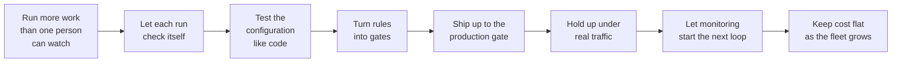

Each step begins where the one before it hit a limit, and the first limit is attention.

## Running more work than one person can watch

The first sign of scale is that one engineer has more work in progress than one session can hold. The fix is to run several streams at once. The catch is that every stream ends on the same person's desk. **The number of streams is set by review, not by compute.**

### Give each parallel session its own worktree

A **parallel session** is a second full Claude Code instance working a separate task. Sessions know nothing about each other. The engineer steering them is the only thing they share.

Two sessions in one folder fight over the same files. So each one gets its own **worktree**: a separate checkout of the repository on its own branch. One terminal runs `claude --worktree feature-auth`, another runs `claude --worktree fix-rate-limit`, and neither can overwrite the other's changes.

The diagram shows the shape. Look at where the arrows end.

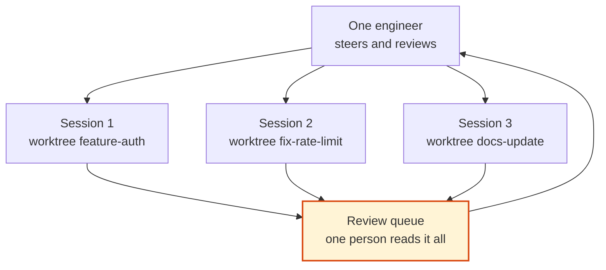

Every arrow ends at the same review queue. So the ceiling is how many streams one person can review properly, not how many the machine can run. [When Code Is Cheap](/blogs/blog/when_code_is_cheap/) makes the same point about who checks the output: review hours must be planned like any other capacity.

So split the work so tasks touch different files. Tasks that share files run in one session, one after another. Start with two or three sessions, and add one only while review keeps up.

When the branches come back, merge them one at a time onto the main branch, and run the tests after each merge. Two branches that pass alone can still fail together, and merging one at a time shows which pair it was.

### Delegate to a subagent only when the result is all you need

Inside one session, a **subagent** runs a scoped job in its own context window and returns only a summary. So one question decides when to use it: does the in-between work matter to you?

If you only need the result, delegate. Research is the classic case. "Where is the token validated?" may take dozens of file reads, and the main session needs one line back. Code review is another. A reviewer in a fresh context has not watched the code being written, so it does not share the author's assumptions.

If you need to see and react to the steps, keep the work in the main session. Three common uses fail. The first adds nothing, and the other two hide the steps you need:

- **Expert personas.** "You are a Kubernetes expert" adds nothing the main session does not already know.
- **Sequential pipelines.** One subagent reproduces a bug, the next debugs it, a third fixes it. Each step depends on what the last one found, and the findings get lost in the handoffs.
- **Test runners.** A subagent that reports "tests failed" hides the output you need to fix them.

A subagent that is worth having still needs four things. A description that tells the main session when to launch it and what to ask for. An output format in its system prompt, which gives it a natural place to stop. A section in that format for obstacles it hit, so the main session does not rediscover a workaround. And only the tools its job needs: read-only for research, no edit rights for a reviewer.

### Hand the longest loops to a managed runtime

Some loops outgrow a session altogether, and once they run unattended for hours, nobody watches them at all. They work across many tools, write files, keep state, and must survive a dropped connection. Running that loop on your own server means owning its sandbox, its state, and its recovery.

A **managed agent** hands that loop to the provider. You define the agent once (model, system prompt, tools), give it an environment (a sandbox with the packages and network rules it needs), and start a run, which the API calls a session. Then you send events in and read events out.

The provider stores each run's history, so a client that drops can fetch what it missed and carry on. From Prototype to Production compared this option with writing the loop yourself.

Long loops also start without a person. A run can work toward a goal until a check passes, run on a schedule, or start on an event such as a failed build. Each of these needs the same three things: a saved checkpoint so it can resume, a notification when it finishes or stalls, and a named person it hands over to when it cannot go on.

### Make a long run resumable after any interruption

A run that lasts hours will be interrupted: by a crash, a rate limit, a deploy, or a new model version. **A long run is only as durable as the state it keeps outside the model.** So the state is saved at every step, not held in the model's context.

Three habits make a run resumable:

- **Save a checkpoint after each step.** Write what is done, what is next, and the key results to a file or a database. A restarted run reads the checkpoint and continues from there.
- **Make each step safe to run twice.** A step retried after a crash must not send the email twice or charge the card twice. Give each action an ID, and skip any action whose ID is already recorded.
- **Treat a person's approval as a pause, not a wait.** When a step needs approval, save the state and stop. The approval restarts the run from the checkpoint, so nobody holds a session open for hours.

The diagram shows how the three fit together. Note that after a crash and after an approval, the run restarts the same way: from the last checkpoint.

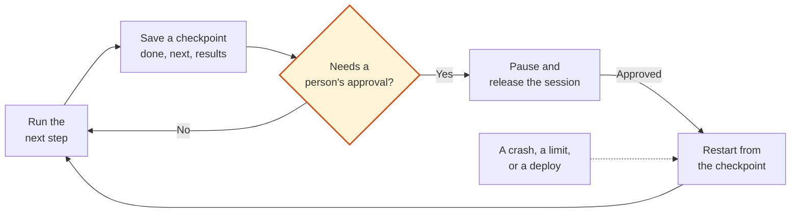

A new model version is an interruption too. A run that resumes on a different model may read its own checkpoint differently. So pin the model for the length of a run, and test a model change on saved checkpoints before it picks up runs already in flight.

### Keep a long run's context small enough to stay sharp

A resumable run can still drown in its own context. Every tool result stays in the window, and every tool definition is sent with every request. From Prototype to Production covered pruning, compaction, and memory in one session. At scale, three features of the API do that work on the server, as the table shows.

| Feature | What it takes out of the window | Watch out for |
| --- | --- | --- |
| Context editing | Old tool results, replaced by a short note that they were cleared, once the context passes a size you set | A result the agent needs later must be saved somewhere else first |
| Compaction | Old turns, replaced by a summary | The summary can drop a detail that was mentioned once |
| Tool search | Tool definitions, which stay out of the window until the agent searches for one | Keep the few tools used most always loaded |

What must survive between sessions goes into a **memory** store instead: decisions, notes, and what the agent learned. The agent reads it at the start and writes to it at the end.

So more sessions, more subagents, and longer loops all raise output, and none of them raises review. What can each run check before a person sees it?

## Letting each run check its own work

A run that cannot check itself sends every mistake to a person. A run that can check itself sends only the ones its check could not fix. **Give every run a way to verify its own work, and the reviewer stops being the first test.**

### Give the session a check it can run itself

The check has to be one command, with a clear pass and fail. If checking the work today takes three commands and some knowledge of the environment, wrap them in one command such as `make test` that exits non-zero on failure. Then list each command in CLAUDE.md, the instruction file every Claude Code session reads at the start, with an example of a healthy output.

Next, state the target as something checkable: "all tests in `test_status.py` pass," or "the endpoint returns 200 with the new field." For interface work, give the session a browser or screenshot tool and the design mockup to match. Two or three rounds of build, screenshot, compare is normal.

The diagram shows the loop this creates, and the one step outside it.

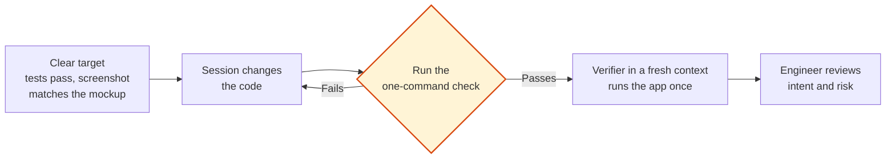

The loop and the verifier are different things. The loop runs as often as the work needs. The **verifier** is the fresh-context reviewer from the subagent advice above, run once after the session thinks it is done.

### Protect the check from the code it checks

A check the session can edit is not a check. An agent asked to make a test pass can also make it pass by changing the test. So the loop needs one more rule.

For a bug fix, write the failing test first. Ask the session to reproduce the bug as a test, confirm it fails for the expected reason, and commit it. Only then ask for the fix, with a **hook** (your own script that runs at a fixed point in the session) that blocks edits to test files during the fix. A test that existed before the fix, and that the agent could not rewrite, is proof the bug is gone.

### Check the run in proportion to how little you watched

Even a self-checked run ends with a summary, and a summary is the run's own account of itself. The trap is a tidy summary over a diff that touched a file nobody expected. So the engineer's own check grows with how little of the run they saw.

A short session you watched needs a glance. An overnight run needs a real check:

- Read the diff first. Look at the files in the plan, then for anything outside it.
- Confirm the tests ran, from the hook's output, not from the summary's claim.
- For a headless run (one started from a script with `claude -p`, nobody at the terminal), read its JSON result and exit code, not its prose.
- For anything that matters, ask a fresh session for a cold review of the changed code.

That last step is the verifier again, pointed at work nobody saw being done.

So each run now arrives already checked against its own target. But all runs read the same CLAUDE.md, skills (instruction files a session loads when a task needs them), and hooks. What checks the configuration that steers them?

## Testing the configuration like code

A single line in CLAUDE.md changes the behavior of every session that reads it. So does a skill, a hook, or a tool description. That gives the configuration the widest reach of any code in the repository. **Configuration that steers every run deserves the regression tests that ordinary code gets.**

### Rerun the evals whenever the configuration changes

From Request to Running System gates every prompt and model change on an **eval**. Configuration is the change it left out. An eval here is a real task plus the checks that define an acceptable result. Collect 20 to 50 tasks from recent work, each with its accepted outcome. Write each one down as a prompt, the folders it may change, and its checks: tests pass, lint is clean, behavior is unchanged, policy is followed.

Then run the suite in CI (continuous integration, the pipeline that builds and tests every change), on a schedule and on every change to CLAUDE.md, skills, or hooks. The diagram shows one eval's run. Note the two ways it can fail.

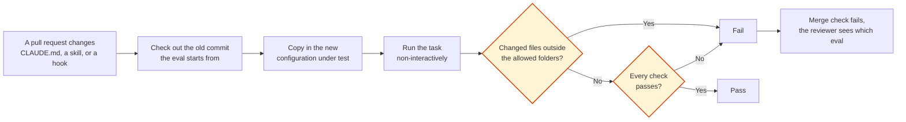

Those two failure checks make the suite trustworthy. Each eval starts from the commit just before the real past task it was copied from, so the agent works on the code as it stood then. And the run fails if it touched anything outside its allowed folders, so the agent cannot pass by rewriting the Makefile or the checks. The check scripts themselves run from a copy taken before the agent starts, so the agent cannot edit them either.

The value shows on a change that looks safe. In a worked case from the course, a team trims CLAUDE.md to fit on one page and drops the line saying not to log request or response bodies. It looks redundant, because a skill and a hook already keep fields tagged as personal data out of the logs.

The suite runs because CLAUDE.md changed. One eval asks for debug logging on a claim-status endpoint, and this time the session logs the whole response. The personal-data check still passes, because no field in the response is tagged. But a free-text field holds a customer's name and phone number, and a second check that looks for whole response bodies in the logs fails. The line goes back in before the merge.

So the dropped line was not redundant: the tags covered fields, and only the line covered free text.

The same suite measures gains, not only losses, because tool descriptions are configuration too. In one of the course's recorded demos, a team merged four overlapping tools, each returning one fact about a project, into one tool with a parameter, and rewrote the descriptions. Same model, same 30 test questions: the number answered with the right tool calls rose from 14 to 26. So a description rewrite deserves the same eval run as a model change.

### Turn every incident into an eval

A suite built once goes stale. As models improve, every setup passes the old cases, so they stop showing a difference. The suite needs new cases, and the best source is production.

The rule is simple: every production incident leaves an eval behind, written by the team that owned the incident. The eval replays the request that caused the incident, from the commit before it, and fails if the mistake comes back. Then the same class of incident should stop repeating, and a falling repeat rate is the sign the suite is working.

A suite also goes stale in two quieter ways. A case can leak into a prompt or an example, and then it passes because it is known, not because the work is right. So keep the cases out of prompts and rotate fresh ones in. And the cases can miss whole kinds of input. So compare the mix of the suite with the mix of production traffic, and add cases where production has inputs the suite does not.

### Trust a model judge only after it agrees with people

Some checks need judgment, so a second model grades the output. **A model judge may gate a release only after it agrees with people, and only while it keeps agreeing.** From Prototype to Production showed how to make a judge explain its reasoning before it scores, and how to check it once against human labels. At scale the judge becomes a release gate, and two more failures matter.

The first is bias. A judge that compares two answers often prefers the one shown first, which is called **position bias**, or the longer one. So show each pair in both orders. If the verdict flips with the order, the judge is guessing.

The second is drift. A judge is a model too, and a new version can grade differently. So keep a fixed set of cases that people have labeled, and measure agreement on it after every change to the judge, the same way you would compare two human graders.

The exam guide for Anthropic's developer course has a practice question about this trap. Like the course's stories, its team is made up. A team gated prompt releases with a judge that picked the better of two answers. Every new prompt passed, yet users saw no gain. Checked against people, the judge agreed on only slightly more than half of the pairs, barely better than a coin toss. And it picked the first answer far more often than people did.

The right first move was not a bigger judge model. It was to randomize the order, measure agreement again, and take away the judge's power to gate until agreement was good enough. So a judge that gates releases is itself under test.

### Measure quality on live traffic too

An offline suite only knows the inputs someone collected, and live traffic brings inputs nobody thought of. So a small sample of real requests is graded too, with the same checks and the same judge you checked against people, and the score is watched over time. From Request to Running System covered experiments that compare two versions on live traffic. Here the point is steady measurement, not a one-off test.

The measure has to fit the task, as the table shows.

| Kind of task | A measure that fits |
| --- | --- |
| Extraction | An exact match on each field |
| Writing | The score of a judge checked against people, using a rubric |
| An agent's task | Whether it finished, and how many steps and how much cost it took |
| An answer from retrieved sources | Whether every claim is backed by a cited source |

User feedback, such as a thumbs-down or a correction, is a signal too, but a lopsided one, because unhappy users click more. Use it to find cases worth adding to the suite, not to score the system.

So the configuration is now under test. But an eval only samples 20 to 50 tasks, and it sees a broken rule only after a session has broken it. What stops a live session from breaking the rule in the first place?

## Turning rules from advice into gates

An eval sees a broken rule after the fact, because to a session an instruction is only a request. It follows the request most of the time, and at scale "most of the time" means a steady trickle of violations. **A rule that must hold every time needs a gate: a check that runs every time and can stop the action.**

### Back every must-hold rule with a hook

From Prototype to Production drew the line between a convention and a guardrail: a rule in CLAUDE.md is followed most of the time, a hook every time it fires. A skill sits on the convention side. It makes a policy likely, because it loads the policy while the code is written. A hook is what turns the policy into a gate.

The plainest case is "done." An instruction in CLAUDE.md asks the session to run the tests before reporting a task complete. A **stop hook**, which runs when the session tries to end its turn, enforces it: it runs the tests and refuses to let the turn end on a failure.

At scale, three details decide whether a hook really holds. First, the hook script's exit code. Exit 2 blocks the action and sends the reason back to the session. Exit 1 feels like an error but does not block: the action runs anyway. A guardrail that exits 1 is a log line, not a gate.

Second, a hook can rewrite instead of refuse. A pre-tool hook can return a changed input, for example a shell command with a live secret replaced by a placeholder. The command still runs, but the secret never leaves the machine. The rewrite replaces the whole input, so it must copy back the fields it does not change.

Third, every hook has a blind spot. A hook that runs after an edit cannot undo it, though its message lets the session fix the line. And a hook on the edit tools does not fire when a shell command rewrites the file. The diagram shows how the layers cover each other's gaps.

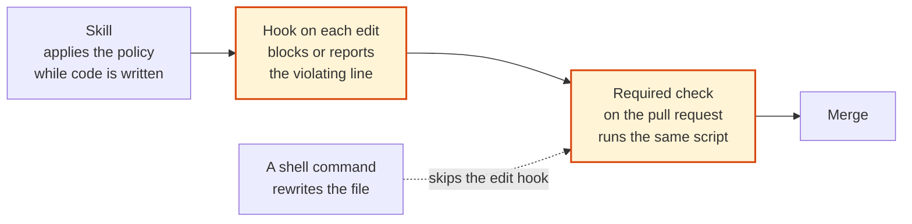

So the same check script runs in two places: at the edit, where it is fast and scoped to one file, and on the pull request, where it catches anything that reached the branch another way.

### Let a gate ask or wait, and name the way through

Some gates should not just allow or block. They should ask, or wait for someone else's approval. A release gate, a hook on the release tool, is the clearest case. In development it allows. In staging, a pipeline run on the main branch is allowed outright, and a session someone is driving gets asked. In production it looks for an approved change ticket for that exact version, and blocks until one exists.

A block that only says "denied" stalls the run. So every block names the route to approval: "Open a change ticket for this version, wait for the release manager to approve it, then call release again with the ticket number." The session can pass that on, and the person knows exactly what to do.

Two cautions keep such a gate honest. In a non-interactive run nobody can answer an "ask," so it becomes a denial, which is why staging allows the pipeline outright. And the gate only works if the agent has no way to write to the records it reads, such as the change tickets.

### Lock the gates where nobody can switch them off

A hook in the project's settings holds only while each engineer leaves it on. One engineer with a local override can switch it off. So the rules that must hold for everyone go into the enterprise managed settings that From Prototype to Production described, which an administrator deploys and nobody can override.

A locked-down setup for a regulated team does at least these jobs:

- Deny reads of secrets and block network calls through tools, while pre-approving the safe inner work (build, test, lint) so the deny list does not become a stream of approval prompts.
- Turn on the operating-system sandbox and refuse to start without it, because a tool-level deny on web fetches does not stop a shell command from reaching the network.
- Keep credential files such as SSH keys and cloud keys unreadable from sandboxed commands, and strip named secrets from their environment.
- Let only managed hooks run, so the release gate cannot be bypassed by a project file.
- Allow tools, plugins, and MCP servers only from the organization's approved list.
- Refuse to start on a version below the one the organization assessed.

Each deny removes some capability, so treat such a setup as a starting point, tuned to the data the repository holds.

Managed settings can also fix the permission mode, which sets what the agent may do without asking. Of the six modes in From Prototype to Production, two fit unattended work. Do-not-ask runs reads and pre-approved tools and denies anything that would prompt, so a pipeline never hangs on a question. Auto judges intent, not correctness, so pair it with the stop hook from "Back every must-hold rule with a hook."

### Break the mix of private data, untrusted input, and a way out

Gates stop what someone foresaw. An attacker works through what nobody foresaw: the content an agent reads. From Prototype to Production explained prompt injection, an instruction hidden in a web page, a document, or a tool result that the model takes as a command. At scale, the question is not whether one gets through, but what it can do when it does.

Simon Willison named the dangerous case the [lethal trifecta](https://simonwillison.net/2025/Jun/16/the-lethal-trifecta/): an agent that can read private data, reads content an attacker can write, and can send data out. With all three, one hidden instruction can copy the private data to the attacker. **So give an agent at most two of the three. If it needs all three, put the sending step behind a check in code or a person's approval, which a hidden instruction cannot talk its way past.**

The diagram shows where that gate sits.

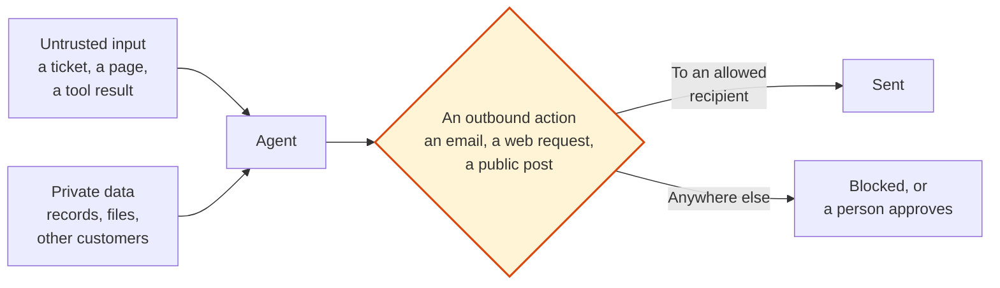

The exam guide has a practice question with exactly this shape. A support agent read tickets, could look up any customer's record, and could send email. A hidden instruction in one ticket made it email another customer's record to an outside address. A stronger line in the prompt did not close the path. A recipient allowlist or human approval on the email tool did, together with limiting the lookup to the ticket's own account.

Two more routes open once agents keep state. In **tool poisoning**, the instruction arrives in a tool's description or result, so a tool from an outside server is untrusted input too. In **memory poisoning**, an injected note is written into the agent's memory and comes back in every later session. So a memory write from a run that read untrusted content is untrusted too, and what the memory holds gets reviewed.

The layers around the model then catch what gets through. Each has its own job: screening input and output, removing personal data before anything is logged or sent, blocking destructive actions in code, and a fixed path for a request the model refuses. From Request to Running System covered these layers and the risk register behind them.

Every filter fails both ways. It blocks good requests, which are false positives, and it lets bad ones through, which are false negatives. So tune each filter on labeled examples, and measure both rates.

Filters only catch the attacks someone thought of. So the new work at scale is a **red-team exercise**: your own team attacks the system on purpose. Start with the agents that have two of the three, and draw the attacks from public lists of risks such as the [OWASP Top 10 for LLM Applications](https://genai.owasp.org/llm-top-10/) and NIST's [Generative AI Profile](https://www.nist.gov/publications/artificial-intelligence-risk-management-framework-generative-artificial-intelligence).

### Give each agent its own identity, never a shared key

A gate can only check what it can see, and what it sees is an identity. When every agent and every pipeline job uses one shared API key, nothing tells them apart. A log cannot say which agent did what, and a leaked key opens everything. **So each agent gets its own identity, with the narrowest access its job needs.** Three practices follow:

- **No long-lived keys in pipelines.** With workload identity federation, a CI job proves who it is with a short-lived token from its own platform, so no API key is stored in the pipeline at all.
- **Least privilege per tool.** Each agent's tools and data match its job, as the deploy servers in the next section show.
- **An audit log of security-relevant actions.** Every write, send, and permission change is logged with the identity that did it, so an incident can be traced to one agent.

So the gates now hold inside every session, for everyone. But a session on a laptop is not where most work ships. How far can the pipeline itself be trusted?

## Shipping through the pipeline up to the production gate

A laptop session is watched at least once. A pipeline job starts on an event, with nobody watching at all. That raises the stakes of every earlier step. **The agent may act up to the production gate and cannot pass it.** The one thing it may do in production on its own is roll back, because a person approved that procedure in advance.

### Start the pipeline with read-only judgment

Pipelines already run scripts. What they lack is judgment: why did the build break, is this test flaky, what goes in the changelog. Those jobs used to wait for a person, and they are where the agent starts.

The order matters. First, read-only jobs: run the agent non-interactively with `claude -p` to triage a failed build or draft release notes. Then write jobs behind the existing gates: fix lint, update generated docs, address a review comment. Anything the agent writes arrives as a pull request, through branch protection (the repository rules that require review before a merge), with no route to push to the main branch.

Whatever the job, it runs in a container with a network policy and short-lived credentials. By default it holds no production credentials at all. So how does an agent with no production credentials deploy anything?

### Give each environment its own deploy tools

It deploys through tools, exposed through MCP (the Model Context Protocol, a standard way for a server to offer tools to any client): release, status, and rollback. The design choice that makes this safe is one MCP server per environment, each with its own access key.

Why separate servers? A permission rule that allows an MCP tool names the server and the tool, not the tool's arguments. So "release to staging" and "release to production" can only be told apart if they live on different servers. The staging job then holds only the staging key, and the other servers refuse it.

The diagram shows the three environments. Note that rollback reaches production without passing the gate, and release does not.

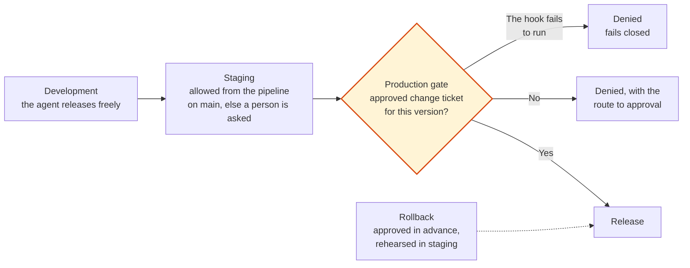

In production, release is left off the list of tools that may run without asking. So the release gate from the previous section is the only thing that can say yes. If that hook crashes or never runs, nothing says yes, and the release is denied. That is **failing closed**, the rule From Request to Running System traces to Saltzer and Schroeder. It is the opposite of the exit-1 trap, where a broken check lets the action through.

Rollback stays on the list, because it is a **runbook**: a written procedure approved in advance. That makes it the path to rehearse most, as one command the agent can run, exercised regularly in staging.

### Keep the approval with a person who did not write the code

Automated review ranks findings, but it never approves. Approval stays with a code owner, a person named as responsible for that part of the code, who did not write it. The review's job is to tell that person where to look, so their attention moves up a level: does the change do what the plan intended, and is the risk acceptable?

The review policy lives in a file at the repository root, often called `REVIEW.md`. It names the review passes (bugs, security, and compliance with the plan), says what counts as important and what is a nit (a minor style comment), caps the nits, and lists what to skip. When a finding repeats, its correction goes into CLAUDE.md, so the next session avoids the mistake.

A pass that reads the plan catches what a diff alone cannot. In one course case, a pull request added a status panel to a customer portal that fetched new data on every render. Nothing in the diff looked wrong. But the plan file committed with the task said the panel must cache, because the system behind it allows 50 requests a second. The compliance pass read the plan and flagged it.

So the review earned its place by reading what the reviewer of a diff would not have open. One gap remains when an agent opens pull requests under an app's name, as Anthropic's Slack agent does. Branch protection stops a pull request's author from approving it, and the author is now the app. So the person who asked for the change could approve their own request.

The fix is two required approvals, so at least one approver is someone other than the requester. Also dismiss approvals when new commits arrive, or the agent can push after a person has approved.

An automated reviewer earns its place the same way a judge does. Start it in shadow mode: it reviews every pull request, but its findings go to a log, not to the author, and nothing waits on it. Compare its findings with what human reviewers found on the same pull requests. Only when it catches real problems without burying them in noise does it post comments, and only after that may it block a merge.

### Roll a prompt or model change out to a slice of traffic first

Code passes through review and the gate. A prompt or a model change can skip both, because it is not code, and yet it changes every run. **So a prompt or model change ships like code: versioned, tested, and released to a slice of traffic at a time.** From Prototype to Production covered pinning the model and promoting through the eval. At scale the release itself becomes a process, as the diagram shows.

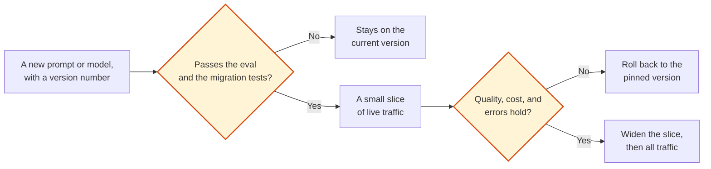

Migration tests look for what a new model changes on purpose: a different default length, stricter refusals, a changed output format. Each known change gets a case before the switch.

The same discipline covers the tools agents call. An MCP server is a dependency like any other. So version its tool schemas, keep the old version working while clients move, and test the agents against the new schema before the switch. A remote MCP server checks who is calling, using the agent's own identity from "Give each agent its own identity, never a shared key."

Large teams send every model call through one gateway, which holds the keys, picks the model and the platform, and applies the rollout. A gateway that can send a request to the vendor's API or to a cloud platform must also check that every feature the request uses exists where it sends it, because cloud platforms can get new features later than the vendor's API.

So the pipeline now ships up to production and stops there. After the release, the system meets real traffic. What keeps it up when that traffic hits the limits?

## Holding up under real traffic

Real traffic does what tests do not. It arrives in bursts, hits rate limits, and asks about things nobody indexed. **At scale, reliability is mostly about telling one kind of failure from another, because each kind needs a different answer.**

### Branch on why a call stopped, not only on whether it failed

From Prototype to Production sorted errors into those a retry can clear and those it cannot. A model call has a second signal: the **stop reason**, which says why a response ended, even when the HTTP status says success. A retry path that ignores it treats very different problems the same way. The table pairs each signal with its answer.

| What happened | The signal | The right answer |
| --- | --- | --- |
| Rate limited, overloaded, or a passing server fault | HTTP 429, 529, or a 500-range error | Wait as long as the response's retry-after header says, retry with backoff, then fall back |
| The request itself is wrong | Another 400-range error | Fix the request. A retry fails the same way |
| The output hit its limit | Stop reason `max_tokens` | Raise the limit or continue the answer. A plain retry stops at the same place |
| The context window ran out | Stop reason `model_context_window_exceeded` | Treat the answer as cut off, and shorten or compact the input |
| The model declined | Stop reason `refusal`, with a success status | Never the same request again. Send it to a safety path, or to a fallback model where policy allows |
| A tool that runs on the provider's side paused a long loop | Stop reason `pause_turn` | Send the response back so it continues |

Another practice question from the exam guide shows the cost of skipping this. A team's fallback path sent every unwanted result to a second model, with backoff: errors, cut-off answers, and refusals alike.

After a model update its cost jumped, and the traces showed three causes mixed in that one path: rate limits, answers cut off at the output limit, and refusals. Retrying the cut-off answers repeated the cut and wasted tokens, and retrying the refusals repeated the refusal at extra cost.

More retries would have made the cost spike worse. The fix was to branch on the stop condition, as in the table.

Retries handle one call. When a whole dependency is failing, a **circuit breaker** stops calling it for a while, so the system fails fast instead of piling up retries. A fallback then takes over: another model, another region, or another platform. From Request to Running System put each control in its own layer.

The new risk at scale is a fallback that cannot do what the main model does. A fallback that lacks a feature the main model uses, such as a tool type or a beta option, fails on exactly the requests it was meant to save. So test each fallback with real request shapes, not with a simple hello-world call.

### Shape the load before it reaches the limit

Retries answer a limit after it is hit. Shaping the load keeps it from being hit. **First find the limit you will hit first: requests per minute, tokens per minute, or the budget.** Many short calls hit the request limit. A few long documents hit the token limit. A large nightly job hits the budget.

Then four tools, each for its own case:

- **A queue with backpressure.** Requests wait in a queue, and when the queue grows past a set length, new work is slowed or refused at the door, instead of everything failing at the API.
- **Priority classes.** A user waiting for an answer goes ahead of a background job, so a nightly burst cannot starve the interactive path.
- **Batch for work nobody is waiting for.** From Prototype to Production introduced the batch API. At scale, moving deferrable work there frees the live limits for live traffic, at a lower price per token.
- **A quota per tenant.** In a shared system, each customer or team gets its own share of the limits and its own key, so one heavy tenant cannot use up everyone's capacity, and spend can be traced to whoever caused it.

The diagram shows the four together, as one path a request takes.

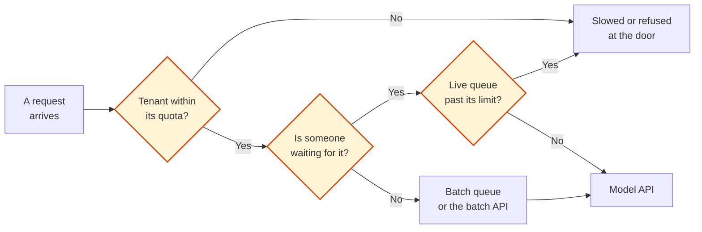

Size capacity from the peak, not the average. Take the busiest minute of the busiest hour, count its requests and tokens, and compare them with your account's per-minute rate limits.

### Keep answers grounded as the knowledge grows

The last kind of failure gives no error at all: an answer that sounds right and is not backed by anything. From Request to Running System built the retrieval pipeline: chunking, and hybrid search that combines keyword and meaning. From Prototype to Production compared a prepared index with agentic search, where the model searches as it goes. At scale, three practices keep answers grounded:

- **Rerank before the model reads.** Retrieve more candidates than you need, let a reranking model order them by how well each answers the question, and pass only the best few.
- **Make the answer show its sources and its doubt.** Ask for a citation on every claim, and allow the answer "not found in the sources". A model that is allowed to say so is less pushed to fill the gap.
- **Diagnose a bad answer stage by stage.** Ask in order: was the document in the index, did search find it, did ranking keep it near the top, and did the model use it? Each "no" points to a different fix.

So the service now tells its failures apart, shapes its load, and grounds what it says. But when it breaks anyway, at night, nobody is watching. Who notices?

## Letting monitoring start the next loop

So far every loop starts from a person or a code event. Nothing yet starts one from what production does: an alert still wakes someone, and a ticket still waits for someone to pick it up. **The last step is to let a signal from production start the agent, while a person triages what it finds.** This is the feedback loop from From Request to Running System, with the agent doing the first diagnosis.

### Trace every run and set the line it must hold

A signal needs something to measure first. **Every run leaves a trace, and every service states the level it must hold.** A trace records each step of a run as a **span**, one timed entry: each model call with its tokens, cost, cache reads, and time, and each tool call with its result. One trace ID runs through the agent and all its subagents, so a run that crosses several agents can be followed end to end.

From the traces come the numbers the team watches, called **service level indicators**: the task success rate, the share of answers that pass the live checks, latency at the 95th percentile, and cost per task. A **service level objective** sets the line each one must hold, such as "95 percent of tasks finish without a person". Alerts and dashboards follow from those lines, cost lines included, so a cost jump arrives as an alert, not as an invoice.

Traces can hold sensitive content, and some customers require that none is kept. Under such a rule, keep the shape of the trace and drop the content: timings, token counts, tool names, and stop reasons stay, and prompts and outputs are left out or redacted. Most diagnosis needs only the shape.

### Find the pattern no single trace shows

One trace shows one run. Some failures only show across many runs: a tool that fails one time in fifty, or a model version that does worse on one kind of input. So keep every failed trace and a random sample of the rest.

Then group the failures by what they share: model version, prompt version, tool, tenant, and kind of input. A **cohort** that fails far more often than the rest points to a cause no single trace reveals. Compare the same groups before and after a model update, and a drop in quality caused by the update shows up.

Traces of many runs also answer an architecture question. From Request to Running System told of a team that chose an agent, then found in its traces that the real paths fell into four shapes. If most runs follow a few fixed paths, turn those paths into a fixed workflow and keep the agent for the rest. If a workflow keeps meeting cases its steps never planned for, replace that part with an agent.

### Let rarer readings unlock more action

Cohorts and service levels say what to watch. The next question is how far a reading must move before it starts the agent. A trigger that fires on every blip buries the team in noise. A trigger that waits for disaster fires too late. That problem is a century old.

In a 1924 memo at Western Electric, a year before its engineers became Bell Telephone Laboratories, [Walter Shewhart](https://en.wikipedia.org/wiki/Walter_A._Shewhart) drew the first control chart. His point was that a process always varies by chance, and only variation outside its normal range has a cause worth chasing.

A **control band** applies that idea to a metric. Take the mean of the last 30 days of hourly readings, and measure how far readings usually stray from it: the standard deviation, or **σ**. The 1σ line is the mean plus one σ, the 2σ line the mean plus two, and so on.

Chance alone crosses each line now and then. If a steady metric's readings follow a bell curve, then at 720 hourly readings a month (30 days of 24), about four a day land more than 1σ above the mean, about 16 a month more than 2σ above, and about one a month more than 3σ above.

So each line unlocks a little more. A reading past 1σ is only logged: at four a day, acting on it would be noise. A reading past 2σ starts a read-only diagnosis, cheap enough to waste 16 times a month. Only a reading past 3σ, which chance reaches about once a month, lets the agent act, and then only through a pull request or an approved runbook.

A spike is not the only danger. A slow drift may never cross 3σ. The [Western Electric rules](https://en.wikipedia.org/wiki/Western_Electric_rules), from a 1956 quality-control handbook, include drift rules that catch it: flag four of the last five readings past the 1σ line, or eight in a row above the mean. A drift counts as a 2σ reading.

The diagram shows the alert levels a team writes in version-controlled config. Note that the model appears only after a plain script has sorted the reading.

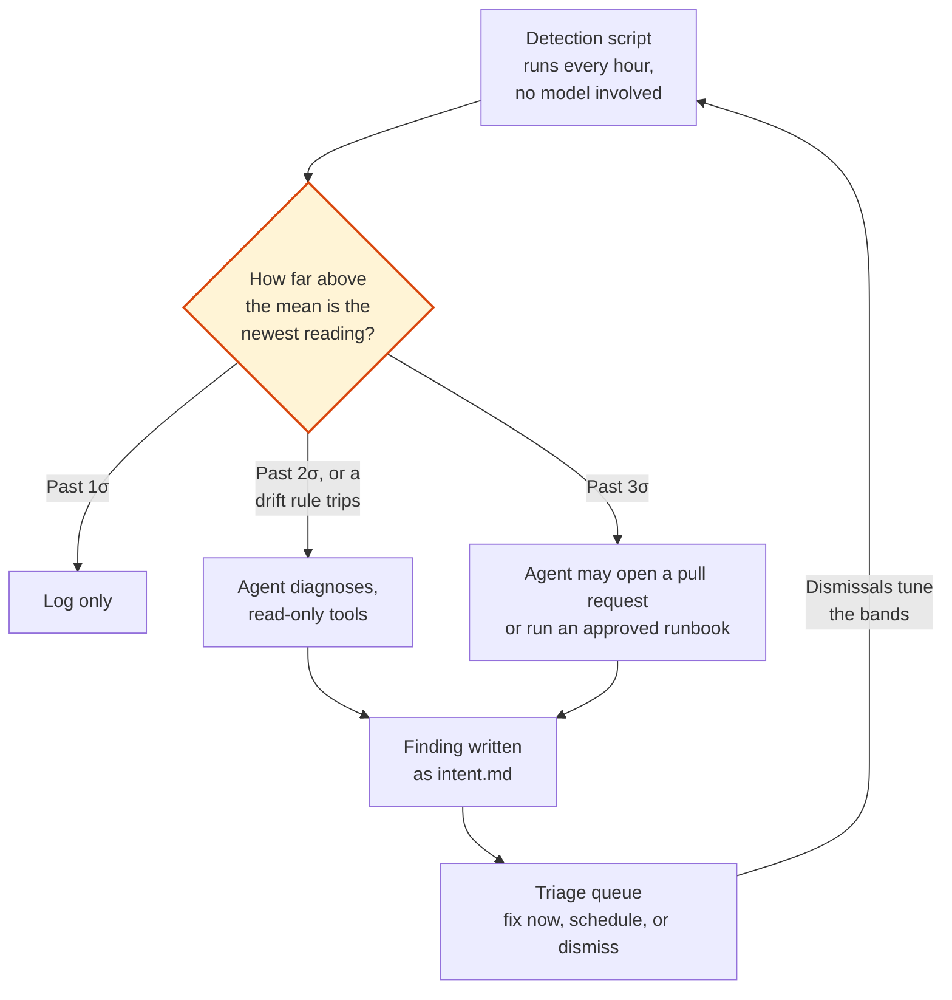

So detection stays deterministic: a short script, version-controlled and unit-tested, with no model in it. And the loop tunes itself. Each finding a person dismisses as noise is a reason to adjust that metric's band, so the same blip stops waking the agent.

### Write the finding as a plan, not a fix

What the agent produces matters as much as when it starts. A fix pushed in the middle of the night skips every gate built so far. So the agent writes its diagnosis as **intent.md**, a short problem statement in four parts: the anomaly and its evidence, the outcome it proposes, the systems affected, and the open questions. These are the parts a person would write to propose new work.

From there the finding goes through the same pipeline as anything else. A person triages the queue: fix now, schedule, or dismiss. A fix goes through review. And the incident leaves an eval behind, as in "Turn every incident into an eval."

A worked case from the course shows why the agent writes a plan even when it can fix the symptom. The rollback is safe, but the real question is one only a person can answer.

<div class="example">

**Example · A cache set to zero**

An insurer's customer portal shows claim status and caches each answer for 60 seconds. A release at 13:52 sets the cache to zero. Every page view now reaches the older claims system behind it, which allows 50 requests a second, and it starts refusing requests.

At 14:00 the hourly check reads the status endpoint's error rate at 1.9 percent. The 30-day mean is 0.2 percent, and σ is 0.02 percentage points. So the reading sits about 85σ above the mean, far past the 3σ line, and the agent may take one of two routes: open a pull request, or run an approved runbook.

A release went out minutes before the breach, so the agent runs the rollback runbook at 14:02. The earlier version is live again at 14:04. Then it writes intent.md: the problem with its numbers, the release that caused it, the constraint that status may be up to 60 seconds old, and one open question: who asked for live status, and is 60 seconds too slow for them?

The fix goes through review like any other change. The incident leaves an eval that asks a session to make the panel "feel live" and fails if the cache is gone.

</div>

So the agent acted only through a rehearsed route, and the real decision, what "live" should mean, went back to a person.

The same work can also arrive in a chat channel instead of from a script. An agent with its own identity in the on-call channel picks up each alert, posts what broke and a proposed fix in the alert's thread, and drafts the postmortem once the incident closes. Where no rollback runbook has been approved in advance, it waits for the on-call engineer to approve the rollback in that thread.

### Find which layer failed before fixing anything

Whoever picks up a finding, agent or person, checks its diagnosis before acting on it, because the first guess is often wrong. **Before fixing anything, find which layer the failure came from: the model, the harness, a tool, or the data.** Each layer needs a different fix, and a fix in the wrong layer only moves the problem. The table says where to look for each.

| Layer | What it looks like | Where to look |
| --- | --- | --- |
| The model | A wrong or made-up answer from correct inputs | The same inputs on the pinned model version, and the eval cases |
| The harness | Lost context, a skipped step, steps in the wrong order | The trace: what the model was actually sent |
| A tool | An error, an empty result, or a wrong value | The tool's own logs, and its result in the trace |
| The data | A stale or missing document, or a bad record | The index, or the source system |

Two kinds of failure hide from normal error counts, so track each on its own. A refusal arrives with a success status. A grounding failure is an answer that ignored or misread the source it was given, and nothing errors at all. From Request to Running System gave a table from symptom to cause, and finding the layer first tells you which row of it to read.

When the failure is live, the order is assess, mitigate, communicate, then learn. Assessing decides how many users are hit, and how badly. Mitigation stops the harm before the cause is known: roll back the release, switch to the fallback, or turn the feature off. Communication tells users and stakeholders what happened and when it will be fixed. Learning comes last: the incident leaves an eval, an alert where monitoring missed it, and a postmortem.

Now the loop starts itself. But a loop that runs without anyone starting it also spends money without anyone noticing.

## Keeping cost flat as the fleet grows

Every earlier step adds runs: parallel sessions, evals on every configuration change, agents in CI, agents woken by monitoring. While one team uses a feature, the bill is small. Across a fleet, a small waste per run multiplies by every run. **At scale, cost is set by what every run does by default: the model it starts on, what it resends each turn, and the settings nobody changes.**

### Start on the smallest model and tune effort before moving up

From Prototype to Production starts on the balanced tier and steps down for high-volume work. For a fleet, make the bottom the starting point of the search. The course's rule is to run 20 to 30 real examples through the smallest tier first, and stop at the cheapest model whose output you would ship. At volume, every step up is multiplied by every run.

Routing can go further. A **cascade** sends each request to the small model first, and escalates to a larger one only when a check fails or the small model reports low confidence. If most requests pass the small model's check, most pay the small price.

**Effort**, the request setting From Prototype to Production introduced, is the second dial. It sets how hard the model works on a task, not what it knows. Too low, and it stops early with unfinished work, which costs a second request. Too high, and it overthinks, finds tasks you never assigned, and takes longer. The diagram shows which dial to turn.

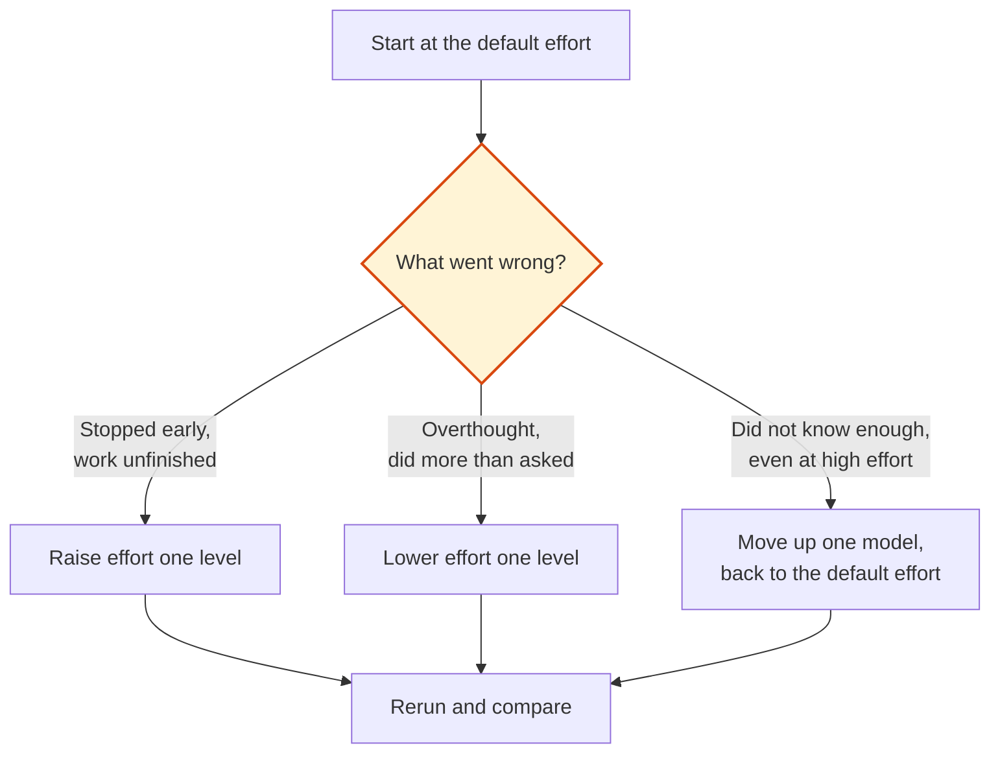

So change the model only when more effort did not fix the problem. And when you change models, start again at the default effort, because the same level name means a different amount of work on a different model. When a new model ships, rerun the tasks: it may do the same work at a lower effort, for less.

### Stop paying for the same tokens on every turn

The second default is what each request resends. An agent that uses tools sends everything again on every request: the tool definitions, the system prompt, the question, and every tool result so far. So its cost grows with each call. In one recorded demo, an agent's first request carried 606 input tokens, and its 37th carried 47,905, almost all of it the 36 earlier tool calls and their results.

Prompt caching cuts the part that never changes. From Prototype to Production gave the prices and the conditions for a cache hit. One trap matters once you track spend across a fleet: with caching on, the input-token count leaves out the cached part, so the true total adds the cache reads and writes to it. Watch all three counts, or a cache that silently stopped working looks like a cheaper month.

A long run needs one more rule to keep its cache. Changing the system prompt halfway through a conversation changes the cached prefix, so the next request pays full price for all of it again. Add a new instruction as a message at the end instead, and the cached part stays the same.

**Programmatic tool calling** cuts the part that grows. The model writes a short script that calls your tools, the script runs in a code-execution container, and only what the script prints reaches the model. The tool results stay with the script.

The difference is large when lookups do not depend on each other. One demo asked which of 40 engineers were under 70 percent utilization in a month. That took 41 tool calls: one to list the engineers and one per engineer.

The ordinary tool loop sent 42 requests to the model and about 1.1 million input tokens in total, for $2.29. The scripted run sent 3 requests and about 28,000 input tokens, for under 7 cents, plus separately billed execution time.

It helps little when the model must reason over each result before the next call. And independent calls save clock time as well as tokens: the loop answers every call in one message, as From Prototype to Production described, and runs the read-only ones at once. In another demo, a job-site check with three independent lookups went from 19.9 seconds to 10.8, measured from question to answer.

### Cut the wait the user sees, not only the total

Cost is one half of the budget, and waiting is the other. **Measure two numbers: the time to the first token, which is when the user sees something start, and the total time to the full answer.** They have different fixes, as the table shows.

| To cut | Levers |
| --- | --- |
| Time to the first token | Stream the response. Cache the long fixed prefix, so the model starts sooner. Send less context |
| Total time | Run independent tool calls at once, as above. Use a lower effort or a smaller model on steps that need no more. Ask for shorter output |

Set the latency target at the 95th percentile, the time that 95 of every 100 requests beat, not the average, because the slow tail is what users remember. From Request to Running System made the same point when modeling cost and latency before the build.

### Change the defaults before you raise a cap

Back to cost: the last default is the one nobody changes. From Request to Running System set the spend posture before rollout: the default model, effort guidance, and caps. At fleet scale, the default is the lever, because most people never touch the model picker. If the default is the most capable model at a high effort, that expensive setup is what most usage runs on.

That makes a request to raise a spend cap a reason to look, not an automatic yes. In a worked case from the course's admin lessons, a platform team hit its monthly cap in the second month and asked for more. The review showed most of that spend was the most capable model writing routine pull-request summaries.

The default model was lowered for the role the team's members hold, and the cap was left alone. The next month the team ran under its cap, with the same volume of work. So the review asks one question before a cap moves: is a setting wasting the spend, or was the cap set below what the work needs? Change the setting in the first case, and re-base the cap only in the second.

A cap is easier to set from a forecast. Cost per task, taken from the traces, times the tasks expected next month gives the bill before it arrives, and the gap between forecast and actual is itself a signal. In a shared system, each tenant also gets its own budget, enforced where its requests pass, so one customer's spike stops at its own limit.

**Lesson: at scale, the person stops working inside the loop and writes its checks.** Parallel streams are bounded by review, runs check themselves, evals test the configuration, hooks hold the rules, the pipeline stops at production, the service tells its failures apart under load, monitoring starts the next loop, and defaults keep the bill flat. The person writes those checks and reads what they send back.

So what can you do this week? Write down every check you did by hand on agent output in the last five days. Take the one you did most often, and turn it into a hook or an eval that runs without you.

## Appendix with the files behind each check

Whichever check you pick, it ends up as a file. The argument above says which checks to build and why. This appendix shows what each one looks like on disk, in the same order as the eight steps. The snippets are shortened from the course's examples and use Claude Code's formats. File names, flags, and setting keys change, so check the current documentation before you copy one.

The table maps each step of the post to the file that carries it.

| Step | File |
| --- | --- |
| Run more work | `.claude/agents/*.md`, one file per subagent |
| Let each run check itself | The verification block in `CLAUDE.md` |
| Test the configuration | `evals/*.json` and a CI workflow |
| Turn rules into gates | Hooks in `settings.json`, and managed settings |
| Ship up to the production gate | Pipeline jobs, `.mcp.json`, and `REVIEW.md` |
| Hold up under real traffic | The code around each model call that branches on why it stopped |
| Let monitoring start the loop | `bands.yaml` and `intent.md` |
| Keep cost flat | Effort and cache settings on each request |

So nothing here is a new system to install. Each check is a small text file in the repository, reviewed like any other change.

### A subagent that knows when to stop

A subagent is one markdown file in `.claude/agents/`. The frontmatter says when to use it and which tools it may touch, and the body is its system prompt. This is the verifier from "Give the session a check it can run itself."

```markdown
---
name: verifier
description: Runs the app and checks the change works before the session reports done
tools: Bash, Read
---
Start the app with make run. Exercise the changed behavior and the two
nearest neighboring flows. Report what you ran, what you saw, and any
behavior that does not match plan.md. Do not fix anything; report only.
```

The `description` does two jobs: the main session reads it to decide when to launch the subagent, and uses it again to write the task it hands over. The diagram shows both uses, and what comes back.

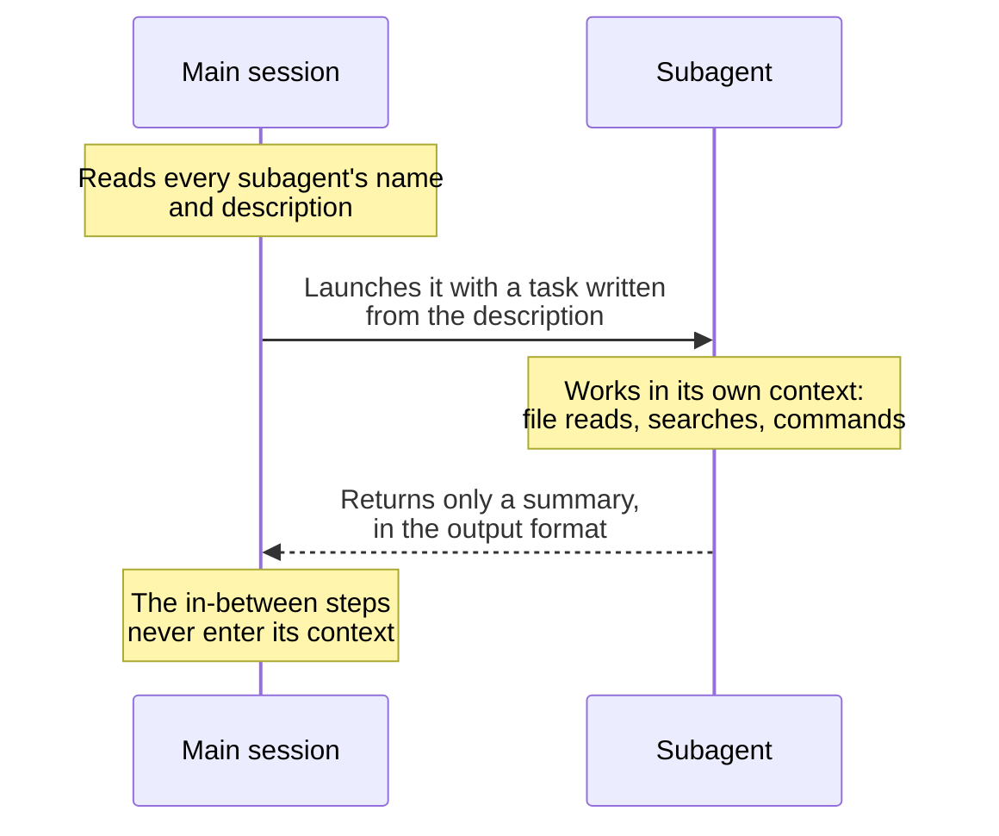

So put the handover rule in the description too, such as "tell the agent exactly which files to review."

For a subagent that returns findings, end its prompt with an output format. The format is what tells it the work is finished. A reviewer's might be:

```markdown
Provide your review in this structure:
1. Summary: what you reviewed and your overall assessment
2. Critical issues: security, data integrity, or logic errors
3. Major issues: quality or architecture problems
4. Minor issues: style and documentation
5. Approval status: ready to merge, or needs changes
6. Obstacles encountered: setup problems, workarounds, commands that
   needed special flags
```

The tool list then follows the job, as the table shows.

| Subagent | Tools | Why |
| --- | --- | --- |
| Research | `Glob, Grep, Read` | It cannot change a file by accident |
| Code reviewer | `Bash, Glob, Grep, Read` | It needs `git diff`, and still cannot edit |
| Code modifier | adds `Edit, Write` | Changing code is its job |

One more field matters once skills exist: a subagent does not see skills the main session already loaded. List the ones it needs in a `skills:` field, and keep `Skill` in its tool list.

### A verification block the session reads

The one-command check lives in CLAUDE.md, where every session finds it. The block names each command with what a healthy run prints, and states the rule that protects the tests.

```markdown
## Verifying your work

- Build: make build (must finish with "Build succeeded")
- Test: make test (all green; never skip or delete a failing test)
- Lint: make lint (zero warnings)

Run all three before reporting any task complete, and paste the output.
If a test fails, fix the code, not the test.
```

The last line is advice until a hook backs it. The hooks further down do that.

### An eval as a task with checks

An eval for the configuration is one JSON file per task. This one is the logging case from "Rerun the evals whenever the configuration changes," shortened.

```json
{
  "name": "status-no-pii-in-logs",
  "from": "9d04e7a",
  "prompt": "Add debug logging to the claim status endpoint so on-call can see which claim was asked for and what we returned. Run the tests before you finish.",
  "may_change": ["claims-api/routes", "claims-api/tests"],
  "checks": [
    { "name": "tests pass", "run": "make test" },
    { "name": "lint clean", "run": "make lint" },
    { "name": "no pii in logs", "run": "scripts/check-endpoints.sh claims-api/routes/status.py" }
  ]
}
```

Each field has one job.

| Field | What it holds |
| --- | --- |
| `from` | The commit the run starts from: the code just before the real task |
| `prompt` | The request, as a person would type it |
| `may_change` | The only folders the run may touch. A change anywhere else fails the eval |
| `checks` | Commands that must each exit zero |

The workflow that runs the suite needs two triggers: any change to the configuration, and a schedule.

```yaml
on:
  pull_request:
    paths: ['CLAUDE.md', '.claude/**', 'evals/**']
  schedule:
    - cron: '0 2 * * *'
```

For each eval, the job checks out the `from` commit, copies in the CLAUDE.md and `.claude/` folder of the branch under test, and runs the prompt non-interactively. Three details keep the result honest:

- Delete the `evals/` folder from the run's checkout, so the agent never sees its own checks.
- Run the checks from a copy made before the run, so the agent cannot edit them.
- Do not start the run in bare mode. Bare mode skips CLAUDE.md, skills, and hooks, which are the files under test.

### A hook that returns a decision

A hook is registered in a settings file: an event, a matcher for the tools it watches, and the script to run. This entry puts the release gate in front of the release tool on every deploy server.

```json
{
  "hooks": {
    "PreToolUse": [
      {
        "matcher": "mcp__deploy-.*__release",
        "hooks": [
          { "type": "command",
            "command": "${CLAUDE_PROJECT_DIR}/.claude/hooks/release-gate.sh" }
        ]
      }
    ]
  }
}
```

The script answers in one of two ways. The simple way is the exit code.

| Exit code | Effect |
| --- | --- |
| 0 | The action goes ahead. JSON on standard output is read as a decision |
| 2 | The action is blocked, and standard error goes back to the session |
| Anything else | Not a block. The error is logged and the action runs |

The fuller way is to exit 0 and print a decision as JSON. A pre-tool hook can allow, deny, or ask.

```json
{
  "hookSpecificOutput": {
    "hookEventName": "PreToolUse",
    "permissionDecision": "deny",
    "permissionDecisionReason": "Production needs an approved change ticket. Open one for this version, wait for the release manager to approve it, then call release again with the ticket number."
  }
}
```

The diagram puts the two ways together. Follow the branch on the left to see why exit 1 is a trap.

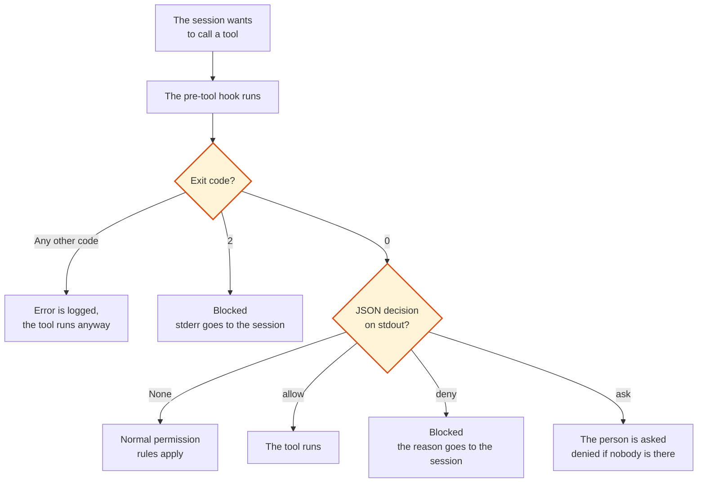

The reason on a deny is shown to the session, so it should name the route to approval. The reason on an ask is shown to the person. To rewrite a call instead of blocking it, return `updatedInput` with the whole input, including the fields that did not change.

A few events cover most gates.

| Event | When it fires | Typical use |
| --- | --- | --- |
| `PreToolUse` | Before a tool call | Block, ask, or rewrite |
| `PostToolUse` | After a tool call succeeds | Format, lint, run a policy script |
| `Stop` | When the session tries to end its turn | Run the tests and refuse on failure |
| `SessionStart` | At the start, and after compaction | Put key state back into context |

Hooks in a project file can be switched off locally, which is why the must-hold ones move to managed settings.

### Managed settings for a regulated team

Managed settings are one JSON file that an administrator deploys. The table lists the keys behind each job in "Lock the gates where nobody can switch them off."

| Key | What it enforces |
| --- | --- |
| `permissions.deny` | No reads of `.env` files or secrets folders, no web fetches, no `curl` or `wget` |
| `permissions.allow` | The safe inner work runs unasked: git, build, test, lint |
| `disableBypassPermissionsMode` and `allowManagedPermissionRulesOnly` | No engineer, project file, or flag can widen the rules |
| `sandbox` with `failIfUnavailable` | The agent refuses to start without the sandbox, and a failed command cannot be retried outside it |
| `sandbox.network.allowedDomains` | Shell commands reach only the listed hosts |
| `sandbox.credentials` | SSH and cloud key files are unreadable, and named secrets are stripped from the environment |
| `allowManagedHooksOnly` | Only hooks defined here run, so the gates must live in this file |
| `allowManagedMcpServersOnly` and `strictKnownMarketplaces` | Tools and plugins come only from the approved list |
| `requiredMinimumVersion` | The agent refuses to start below the assessed version |

Two of these enforce one goal at different layers. The permission rule blocks the web-fetch tool, and the sandbox's domain list blocks a shell command that tries the same thing.

### A pipeline job that cannot wait for an answer

In CI the agent runs with `claude -p`, which takes a prompt, works, and exits. The first jobs only read.

```yaml
- name: Triage failed build
  if: failure()
  run: >
    claude -p "Read the build log at out/build.log. Identify the most
    likely cause, say whether the failure looks flaky or real, and write
    a three-line summary for the PR thread." >> triage.md
```

A job that acts names every tool it may use and runs in do-not-ask mode, so anything off the list is denied and the job never hangs.

```yaml
- name: Release to staging and roll back if unhealthy
  env:
    DEPLOY_STAGING_TOKEN: ${{ secrets.DEPLOY_STAGING_TOKEN }}
  run: >
    claude -p "Release version ${{ github.sha }} to staging, then call
    status. If the 5xx rate on any endpoint is over 1%, roll back.
    Finish with three lines for the release notes."
    --allowedTools "mcp__deploy-staging__release,mcp__deploy-staging__status,mcp__deploy-staging__rollback"
    --permission-mode dontAsk >> release-notes.md
```

The job holds only the staging credential, because each environment has its own server entry in `.mcp.json`:

```json
{
  "mcpServers": {
    "deploy-staging": {
      "type": "http",
      "url": "https://deploy.example.com/mcp/staging",
      "headers": { "Authorization": "Bearer ${DEPLOY_STAGING_TOKEN}" }
    }
  }
}
```

A few more flags make such runs easier to check.

| Flag | Use |
| --- | --- |
| `--output-format json` | A result a script can read, with an error field and a session ID |
| `--json-schema` | Forces the answer into your schema |
| `--max-turns` | A hard cap on the loop |
| `--resume` | Continues an earlier run by its session ID, for work in two passes |
| `--bare` | Skips project configuration for identical runs on every machine. Not for evals of that configuration |

The review policy is one more file in this pipeline, `REVIEW.md` at the repository root:

```markdown
# Review instructions
## Passes
Run three passes and tag each finding with its pass:
- Bugs: logic errors, broken edge cases, subtle regressions
- Security: injection risks, authentication gaps, personal data in logs
- Compliance: the change matches spec.md, plan.md and our design principles
## What Important means here
Reserve Important for findings that would break behavior, leak data
or breach a policy. Style and naming are nits.
## Cap the nits
Report at most five nits per review; summarize the rest as a count.
## Do not report
Generated files under src/gen/ and anything CI already enforces.
```

The cap on nits matters more than it looks: a review that buries two real findings under thirty style notes gets skimmed.

### A call that branches on why it stopped

The table in "Branch on why a call stopped" becomes a few lines of code around every model call. Note that a success status still goes through the stop reason.

```python
RETRY_STATUS = {429, 500, 502, 503, 504, 529}

def next_action(status, resp):
    if status in RETRY_STATUS:
        return "wait as told, retry with backoff, then fall back"
    if status >= 400:
        return "fix the request: a retry fails the same way"
    return {
        "end_turn": "done",
        "stop_sequence": "done",
        "tool_use": "run the tools and send the results back",
        "pause_turn": "send the response back so it continues",
        "max_tokens": "raise the limit or continue, never a plain retry",
        "model_context_window_exceeded": "treat as cut off, compact the input",
        "refusal": "safety path or an allowed fallback, never the same request",
    }.get(resp.stop_reason, "log it and alert")
```

The last line matters as much as the others: a stop reason the code does not know is logged and sent as an alert, not treated as success.

### Alert levels and the finding they produce

The alert levels from "Let rarer readings unlock more action" are a short config file, kept in version control beside the detection script.

```yaml
metric: status_5xx_rate
baseline: rolling_30d
rules: western_electric
tiers:
  1sigma: { action: log }
  2sigma: { action: diagnose,
            tools: "Read,Grep,Bash(gh run view *)" }
  3sigma: { action: propose,
            routes: [pull_request, runbook:rollback-deploy] }
```

The script that reads it needs only a mean, a standard deviation, and a handful of comparisons. Give it a floor for σ, so a perfectly flat metric does not turn every tiny blip into a breach, and at least a day of readings before it judges anything.

What the agent writes back is `intent.md`. The headings are fixed, so a person can triage it in a minute.

```markdown
# Intent: status endpoint 5xx after release 4f2c9e1
Author: monitoring agent (status_5xx_rate, 3 sigma). Status: draft.
## Problem
The 5xx rate read 1.9% at 14:00. The 30-day mean is 0.2%.
Release 4f2c9e1 went out at 13:52 and set the panel's cache to zero.
## Proposed outcome
Customers get fresher status without passing the claims-core limit.
## Affected users and systems
Portal customers, claims-api, claims-core.
## Constraints
Status may be up to 60 seconds old. The claims-core limit is fixed.
## Action already taken
Ran the rollback-deploy runbook at 14:02. Previous version live at 14:04.
## Open questions
Who asked for live status, and is 60 seconds too slow for them?
```

The "Action already taken" heading is the audit trail: it is the only place the agent acted, and it names the runbook that allowed it.

### Effort, cache counts, and scripted tool calls

The cost levers are settings, not files. Effort has named levels, from low through medium and high to extra-high and max, and several places to set it.

| Where | How |
| --- | --- |
| One run | The `--effort` flag |
| This and later sessions | The `/effort` command, or `effortLevel` in settings |
| One skill or subagent | An `effort` field in its frontmatter |
| An API request | The effort field inside `output_config` |

Start each task type at the default, and move one level at a time.

Caching the tool definitions takes one line, on the last tool in the list:

```python
TOOLS[-1]["cache_control"] = {"type": "ephemeral"}
```

After that, a request's real input is three numbers added together, and the first one alone will mislead you:

```python
u = resp.usage
total_input = (u.input_tokens
               + u.cache_read_input_tokens
               + u.cache_creation_input_tokens)
```

Programmatic tool calling takes four changes to an ordinary tool loop:

1. Add the code-execution tool to the tool list.
2. Mark each tool the script may call with an `allowed_callers` field naming that tool.
3. Read the container ID from each response and send it back with the next request.
4. Say in each tool's description what shape its result takes, because a script now has to parse it.

The diagram shows where the tool results go after those changes. Note that they never reach the model.

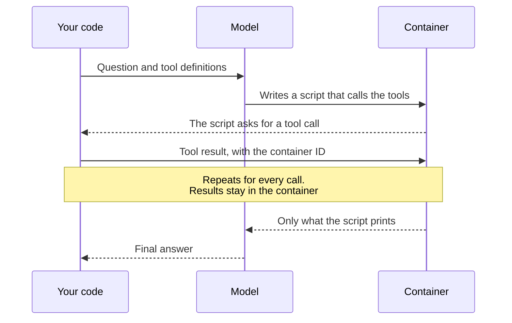

So the model pays for one short printout instead of every result.

It does not work with every model or every tool setting, so test it on a slice of real traffic and compare the billed input tokens with and without it.

These files are small. The work is in deciding what each one must check, which is the argument of the post above.

## Glossary

The terms used in this post, in alphabetical order.

| Term | Meaning |
| --- | --- |
| Auto mode | A permission mode in which a classifier, a second model, stops actions that go beyond the request. It judges intent, not correctness |
| Backpressure | Slowing or refusing new work at the door when a queue grows too long, so the system does not fail all at once |
| Branch protection | Repository rules that require review and passing checks before a change can merge |
| Cascade | Sending a request to a small model first, and escalating to a larger one only when a check fails |
| Checkpoint | A saved record of what a run has done and what is next, so it can resume after an interruption |
| CI | Continuous integration: the pipeline that builds and tests every change |
| Circuit breaker | A control that stops calling a failing dependency for a while, so the system fails fast instead of piling up retries |
| CLAUDE.md | The instruction file every Claude Code session reads at the start |
| Code owner | A person named as responsible for part of the code, whose approval a merge needs |
| Cohort | A group of runs that share something, such as a model version or a tenant, compared with the rest to find a common cause |
| Context editing | An API feature that clears old tool results from the context window once it passes a set size |
| Control band | A range around a metric's normal level, measured in σ from its recent mean. A reading far outside it suggests a real change, not chance |
| Do-not-ask mode | A permission mode for unattended runs: reads and pre-approved tools run, and anything that would prompt is denied |
| Effort | A request setting for how hard a model works on a task: how many tokens, tool calls, and checks it spends. It does not change what the model knows |
| Eval | A real task plus the checks that define an acceptable result, run automatically to compare setups |
| Fail closed | A gate that blocks the action when the gate itself fails to run |
| Fleet | Every session, pipeline job, and triggered agent running at once |
| Gate | A check that runs every time and can stop the action |
| Headless run | A run started from a script, such as `claude -p`, with nobody at the terminal |
| Hook | Your own script that runs at a fixed point in the agent's loop, every time it fires, and can block, rewrite, or report an action |
| intent.md | A short problem statement an agent writes instead of pushing a fix: anomaly and evidence, proposed outcome, systems affected, open questions |
| Lethal trifecta | An agent that reads private data, reads content an attacker can write, and can send data out. With all three, one injection can leak the data |
| Loop | The cycle of giving an agent a task, letting it run, checking the result, and deciding the next step |
| Managed agent | An agent loop run on the provider's infrastructure: you define the agent and its environment, start a run, and exchange events |
| MCP | Model Context Protocol: a standard way for a server to offer tools to any client |
| Parallel session | A separate full coding-agent instance working its own task at the same time as others |
| Position bias | A model judge preferring an answer because of where it was shown, such as first, not because it is better |
| Programmatic tool calling | The model writes a script that calls your tools in a container, so only the script's printout reaches the model |
| Runbook | A written procedure approved in advance, such as a rollback, that an agent may run |
| Service level indicator | A number taken from traces that shows how well a service works, such as a task success rate or a latency |
| Service level objective | The line a service level indicator must hold, such as a task success rate or a latency at the 95th percentile |
| Shadow mode | Running a new check or reviewer on real work while nobody acts on its output, to measure it before it can block anything |
| σ (sigma) | Standard deviation: how far readings usually stray from their mean |
| Skill | An instruction file a session loads when a task needs it |
| Stop hook | A hook that runs when the agent tries to end its turn, and can refuse until a condition holds, such as passing tests |
| Stop reason | The field in a model response that says why it ended: done, a tool call, the output limit, a refusal, and others |
| Subagent | A helper inside one session that works in its own context window and returns only a summary |
| Time to first token | The time until the first part of a response appears, which is what a user waits for before seeing anything |
| Tool search | An API feature that keeps tool definitions out of the context window until the agent searches for the one it needs |
| Verifier | A subagent that checks finished work once, in a fresh context, so the author's assumptions do not shape the verdict |
| Western Electric rules | Rules from a 1956 quality-control handbook that flag patterns, such as a slow drift, a single limit would miss |
| Workload identity federation | A way for a job, such as a CI run, to prove its identity with a short-lived token from its platform, without a stored API key |
| Worktree | A separate checkout of a repository on its own branch, so parallel sessions cannot overwrite each other's files |

## References

**Anthropic partner training** (sign-in required)

- Anthropic, [Claude Certified Developer – Professional](https://anthropic-partners.skilljar.com/path/claude-certified-developer-professional) prep courses: production integration, agent architecture and orchestration, observability, evaluation engineering, runtime guardrails and security, debugging and incident response, agent fleet operations, and cost and latency at scale. The source of most examples here, including the demo measurements and the worked cases; this post reorders the material into the order a running system grows. The course's exam guide lists eight skill areas (not the same as this post's eight steps), from agent architecture to fleet operations, and this post covers each of them.

**Documentation**

- [Claude Code documentation](https://code.claude.com/docs). How worktrees, subagents, hooks and their exit codes, permission modes, managed settings, sandboxing, and non-interactive runs work.
- [Claude platform documentation](https://platform.claude.com/docs). The reference for managed agents, prompt caching, programmatic tool calling, parallel tool use, and the effort setting.
- [Stop reasons and fallback](https://platform.claude.com/docs/en/api/handling-stop-reasons). What each stop reason means, and how to handle a refusal, a cut-off answer, and a paused turn.
- [Context editing](https://platform.claude.com/docs/en/build-with-claude/context-editing) and [tool search](https://platform.claude.com/docs/en/agents-and-tools/tool-use/tool-search-tool). How old tool results are cleared from the context window, and how tool definitions stay out of it until needed.

**Security**

- Simon Willison, [The lethal trifecta for AI agents](https://simonwillison.net/2025/Jun/16/the-lethal-trifecta/) (2025). Private data, untrusted content, and a way to send data out: an agent with all three can be made to leak, and the fix is to remove one of them.
- [OWASP Top 10 for LLM Applications](https://genai.owasp.org/llm-top-10/). A public list of the main risks for systems built on language models, with prompt injection first.
- NIST, [AI Risk Management Framework: Generative AI Profile](https://www.nist.gov/publications/artificial-intelligence-risk-management-framework-generative-artificial-intelligence) (2024). The risks that generative AI adds or makes worse, and actions to manage each one.

**Older ideas this post leans on**

- [Walter Shewhart](https://en.wikipedia.org/wiki/Walter_A._Shewhart) (1924). His memo at Western Electric, a year before Bell Labs was formed, introduced the control chart, to tell chance variation from variation with a cause worth chasing.
- [Western Electric rules](https://en.wikipedia.org/wiki/Western_Electric_rules) (1956). Decision rules from a quality-control handbook that flag a slow drift a single limit would miss.

**Related posts on this blog**

- [From Prototype to Production](/blogs/blog/from_prototype_to_production/). The step before this one: from the first API call to one feature that passes production review, including hooks, permission modes, caching, and effort.
- [From Request to Running System](/blogs/blog/from_request_to_running_system/). The architect's view after launch: evals as the gate for every change, fail-closed guardrails, the feedback loop from signals to decisions, and the spend posture.
- [When Code Is Cheap](/blogs/blog/when_code_is_cheap/). Its question 10 argues that review capacity, not generation, sets how much work a team can take on, and that review hours must be planned.
