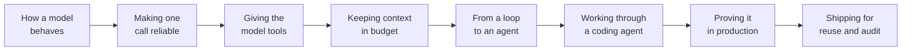

Most developers meet a language model in a chat window, then send it a few API calls, and for a while that is enough. It stops being enough the day the code has to survive production. A prompt that looked solid fails on an input nobody tried. A tool call breaks halfway. A stream drops in the middle of a sentence. An agent runs past its budget, or writes to a file it should never have touched. None of these are exotic. They are what happens when a working prototype meets real traffic.

This post follows that journey from the developer's side of the keyboard. Its companion, [From Request to Running System](/blogs/blog/from_request_to_running_system/), looks at the same territory as an architect: which decisions to make before building, and how to defend them. This one is about the code and configuration that make those decisions real, in the order a build grows. It starts with how a model behaves and what that means for code. It then makes one call reliable, gives the model tools, keeps its context inside a budget, and turns the loop into an agent. The last three sections cover working through a coding agent, proving the system in production, and shipping it so others can reuse it and a customer can audit it. Each section ends with a short recap, and a glossary and references close the post.

As in the companion post, I write it around Claude, because its documentation is detailed and the product names make examples concrete. The engineering transfers to any model provider. API details, model names, beta headers, and limits change often, so check them against current documentation before you build. The failure stories are composites of patterns that keep recurring, not reports on any single project.



## How a model behaves, and what that means for your code

Before writing a line of code against a model, it helps to know what the words mean. Three foundations come first, because every later section takes them for granted: how a model consumes and produces text, how the model tiers differ, and how a program actually reaches the model.

### Tokens, the context window, and sampling

A model does not read characters or words. It reads **tokens**: chunks of text. Their average size depends on the model's tokenizer and changes between model generations, so any characters-per-token rule of thumb is only a rough guide. Everything the model touches is counted in tokens: your prompt, the conversation history, tool definitions, tool results, and the response it writes. Tokens are both the unit you pay for and the unit of your budget. When you ask what a feature will cost or whether an input fits, you are counting tokens, not words.

The budget is the **context window**: the total number of tokens a model can take in for one request. It holds everything at once, from the system prompt to the last tool result to the answer being generated. It is fixed, and it has two different edges. If the input is already larger than the window, the API rejects the request with a validation error before generating anything. If the input fits but generation runs into the ceiling, current Claude models stop and return what they have so far, with a stop reason that says the window was exceeded. In neither case does the API quietly drop your oldest messages. Keeping a long session alive is your application's job: it has to trim or summarize history before each call. In development the window rarely fills, because test inputs are short. In production, longer inputs and more turns fill it much sooner.

Inside that window, a model does not pick one fixed next token. At each step it produces a probability distribution over possible tokens and samples from it. This is **sampling**, and it is older than it looks. In his 1948 paper [A Mathematical Theory of Communication](https://people.math.harvard.edu/~ctm/home/text/others/shannon/entropy/entropy.pdf), Claude Shannon built approximations to English by choosing each next word according to how often it followed the previous one in real text. He did it by hand, opening a book at a random page and reading on until the current word turned up again. His second-order word approximation begins "THE HEAD AND IN FRONTAL ATTACK ON AN ENGLISH WRITER." Each pair of words is plausible, and the whole is nonsense. A modern model runs the same loop with a far better estimate. The better estimate is what makes it fluent. The sampling step has not changed, and that is what makes it vary from run to run.

Settings such as temperature shape the distribution: lower values concentrate probability on the likeliest tokens and make output more repeatable, higher values spread it out. Sampling controls are also model-dependent. The newest Claude models reject non-default temperature, top_p, and top_k with an error and are steered through prompting instead. Even temperature zero does not guarantee identical output.

The consequence is **non-determinism**: identical inputs do not guarantee identical outputs. That changes how you test. A test that asserts the exact text of a response will flicker, because a correct answer can be phrased many ways. Assert on what must hold instead: a required field is present, a value is in range, the structure parses. When you need to judge meaning rather than shape, you need an eval with a model as grader, which the production section builds.

### Model tiers and the default choice

Model families come in tiers that trade cost, latency, and capability. Claude currently spans Haiku for speed and cost, Sonnet as the balanced default for most production work, Opus for demanding work above Sonnet, and Fable as the most capable tier for the hardest reasoning, coding, and agentic tasks. The practical habit is to start with the balanced default and move only when an eval says so. Whether the model also reasons before answering is a separate lever, set per request, and it comes up with prompting in the next section. The production section adds a router that picks a model per step.

### How a program reaches the model

At bottom, a model provider is an HTTP REST API: your code sends a JSON request with an API key and reads a JSON response back. You can call it with any HTTP client, but most teams use an official **SDK**, a thin convenience layer that handles authentication, request construction, retries, and parsing. The SDK and raw REST reach the same API and the same model.

The real choice is the shape of the response, and it follows who is waiting. A synchronous request waits for the complete answer, which is fine for short responses and backend jobs. **Streaming** sends the answer in pieces as the model generates it, so output appears immediately, and your code reassembles the pieces. Claude streams over the same HTTP connection using server-sent events. For high volume, two patterns solve different problems. An async client, such as the Python SDK's async client or the promise-based TypeScript client, makes non-blocking calls so your application can do other work while it waits. The **Message Batches API** is for bulk offline work where nobody is waiting on any single result: you submit a large set of requests at once, get an identifier, and poll for completion, at a lower price. Streaming gets its own failure rules in the tools section, and batch jobs get their details in the context section.

### Recap

- **Think in tokens.** Tokens are the unit of input, output, and cost, and that is what the API meters and the context window measures.
- **The context window is a fixed budget with two edges.** An oversized input fails before generation, hitting the ceiling mid-answer returns truncated output, and managing history is the application's job.
- **Sampling makes output vary by design.** Test on properties, not exact text, and use evals to judge meaning.
- **Start in the balanced tier.** Let evals move you up or down.
- **Pick the request shape by who is waiting.** Synchronous, streaming, async, or batch, depending on whether a user is waiting and whether the work is real-time or bulk.

## Making one call reliable

Knowing that output varies from run to run changes how you write a prompt. Writing code that uses a model is different from using a model to write code. Interactively, you type a prompt, read the answer, and adjust. Programmatically, nobody is there to adjust, so the prompt has to hold up on inputs you never saw. This section makes a single call reliable in three steps: diagnose the prompt, move control into the API where you can, and decide how much the model should think first. Each step is built around a failure that is easy to miss in development and expensive to fix once it ships.

### Diagnose the failure before you re-prompt

When a prompt breaks, the instinct is to add more words and try again. That rarely helps, because rewording changes how you say something without adding the structural piece that is missing. If the model is blurring your instructions with your input data, clearer phrasing will not fix it. If the output format keeps drifting, "please format this correctly" will not fix it either.

The better habit is to diagnose the failure first, then add the one technique that addresses it. There are four common failures, and each points to a fix. Sometimes the result comes back in the wrong shape: a sentence where you wanted a label, or prose where you wanted JSON. Then the prompt is missing an **output constraint** that names the form, field names, and stopping point. When content drifts in scope or tone and gets worse deeper into a conversation, the **system prompt**, the behavioral contract for the whole session, is too vague. When the model understood the task but invented a structure you never asked for, it needs examples, because it cannot infer an exact shape from a description. And when output is clean on the cases you tested but breaks on a variant, the prompt needs a constraint or an example that covers that variant. Across all four, **XML tags** with descriptive names, such as `<my_code>` and `<docs>`, mark where instructions end and data begins, so the model does not read one as the other. Each failure is a missing piece of structure, which is why more words cannot supply it.

Examples deserve a decision of their own, because each one buys quality at a token cost on every call. **Zero-shot** gives the instruction alone. One-shot adds one example of an input paired with the desired output. Multi-shot, also called **few-shot**, includes several. The examples are not training data. They sit in the prompt and show the exact shape of answer you want, which a description alone often fails to pin down. Use zero-shot when the task is simple and the output shape is obvious. Add one or two examples when the output has a specific structure, casing, or edge case that instructions keep missing. One or two correct examples usually fix that faster than another paragraph of instructions. The choice also interacts with the model tier. A more capable model may succeed zero-shot where a smaller one needs examples, so examples can let a cheaper model do the job. Try the smallest model and the fewest examples that pass your eval, and add only where the eval says you must.

A support-ticket classifier shows the diagnosis and the examples working together. A bare prompt, "You are a support classifier. Classify the ticket," returned "Billing" on some runs, "billing" on others, and occasionally "This looks like a billing issue." The router downstream broke on the inconsistency. The fix stacked three techniques: a system prompt that allowed exactly one label from BILLING, TECHNICAL, or ESCALATION and nothing else, two tagged examples showing the exact casing, and tags keeping those examples apart from the instruction.

```text
System: You are a support classifier. Classify each ticket into exactly one of:
BILLING, TECHNICAL, ESCALATION. Return only the label. No other text.

<sample_input>My account shows two charges for April.</sample_input>
<ideal_output>BILLING</ideal_output>
<sample_input>The API keeps returning a 429 error.</sample_input>
<ideal_output>TECHNICAL</ideal_output>

User: <ticket>I was charged twice for the same month.</ticket>
```

The cost of skipping diagnosis shows up clearly in one developer's six revisions of that same prompt. Pass one asked for one of three categories and got sentences back. Pass two added "be concise" and got inconsistent casing. Pass three added three paragraphs describing each category and got "billing/technical" for ambiguous tickets. Pass four forbade two categories and worked on 80 percent of tickets. Pass five added more paragraphs about edge cases. The now-verbose prompt produced verbose output: over 2,000 characters per call, higher latency, and no gain in accuracy. Models tend to match their output length to their input. Only pass six, which replaced the instructions with a schema and two examples, worked on every ticket. If three re-prompts in a row have not helped, stop adding text and diagnose.

### Enforce the format with structured outputs

Even a well-diagnosed prompt is still a request, and a model can occasionally return a stray sentence or malformed JSON. **Structured outputs** close that gap at the API level by constraining generation against a JSON schema, so output that violates the schema cannot be produced. There are two forms. JSON outputs constrain the final response to your schema, which removes the parse-and-retry code around extraction calls. Strict tool use validates the arguments the model passes to a tool before your code runs, which matters in agent loops where a malformed argument could trigger a wrong action.

The costs are real but small. The first request on a new schema is slower while the API compiles it, though compiled schemas are cached for a day. A short injected prompt adds input tokens. Refusals and truncation at the token limit can still return non-conforming output, so you still check the stop reason. And JSON outputs cannot be combined with prefilling the assistant's reply.

### Use extended thinking only where it pays

Prompting shapes what the model produces. Extended thinking shapes how much work it does first. Turned on, the model reasons step by step in a separate thinking block before the block that holds the answer. On current Claude models this is **adaptive thinking**: the model decides when and how much to think, and you tune depth with an effort setting rather than a fixed token budget. The older budget setting is deprecated and errors on the newest models. Thinking content is hidden by default unless you request a summary. Thinking tokens are billed at the output rate, so running a simple task at high effort means paying for accuracy you do not need.

The decision follows the shape of the task. Multi-step reasoning that holds several constraints at once, such as a derivation, a multi-hop logic problem, or planning dependent actions, deserves it, with effort matched to depth. Mechanical work such as classification, format conversion, lookups, or field extraction does not: a constrained prompt is cheaper and just as accurate. Agent loops that plan across several tool calls benefit, because reasoning before a plan reduces wrong-tool choices later. Budget for the planning step, not for every call. Because the model tier and reasoning are independent levers, they compose. A capable model with reasoning off is fast and direct. A smaller model with reasoning on spends more tokens to think. And the hardest tasks pair a capable model with higher effort.

One rule is not optional. When thinking is on and the conversation uses tools, every thinking block must go back to the API unchanged on the next turn. Each block carries a signature that verifies the reasoning was not altered. Edit it, summarize it, or drop it, and the API rejects the request. Redacted thinking blocks follow the same rule, even though their content is encrypted. The most common slip is stripping thinking blocks to save context, which breaks the next call. If accumulated reasoning is eating your budget, the answer is context engineering (see the context section), not deletion.

### Recap

- **Diagnose a failed prompt before re-prompting.** Wrong shape means a missing output constraint, drift means a weak system prompt, and invented structure means missing examples. If three re-prompts have not helped, stop adding text.
- **Use the fewest examples and the smallest model that pass the eval.** Examples cost tokens on every call, but they can let a cheaper model do the job.
- **When untested inputs still break the parser, move control into the API.** Structured outputs make non-conforming output impossible to generate, though you still check the stop reason.
- **Match reasoning depth to the task, and return thinking blocks unchanged.** Extended thinking pays on multi-step problems, is wasted on mechanical ones, and breaks the next call if you strip it.

## Giving the model tools

A reliable call can only answer from what it is given. Tools let it fetch and act, and they change the job. With tools, you stop steering language toward a good answer and start handing the model a set of actions, trusting it to pick the right one. The loop around that pick has strict rules that no prompt can bend. The pick itself is driven almost entirely by what you wrote in the schema. This section follows that order: the loop, the choice inside it, tools someone else wrote, and streaming tool calls without corrupting state.

### The tool-use loop and its blocks

The most common misconception is that the model runs the tools. It does not. **Tool use** is a loop between the model and your code. You define each tool with a name, a description, and an input schema. The model reads those definitions, decides a tool fits, and returns a block naming the tool and its inputs. Your application executes the tool and sends the result back, and the model continues. The loop is not automatic: if your code does not handle the return correctly, the model never gets the data it asked for.

The conversation is built from typed blocks, and the API enforces how they pair. A text block carries prose. A **tool_use block** carries a tool call with its name, a unique ID, and its inputs. A tool_result block carries what your code returned, with the matching ID and an optional error flag. A thinking block carries reasoning when extended thinking is on. Every tool_use block must be answered by a tool_result with the same ID in the very next user turn. A missing result, a mismatched ID, or results that arrive a turn late all fail validation, and no prompt change will fix that, because the problem is structural. When the model returns text alongside a tool call, keep the whole content array when you append the turn, or you corrupt the context it relies on. Independent calls can run in parallel, and current models issue them that way by default. Where one call depends on another's result, the calls must run in sequence, and you can force one call per turn when needed.

### Descriptions decide which tool runs

If the loop is mechanical, the choice inside it is not. The description is where tool selection is won or lost. Names should be specific: `get_account_balance` tells the model far more than `get_data`. Descriptions should say both when to use the tool and when not to. "Use this to find information" is indistinguishable from any other tool that retrieves something. "Use this to retrieve the current balance for an account ID. Do not use this for transaction history" gives the model an exclusion condition. Three or four sentences per tool, covering what it does, when to reach for it, and what it returns, is about right.

The input schema needs the same care. Mark a field as required only when the call makes no sense without it. If every field is required, the model invents values it has no basis for. When two tools take the same parameter shape, routing falls back on the descriptions alone, so add language that separates their domains.

Here is how overlapping descriptions play out. A developer spent a morning wondering why the model kept calling `search_docs` when the answer was already in the conversation. The senior engineer asked what the two descriptions said. One read "Use this to find information about the product." The other read "Use this to retrieve relevant information from the current session." From the model's side, both said "find information." The fix was two sentences per tool: when to call it, and when not to. If descriptions cannot be separated even with exclusions, the tools probably should be merged into one with a type parameter. And exclusions only work when the model sees the full history, so truncating earlier turns silently breaks them.

### Using tools someone else wrote

Everything so far assumes you write the tools yourself. Often someone already has, and then you may not need to write schemas at all. The **Model Context Protocol (MCP)** moves tool definitions and execution out of your application into dedicated servers. For a service like GitHub, an existing MCP server already exposes repositories, pull requests, issues, and more. Your client asks the server for its tool list, passes the definitions to the model, and the same description-based routing applies. So the overlap trap from the `search_docs` story applies to tools you did not write, too. The tool-use loop does not change, only who wrote and maintains the definitions.

Connecting has a cost, though. Each connected server adds its definitions to the context window whether or not they are used, so connect only what you need. Claude's API connector lets you defer loading definitions and switch individual tools off. That makes the choice simple. Use MCP when a well-maintained server exists. Write schemas yourself when none fits or you need tighter control. And use both together: connect for breadth, and tune descriptions for the tools you actually route to. Transports and scopes matter once you build or share servers yourself, which the coding-agent section covers.

### Streaming without corrupting state

The first section showed that a streamed answer arrives in pieces your code puts back together. With plain text, a cut-off stream is just a short answer. With tools, it can become a half-formed action. Streaming makes long responses feel fast, but it gives your code a new job: you assemble the final message yourself from a series of events, and you must be ready for the series to stop early.

A streamed response arrives as events, each describing one change. A start event opens the message. A block-start event opens a content block with its type and index. A tool_use block opens with its name and ID but no input yet. Delta events append fragments: text, pieces of a tool's JSON input, or thinking. A block-stop event closes the block. A message-delta event carries the stop reason and final usage. A message-stop event says the stream is complete. Your handler applies each event to the partial state it is building.

The rule that keeps that state from corrupting is simple: do not act on a partial block. A tool call's input arrives as a JSON string spread across many deltas. It is not valid until its block closes. Parse it early, and you either crash or run the tool with half its arguments. Likewise, append the assistant turn to history only after message-stop, with every block complete. If the stream breaks first, discard the partial turn and retry from the last complete one. And check the stop reason before continuing a loop: only "tool_use" means the assembled calls are ready to run.

One team learned this the hard way. Their agent streamed so operators could watch it work, and the handler appended the turn whenever its read loop ended. On a fast local connection, the loop always ended at message-stop. In production, a network blip ended one stream after a tool call had opened but before its input finished. The handler appended a turn with truncated JSON, the operator retried, and the retry failed validation on the corrupted turn. The team spent an afternoon inspecting the schema and the retry logic, because the error appeared on the retry. The real cause was upstream: a stream ending is not the same as a message completing. For short responses or backend jobs where nobody is watching, a plain non-streamed call avoids the whole problem.

### Recap

- **The model asks; your code runs the tool.** Every tool_use block needs a matching tool_result in the very next turn, and a broken pairing is structural, not a prompt problem.
- **Most wrong-tool bugs live in the description.** Say when to use the tool and when not to, require only the fields the call truly needs, and merge tools whose descriptions cannot be separated.
- **Connect an MCP server deliberately.** It changes who writes the tools, not the loop, and every connected server costs context.
- **A stream ending is not a message completing.** Act on a block only after it closes, commit a turn only after message-stop, and discard partial turns on interruption.

## Keeping context inside its budget

Tools are where the context window starts to fill. Every tool result is appended to the window and stays there for the rest of the session. In a single call that is invisible. In an agent running ten or twenty tool calls, the window fills fast, and then the agent either compacts and loses detail or stalls before finishing. Deciding in advance what enters the window, what comes back out as a summary, and what never enters at all is **context engineering**. This section covers four ways to stay in budget, prompt caching, retrieval, and then images, documents, and batch jobs.

### Four ways to stay in budget

Context engineering starts with the model choice, which sets the price and speed floor, and then with an honest view of the window as working memory. The first section noted that production fills the window sooner. The reason is that production tool outputs are often three to five times longer than test fixtures, and sessions run longer.

There are four strategies for staying in budget, each suited to a different situation. **Pruning** rewinds to an earlier message and drops what came after. It is useful after an unproductive detour, at the cost of anything learned along the way. **Compaction** summarizes history into a shorter version that keeps what matters. It is useful when you want to continue the same work near the ceiling, at the cost of whatever the summary leaves out. In Claude Code compaction is a command; on the API it is a server-side option in beta, or a summarizer you write yourself. **Clearing** starts fresh, which is right when the next task is unrelated and old context would only bias it, so anything that must persist has to live somewhere durable. A **subagent** handoff gives a self-contained task to a separate agent with its own context window and only what it needs, and gets back a short result. That is ideal for exploration where the journey is long but the answer is short, though you lose visibility into how it got there.

When you write your own compaction, the summarizer prompt decides what the agent will know next. "Summarize the conversation so far" tends to drop task-critical state, such as which files changed, what was decided at a branch point, and which errors were hit and fixed. "Summarize the conversation, preserving every file path modified, every decision made, and every error encountered with its resolution" produces a summary the agent can actually use. An under-specified summarizer is one of the most common causes of agents failing across sessions.

Running out of window usually looks like something else. A receipt-processing agent ran under a 40,000-token budget the team set for cost, well below the model's own window. In development, twenty receipts produced tool results of about 800 tokens each, and a full session used about 18,000 tokens. In production, receipts came with supporting documents, results averaged about 3,200 tokens, and the budget filled at turn eight. The agent started picking the wrong tools and returning incomplete analyses, which looked like a schema problem. The real cause was that accumulated tool output had crowded the system prompt and early instructions out of the window. The fix was to prune tool outputs after use and compact before the cap. When tool selection degrades after a fixed number of turns, check the window before the schema. Token counting would have caught this before launch. It measures a request before you send it, so you can check budgets against real tool outputs in development and stop oversized requests in production before they fail.

### Prompt caching: when reuse pays

Strategies decide what stays in the window. **Prompt caching** cuts the cost of what is already there. It stores the processing of a stable prefix, so later requests reuse it at a fraction of the price.

Caching is enabled per request, not by an account-wide switch. You either mark breakpoints yourself, up to four per request on the last block of each prefix you want cached, or turn on an automatic mode that places them as a conversation grows. Explicit breakpoints give finer control. Requests are processed in the order tools, system prompt, then messages, so a breakpoint after the tools caches the tool definitions while the messages stay dynamic. So put what never changes first and what changes every turn last. Long system prompts and tool definitions are the best candidates. The cached content must match exactly: one changed character before the breakpoint forces a fresh write. The default cache lives five minutes from last use. A one-hour option suits agents that pause between steps. And prompts below a minimum length, which depends on the model, are never cached.

Caching pays when reads outnumber writes, and the bar is low. Cache writes cost more than ordinary input, about 1.25 times for the five-minute lifetime and 2 times for the one-hour lifetime, while reads cost about a tenth. So with the five-minute lifetime, one reuse already pays for the write, and the one-hour write needs two. The rules above come down to three conditions: the prefix is identical, it recurs within the lifetime, and it clears the minimum. Miss one and you pay the write premium for nothing. Cached content can also be stale. That is fine for a fixed system prompt and dangerous for anything that should reflect live state.

### Retrieval: index or search

Caching helps when the same text repeats. It cannot help when the material is too large to send at all. Retrieval solves that by giving each request only a slice. There are two ways to do it. Classical **RAG** chunks and embeds the material ahead of time and matches questions against the index, like a librarian who has already summarized every chapter. **Agentic search** skips the index and lets the model search and read at the moment of need, like a researcher who goes and finds the answer. Claude Code's deferred tool loading and Claude.ai Projects with large knowledge bases both work the second way. Either way, retrieval is only as good as what it finds, so descriptive file names and well-organized material matter.

The choice between the two follows the corpus and the questions. A pre-built index is inspectable and testable, but it must be built, synced, and secured. Like a cache, an index can go stale. Searching at query time avoids the index and its staleness, at a higher cost per query. A stable corpus with simple lookups favors the index, while a changing corpus or multi-step questions favor iterative search. When traffic is mixed, a cheap classification call can route single-fact lookups to a fixed retrieval pass and multi-step questions to agentic search, so you pay for iteration only when the question needs it. If all your traffic has one shape, skip the router and hardcode the path that fits.

If you build an index, it can break in three places. Chunks can be too small to be useful or too large to match well, so sentence- or section-based chunks with a little overlap are a sensible default. The embedding match retrieves what is semantically close, which can miss an exact identifier, so a lexical match is sometimes run alongside it. And the assembly step must hand retrieved text to the model in the structure the prompt expects, or the model answers from memory.

### Images, documents, and batch jobs

Images and documents spend context before the model reads a word of your prompt. Claude sees images in 28-by-28-pixel patches, so an image costs roughly its width divided by 28 times its height divided by 28 in visual tokens. A 1,000-by-1,000 image is about 1,296 tokens, so ten high-resolution screenshots weigh as much as a long system prompt. Each model tier has its own maximum resolution, and larger images are downscaled first. Run that arithmetic on your largest production image before writing the ingestion code, because the fix is often a resize step that takes minutes to add before launch.

There are three ways to send an image. Inline base64 suits one-off images, though the bytes travel with every request. A public URL avoids the payload but depends on the link being stable and reachable. The **Files API** uploads once and references a file ID from then on, which suits assets reused across requests or conversation turns; it is in beta and not available on every cloud route. PDFs use a document block with the same source options. The prompting techniques still apply, plus guidance for visual ambiguity, such as how to treat overlapping objects.

Volume is the other way token spending gets out of hand. Here the problem is not the window but the number of requests and the bill. For high volume, looping over the synchronous API is the wrong model, and splitting the list into chunks does not change that. One developer kept hitting rate limits on a nightly job despite chunking, until a senior engineer pointed out that the API still saw one request per item, back to back. The Message Batches API from the first section takes up to 100,000 requests or 256 MB in one submission and processes them asynchronously at lower cost. A batch can take up to 24 hours, and results come back in arbitrary order, matched back by a custom ID you set on each request. That makes it right for nightly pipelines and evaluation runs and wrong for anything a user is waiting on. Batches also combine with the features above. A scheduled job that reuses a long fixed prompt can cache it. A nightly job that reuses the same assets, such as classifying images against a fixed taxonomy, can upload them once through the Files API.

### Recap

- **Context is a fixed budget that tool outputs spend fastest.** Prune, compact, clear, or delegate to subagents, and suspect the window when tool choices degrade after a fixed number of turns.
- **A summarizer prompt decides what the agent knows next.** Name the file paths, decisions, and errors it must preserve.
- **Cache only what repeats, exactly, within the lifetime.** Writes cost more than reads, but one reuse within five minutes already pays for the write, and cached content can go stale.
- **Choose retrieval by the corpus and the questions.** An index for stable lookups, search for changing material or multi-step questions, and a cheap router when traffic is mixed.
- **Calculate multimodal cost first, and batch offline work.** Looping over the synchronous API is not batching.

## From a loop to an agent

With tools working and context under control, every piece of an agent is in place. An agent is a multi-step tool-use loop with managed context and a defined goal. Connecting the pieces across many turns surfaces new failures, so the first design question is whether the problem needs an agent at all. After that come the wiring, the conditions that stop the loop, the places a person must look, and what the agent remembers next time.

### Workflow or agent, and how to wire it

One test decides it: can you write the path down before the run starts? Choose a **workflow** when you can write the exact steps in code, errors are costly, standard observability matters, inputs are well constrained, and every run follows the same sequence. Choose an **agent** when you can state the goal and the tools but not the path, inputs vary unpredictably, the actions are constrained by the registered tools, and some non-determinism is acceptable. Using an agent where a workflow would do adds behavior that lives only in transcripts. Using a workflow where an agent is needed breaks the first time input leaves the planned path.

Once you choose an agent, the loop is the pattern and the wiring is an implementation choice. There are three wiring paths, and they differ in how much of the runtime you own. A raw loop against the Messages API gives you full control and makes you responsible for the loop, tool execution, context, retries, and exit conditions. The **Agent SDK** runs the same loop that powers Claude Code inside your own process. You still execute the tools. A setting controls whether project files such as CLAUDE.md and skills load, so always set it explicitly rather than trust the default.

A managed agent service runs the loop and a sandbox on the provider's side. Your application streams events in and results out. For Claude it is in public beta. It suits long-running work and saves you building a sandbox, but sessions are stored server-side, which currently rules it out for zero-data-retention and HIPAA workloads. A common path is to prototype on the SDK and move to the managed service, expecting to rewrite the agent definition rather than export it. Regulated data can rule out some of these paths before you write any wiring, as the shipping section explains.

### Exit conditions and human gates

Whatever the wiring, the loop needs the same four things. Tools must be registered. The system prompt must be scoped to the task and to the tools that actually exist. Every tool call must be answered before the next turn, the pairing rule from the tools section. And exit conditions must be explicit, so they do not depend on the model volunteering to stop. An exit condition is something your code checks, such as a turn limit, a token budget, or a passing check. Keep the tool set minimal. Registering every tool "just in case" degrades selection, so start small and add a tool only when a real gap appears.

The loop also needs at least one human-in-the-loop (**HITL**) checkpoint, and one question places it: what is the worst outcome if this step runs unchecked? Put a gate before any write, delete, or send that cannot be undone. Put one after a planning step, before execution, to catch a wrong plan. And put one on unexpected output, such as an error flag, an empty result, or a value out of range.

One configuration agent shows why gates belong in the design. It could read, write, and validate config files, retrying its edit until validation passed, up to ten times. In a scratch directory it worked every time. In a customer environment it found an out-of-range rate limit, corrected it, validated it, and stopped after one clean iteration, exactly as designed. The customer's application depended on the old value and began failing within minutes, because validation checked the schema, not downstream dependencies. The loop was fine. What was missing was a pause between "change proposed" and "change written to a live system," a pause the scratch-directory tests never needed. A met exit condition tells you when to stop, not whether the result is safe to apply.

### Memory: what the agent knows next time

Exit conditions and gates decide how a run ends. Memory decides what survives it. An agent that works within a session remembers nothing when the session ends. Memory scope decides what it knows at the start of the next one, and the wrong choice fails in one of two opposite ways: too much in-context state inflates every call, and too little persistent state makes the agent forget.

There are four scopes. In-context memory keeps state in the live conversation. It has no retrieval overhead, but its token cost grows with every turn, and it is lost when the session ends. External storage writes state to a database and reads it back, surviving across sessions, users, and instances at the cost of latency and read-write code. Summarized memory injects a condensed version of earlier conversations, which is cheaper than replaying history but limited to whatever the summarizer kept. Stateless agents carry nothing, which is correct for jobs that finish and close. Make the choice at design time. An assistant that picks up a user's thread each day needs external storage. A formatter that transforms one file and exits is stateless. A multi-hour coding session that will not continue can stay in context.

A support-escalation agent shows the memory failure. Development ran single long sessions, and in-context history worked. Production ran many shorter sessions across days, and by the fourth session the injected history alone exceeded 40,000 tokens, with the system prompt and tools pushing past 45,000 before the first useful turn. The agent began returning incomplete results that looked like tool-selection failures. It is the same symptom as the receipt agent in the context section, but the cause is history carried across sessions, not tool output piling up inside one. Moving history to external storage and injecting only the relevant part was not hard, but doing it under production pressure cost far more than deciding at design time.

Repeatable instructions are a separate problem from state, and the pattern for them is a **skill**: a SKILL.md file with a name and description in its frontmatter and instructions below. Only the name and description load at startup. The full instructions load when a request matches the description. By contrast, a project instruction file such as CLAUDE.md loads into every Claude Code session, and in-context instructions grow with the conversation. So use the instruction file for always-on project standards, skills for task-specific expertise, and in-context instructions for one-off work. How a skill travels between tools and teammates is covered in the coding-agent section.

### Recap

- **Decide workflow or agent before wiring.** An agent is right when the goal and tools are known but the path is not, and the wiring path decides how much of the runtime you own.
- **Exit conditions must not depend on the model volunteering to stop.** Keep the tool set minimal, and place human gates by asking what the worst unchecked outcome would be.
- **Choose memory scope by the shape of the session.** Carry state in storage or summaries as needed, and carry repeatable instructions in skills.

## Working through a coding agent

So far the agent has lived in your own code. A coding agent such as Claude Code is that same loop, already built. Once your own build works, the next challenge is making it configurable, shareable, and safe to connect to real systems. On your own machine every shortcut feels fine: the permission mode, the small rules file, the script path, the credential in the config, the connection that worked in staging. Each of those can fail the moment the work leaves your machine. This section covers running a coding agent under a permission model, giving it durable project context, packaging a workflow so a teammate can install it, and connecting to external and enterprise systems through MCP without leaking credentials or failing a security review. Claude Code is the example here, and other coding agents have similar concepts.

### Permission modes and where a person must look

A coding agent runs the same tool loop as the API, with one more layer: a permission system that decides which actions need your approval. It works in three phases. It explores first, reading files and tracing logic until it understands the codebase. Then it proposes a plan. Only after you approve the plan does it write and run changes. That order produces better changes, and it is also where permissions apply.

A **permission mode** sets how often the agent stops to ask. Claude Code's default mode allows reads and prompts before nearly every edit or command, which is safe but slow and the right start for an unfamiliar codebase. An accept-edits mode also approves file edits and common filesystem commands inside the working directory, while other shell commands, writes outside the directory, and protected paths still prompt. Plan mode allows research only and blocks all edits until a plan is approved.

Three more modes ask less often. An auto mode lets a separate classifier approve safe actions and block anything that escalates beyond your request, with production deploys, mass deletes, credential theft, and force-pushes to main blocked by default. It is a research preview, not a guarantee. A do-not-ask mode runs only pre-approved tools and denies everything else, for locked-down CI. And a bypass mode skips every check except a last-resort prompt on catastrophic deletes, and belongs only in a disposable container.

A mode is set in settings, which live at four levels. User settings follow you across projects. Project settings are committed so the whole team shares them. Local project settings hold personal overrides and are ignored by git. Enterprise managed settings are set by administrators and cannot be overridden. Allow and deny rules sit on top of the mode, and a deny always beats an allow. An enterprise-level deny is the most durable control there is, because no developer can remove it and it holds even in bypass mode.

Modes decide what the agent may do unasked. Where a human must still look follows the worst-outcome rule that placed the gates in the earlier agent section. Let low-stakes, reversible actions through, such as a formatting fix inside the working directory. Gate anything hard to undo or touching a sensitive path, such as writes outside the project, destructive commands, or security-relevant files. And never let the agent be the only gate on code your team has marked sensitive, however confident its own review sounds. Permission mode is a risk decision, not a speed decision.

One cleanup session shows what bypass mode removes. After three quiet days, a developer switched to bypass to rename old API endpoint references, a task that felt routine. The pattern matched files in both the source tree and a production config directory, the cleanup script ran without a prompt, and three files of production endpoint overrides were deleted. In default or accept-edits mode, the script call would have stopped for approval. Before switching modes, put deny rules on sensitive directories, and if you want fewer prompts, use a classifier-gated mode rather than a full bypass.

AI code review deserves the same calibrated trust. A review gives you findings to triage, not a verdict to apply. Trust what the reviewer can prove from the diff in front of it, such as a missing null check or an unclosed resource, and confirm it on the lines it cites. Treat any claim about runtime behavior or another system as a hypothesis to test. Put the human gate where a finding turns into an action that is hard to reverse, and improve the reviewer's accuracy by giving it the conventions it would otherwise have to guess.

### Project context that loads every session

Permissions control what the agent may do. Project context controls what it knows and how it behaves, session after session. Four mechanisms carry it, each with a different trade-off between context cost and reliability.

**CLAUDE.md** is a file at the project root that loads into every session before your first message, so its conventions, constraints, and commands are always present. The init command generates a starter version, which you should prune to the rules that actually change outcomes: test commands, framework conventions, paths not to touch, and departures from defaults. Size is its main failure mode. Every line dilutes every other line.

**Rules files** in the project's rules directory add a narrower layer. A paths pattern in a rule's frontmatter makes it load only when the agent works on matching files, such as a rule that every SQL file in the database module must declare a transaction boundary. Without a paths field, a rule loads at startup like CLAUDE.md, whatever folder it sits in.

**Hooks** run your own scripts at fixed points in the agent's lifecycle, and unlike instructions, they fire every time regardless of what the model decides. A pre-tool hook runs before a tool call and can block it by exiting with code 2 and explaining why. A post-tool hook runs after a call and suits formatting, tests, and audit logging. Other events fire when a prompt is submitted, when the model stops, on notifications, and when sessions start and end. A rule in CLAUDE.md is followed most of the time. A hook is followed every time. That is the difference between a convention and a guardrail.

**Subagents** run delegated tasks in their own context and return only a result. The built-in Explore and Plan subagents skip CLAUDE.md and git status for speed, so project rules are not in their view. The general-purpose subagent loads both. Custom subagents do not inherit your skills or the parent's history, though they do inherit its permissions.

An 847-line CLAUDE.md shows the dilution in practice. It had grown over two months of team additions: framework preferences, testing conventions, a style guide, dependency rules, path restrictions, a historical decisions log, and archived notes. Line 347 said not to modify a legacy tokens directory. Asked to refactor an auth module, and told again not to touch that directory, the agent edited a file in it anyway while updating an interface. The rule was there. It was simply outweighed by the 846 lines around it. Keep CLAUDE.md to the rules that change behavior now, move path-specific guidance into rules files and history into reference documents, and turn the one rule you cannot afford to lose into a hook.

### Packaging workflows as skills and plugins

Once your setup works, the next question is how a teammate installs it in one step rather than repeating your configuration by hand.

A skill, introduced in the agent section, lives in the project's skills directory and can run in Claude Code, through the Messages API, in the Agent SDK, or in a managed agent, and it loads and runs differently in each. In Claude Code it is discovered from the filesystem and runs locally under your permission rules. On the API it is sent with the request and runs in the provider's code execution container, behind beta headers, so a skill that calls a local script will not find it there. In the Agent SDK it loads only if you set the setting sources explicitly, and the most common surprise is a skill that worked in the terminal doing nothing in the SDK because that setting was never set. In a managed agent it is attached to the agent definition and runs in the provider's sandbox. Three rules keep a skill portable. Write the description as the matching criterion. Do not assume local files or tools exist. And list the skill in the frontmatter of any subagent that needs it.

Explicit entry points are now skills too. You invoke a skill by name with a slash command, and a frontmatter flag stops the model from loading it automatically when you want it to run only on request. The older commands directory still works but is legacy. Commands shipped in a plugin are namespaced by the plugin's name, so two plugins can both offer a run-tests command without colliding, and renaming a plugin renames all of its commands.

A **plugin** bundles skills, hooks, subagents, and MCP servers into one versioned, installable unit, distributed through a marketplace. The official marketplace is available by default, third-party ones can be added from a GitHub repository, and administrators can push plugins organization-wide through managed settings, with an allowlist of permitted marketplace sources. A plugin carries only what it bundles. A deny rule or hook the author relied on locally does not travel unless it is included.

The classic packaging failure installs everywhere and runs only on the author's machine. One deployment-validation skill pointed at a script under the author's home directory, an absolute path that existed nowhere else. A second skill in the same plugin depended on an environment variable set in the author's shell and never documented. Every install succeeded and every teammate's run failed, and three people spent two hours tracing the missing variable. Reference scripts relative to the project or the plugin's own root, through the variables the tool provides for that. Bundle what the plugin depends on, document and validate every required environment variable, and test the install on a clean machine before sharing it.

### Building and connecting MCP servers

Plugins package your own workflow. MCP servers expose capabilities to the model from outside your codebase, and building one starts with what to expose, the transport, and the scope.

Wiring a tool directly means each application owns its schema and code, so three applications that need the same service maintain three integrations. MCP turns the integration into a server that any MCP client can use. Servers expose three kinds of capability. Tools are actions the model can call. Resources are read-only data the client fetches into context directly, either at a fixed address or through a template with a parameter, which is cheaper and more predictable than a tool call when you know the data is needed. Client support for resources varies. Prompts are vetted instruction templates a client invokes by name, so every user gets the same carefully built wording.

Transport is the channel between client and server, and it follows where the server runs. **Stdio** launches the server as a local subprocess and suits personal tools and development servers. **Streamable HTTP** connects to a remote server and is the choice for anything shared or hosted. The older SSE-only transport is legacy: it is deprecated and superseded by streamable HTTP. As the tools section noted, every connected server costs context. Claude Code defers its tool definitions by default and searches for the relevant ones when a task needs them, with an option to load them upfront when they fit in about a tenth of the window.

Scope decides who loads a server. Local scope keeps it to you and the current project. User scope makes it yours across every project. Project scope writes it to a committed `.mcp.json` so everyone who clones the repository gets it. A project-scoped stdio server spawns a local process on each teammate's machine, so each needs the runtime installed. A stdio server in a committed config only looks shareable. Enterprise scope is pushed by administrators and cannot be overridden. Permission rules can target single MCP tools by server and tool name, such as allowing only GitHub's create-issue tool to run unprompted while everything else on that server still asks, and a deny on one tool beats an allow on the server. The API connector's per-tool switch from the tools section is different: it controls what the model sees, not what it may do.

The GitHub server ties these together. It is remote, so it uses HTTP. Project scope fits a team, and local scope fits one person. It authenticates with a personal access token passed as a bearer header, supplied through an environment variable and never written into the committed file. Linear's server uses OAuth instead: the first connection opens a browser sign-in, and the token is issued and stored without anyone copying a secret.

The most common mistake in this area is a key in the config. A developer connected a data-warehouse server with a service-account key written straight into `.mcp.json`, meaning to move it later, then committed the file so teammates could connect. Within two days the key was on three teammates' machines, in a CI runner, and in repository history. Moving it to an environment variable fixed the current file but not the history, so the account had to be rotated, which broke two other services using the same key and cost three hours. Treat any inline credential in a committed file as compromised. Prevent it with an instruction in CLAUDE.md, and back that instruction with a pre-tool hook that blocks writes of credential-like values to the config.

### Credentials and enterprise sign-in

A prototype answers one question: does the connection work? An enterprise integration must also answer who the model acts as and whether that is auditable, what data it can reach and where that data goes, whether an administrator can lock the configuration, and whether access is logged well enough for an audit.

Authentication follows the service. Remote services tied to a user's identity use OAuth: the server signals that authentication is required, the client runs a browser sign-in, and a token is stored. Remote services that act as a service account use an API key from an environment variable or a pipeline secret, never a committed file. Local services over stdio rely on filesystem permissions and deny rules.

Managing the secret matters as much as choosing the method, and it takes three practices. The first is separation: the config holds a variable reference, never the value, because config files get committed and cloned. The second is a home for the value: an environment variable for something local and short-lived, and a **secret store** for anything shared or audited. A store centralizes the value, controls who reads it, logs access, and updates every consumer in one rotation. The third is rotation, on a schedule and immediately after any suspected exposure, because a leaked key cannot be made secret again. A value read by name rotates without touching code, while a value baked into code cannot be rotated cleanly. Scope each credential to the narrowest access it needs, and keep a list of what uses it so rotation does not surprise anyone.

Regulated customers ask three of those questions early, and each has a concrete answer. Where data goes is answered by a regional endpoint, combined with a platform that pins processing to that region. How access is logged is answered by a post-tool hook that records every tool call and its parameters, which gives auditors their record. And whether an administrator controls configuration is answered by enterprise managed configuration, which locks the integration so no developer can change authentication during an audit window. Zero-data-retention eligibility varies by model and platform, so confirm it for each model you plan to use. Answer these questions during scoping, and the security review becomes a checklist instead of a blocker.

One OAuth integration passed every staging test and failed every production sign-in with a redirect mismatch. The OAuth app had been registered for the staging host only, and providers accept only registered redirect addresses. The security reviewer added a second point: most enterprise customers want separate OAuth app registrations per environment anyway. Add the redirect registration to the deployment checklist, so it is not discovered at the first production login.

Code modernization is a good test of all of this, because it concentrates the risks: a large blast radius, unknown dependencies, and limited reversibility. Plan mode holds the agent in read-only exploration while you build confidence. Hooks block edits to the most sensitive paths. CLAUDE.md carries the target conventions, so the agent does not drift back to the legacy patterns it reads around it. Before starting, answer three questions: what breaks downstream if an edit is wrong, how every change is audited, and who approves each phase before the next begins.

### Recap

- **Permission mode is a risk decision, not a speed decision.** Match the mode to the work and the environment, and use deny rules at project or enterprise level to cover what a mode alone does not.
- **Treat an AI review as findings to triage.** Trust what the reviewer can prove from the diff, test its other claims, and gate where a finding becomes an action that is hard to reverse.
- **Use the right mechanism for each piece of durable context.** CLAUDE.md for universal rules, rules files for scoped guidance, hooks for enforcement, and subagents for isolated work.
- **Shareable setups need portable parts.** Skills load differently in each runtime, so avoid absolute paths, document required variables, and test installs on a clean machine.
- **Settle transport, scope, and credentials before you share.** Stdio is for local servers and HTTP for shared ones, credentials live in a store and rotate, and audit hooks and locked managed settings are easy to build in and hard to retrofit.

## Proving it works in production

A system that works on your machine has not yet proven it keeps working. This section closes the gap between development and production. There, an untested input arrives, a rate limit hits at peak, a bill triples, or a fetched page carries an instruction aimed at the agent. The failure is almost never a bug in the code that ran. It is a decision that was never made. So the section starts with writing those decisions down, then builds the layers that enforce them: evals, tests and tracing, failure handling, model and cost discipline, and a security boundary.

### Write the design document first

Before writing production code, write a short **design document**, usually one page, that records four decisions concretely enough to check the built system against them. Success criteria name what the feature must produce for representative cases, in terms specific enough to grade: "summarize the thread" cannot be checked, but "a two-sentence summary listing every action item and its owner" can. Failure handling lists the errors production will throw, marks each retriable or terminal, and says what the user gets when recovery is impossible. The cost and latency budget sets the per-request and monthly ceilings, the latency target, and the minimum reliability the design will not trade away. The trust boundary names which inputs someone else can write, and the smallest set of actions the feature needs.

Every later layer reads from this page. The criteria become eval cases, the failures become error paths, the budget becomes what you instrument, and the boundary becomes what you enforce with a hook. If a coding agent is doing the building, this page is also what you hand it before it writes anything.

### Evals and a calibrated judge

The first layer turns the success criteria into a number. An **eval** works like a thermometer. It does not make the system healthier, but it gives you a reading you can trust. You collect input cases, write down the expected behavior for each, run the feature on every case, grade each output, and average the scores. Before you have one, "done" is a feeling. After, it is a score you can track as you change the prompt, the tools, or the model. You write it before the feature, so that you define success before you start rationalizing whatever the model happens to produce.

```python
def run_eval(dataset):
    results = []
    for case in dataset:
        output = run_feature(case["input"])
        results.append(grade(case, output))
    return sum(results) / len(results)
```

A first score of two or three out of ten is normal. What matters is whether it rises as you change one thing at a time. The per-case results matter as much as the average, because a steady average can hide three cases fixed and three broken.

Choose the grader by the shape of the output. Exact match works when there is one correct form, such as a single label, and is nearly free, but it fails every valid paraphrase or reordering. A code-graded check works when a rule can validate the output: valid JSON, parseable code, a number in range, a required field. It is cheap, and it says nothing about whether the content is good. **LLM-as-judge** works for open-ended quality such as faithfulness, instruction following, or tone, which no code rule captures, at the price of a model call per case and noisier scores. Many teams grade structure in code on every commit and run the judge on a slower schedule.

A judge is only useful if it is anchored and calibrated. Ask it for strengths, weaknesses, and brief reasoning before the score, or scores drift toward a safe middle around six. Then calibrate: run it on cases a human has already labeled and measure how often it agrees. If agreement is low, tighten what each score means, add a good and a bad example, and measure again. Coverage matters more than a perfect rubric. Twenty cases that include awkward inputs catch more than three hand-picked ones, and you can have the model generate more cases from a labeled seed set and spot-check them. When a case fails, its category tells you where to look. A formatting failure points at output instructions, a factual failure on retrieved content points at retrieval, and a failure only on long inputs points at context handling.

Here is what skipping this costs. A team shipped a field extractor after reading a dozen sample outputs. It validated that messages were non-empty and dates were well formed. Two weeks later, a customer wrote "I placed my order on March 3 but did not receive it until April 12," and the feature took April 12 as the order date. Every validation passed, because validation checks shape, not correctness, and a batch of records was updated wrongly. Nobody had ever defined the expected behavior for a message with two dates. The fix was a prompt change, but the eval is what found the gap and now guards against it. Ask the model to list edge cases that could break your implementation, such as two dates, no date, or "next Tuesday," and turn the plausible ones into graded cases before launch.

### Tests at every level, and traces

An eval tells you how good the system is. It does not tell you where a failure happened, and a passing eval can hide a break elsewhere. Underneath it you need tests that isolate each kind of failure, and traces that show which step produced a bad result.

Four test levels each catch something the others cannot. A unit test checks one function, such as a parser or tool wrapper, in isolation. A functional test checks that one model call returns the expected shape for an input. An **integration test** exercises the handoff between two components, such as retrieval output passed into a model call. This is where most silent failures hide, because each side can pass its own tests while the handoff is broken. An end-to-end test runs the full flow as a user would and catches anything that only appears when everything runs together, though it cannot tell you where.

Engineering learned the cost of an untested handoff long before language models. In 1999 NASA lost the [Mars Climate Orbiter](https://en.wikipedia.org/wiki/Mars_Climate_Orbiter) because one team's ground software reported thruster data in pound-force seconds while the navigation software expected newton-seconds. The interface specification required newton-seconds, and the investigation board found that verification had not adequately covered the ground software. The error lived in the seam.

A model pipeline fails the same way. In one end-to-end failure, the parser's unit tests passed, and the model call's functional test passed. The full flow failed because retrieval returned a list of chunk dictionaries while the prompt builder expected a plain string, so the context arrived malformed and the model answered from memory. Each side worked alone, and no test covered the handoff. Define the format contract between components and test the seam with real data.

A trace is what turns such a failure into a short fix. It records each step of a run: the prompt, the tool calls, intermediate outputs, and timing. It turns "the case failed" into "step four, the parser, raised a KeyError on a field the model did not return," which is the difference between a five-minute fix and a day of searching by hand.

### Handling failures: retry or fail fast

Tests show that failures exist, and traces show where. The next question is what the system does when a failure happens in live traffic, and the answer starts with one question: would retrying the same request plausibly work?

If yes, the error is retriable. Rate limits, temporary overloads, and transient server faults clear with time; on Claude's API that means 429, 529, and the 5xx family, including 500 and 504. If no, the error is terminal: a malformed request, a failed authentication, a missing resource, which on Claude's API means 400, 401, 403, and 404. Retrying a terminal error only burns the retry budget and buries the real problem under identical failures. When unsure, treat an error as terminal and raise it, because a terminal error fails loudly and gets fixed, while a misclassified retriable one hammers a service.

```python
RETRIABLE = {429, 529, 500, 502, 503, 504}

def is_retriable(status):
    return status in RETRIABLE  # everything else fails fast
```

Check what the SDK already does before writing your own retries. Claude's SDKs retry transient failures with growing delays, and wrapping your own retry loop around theirs multiplies attempts against the very rate limit you hit. Decide where retries live. Rate-limit responses also include a header saying how long to wait. Honor it, because it beats guessing. When it is missing, fall back to **exponential backoff** with jitter and a cap.

Tool failures must reach the model explicitly. When a tool fails, return its result with the error flag set and a short message, not an empty result, so the model can try another approach, ask for clarification, or stop. An empty result is treated as valid data and produces a confident wrong answer. Refusals need their own path too. They arrive with an ordinary success status and a refusal stop reason, so a status-code classifier will not catch them. Raise them, log them, and never retry them silently.

One customer-facing feature called the API in a loop with no error handling, because nothing had ever failed in development. At the first traffic peak, a rate-limit response raised an unhandled exception, and the whole request failed. The first fix, immediate retries in a tight loop, made it worse, because every instant retry counted against the same limit. The right fix was to classify the error as retriable, back off with a cap, and honor the wait header.

### Model choice, cost, and latency

A system that recovers from failure must still be affordable and fast, and that starts with the model. Cost management optimizes spend within a model, but model selection sets the baseline it works from. A larger model buys quality at a higher per-token price and usually higher latency, and a smaller one buys speed and savings at the risk of quality. A larger model can sometimes be cheaper overall if it finishes in fewer tokens. The cost of mistakes belongs in the calculation too, since saving a little per day on a smaller model is a poor trade if its errors are expensive downstream. Reaching for the most capable model by default is the most common and most expensive selection mistake.

You do not need one model for everything. The first section made the balanced tier the default. Production adds an override: keep most traffic there, and send specific requests to a larger or smaller model based on a cheap signal such as task type, input length, or a difficulty classification. Step up when an eval shows the current model failing on the hardest cases and errors are costly. Step down when an eval shows a cheaper model holding the bar on the bulk of traffic. A high-volume classifier whose eval shows the smallest model holds the bar belongs on that model. A dependent multi-step refactor where the middle tier misses the hard cases belongs on a larger one. Mixed traffic belongs behind a router. The eval is the gate in every case.

The eval gates the model choice. Per-call numbers gate the cost. In development you never see the bill. In production, cost and latency become the constraint, so instrument three numbers on every call from the start: token usage, latency, and error rate. With per-call data, a cost spike stops being one question, "why is the bill high," and becomes a sortable table that often shows one step doing most of the spending.

```python
def instrumented_call(make_call, step):
    start = time.perf_counter()
    resp = make_call()
    log_metric(step=step,
               input_tokens=resp.usage.input_tokens,
               output_tokens=resp.usage.output_tokens,
               latency_ms=(time.perf_counter() - start) * 1000)
    return resp
```

A cost or latency problem almost always traces to a few levers: the model for each step, the size of the prompt and context, the number of tool calls, and how output is delivered. Streaming improves perceived latency for users, because a response that starts in 300 milliseconds feels faster than one that arrives whole after two seconds. The rules for streaming tool calls safely are in the tools section. Prompt caching and the Message Batches API, both covered in the context section, are the other big levers: caching for prefixes that repeat, and batches for anything that can wait.

Multi-agent orchestration is the pattern that multiplies cost fastest. In an **orchestrator-worker** design, a lead agent splits a task, subagents work in parallel in their own context windows, and the lead combines the results. Treat it like a hiring decision: five researchers finish a broad survey faster than one, and you pay five salaries. Anthropic reported that its multi-agent research system, with Opus as lead and Sonnet subagents, clearly beat a single agent on its internal research evals while using roughly fifteen times the tokens of a normal chat. It found that token usage explained most of the difference in performance, meaning the pattern works mainly by buying more parallel computation. It fits broad tasks that split into independent parts, such as research across many sources, and fits poorly with tightly coupled work such as coding, where each step depends on the last. Each subagent also needs its own retry and fallback handling, and a cheaper model for the workers reduces the multiplier.

A developer who split a slow task across parallel subagents saw latency drop slightly and the bill triple, with answers barely better. The task did not split: each step depended on the previous one, so the subagents mostly waited on each other while each consumed its own tokens. Moving back to a single agent with good context cut the bill and kept the quality.

Cost is only half the budget. Reliability sets a floor you tune cost above, never below. Decide the floor first, for example a four-second ceiling and three retries per dependency. Then accept a cheaper model only if it stays inside both, and refuse to cut retries if failures would rise past the floor. Cost pressure is loud and daily, while reliability problems look like noise until they become an incident, so setting the floor first stops the louder pressure from winning. A pinned eval baseline makes the floor checkable.

### The security boundary

Cost and latency can be traded against each other. Security cannot. Security needs a hard boundary, and the hooks and logging you already have can enforce it. The core threat for any agent that reads content it did not write is **prompt injection**. A model processes its whole context as one stream of tokens and has no built-in line between your instructions and text that arrived from a fetched page, a document, a database record, an email, or a tool result. An instruction hidden in that content, in white text at the bottom of a page, in an image, or in a record the agent will read next week, can be taken as a command. Model training and classifiers make current models resist many injections, and wrapping untrusted content in delimiters helps a little, but none of this is guaranteed. Trusting your users does not help either, because the hostile instruction comes through the content, not the user. The reliable boundary is not in the wording. It is in what the agent is allowed to do.

A jailbreak is a different threat with the same defense. It tries to get the model to ignore its own safety constraints, while an injection tries to hijack your application's instructions. In both cases, you validate and constrain what reaches the model, and limit what the model can do as a result.

Identity and access form that limit. Give the agent an identity with the narrowest permissions the task needs: write to one output directory, read only its input, and explicitly deny system paths, secrets, and cloud credentials. Keep secrets out of config, as the coding-agent section describes, and protect the agent's own auth configuration, because whatever can widen its permissions can remove the control that limits damage. Assume an injection gets through everything else. With broad permissions it becomes an incident. With **least privilege** it becomes a denied action and a log entry.

Hooks turn those limits into enforcement. A pre-tool hook can deny a write outside the permitted path and log the attempt, while logging every permitted privileged action as well, so the control and its evidence exist before anyone asks. When several rules apply to the same action, deny beats ask, and ask beats allow. A prompt instruction is not a security control: if something must hold, enforce it with a hook. Hooks do share one weakness, though. They only cover what they explicitly check. Operating-system sandboxing closes that gap by restricting the agent's filesystem to its working directory and its network to named endpoints. The OS enforces it, not application logic, so it holds even when a hook is missing or misconfigured.

One pair of developers learned this in a pairing session. Their agent fetched web pages and could write to one file path. Since all users were internal, they had skipped validating fetched pages. Then the agent wrote a file nobody asked for. A line near the bottom of a summarized page told it to ignore its instructions and write the summary elsewhere, and it did. The fix had two sides: treat fetched content as data, and put a hook in front of the write tool that refuses actions triggered by untrusted input. With the hook in place, the same injected line produced a denied write and an audit entry.

### Recap

- **Write the decisions down, then turn "done" into a score.** The design document becomes the eval cases, error paths, budget, and boundary. Calibrate a judge against human labels, because validation checks shape, not correctness.
- **Test the seams and trace every run.** Most silent failures hide where two working components hand data to each other.
- **Classify every failure and handle each by name.** Retriable errors get capped backoff, tool errors go back to the model flagged, and refusals get their own path.
- **Set the reliability floor first, then tune cost above it.** Choose a model per step behind an eval, instrument every call, and fan out only when work truly splits.
- **Treat fetched content as data and enforce the boundary outside the prompt.** Least privilege, hooks, and sandboxing limit what an injection can do.

## Shipping it for reuse and audit

Once the system is proven in production, the last part of the job begins. A build that works is not yet a build that survives reuse, review, or deployment. The same template must be configured by a team that never spoke to you. A contribution must be verifiable by a maintainer who reconstructs nothing. A platform must follow from written requirements and pass a customer's residency review. A model must be pinned, so an upstream change is a decision rather than a surprise. And connected components must hold their trust boundaries under audit. More of these decisions than you might expect are driven by the customer's existing cloud, compliance posture, and review process.

### Packaging a build so the next team can use it

The most expensive thing on a delivery team is engineering time spent rebuilding the same thing for the next customer. An **accelerator** is a solution packaged so the next engagement starts from a working foundation. You separate the customer-specific parts and expose them as parameters with documented defaults, so the asset gets configured rather than rewritten. Doing this while the build is fresh is far cheaper than reconstructing intent months later, after the person who knew why a value was hardcoded has moved on.

Reusable work usually takes one of three forms. An agent template bundles a system prompt, tool schemas, and loop structure, and packaging it means pulling domain-specific values into configuration. An MCP server package bundles tools, and packaging it means documenting each input and letting the installing team set the scope. An eval suite bundles a graded dataset and rubric, and packaging it means shipping them together, so a new team can confirm the asset still works in their context. Shipping an agent as loose scripts is the most common wrong form, because every customer value hides in a different file, and the next team copies and diverges instead of configuring.

Document what the code cannot say: the environment the asset assumes, the inputs it expects, the failures it already handles, and the eval that defines working. And bundle the audit story, meaning what data the asset touches, what identity it acts under, and what it logs, because an accelerator without those passes a demo and stalls at the first security review.

A team that shipped an agent template under deadline hardcoded the repository path, model name, review thresholds, and a few domain-specific prompt fragments, then filed it as reusable. Months later, a second team found nothing to configure, no note of which values were customer-specific, and no eval to tell them whether their edits worked. They rewrote it from scratch. A template that runs has not been packaged. The warning signs are no parameters, no documented assumptions, and no bundled eval.

### Contributing back

Packaging for your own team already does most of the work of sharing, because parameters, documented assumptions, and a bundled eval are what a maintainer needs too. Contributing back moves an asset from private reuse into shared infrastructure, through a channel built for it. Anthropic's Cookbook, for example, is a repository of focused reference implementations, while open-source tools and MCP servers each have their own repositories and conventions. Sending a whole multi-component application where one focused pattern belongs is one of the most common reasons contributions never get reviewed.

Maintainers accept what they can verify, and four things make that possible: code that does one thing, an example that shows it running, a test that proves the behavior, and a short statement of assumptions. Rights come before any technical review. Code carried in from a customer engagement may have restrictions on where it can go, so confirm you may contribute it and attribute what you built on, or legal will have to unwind it later. A conversation-handling pattern from a customer-service engagement, stripped of customer specifics and reduced to one clear example with a test, is the kind of contribution that gets accepted.

One developer's pull request sat unreviewed for three weeks. The code worked and was used daily. The maintainer explained that they could not tell: there was no test to run, no example to watch, and nothing saying what the code assumed. Reviewers handle contributions they can verify quickly, and leave the rest for whenever they have time to reverse-engineer them.

### From requirements to the systems lifecycle

Packaging and contributing are about the asset itself. Where it runs is the next decision, and that decision should follow from requirements, so it helps to say where requirements come from. A functional requirement states what the system must do, specifically enough to check. "Help support agents answer faster" is a business problem. "Classify each ticket into one of four queues, draft a reply citing the relevant policy, and never send without human approval" is a set of functional requirements, each of which can become an eval case and a review criterion.

Infrastructure requirements are the non-functional constraints the deployment must meet, and most are not stated in the business problem. You derive them by asking about latency where the user is, scale and peaks, data residency and the regulation behind it, and identity and auditability. Those four most often decide the platform, and they are easiest to capture before any platform is chosen. A short requirements record lets you defend the platform choice as following from requirements rather than familiarity. For a regulated EU bank that wants call transcripts summarized and reviewed before they are stored, "a human approves each summary before it is stored" is a functional requirement, while "transcripts are processed in the EU" is an infrastructure requirement. "Fast and accurate" is neither, because nothing can be checked against it.

Requirements are the first phase of a **systems lifecycle** that every engineered system shares. Requirements capture the needs. Design chooses the platform, model, and trust boundaries. Build writes the agent, tools, and prompts. Test runs evals and the four test levels. Deploy pins versions and gates promotion on the eval. Operate instruments cost, latency, and errors and enforces guardrails. Iterate feeds what production teaches back into requirements. Gates between phases are where a regulated engagement keeps control: no build until the platform satisfies residency, and no full rollout until the new version clears the eval against the pinned baseline.

### Choosing a platform the customer can approve

The same model can run in several environments, and the customer's existing cloud usually decides which. For Claude, the first-party API is Anthropic's own and usually gets new features first. Claude Platform on AWS is reached through the customer's AWS account with Anthropic's model IDs and lifecycle, with inference run by Anthropic outside the AWS boundary. Amazon Bedrock keeps data inside the customer's AWS boundary, under AWS identity. It offers a Messages-API integration with broad feature parity, and a legacy integration with its own versioned identifiers. Google Vertex AI does the same inside Google Cloud. Third-party platforms such as Microsoft Foundry embed the model in a product the customer already uses. On Foundry, where inference runs depends on how that model is hosted, and that matters for residency.

Regulated data narrows the choice further, and it decides the endpoint, credentials, and log destinations before you write the wiring. Privileged legal material usually means the API inside the firm's own application, through an approved gateway with full logging that the organization implements itself. Health data means a configuration covered by a Business Associate Agreement, which excludes consoles, beta features, and consumer plans. EU residency means a cloud route with the region pinned in client configuration, such as Bedrock or Vertex, because the direct API does not currently offer EU-only processing. Within Bedrock, choosing between global and regional endpoints is the main residency control, and it can affect cost. Government workloads mean an authorized environment, and development code must not drift onto the commercial endpoint. Internal policy means the cloud vendor the CIO has already cleared.

Choosing the customer's cloud is a start, but not yet an argument a procurement and security team will sign. Three measurements make it one. Latency should be measured from the customer's actual region with their actual payload, because a number taken from your laptop hides the round-trip penalty. An in-region cloud route often wins on round trip, while the first-party API wins on earliest feature access. Compliance often ends the debate: a customer certified on one cloud rarely re-certifies on another, residency and certifications differ by platform, and regulated customers treat them as pass or fail. Cost per token is broadly similar across platforms. Total cost moves with data egress, platform fees, and integration effort. The cheapest token is not always the cheapest system.

A team building for a regulated customer picked the platform they had shipped on before. The integration came together quickly and passed functional tests. At the security review, the reviewer asked where data was processed, and the answer failed the customer's residency rule, which a less familiar platform with a regional option would have met. The build had to be redone. The comparison trace shows the whole chain. The platform was chosen on familiarity. Latency was measured from a developer laptop, at 180 milliseconds, for a customer in eu-west. EU-only residency was required, and the data was processed outside the EU. Easy to build is not the same as allowed to ship, and checking during scoping costs one conversation while checking at review costs a rebuild.

### Pinning versions and promoting through the eval

Once the platform is chosen, versioning keeps an upstream change from silently changing production. Aliases are convenient, but they move to new snapshots over time and can resolve differently on different platforms. A pinned full model ID is a fixed snapshot; current Claude models pin with the model ID alone, while older ones needed a date suffix. Pin the model, version the prompt and the asset with the code, and keep the previous version available for rollback. Promote a new version by sending it a share of traffic, comparing it against the pinned baseline on your eval, and only then promoting or rolling back. That is where the eval stops being a one-time test and becomes the deployment gate.

The log of one incident tells the story in six lines. The app deployed against the "opus" alias. The alias advanced to a new version with no application change. The parser threw a KeyError because the output shape had changed. A rollback was attempted, but no pinned prior version had been kept. The parser was hot-fixed, and the root cause was recorded as an unpinned deployment, which the hotfix left in place.

### Trust boundaries between components

Finally, the pieces come together in one application. An API request might start a Claude Code task that reaches a customer system through an MCP server, with each component adding a capability the others lack. Every connection between them is a place where identity, secrets, and untrusted input can cross, so map which component does what before connecting anything.

A **trust boundary** is any point where data or instructions move from one deployment environment to another, and it is exactly where the injection and access controls from the security boundary in the production section apply. Least privilege applies to the whole application, which is only as contained as its most privileged seam: one over-scoped component becomes the weak point even if every other one is tight. At the entry point, validate input and choose the identity the call runs under. At the coding task, treat fetched content as data at the next seam. At the MCP server, scope access to the minimum and log it. If a seam cannot be secured, do not ship around it. Escalate to a human owner.

Two developers wiring three components that each passed their own tests found the gap in one exchange. The coding task's fetched content went straight into the next call's prompt. If it carried instructions, the next component would follow them, because nobody had marked that seam as a boundary. Each component was trusted. The seam between them was not.

The end-to-end fix for a code-review accelerator deployed on Bedrock for a regulated AWS customer shows the main lessons of this section in a few lines. Parameterize the hardcoded repository path. Pin the full Bedrock model ID and keep the previous version for rollback. Wrap fetched content as data before it reaches the next call. Gate promotion on the bundled eval against a baseline score.

```python
def build_agent(repo_path):                         # set per engagement
    return Agent(model="us.anthropic.claude-opus-4-8",  # pinned, not an alias
                 system_prompt=SYSTEM_PROMPT,
                 repo_path=repo_path,
                 tools=[read_file, run_linter])

deploy(platform="amazon_bedrock", identity=aws_role_arn,
       retain_previous_pinned_version=True)          # rollback target

fetched = code_task.run(fetch_url=customer_page)
next_call(input=treat_as_data(fetched))              # untrusted is data

assert eval_suite.run(model="us.anthropic.claude-opus-4-8") >= baseline_score
```

### Recap

- **Package while the build is fresh.** Expose customer-specific values as documented parameters, and bundle the eval and the audit story, because what is customer-specific is hardest to reconstruct after people move on.
- **A maintainer accepts what they can verify.** Match the contribution to its channel, send focused code with an example, a test, and stated assumptions, and confirm the rights first.
- **Let requirements and regulation choose the platform.** Measure latency from the customer's region, treat compliance as pass or fail, and compare total cost rather than token price.
- **Pin what ships.** Pin the full model ID, keep the previous version, and promote through the eval.
- **Mark every seam as a boundary.** Scope each component to least privilege, treat fetched content as data, and send seams that cannot be secured to a human owner instead of shipping them.

## Glossary

The terms used in this post, in alphabetical order.

| Term | Meaning |
| --- | --- |
| Accelerator | A working build packaged so the next engagement configures it instead of rebuilding it: parameters, documented assumptions, a bundled eval |
| Adaptive thinking | A reasoning mode where the model decides when and how much to think, tuned by an effort setting rather than a token budget |
| Agent | The model choosing its own sequence of tool calls toward a goal. The control flow lives inside the model |
| Agent SDK | A library that runs the same agent loop as Claude Code inside your own process, while your code executes the tools |
| Agentic search | Letting the model search and read across several rounds at query time instead of matching a pre-built index |
| CLAUDE.md | A project file loaded into every coding-agent session, holding universal constraints and conventions. It dilutes as it grows |
| Compaction | Summarizing accumulated conversation so a session can continue near the context ceiling |
| Context engineering | Deciding in advance what enters the context window, what is summarized, and what never enters |
| Context window | The total tokens a model can take in for one request, including prompts, history, tools, results, and the answer |
| Contribution readiness | What a maintainer needs to accept a contribution: focused code, a runnable example, a test, stated assumptions, and confirmed rights |
| Design document | A one-page record of success criteria, failure handling, cost and latency budget, and trust boundary, written before building |
| Eval | A set of input cases, expected behaviors, and grades that turns "done" into a trackable score |
| Exponential backoff | Retrying with growing waits, jitter, and a cap, honoring the server's wait header when present |
| Few-shot | Including several input-output examples in a prompt to show the exact shape of the answer |
| Files API | Uploading a file once and referencing it by ID in later requests |
| HITL | Human in the loop: a checkpoint that pauses an automated process for review before a consequential action |
| Hook | A script bound to a lifecycle event, such as before a tool call, that runs every time and can block the action |
| Integration test | A test that drives the handoff between two components with real data, where most silent failures hide |
| Least privilege | Giving each identity or component only the access its task needs, so a steered agent can do little harm |
| LLM-as-judge | Grading open-ended output with a second model and a rubric, trustworthy only after calibration against human labels |
| MCP | Model Context Protocol: an open standard for exposing tools, resources, and prompts from a server to any MCP client |
| Message Batches API | Submitting many requests at once for asynchronous processing at lower cost, with results matched by a custom ID |
| Model alias vs pinned ID | An alias moves to new snapshots over time. A pinned full model ID stays fixed until you change it |
| Non-determinism | Identical inputs can produce different outputs, so tests assert properties rather than exact text |
| Orchestrator-worker | A lead agent that splits work across parallel subagents and combines their results, at a large token multiplier |
| Output constraint | The part of a prompt that fixes the form of the response: fields, types, length, and what to do when data is missing |
| Permission mode | A coding-agent setting that controls how often the agent asks before acting, from asking before everything to asking for nothing |
| Plugin | A versioned bundle of skills, hooks, subagents, and MCP servers installed in one step from a marketplace |
| Prompt caching | Reusing the processing of a stable prompt prefix across requests at a fraction of the cost |
| Prompt injection | Instructions hidden in content the agent reads that it treats as commands. Defended by treating content as data and limiting actions |
| Retriable vs terminal error | Whether retrying the same request could succeed. Retriable errors get backoff, terminal ones fail fast |
| Rules file | A scoped instruction file that loads only when the agent works on matching paths |
| Sampling | Choosing each next token from a probability distribution, which is why the same prompt can return different text |
| SDK | A language library that wraps the REST API, handling authentication, retries, and parsing |
| Secret store | A managed service that holds credentials, returns them at runtime, logs access, and makes rotation a single change |
| Skill | A SKILL.md file of reusable instructions that loads on demand when a request matches its description |
| Stdio | A local MCP transport where the client launches the server as a subprocess |
| Streaming | Receiving a response as a series of events while it is generated, then assembling it yourself |
| Structured outputs | API-level schema enforcement for responses or tool arguments, so non-conforming output cannot be generated |
| Subagent | A separate agent with its own context that handles a delegated task and returns only a result |
| System prompt | The persistent behavioral contract for a session: role, scope, format, and rules that must not change |
| Systems lifecycle | Requirements, design, build, test, deploy, operate, and iterate, with gates between phases |
| Token | The unit a model reads, writes, and bills by. Its size depends on the model's tokenizer |
| Tool use | The loop in which the model asks for a tool, your code runs it, and the result goes back to the model |
| tool_use block | The content block naming a tool call, its ID, and its inputs, which must be answered by a matching result in the next turn |
| Trace | A record of each step of a run: prompts, tool calls, intermediate outputs, and timing |
| Trust boundary | Any seam where data or instructions cross from one environment to another, where incoming content is treated as data |
| Workflow | Steps orchestrated in your own code, some of which call the model |
| XML tags | Descriptively named tags that separate instructions from data and examples inside a prompt |
| Zero-shot | A prompt with instructions and no examples |

## References

**Anthropic partner training** (sign-in required)

- Anthropic, [Claude Certified Developer – Foundations](https://anthropic-partners.skilljar.com/path/claude-certified-developer-foundations): MSO Foundations, Production-Grade Prompting, Agents & Tool Use, Claude Code, MCP & Integration, Production Engineering, Evals & Security, and Accelerators & IP Contribution. The source of most of the examples here; this post reorders its material into the order a build grows.

**Documentation**

- [Claude platform documentation](https://platform.claude.com/docs). The reference for everything the API does: models and tiers, tool use, structured outputs, streaming events, prompt caching, token counting, vision, the Files API, the Message Batches API, errors and rate limits, model IDs and deprecations, and the cloud platform guides. Other vendors publish equivalent pages.
- [Claude Code documentation](https://code.claude.com/docs). How permission modes and settings, CLAUDE.md, rules, hooks, subagents, skills, plugins and marketplaces, MCP configuration, and sandboxing work in the coding agent.
- [Model Context Protocol](https://modelcontextprotocol.io/). The open specification for the tools, resources, prompts, and transports an MCP server can expose.

**Engineering writing**

- Anthropic, [Building effective agents](https://www.anthropic.com/engineering/building-effective-agents). Argues for the simplest workflow pattern that works, and says when an agent is worth its cost.
- Anthropic, [How we built our multi-agent research system](https://www.anthropic.com/engineering/multi-agent-research-system). How the orchestrator-worker pattern beat a single agent on research tasks, and why it spent about fifteen times the tokens of a chat to do it.
- [Claude Cookbooks](https://github.com/anthropics/claude-cookbooks). Focused reference implementations, including building evals, and a channel for contributions.
- [Anthropic Trust Center](https://trust.anthropic.com/). Certifications, data retention, and regulated-industry posture, for answering a customer's security review.

**Older ideas this post leans on**

- Claude Shannon, [A Mathematical Theory of Communication](https://people.math.harvard.edu/~ctm/home/text/others/shannon/entropy/entropy.pdf) (1948). Includes the "approximations to English" built by sampling each next word from real text statistics, the same mechanism a language model uses.
- [Mars Climate Orbiter](https://en.wikipedia.org/wiki/Mars_Climate_Orbiter) (1999). A spacecraft lost because two correct programs disagreed on units at the handoff between them.

**Related posts on this blog**

- [From Request to Running System](/blogs/blog/from_request_to_running_system/). The architect's view of the same territory: discovery, evals before the build, design, production, safety, running the system, and handing it to the team.
- [When Code Is Cheap](/blogs/blog/when_code_is_cheap/). Eleven questions to ask before and after putting AI into a project.
- [Migration is a harness](/blogs/blog/migration_is_a_harness/). Planner, orchestrator, generator, and evaluator applied to migrating a legacy system.
