Most developers meet a language model in a chat window, then send it a few API calls. That is enough until the code has to survive production. A prompt that looked solid fails on an input nobody tried. A tool call breaks halfway. A stream drops in the middle of a sentence. An agent runs past its budget, or writes to a file it should never have touched.

None of these are exotic. They are what happens when a working prototype meets real traffic.

This post follows that journey from the developer's side of the keyboard. Its companion, [From Request to Running System](/blogs/blog/from_request_to_running_system/), looks at the same territory as an architect: which decisions to make before building, and how to defend them. This one is about the code and configuration that make those decisions real.

I write it around Claude, as in the companion post, because its documentation is detailed and the product names make examples concrete. The engineering transfers to any model provider. API details, model names, beta headers, and limits change often, so check current documentation before you build. The failure stories are composites of patterns that keep recurring, not reports on any single project.

The journey has eight stages, and the diagram shows them in the order a build grows.

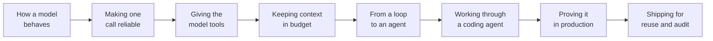

Each stage begins where the one before it hit a limit. A glossary and references close the post.

## Understanding how a model behaves

Every later stage takes four facts for granted: text is counted in tokens against a fixed window, output varies from run to run, models come in tiers, and a request has a shape you choose.

### Count in tokens against a fixed window

A model does not read characters or words. It reads **tokens**: chunks of text. Their average size depends on the tokenizer and changes between model generations, so any characters-per-token rule is only a rough guide.

Everything is counted in these tokens: your prompt, the conversation history, tool definitions, tool results, and the response. So tokens are what you pay for and what your budget is measured in. What will a feature cost? Does an input fit? Count tokens, not words.

That budget is the **context window**: the total number of tokens a model can take in for one request, from the system prompt to the last tool result to the answer being generated. It is fixed, and it has two edges. The diagram shows what current Claude models do at each edge.

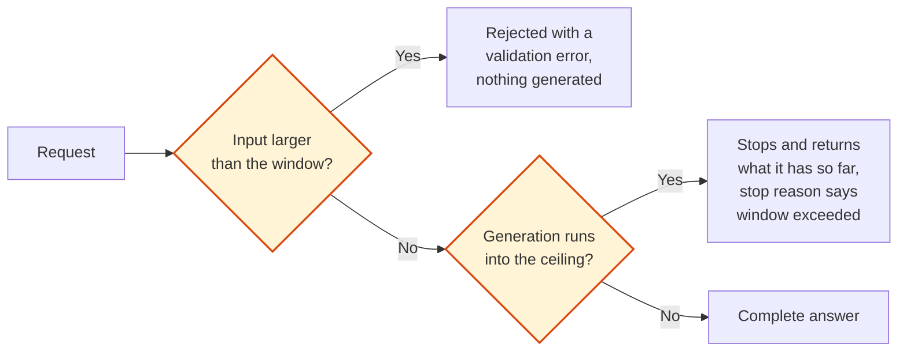

In neither case does the API quietly drop your oldest messages. So keeping a long session alive is your application's job: trim or summarize history before each call.

So what you send can be counted. What comes back cannot be predicted the same way.

### Test properties because output varies

What comes back varies because a model does not pick one fixed next token. At each step it produces a probability distribution over possible tokens and samples from it. This is **sampling**, and it is older than it looks.

In his 1948 paper [A Mathematical Theory of Communication](https://people.math.harvard.edu/~ctm/home/text/others/shannon/entropy/entropy.pdf), Claude Shannon built approximations to English by choosing each next word according to how often it followed the previous one in real text. He did it by hand, opening a book at a random page and reading on until the current word turned up again. His second-order word approximation begins "THE HEAD AND IN FRONTAL ATTACK ON AN ENGLISH WRITER." Each pair of words is plausible, and the whole is nonsense.

A modern model runs the same loop with a far better estimate. The estimate makes it fluent. The unchanged sampling step makes it vary from run to run.

Settings such as temperature shape that distribution: lower values concentrate probability on the likeliest tokens and make output more repeatable, higher values spread it out. These controls depend on the model. The newest Claude models reject non-default temperature, top_p, and top_k with an error and are steered through prompting instead. And even temperature zero does not guarantee identical output.

The consequence is **non-determinism**: identical inputs do not guarantee identical outputs. So a test that asserts the exact text of a response will flicker, because a correct answer can be phrased many ways. Assert on what must hold instead: a required field is present, a value is in range, the structure parses. To judge meaning rather than shape, you need an eval with a model as grader, which the stage on production builds.

Every model varies like this. Models differ in cost and capability.

### Start on the balanced tier

Models differ by tier, and tiers trade cost, latency, and capability. Claude currently spans four: Haiku for speed and cost, Sonnet as the balanced default for most production work, Opus for demanding work above Sonnet, and Fable as the most capable tier for the hardest reasoning, coding, and agentic tasks.

The rule is short: start with the balanced default and move only when an eval says so. Whether the model also reasons before answering is a separate lever, set per request, and the next stage covers it. The stage on production adds a router that picks a model per step.

Whichever tier you pick, your program has to reach it.

### Pick the request shape by who is waiting

To reach the model, your code calls an HTTP REST API: it sends a JSON request with an API key and reads a JSON response back. Any HTTP client works, but most teams use an official **SDK**, a thin layer that handles authentication, request construction, retries, and parsing. Both reach the same API and the same model.

So the real choice is the shape of the response, and it follows who is waiting. The diagram shows the four shapes.

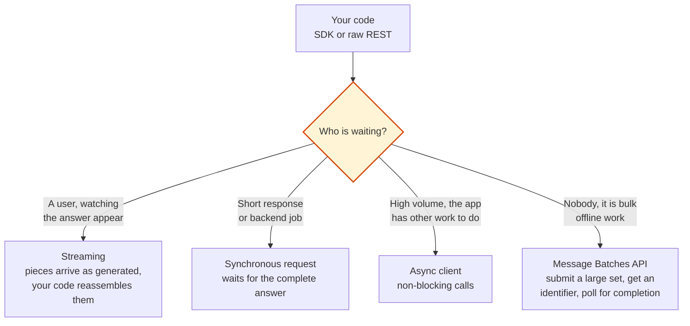

**Streaming** makes output appear immediately, and Claude streams over the same HTTP connection using server-sent events. Async clients include the Python SDK's async client and the promise-based TypeScript client. The **Message Batches API** runs at a lower price.

Of these facts, variation causes trouble first, as soon as nobody reads the answer.

## Making one call reliable

Because output varies from run to run, writing code that uses a model is different from using a model to write code. In a chat you read the answer and adjust. In a program nobody is there to adjust, so the prompt has to hold up on inputs you never saw.

A single call becomes reliable in three steps: diagnose the prompt, move control into the API where you can, and decide how much the model should think first. Each step guards against a failure that is easy to miss in development and expensive to fix once it ships.

### Diagnose the failure before you re-prompt

When a prompt breaks, the instinct is to add more words and try again. That rarely helps, because rewording does not add the missing structural piece. Clearer phrasing will not stop a model from blurring your instructions with your input data. And "please format this correctly" will not stop a drifting output format.

So diagnose first, then add the one technique that addresses the failure. Four failures are common, and each points to a fix, as the diagram shows.

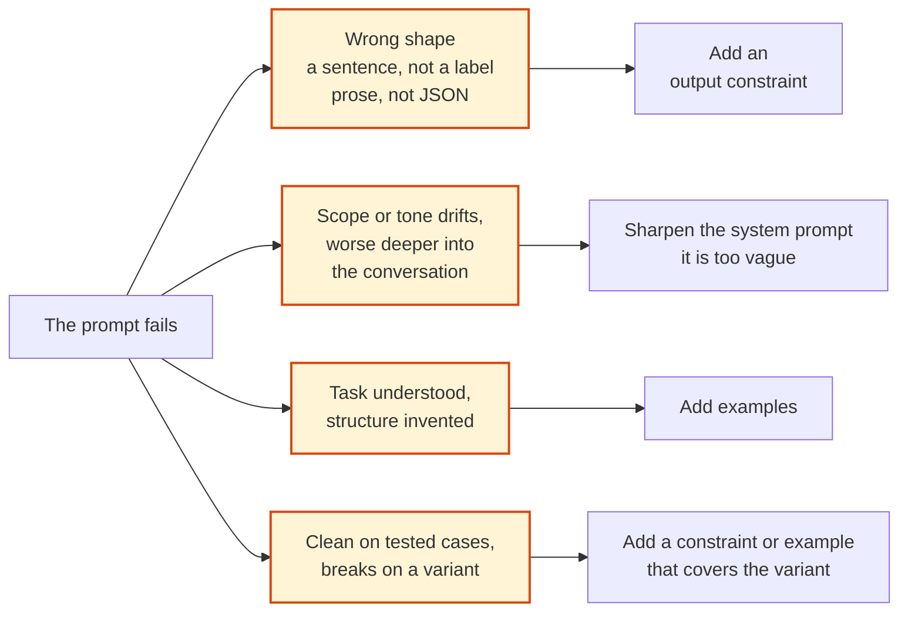

An **output constraint** names the form, the field names, and the stopping point. The **system prompt** is the behavioral contract for the whole session. Examples are needed because the model cannot infer an exact shape from a description.

Across all four, **XML tags** with descriptive names, such as `<my_code>` and `<docs>`, mark where instructions end and data begins, so the model does not read one as the other. Each failure is a missing piece of structure, which is why more words cannot supply it.

Of the four fixes, examples need a rule of their own.

### Add the fewest examples that pass the eval

Each example buys quality at a token cost on every call. **Zero-shot** gives the instruction alone. One-shot adds one example of an input paired with the desired output. Multi-shot, also called **few-shot**, includes several. These examples are not training data. They sit in the prompt and show the exact shape you want.

So use zero-shot when the task is simple and the output shape is obvious. Add one or two examples when the output has a specific structure, casing, or edge case that instructions keep missing. They usually fix that faster than another paragraph of instructions.

This choice interacts with the model tier: a more capable model may succeed zero-shot where a smaller one needs examples, so examples can let a cheaper model do the job. So try the smallest model and the fewest examples that pass your eval, and add only where the eval says you must.

A bare support-ticket prompt, "You are a support classifier. Classify the ticket," returned "Billing" on some runs, "billing" on others, and occasionally "This looks like a billing issue." The router downstream broke on the inconsistency.

The fix stacked three techniques: a system prompt that allowed exactly one label from BILLING, TECHNICAL, or ESCALATION and nothing else, two tagged examples showing the exact casing, and tags keeping those examples apart from the instruction.

```text
System: You are a support classifier. Classify each ticket into exactly one of:
BILLING, TECHNICAL, ESCALATION. Return only the label. No other text.

<sample_input>My account shows two charges for April.</sample_input>
<ideal_output>BILLING</ideal_output>
<sample_input>The API keeps returning a 429 error.</sample_input>
<ideal_output>TECHNICAL</ideal_output>

User: <ticket>I was charged twice for the same month.</ticket>
```

One developer needed six revisions to reach that prompt, which shows the cost of skipping diagnosis. Pass one asked for one of three categories and got sentences back. Pass two added "be concise" and got inconsistent casing. Pass three added three paragraphs describing each category and got "billing/technical" for ambiguous tickets. Pass four forbade two categories and worked on 80 percent of tickets.

Pass five added more paragraphs about edge cases. The verbose prompt produced verbose output: over 2,000 characters per call, higher latency, and no gain in accuracy, because models tend to match their output length to their input. Only pass six, which replaced the instructions with a schema and two examples, worked on every ticket.

**Lesson:** if three re-prompts in a row have not helped, stop adding text and diagnose.

### Enforce the format in the API

Even a well-diagnosed prompt is still a request, and a model can occasionally return a stray sentence or malformed JSON. **Structured outputs** close that gap at the API level: generation is constrained against a JSON schema, so output that violates it cannot be produced.

Two forms exist. **JSON outputs** constrain the final response to your schema, which removes the parse-and-retry code around extraction calls. **Strict tool use** validates the arguments the model passes to a tool before your code runs. That matters in agent loops, where a malformed argument could trigger a wrong action.

The costs are real but small:

- The first request on a new schema is slower while the API compiles it, though compiled schemas are cached for a day.
- A short injected prompt adds input tokens.
- Refusals and truncation at the token limit can still return non-conforming output, so you still check the stop reason.
- JSON outputs cannot be combined with prefilling the assistant's reply.

So when untested inputs still break your parser, move control into the API. What remains is how much work the model does before it answers.

### Pay for thinking only where the task needs it

Prompting shapes what the model produces. Extended thinking shapes how much work it does first: the model reasons step by step in a separate thinking block before the block that holds the answer.

On current Claude models this is **adaptive thinking**. The model decides when and how much to think, and you tune depth with an effort setting rather than a fixed token budget. The older budget setting is deprecated and errors on the newest models. Thinking content is hidden by default unless you request a summary.

Thinking tokens are billed at the output rate, so a simple task at high effort pays for accuracy it does not need. The decision therefore follows the shape of the task.

| Task | Thinking |
|---|---|
| Multi-step reasoning that holds several constraints at once: a derivation, a multi-hop logic problem, planning dependent actions | Yes, with effort matched to depth |
| Mechanical work: classification, format conversion, lookups, field extraction | No. A constrained prompt is cheaper and just as accurate |
| Agent loops that plan across several tool calls | Yes, because reasoning before a plan reduces wrong-tool choices later. Budget for the planning step, not for every call |

Model tier and reasoning are independent levers, so they compose. A capable model with reasoning off is fast and direct. A smaller model with reasoning on spends more tokens to think. The hardest tasks pair a capable model with higher effort.

One rule is not optional. When thinking is on and the conversation uses tools, every thinking block must go back to the API unchanged on the next turn. Each block carries a signature that verifies the reasoning was not altered. Edit it, summarize it, or drop it, and the API rejects the request. Redacted thinking blocks follow the same rule, even though their content is encrypted.

The most common slip is stripping thinking blocks to save context. If reasoning is eating your budget, the answer is context engineering (the stage on context), not deletion.

But what does a reliable call do when the answer is not in the prompt at all?

## Giving the model tools

A reliable call can only answer from what it is given. Tools let it fetch and act, and they change your job: you stop steering language toward a good answer and start handing the model a set of actions, trusting it to pick the right one. The loop around the pick has rules that no prompt can bend. The pick itself is driven almost entirely by what you wrote in the schema.

### Answer every tool call in the very next turn

The most common misconception is that the model runs the tools. It does not. **Tool use** is a loop between the model and your code. You define each tool with a name, a description, and an input schema, and the loop runs as the diagram shows.

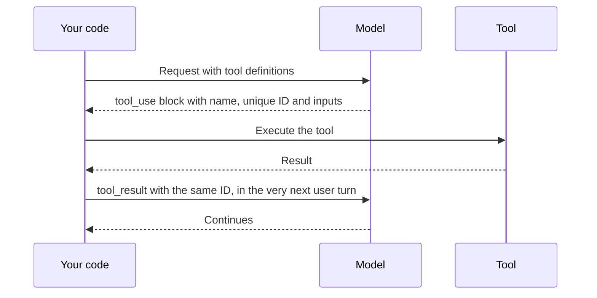

Nothing in that loop is automatic. If your code mishandles the return, the model never gets the data it asked for.

The conversation is built from typed blocks. A text block carries prose. A **tool_use block** carries a tool call. A tool_result block carries what your code returned, with the matching ID and an optional error flag. A thinking block carries reasoning when extended thinking is on.

The API enforces how these blocks pair: every tool_use block must be answered by a tool_result with the same ID in the very next user turn. A missing result, a mismatched ID, or results that arrive a turn late all fail validation. No prompt change will fix that, because the problem is structural.

Two more rules follow. Keep the whole content array: when the model returns text alongside a tool call, append the full turn, or you corrupt the context it relies on. And run dependent calls in sequence. Independent calls can run in parallel, and current models issue them that way by default. But where one call depends on another's result, they must run in sequence, and you can force one call per turn when needed.

So the loop is mechanical. The choice inside it is not.

### Write descriptions that tell the tools apart

That choice is won or lost in the name and the description. Names should be specific: `get_account_balance` tells the model far more than `get_data`.

The description should then say when to use the tool and when not to. "Use this to find information" is indistinguishable from any other tool that retrieves something. "Use this to retrieve the current balance for an account ID. Do not use this for transaction history" gives the model an exclusion condition. Three or four sentences per tool is about right, covering what it does, when to reach for it, and what it returns.

The input schema needs the same care. Mark a field as required only when the call makes no sense without it. If every field is required, the model invents values it has no basis for. And when two tools take the same parameter shape, routing falls back on the descriptions alone, so add language that separates their domains.

Overlapping descriptions are the usual reason the wrong tool runs. A developer spent a morning wondering why the model kept calling `search_docs` when the answer was already in the conversation. The senior engineer asked what the two descriptions said. One read "Use this to find information about the product." The other read "Use this to retrieve relevant information from the current session." From the model's side, both said "find information." The fix was two sentences per tool: when to call it, and when not to.

If descriptions cannot be separated even with exclusions, the tools probably should be merged into one with a type parameter. And exclusions only work when the model sees the full history, so truncating earlier turns silently breaks them.

All of this assumes you write the tools yourself.

### Borrow tools through MCP and pay for them in context

When someone else already has, you may not need to write schemas at all. The **Model Context Protocol (MCP)** moves tool definitions and execution out of your application into dedicated servers. For a service like GitHub, an existing MCP server already exposes repositories, pull requests, issues, and more.

Your client asks such a server for its tool list and passes the definitions to the model. The loop does not change, only who wrote and maintains the definitions. The same description-based routing applies, so the overlap trap from the `search_docs` story applies to tools you did not write, too.

But each connected server adds its definitions to the context window whether or not they are used. So connect only what you need. Claude's API connector lets you defer loading definitions and switch individual tools off.

Use MCP when a well-maintained server exists. Write schemas yourself when none fits or you need tighter control. Or use both: connect for breadth, and tune descriptions for the tools you actually route to.

Whoever wrote the tool, a call to it arrives in pieces when you stream the response.

### Commit a streamed turn only when it is complete

With plain text, a cut-off stream is just a short answer. With tools, it can become a half-formed action. Streaming makes long responses feel fast, but your code must assemble the final message from a series of events, and be ready for the series to stop early.

Each event describes one change, and your handler applies it to the partial state it is building.

| Event | What it does |
|---|---|
| Start | Opens the message |
| Block-start | Opens a content block with its type and index. A tool_use block opens with its name and ID but no input yet |
| Delta | Appends a fragment: text, a piece of a tool's JSON input, or thinking |
| Block-stop | Closes the block |
| Message-delta | Carries the stop reason and final usage |
| Message-stop | Says the stream is complete |

One rule keeps that partial state from corrupting: **do not act on a partial block.** The diagram turns it into three checks.

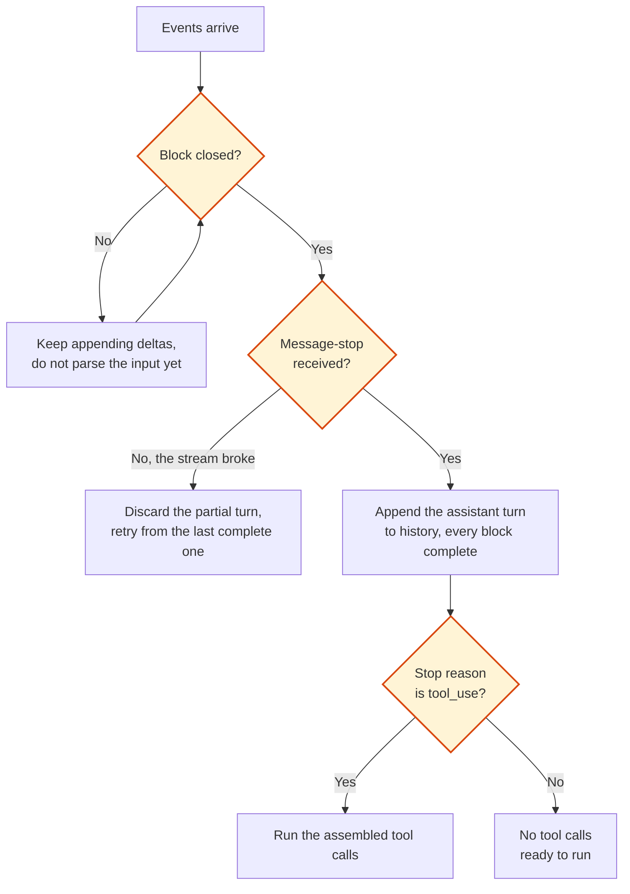

Why wait for the block to close? A tool call's input is a JSON string spread across many deltas, and it is not valid until then. Parse it early, and you crash or run the tool with half its arguments.

This bug hides in testing, because a fast local connection almost never cuts a stream short. One team's agent streamed so operators could watch it work, and its handler appended the turn whenever the read loop ended. On a fast local connection the loop always ended at message-stop. In production, a network blip ended one stream after a tool call had opened but before its input finished. The handler appended a turn with truncated JSON, the operator retried, and the retry failed validation on the corrupted turn.

The team spent an afternoon on the schema and the retry logic, because the error appeared on the retry. The cause was upstream: a stream ending is not the same as a message completing. Where nobody is watching, as in short responses or backend jobs, a plain non-streamed call avoids the whole problem.

But every committed turn stays in the window. What happens when it fills?

## Keeping context inside its budget

Tools are where the context window starts to fill. Every tool result is appended to the window and stays for the rest of the session. In a single call that is invisible. In an agent running ten or twenty tool calls, the window fills fast, and the agent either compacts and loses detail or stalls before finishing.

The answer is **context engineering**: deciding in advance what enters the window, what comes back out as a summary, and what never enters at all.

### Decide what leaves the window

Context engineering starts with the model choice, which sets the price and speed floor, and with an honest view of the window as working memory. Production fills that memory sooner than development: inputs are longer, production tool outputs are often three to five times longer than test fixtures, and sessions run longer.

Four strategies keep a session in budget. The diagram shows the situation each one fits and what it costs.

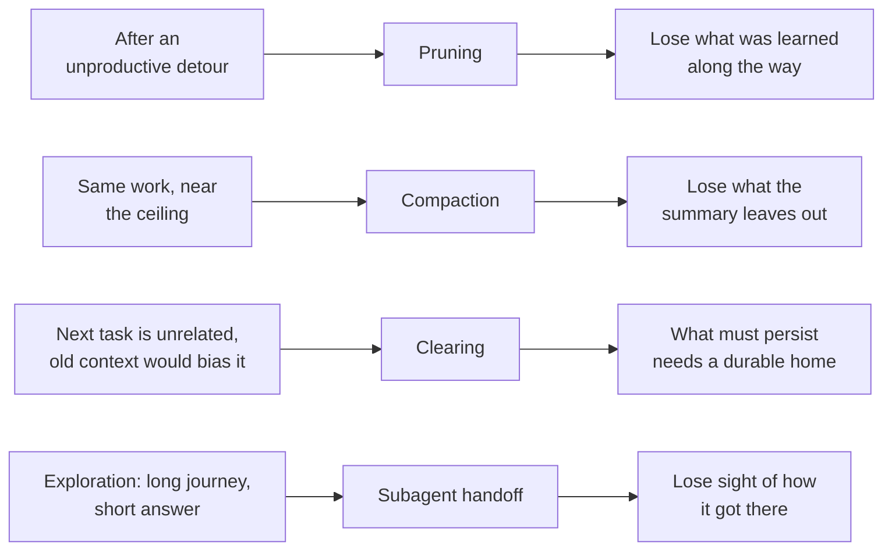

**Pruning** rewinds to an earlier message and drops what came after. **Compaction** summarizes history into a shorter version that keeps what matters. In Claude Code it is a command. On the API it is a server-side option in beta, or a summarizer you write yourself. **Clearing** starts fresh. A **subagent** handoff gives a self-contained task to a separate agent with its own context window and only what it needs, and gets back a short result.

When you write your own compaction, the summarizer prompt decides what the agent will know next. "Summarize the conversation so far" tends to drop task-critical state: which files changed, what was decided at a branch point, and which errors were hit and fixed.

By contrast, "Summarize the conversation, preserving every file path modified, every decision made, and every error encountered with its resolution" produces a summary the agent can use. An under-specified summarizer is one of the most common reasons agents fail across sessions.

Running out of window usually looks like something else. A receipt-processing agent ran under a 40,000-token budget the team set for cost, well below the model's own window. In development, twenty receipts produced tool results of about 800 tokens each, and a full session used about 18,000 tokens. In production, receipts came with supporting documents, results averaged about 3,200 tokens each, and the budget filled at turn eight.

The agent started picking wrong tools and returning incomplete analyses, which looked like a schema problem. In fact, accumulated tool output had crowded the system prompt and early instructions out of the window. The fix: prune tool outputs after use and compact before the cap.

**Lesson:** when tool selection degrades after a fixed number of turns, check the window before the schema.

Token counting would have caught this before launch. It measures a request before you send it, so you can check budgets against real tool outputs in development and stop oversized requests in production before they fail.

What has to stay in the window on every call can at least be made cheaper.

### Cache the prefix that repeats exactly

**Prompt caching** cuts the cost of what is already in the window: it stores the processing of a stable prefix, so later requests reuse it at a fraction of the price.

Caching is enabled per request, not by an account-wide switch. You either mark breakpoints yourself, up to four per request on the last block of each prefix you want cached, or turn on an automatic mode that places them as a conversation grows. Explicit breakpoints give finer control.

Requests are processed in the order tools, system prompt, then messages, so a breakpoint after the tools caches the tool definitions while the messages stay dynamic. So put what never changes first and what changes every turn last. Long system prompts and tool definitions are the best candidates.

Caching pays when reads outnumber writes, and the bar is low. Compared with ordinary input, a cache write costs about 1.25 times for the five-minute lifetime and 2 times for the one-hour lifetime, while a read costs about a tenth. So one reuse already pays for a five-minute write, and a one-hour write needs two.

But a prefix only gets reused under three conditions, as the diagram shows. Miss one and you pay the write premium for nothing.

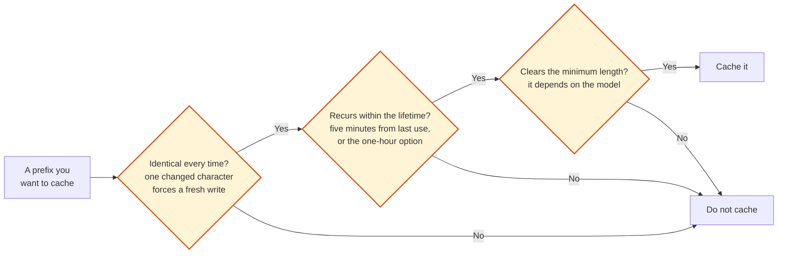

The one-hour option suits agents that pause between steps. And cached content can be stale, which is fine for a fixed system prompt and dangerous for anything that should reflect live state.

But caching cannot help when the material is too large to send at all.

### Retrieve a slice when the material does not fit

For such material, retrieval gives each request only a slice, in one of two ways. Classical **RAG** chunks and embeds the material ahead of time and matches questions against the index, like a librarian who has already summarized every chapter.

**Agentic search** skips the index and lets the model search and read at the moment of need, like a researcher who goes and finds the answer. Claude Code's deferred tool loading and Claude.ai Projects with large knowledge bases both work this way. Either way, retrieval is only as good as what it finds, so descriptive file names and well-organized material matter.

A pre-built index is inspectable and testable, but it must be built, synced, and secured, and like a cache it can go stale. Searching at query time avoids the index and its staleness, at a higher cost per query. So the choice follows the corpus and the questions, as the diagram shows.

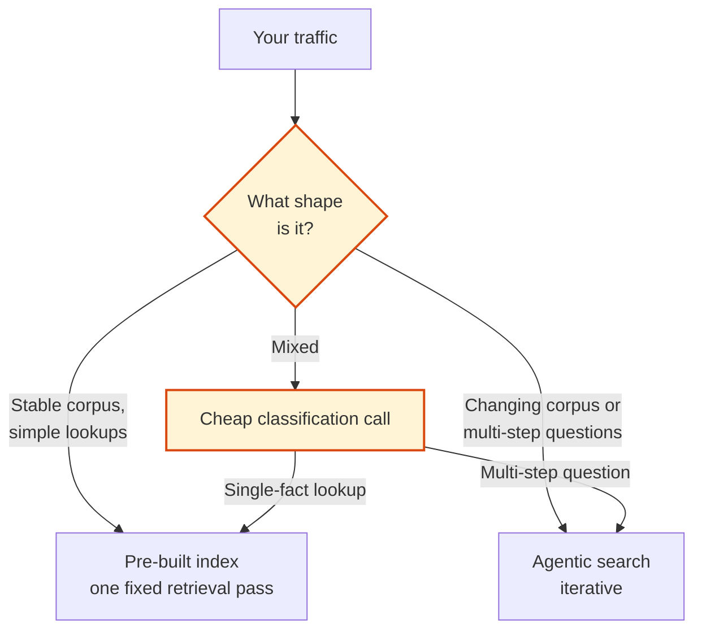

With the router on the mixed branch, you pay for iteration only when the question needs it. If all your traffic has one shape, skip the router and hardcode the path that fits.

An index can break in three places:

1. **Chunking.** Chunks can be too small to be useful or too large to match well. Sentence- or section-based chunks with a little overlap are a sensible default.
2. **Matching.** The embedding match retrieves what is semantically close, which can miss an exact identifier, so a lexical match is sometimes run alongside it.
3. **Assembly.** Retrieved text must reach the model in the structure the prompt expects, or the model answers from memory.

Those three concern text. And text is not the only thing that spends the window.

### Price images and documents before you send them

Images and documents spend context before the model reads a word of your prompt. Claude sees images in 28-by-28-pixel patches, so an image costs roughly its width divided by 28 times its height divided by 28 in visual tokens. A 1,000-by-1,000 image is about 1,296 tokens, so ten high-resolution screenshots weigh as much as a long system prompt. Each model tier has its own maximum resolution, and larger images are downscaled first.

So run that arithmetic on your largest production image before writing the ingestion code. The fix is often a resize step that takes minutes to add.

There are three ways to send an image:

- **Inline base64** suits one-off images, though the bytes travel with every request.
- **A public URL** avoids the payload but needs a stable, reachable link.
- The **Files API** uploads once and references a file ID from then on, which suits assets reused across requests or conversation turns. It is in beta and not on every cloud route.

PDFs use a document block with the same source options. The prompting techniques from the second stage still apply, plus guidance for visual ambiguity, such as how to treat overlapping objects.

Volume is the other way token spending gets out of hand: not the window, but the number of requests and the bill.

### Batch the work nobody is waiting for

For volume, looping over the synchronous API is the wrong model, and splitting the list into chunks does not change that. One developer kept hitting rate limits on a nightly job despite chunking, until a senior engineer pointed out that the API still saw one request per item, back to back.

The right model is the Message Batches API from the first stage. It takes up to 100,000 requests or 256 MB in one submission and processes them asynchronously at lower cost. A batch can take up to 24 hours, and results come back in arbitrary order, matched by a custom ID you set on each request. So it is right for nightly pipelines and evaluation runs and wrong for anything a user is waiting on.

Batches also combine with the features above. A scheduled job that reuses a long fixed prompt can cache it. A nightly job that reuses the same assets, such as classifying images against a fixed taxonomy, can upload them once through the Files API.

Now the model has tools and a window that stays in budget.

## Turning the loop into an agent

Tools, managed context, and a defined goal make an agent: a multi-step tool-use loop. Running that loop over many turns brings new failures. So the first design question is whether the problem needs an agent at all.

### Choose an agent only when the path is unknown

One test decides it: can you write the path down before the run starts? The diagram shows the test, and below it the three ways to wire an agent.

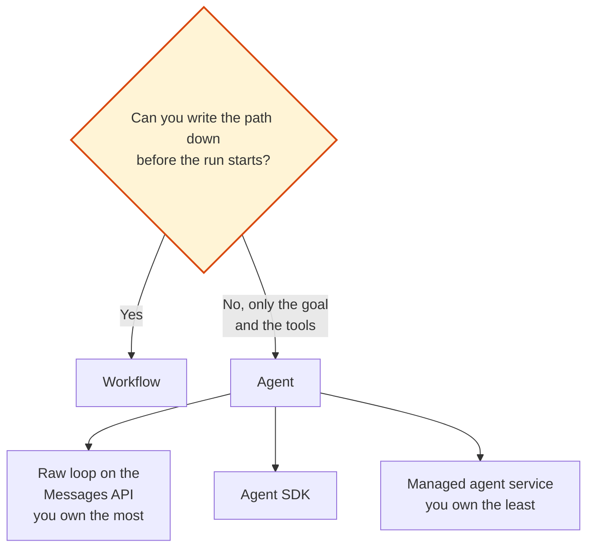

Choose a **workflow** when you can write the exact steps in code, errors are costly, standard observability matters, inputs are well constrained, and every run follows the same sequence. Choose an **agent** when you can state the goal and the tools but not the path, inputs vary unpredictably, the registered tools constrain the actions, and some non-determinism is acceptable.

Both wrong choices cost you. An agent where a workflow would do adds behavior that lives only in transcripts. A workflow where an agent is needed breaks the first time input leaves the planned path.

If the test says agent, the bottom row of the diagram is the next choice.

### Decide how much of the runtime to own

For an agent, the loop is the pattern and the wiring is an implementation choice. Three paths differ in how much of the runtime you own:

- **A raw loop** against the Messages API gives full control. You own the loop, tool execution, context, retries, and exit conditions.
- The **Agent SDK** runs the loop that powers Claude Code inside your own process. You still execute the tools. A setting controls whether project files such as CLAUDE.md and skills load, so set it explicitly rather than trust the default.
- **A managed agent service** runs the loop and a sandbox on the provider's side. Your application streams events in and results out. For Claude it is in public beta. It suits long-running work and saves you building a sandbox, but sessions are stored server-side, which currently rules it out for zero-data-retention and HIPAA workloads.

A common path is to prototype on the SDK and move to the managed service, expecting to rewrite the agent definition, not export it. And regulated data can rule out some paths before any wiring, as the last stage shows.

### Stop the loop in code and pause it for a person

Whatever the wiring, the loop needs four things: registered tools, a system prompt scoped to the task and to the tools that actually exist, an answer to every tool call before the next turn (the pairing rule from the stage on tools), and explicit exit conditions.

An exit condition is something your code checks, such as a turn limit, a token budget, or a passing check. It must not depend on the model volunteering to stop. Keep the tool set minimal too. Registering every tool "just in case" degrades selection, so start small and add a tool only when a real gap appears.

Code can stop the loop, but it cannot judge every step. So the loop also needs at least one human-in-the-loop (**HITL**) checkpoint. One question places it: what is the worst outcome if this step runs unchecked? The diagram shows the three gates that question leads to.

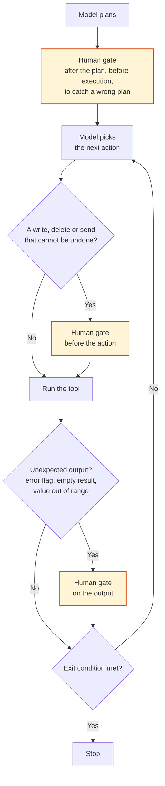

One configuration agent shows why gates belong in the design. It could read, write, and validate config files, retrying its edit up to ten times until validation passed. In a scratch directory it worked every time. In a customer environment it found an out-of-range rate limit, corrected it, validated it, and stopped after one clean iteration, as designed.

The customer's application depended on the old value and began failing within minutes: validation checked the schema, not downstream dependencies. The loop was fine. It lacked a pause between "change proposed" and "change written to a live system," which the scratch-directory tests never needed.

**Lesson:** a met exit condition tells you when to stop, not whether the result is safe to apply.

Gates and exit conditions decide how a run ends. Memory decides what survives it.

### Choose what the agent remembers next session

An agent remembers nothing when its session ends, so memory scope decides what it knows at the start of the next one. Too much in-context state inflates every call. Too little persistent state makes the agent forget.

Four scopes sit between those mistakes.

**In-context memory** keeps state in the live conversation, with no retrieval overhead, but its token cost grows with every turn, and it is lost when the session ends. **External storage**, such as a database, is read back in the next session. It survives across sessions, users, and instances, at the cost of latency and read-write code.

**Summarized memory** injects a condensed version of earlier conversations. That is cheaper than replaying history, but limited to whatever the summarizer kept. **Stateless** carries nothing, which is correct for jobs that finish and close.

So choose at design time, by the shape of the session. An assistant that picks up a user's thread each day needs external storage. A formatter that transforms one file and exits is stateless. A multi-hour coding session that will not continue can stay in context.

A support-escalation agent shows the failure. Development ran single long sessions, and in-context history worked. Production ran many shorter sessions across days. By the fourth session the injected history alone exceeded 40,000 tokens, and with the system prompt and tools the total passed 45,000 before the first useful turn. The agent returned incomplete results that looked like tool-selection failures.

That symptom matches the receipt agent in the stage on context, but the cause is history carried across sessions, not tool output piling up inside one. Moving history to external storage and injecting only the relevant part was not hard. Under production pressure it cost far more than a design-time decision.

### Load repeatable instructions as skills

Repeatable instructions are a separate problem from state. The pattern for them is a **skill**: a SKILL.md file with a name and description in its frontmatter and instructions below. Only the name and description load at startup. The full instructions load when a request matches the description.

By contrast, a project instruction file such as CLAUDE.md loads into every Claude Code session, and in-context instructions grow with the conversation. So use the instruction file for always-on project standards, skills for task-specific expertise, and in-context instructions for one-off work.

So far you have built this loop yourself. You do not always have to.

## Working through a coding agent

A coding agent such as Claude Code is the same agent loop, already built. The challenge now is making your setup configurable, shareable, and safe to connect to real systems.

On your own machine every shortcut feels fine: the permission mode, the small rules file, the script path, the credential in the config, the connection that worked in staging. Each can fail the moment the work leaves your machine. Claude Code is the example, and other coding agents have similar concepts.

### Set the permission mode by risk, not by speed

A coding agent runs the same tool loop as the API, plus a permission system that decides which actions need your approval. It works in three phases: it explores the codebase by reading files and tracing logic, it proposes a plan, and only after you approve does it write and run changes. That order produces better changes, and the last phase is where permissions apply. The diagram shows the phases and how one action is checked.

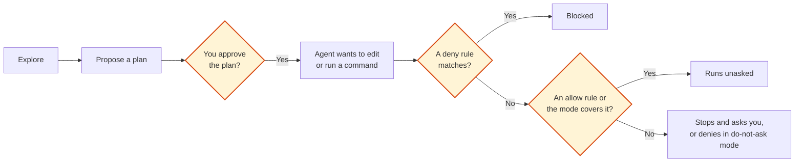

A **permission mode** sets how often the agent stops to ask, and Claude Code has six.

| Mode | What it does |
|---|---|
| Default | Allows reads, prompts before nearly every edit or command. Safe but slow. The right start for an unfamiliar codebase |
| Accept-edits | Also approves file edits and common filesystem commands inside the working directory. Other shell commands, writes outside it, and protected paths still prompt |
| Plan | Research only. Blocks all edits until a plan is approved |
| Auto | A separate classifier approves safe actions and blocks anything that escalates beyond your request. By default it blocks production deploys, mass deletes, credential theft, and force-pushes to main. A research preview, not a guarantee |
| Do-not-ask | Runs only pre-approved tools and denies everything else. For locked-down CI |
| Bypass | Skips every check except a last-resort prompt on catastrophic deletes. Only for a disposable container |

A mode is set in settings, which live at four levels:

- **User settings** follow you across projects.
- **Project settings** are committed, so the whole team shares them.
- **Local project settings** hold personal overrides and are ignored by git.
- **Enterprise managed settings** are set by administrators and cannot be overridden.

Allow and deny rules sit on top of the mode at each of these levels, and a deny always beats an allow. So an enterprise-level deny is the most durable control there is: no developer can remove it, and it holds even in bypass mode.

Permission mode is a risk decision, not a speed decision. After three quiet days, one developer switched to bypass to rename old API endpoint references, a task that felt routine. The pattern matched files in both the source tree and a production config directory. The cleanup script ran without a prompt and deleted three files of production endpoint overrides. Default or accept-edits mode would have stopped the script call for approval.

**Lesson:** before switching modes, put deny rules on sensitive directories. For fewer prompts, use a classifier-gated mode, not a full bypass.

Modes decide what the agent may do unasked, not where a person must still look.

### Keep a person on what cannot be undone

Where a human must look follows the worst-outcome rule from the stage on agents. It sorts actions into three groups:

- **Let through** low-stakes, reversible actions, such as a formatting fix inside the working directory.
- **Gate** anything hard to undo or touching a sensitive path, such as writes outside the project, destructive commands, or security-relevant files.
- **Never let the agent be the only gate** on code your team has marked sensitive, however confident its own review sounds.

AI code review deserves the same calibrated trust. A review gives you findings to triage, not a verdict to apply. So trust what the reviewer can prove from the diff in front of it, such as a missing null check or an unclosed resource, and confirm it on the lines it cites. Treat any claim about runtime behavior or another system as a hypothesis to test.

Put the human gate where a finding turns into an action that is hard to reverse. And give the reviewer the conventions it would otherwise guess, which improves its accuracy.

Those conventions are part of the project context.

### Keep always-on context small and enforce the rest

Project context controls what the agent knows and how it behaves, session after session. Four mechanisms carry it, each with a different trade-off between context cost and reliability.

The first is **CLAUDE.md**, a file at the project root that loads into every session before your first message, so its conventions, constraints, and commands are always present. The init command generates a starter version. Prune it to the rules that change outcomes: test commands, framework conventions, paths not to touch, and departures from defaults. Size is its main failure mode, because every line dilutes every other line.

Second, **rules files** in the project's rules directory add a narrower layer. A paths pattern in a rule's frontmatter loads it only when the agent works on matching files. One example: every SQL file in the database module must declare a transaction boundary. Without a paths field, a rule loads at startup like CLAUDE.md, whatever folder it sits in.

The third mechanism is not an instruction. **Hooks** run your own scripts at fixed points in the agent's lifecycle. A pre-tool hook runs before a tool call and can block it by exiting with code 2 and explaining why. A post-tool hook runs after a call and suits formatting, tests, and audit logging. Other events fire when a prompt is submitted, when the model stops, on notifications, and when sessions start and end.

Unlike instructions, hooks fire every time, whatever the model decides. A rule in CLAUDE.md is followed most of the time. A hook is followed every time. That is the difference between a convention and a guardrail.

Fourth, **subagents** run delegated tasks in their own context and return only a result. The built-in Explore and Plan subagents skip CLAUDE.md and git status for speed, so they do not see project rules. The general-purpose subagent loads both. Custom subagents inherit the parent's permissions, but not your skills or its history.

An 847-line CLAUDE.md shows the dilution. Over two months the team had added framework preferences, testing conventions, a style guide, dependency rules, path restrictions, a historical decisions log, and archived notes. Line 347 said not to modify a legacy tokens directory.

Asked to refactor an auth module, and told again not to touch that directory, the agent still edited a file in it while updating an interface. The rule was there. The 846 lines around it outweighed it.

**Lesson:** keep CLAUDE.md to the rules that change behavior now. Move path-specific guidance into rules files and history into reference documents. Turn the one rule you cannot afford to lose into a hook.

With permissions and context in place, the setup works, but only for you.

### Package the setup so it runs off your machine

So how does a teammate install it in one step? Start with the skill from the stage on agents. It lives in the project's skills directory and can run in four places, and the table shows how it loads and runs in each.

| Runtime | How the skill loads and runs |
|---|---|
| Claude Code | Discovered from the filesystem. Runs locally under your permission rules |
| Messages API | Sent with the request. Runs in the provider's code execution container, behind beta headers, so a skill that calls a local script will not find it there |
| Agent SDK | Loads only if you set the setting sources explicitly. The most common surprise is a skill that worked in the terminal doing nothing in the SDK, because that setting was never set |
| Managed agent | Attached to the agent definition. Runs in the provider's sandbox |

So three rules keep a skill portable. Write the description as the matching criterion. Do not assume local files or tools exist. List the skill in the frontmatter of any subagent that needs it.

Explicit entry points are now skills too. You invoke a skill by name with a slash command, and a frontmatter flag stops the model from loading it automatically when it should run only on request. The older commands directory still works but is legacy.

A setup is more than one skill. A **plugin** bundles skills, hooks, subagents, and MCP servers into one versioned, installable unit, distributed through a marketplace. A plugin's commands are namespaced by the plugin's name, so two plugins can both offer a run-tests command without colliding, and renaming a plugin renames all of its commands.

A plugin reaches a teammate in three ways: the official marketplace, which is available by default; a third-party marketplace, added from a GitHub repository; or managed settings, through which administrators push it organization-wide. In all three cases the teammate installs it in one step. Administrators can also set an allowlist of permitted marketplace sources.

But a plugin carries only what it bundles. A deny rule or hook the author relied on locally does not travel unless it is included.

The classic packaging failure installs everywhere and runs only on the author's machine. One deployment-validation skill pointed at a script under the author's home directory, an absolute path that existed nowhere else. A second skill in the same plugin needed an environment variable set in the author's shell and never documented. Every install succeeded, every teammate's run failed, and three people spent two hours tracing the missing variable.

**Lesson:** reference scripts relative to the project or the plugin's own root, through the variables the tool provides for that. Bundle what the plugin depends on, document and validate every required environment variable, and test the install on a clean machine.

A plugin packages your own workflow. MCP servers expose what sits outside your codebase.

### Share outside systems through MCP servers

Wire a tool directly and each application owns its schema and code, so three applications that need the same service maintain three integrations. MCP turns the integration into one server that any MCP client can use.

Building such a server starts with what to expose. There are three kinds of capability:

- **Tools** are actions the model can call.
- **Resources** are read-only data the client fetches into context directly, at a fixed address or through a template with a parameter. That is cheaper and more predictable than a tool call when you know the data is needed. Client support for resources varies.
- **Prompts** are vetted instruction templates a client invokes by name, so every user gets the same carefully built wording.

Then come two choices. Transport is the channel between client and server, and it follows where the server runs. Scope decides who loads the server. The diagram shows both choices.

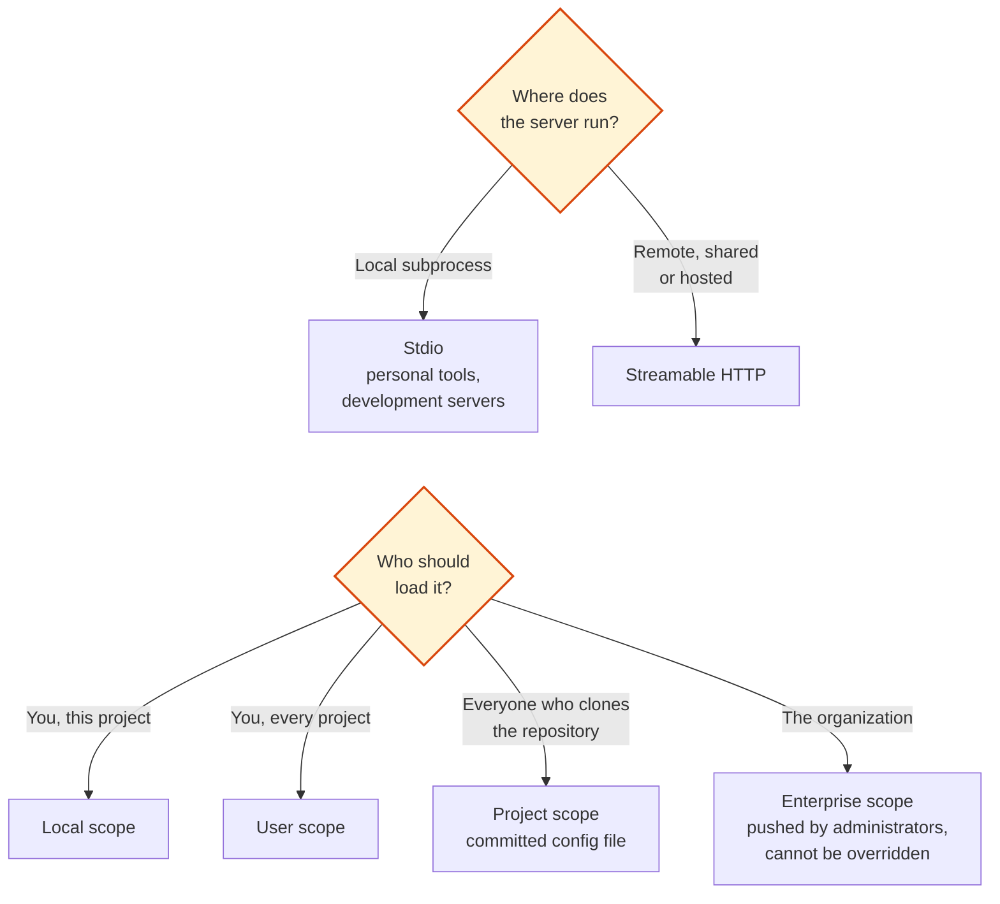

**Stdio** launches the server as a local subprocess, and **Streamable HTTP** connects to a remote server. The older SSE-only transport is legacy: it is deprecated and superseded by streamable HTTP.

Project scope writes the server to a committed `.mcp.json`. A project-scoped stdio server spawns a local process on each teammate's machine, so each needs the runtime installed. A stdio server in a committed config only looks shareable.

Sharing a server also shares its context cost, the one from the stage on tools. So Claude Code defers MCP tool definitions by default and searches for the relevant ones when a task needs them, with an option to load them upfront when they fit in about a tenth of the window.

Permission rules can target single MCP tools by server and tool name, such as letting only GitHub's create-issue tool run unprompted while everything else on that server still asks. A deny on one tool beats an allow on the server. The API connector's per-tool switch from the stage on tools is different: it controls what the model sees, not what it may do.

Two servers tie these choices together. GitHub's server is remote, so it uses HTTP. Project scope fits a team, local scope one person. The server authenticates with a personal access token passed as a bearer header, supplied through an environment variable and never written into the committed file. Linear's server uses OAuth instead: the first connection opens a browser sign-in, and the token is issued and stored without anyone copying a secret.

Both servers keep the secret out of the committed file.

### Treat a committed credential as compromised

The most common mistake is a key in the config. A developer connected a data-warehouse server with a service-account key written straight into `.mcp.json`, meaning to move it later, then committed the file so teammates could connect. Within two days the key was on three teammates' machines, in a CI runner, and in repository history.

Moving it to an environment variable fixed the current file but not the history. The account had to be rotated, which broke two other services using the same key and cost three hours.

**Lesson:** treat any inline credential in a committed file as compromised. Prevent it with an instruction in CLAUDE.md, and back that instruction with a pre-tool hook that blocks writes of credential-like values to the config.

With the key out of the file, authentication follows the service.

| Service | Method |
|---|---|
| Remote, tied to a user's identity | OAuth: the server signals that authentication is required, the client runs a browser sign-in, and a token is stored |
| Remote, acting as a service account | An API key from an environment variable or a pipeline secret, never a committed file |
| Local, over stdio | Filesystem permissions and deny rules |

Managing the secret matters as much as the method. It takes three practices:

1. **Separation.** The config holds a variable reference, never the value, because config files get committed and cloned.
2. **A home for the value.** An environment variable for something local and short-lived, and a **secret store** for anything shared or audited. A store centralizes the value, controls who reads it, logs access, and updates every consumer in one rotation.
3. **Rotation.** On a schedule, and immediately after any suspected exposure, because a leaked key cannot be made secret again. A value read by name rotates without touching code. A value baked into code cannot be rotated cleanly.

Scope each credential to the narrowest access it needs, and list what uses it, so rotation surprises nobody.

A customer's security team will ask more than how the connection authenticates.

### Answer the enterprise questions during scoping

A prototype answers one question: does the connection work? An enterprise integration must answer four more:

- Who does the model act as, and is that auditable?
- What data can it reach, and where does that data go?
- Can an administrator lock the configuration?
- Is access logged well enough for an audit?

Regulated customers ask three of those questions early, and each has a concrete answer.

| Question | Answer |
|---|---|
| Where does data go? | A regional endpoint, combined with a platform that pins processing to that region |
| How is access logged? | A post-tool hook that records every tool call and its parameters, which gives auditors their record |
| Does an administrator control configuration? | Enterprise managed configuration, which locks the integration so no developer can change authentication during an audit window |

Zero-data-retention eligibility varies by model and platform, so confirm it for each model you plan to use. Answer these questions during scoping, and the security review is a checklist, not a blocker. Audit hooks and locked managed settings are easy to build in and hard to retrofit.

One OAuth integration passed every staging test and failed every production sign-in with a redirect mismatch. The OAuth app was registered for the staging host only, and providers accept only registered redirect addresses. The security reviewer added that most enterprise customers want separate OAuth app registrations per environment anyway. So put the redirect registration on the deployment checklist, so it is not discovered at the first production login.

Code modernization tests everything in this stage, because it concentrates the risks: a large blast radius, unknown dependencies, and limited reversibility. Plan mode holds the agent in read-only exploration while you build confidence. Hooks block edits to the most sensitive paths. CLAUDE.md carries the target conventions, so the agent does not drift back to the legacy patterns it reads around it.

Before starting such a job, answer three questions. What breaks downstream if an edit is wrong? How is every change audited? Who approves each phase before the next begins?

Each of those three questions is a decision made before the work starts. The next stage is built on that habit.

## Proving it works in production

Working on your machine is not proof. In production, an untested input arrives, a rate limit hits at peak, a bill triples, or a fetched page carries an instruction aimed at the agent. The failure is almost never a bug in the code that ran. It is a decision that was never made. So write the decisions down, then build the layers that enforce them.

### Write the decisions down first

Before production code, write a short **design document**, usually one page. It records four decisions concretely enough to check the built system against, and each one feeds a later layer.

| Decision | What it records | What it becomes |
|---|---|---|
| Success criteria | What the feature must produce for representative cases, specific enough to grade | Eval cases |
| Failure handling | The errors production will throw, each retriable or terminal, and what the user gets when recovery is impossible | Error paths |
| Cost and latency budget | Per-request and monthly ceilings, the latency target, and the minimum reliability not to be traded away | What you instrument |
| Trust boundary | Which inputs someone else can write, and the smallest set of actions the feature needs | What a hook enforces |

A criterion like "summarize the thread" cannot be checked, but "a two-sentence summary listing every action item and its owner" can. If a coding agent does the building, hand it this page first.

The rest of this stage follows the four rows, starting with success criteria.

### Turn the success criteria into a score

An **eval** turns the success criteria into a number. It works like a thermometer: it does not make the system healthier, but you can trust the reading. Collect input cases, write the expected behavior for each, run the feature on all of them, grade each output, and average the scores.

Without an eval, "done" is a feeling. With one, it is a score you track across changes to the prompt, the tools, or the model. Write it before the feature, or you will rationalize whatever the model produces. The whole loop fits in a few lines.

```python
def run_eval(dataset):
    results = []
    for case in dataset:
        output = run_feature(case["input"])
        results.append(grade(case, output))
    return sum(results) / len(results)
```

A first score of two or three out of ten is normal. What matters is that it rises as you change one thing at a time. Read per-case results too: a steady average can hide three cases fixed and three broken.

Choose the grader by the shape of the output.

| Grader | Fits | Limit |
|---|---|---|
| Exact match | One correct form, such as a single label | Nearly free, but fails every valid paraphrase or reordering |
| Code-graded check | Output a rule can validate: valid JSON, parseable code, a number in range, a required field | Cheap, but blind to whether the content is good |
| **LLM-as-judge** | Open-ended quality no code rule captures: faithfulness, instruction following, tone | A model call per case, and noisier scores |

That is why many teams grade structure in code on every commit and run the judge on a slower schedule.

A judge needs an anchor and a calibration. To anchor it, ask for strengths, weaknesses, and brief reasoning before the score. Otherwise scores drift toward a safe middle around six. To calibrate it, check it against a human, as the diagram shows.

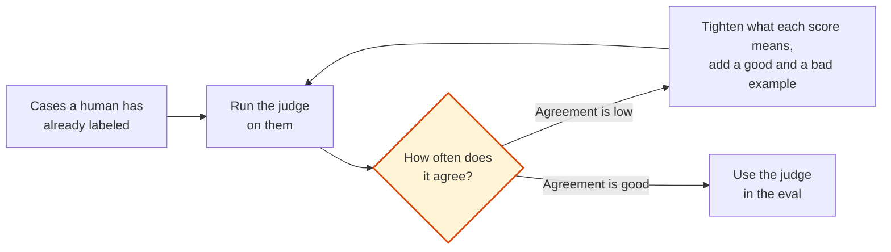

Coverage beats a perfect rubric. Twenty cases with awkward inputs catch more than three hand-picked ones, and the model can generate more from a labeled seed set for you to spot-check. A failed case's category then says where to look: formatting points at output instructions, facts wrong on retrieved content point at retrieval, and failures only on long inputs point at context handling.

Skipping this has a cost. A team shipped a field extractor after reading a dozen sample outputs. It validated that messages were non-empty and dates well formed. Two weeks later a customer wrote "I placed my order on March 3 but did not receive it until April 12," and the feature took April 12 as the order date. Every validation passed, because validation checks shape, not correctness, and a batch of records was updated wrongly.

Nobody had defined the expected behavior for a message with two dates. A prompt change fixed it, but the eval found the gap and now guards it. So ask the model which edge cases could break your implementation, such as two dates, no date, or "next Tuesday," and grade the plausible ones before launch.

An eval says how good the system is, not where it failed.

### Test the seams and trace every run

A passing eval can hide a break elsewhere. Tests isolate each kind of failure, and traces show which step went wrong.

Four test levels each catch what the others cannot.

| Level | What it checks |
|---|---|
| Unit | One function in isolation, such as a parser or tool wrapper |
| Functional | One model call returns the expected shape for an input |
| Integration | The handoff between two components, such as retrieval output passed into a model call |
| End-to-end | The full flow as a user runs it. It catches what only appears when everything runs together, but cannot say where |

Most silent failures hide where the **integration test** looks, because each side can pass its own tests while the handoff is broken.

Engineering learned this long before language models. In 1999 NASA lost the [Mars Climate Orbiter](https://en.wikipedia.org/wiki/Mars_Climate_Orbiter) because one team's ground software reported thruster data in pound-force seconds while the navigation software expected newton-seconds. The interface specification required newton-seconds, and the investigation board found that verification had not adequately covered the ground software. The error lived in the seam.

A model pipeline fails the same way. In one case the parser's unit tests and the model call's functional test both passed, and the full flow still failed. Retrieval returned a list of chunk dictionaries, the prompt builder expected a plain string, the context arrived malformed, and the model answered from memory.

**Lesson:** define the format contract between components and test the seam with real data.

A trace then records each step of a real run: the prompt, the tool calls, intermediate outputs, and timing. It turns "the case failed" into "step four, the parser, raised a KeyError on a field the model did not return," and a day of searching into a five-minute fix.

Tests show that failures exist, and traces show where. The second row of the design page says what to do about them in live traffic.

### Retry only the failures that time can clear

When a call fails in live traffic, ask one question: would retrying the same request plausibly work? The diagram sorts failures by that question, using the status codes of Claude's API.

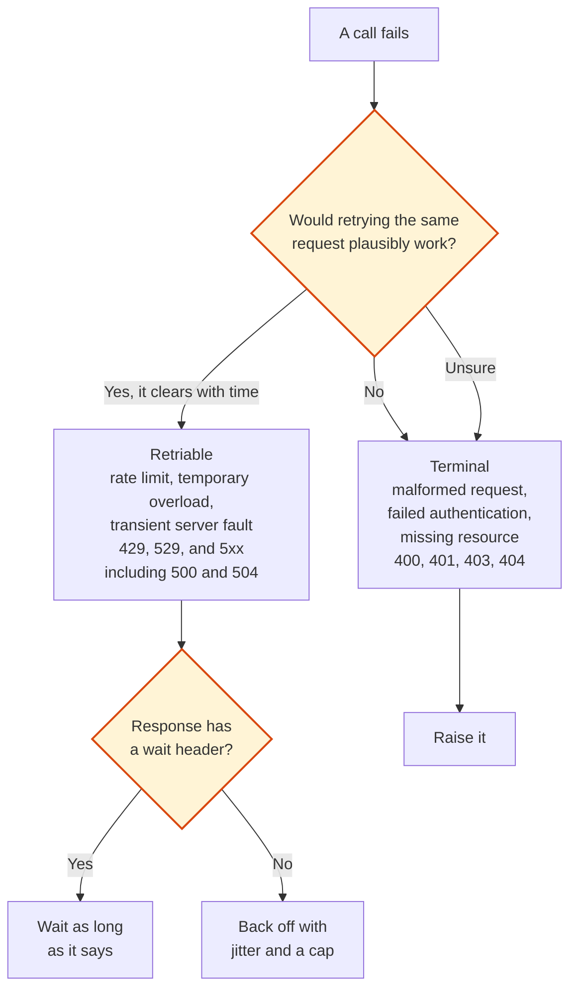

Retrying a terminal error burns the retry budget and buries the real problem under identical failures. So when unsure, choose terminal: it fails loudly and gets fixed, while a misclassified retriable error hammers a service. In code, the whole classification is one set.

```python
RETRIABLE = {429, 529, 500, 502, 503, 504}

def is_retriable(status):
    return status in RETRIABLE  # everything else fails fast
```

Check what the SDK does before adding retries. Claude's SDKs already retry transient failures with growing delays, and a second loop around theirs multiplies attempts against the rate limit you just hit. So decide where retries live. Rate-limit responses carry a header saying how long to wait, and honoring it beats guessing. Without it, fall back to **exponential backoff** with jitter and a cap.

Skipping that decision fails at the first traffic peak. One customer-facing feature called the API in a loop with no error handling, because nothing had ever failed in development. At the first traffic peak a rate-limit response raised an unhandled exception, and the whole request failed. The first fix, immediate retries in a tight loop, made it worse: every retry counted against the same limit. The right fix classified the error as retriable, backed off with a cap, and honored the wait header.

Two failures never arrive as an error status:

- **Tool failures.** Return the result with the error flag set and a short message, so the model can try another approach, ask for clarification, or stop. An empty result is treated as valid data and produces a confident wrong answer.
- **Refusals.** They come with an ordinary success status and a refusal stop reason, so a status-code classifier misses them. Raise them, log them, and never retry them silently.

Next is the third row of the design page: cost and latency.

### Choose the model for each step behind the eval

Recovery is not enough. The system must also be affordable and fast, and the model sets that baseline, since cost management only optimizes spend within a model.

Larger models cost more per token and are usually slower. Smaller ones are faster and cheaper at the risk of quality. Two caveats: a larger model can cost less overall if it finishes in fewer tokens, and small daily savings are a poor trade if the smaller model's errors are expensive downstream. Even so, defaulting to the most capable model is the most common and most expensive selection mistake.

You do not need one model for everything. Keep most traffic on the balanced tier from the first stage, and send specific requests up or down on a cheap signal such as task type, input length, or a difficulty classification.

The eval is the gate every time. Step up when the eval shows the current model failing the hardest cases and errors are costly, as in a dependent multi-step refactor where the middle tier misses the hard cases. Step down when the eval shows a cheaper model holding the bar on the bulk of traffic, as in a high-volume classifier the smallest model can handle. And route mixed traffic.

The eval gates quality. Per-call numbers gate cost.

### Log every call to find where the money goes

Development never shows you the bill. So log three numbers on every call from the start: token usage, latency, and error rate. Then a cost spike is no longer one question, "why is the bill high," but a sortable table that often shows one step doing most of the spending. A small wrapper is enough.

```python
def instrumented_call(make_call, step):
    start = time.perf_counter()
    resp = make_call()
    log_metric(step=step,
               input_tokens=resp.usage.input_tokens,
               output_tokens=resp.usage.output_tokens,
               latency_ms=(time.perf_counter() - start) * 1000)
    return resp
```

Cost and latency problems almost always trace to a few levers: the model for each step, the size of the prompt and context, the number of tool calls, and how output is delivered.

Streaming improves perceived latency: a response that starts in 300 milliseconds feels faster than one that arrives whole after two seconds. Prompt caching covers prefixes that repeat, and the Message Batches API covers anything that can wait.

All of these levers reduce cost. One design choice does the opposite.

### Fan out to many agents only when the work splits

No pattern multiplies cost faster than multi-agent orchestration. In an **orchestrator-worker** design, a lead agent splits a task, subagents work in parallel in their own context windows, and the lead combines the results. Treat it like hiring: five researchers finish a broad survey faster than one, and you pay five salaries.

Anthropic reported that its multi-agent research system, with Opus as lead and Sonnet subagents, clearly beat a single agent on its internal research evals while using roughly fifteen times the tokens of a normal chat. Token usage explained most of the performance difference, so the pattern works mainly by buying more parallel computation.

So the pattern fits broad tasks that split into independent parts, such as research across many sources. It fits tightly coupled work poorly, such as coding, where each step depends on the last. Each subagent needs its own retry and fallback handling, and a cheaper worker model reduces the multiplier.

On coupled work, fanning out only multiplies the bill. A developer who split a slow task across parallel subagents saw latency drop slightly, the bill triple, and answers barely improve. Each step depended on the previous one, so the subagents mostly waited on each other while each consumed its own tokens. A single agent with good context cut the bill and kept the quality.

But how far can cost be cut?

### Set the reliability floor before you cut cost

Cost is only half the budget. Reliability sets a floor you tune cost above, never below. Decide it first, for example a four-second ceiling and three retries per dependency. Then accept a cheaper model only if it stays inside both, and refuse to cut retries if failures would rise past the floor.

Why first? Cost pressure is loud and daily, while reliability problems look like noise until they become an incident. Setting the floor first stops the louder pressure from winning. A pinned eval baseline makes the floor checkable.

### Enforce the security boundary outside the prompt

Cost and latency trade against each other. Security, the fourth row of the design page, does not. It needs a hard boundary, which the hooks and logging you already have can enforce.

The core threat for any agent that reads content it did not write is **prompt injection**. A model reads its whole context as one stream of tokens, with no built-in line between your instructions and text from a fetched page, a document, a database record, an email, or a tool result.

So an instruction hidden in that content can be taken as a command, whether it sits in white text at the bottom of a page, in an image, or in a record the agent will read next week.

Model training and classifiers make current models resist many injections, and wrapping untrusted content in delimiters helps a little. Neither is a guarantee. Trusting your users does not help either, because the hostile instruction comes through the content, not the user.

So the reliable boundary is not in the wording. It is in what the agent is allowed to do. The diagram shows the three checks an injected instruction must pass before it becomes an action.

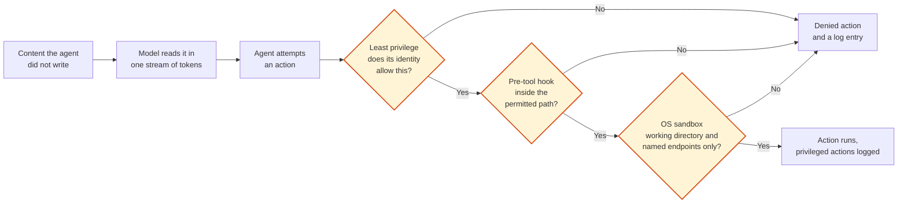

A jailbreak is a second threat with the same defense. It tries to make the model ignore its own safety constraints, while an injection tries to hijack your application's instructions. For both, validate and constrain what reaches the model, and limit what the model can do as a result.

That limit has three layers, one per check:

- **Identity and access.** Give the agent the narrowest permissions the task needs: write to one output directory, read only its input, and explicitly deny system paths, secrets, and cloud credentials. Keep secrets out of config, and protect the agent's own auth configuration, because whatever can widen its permissions can remove the control that limits damage.
- **Hooks.** A pre-tool hook denies a write outside the permitted path and logs the attempt. It also logs every permitted privileged action, so the control and its evidence exist before anyone asks. When several rules apply to one action, deny beats ask, and ask beats allow. A prompt instruction is not a security control. If something must hold, enforce it with a hook.
- **Sandboxing.** Hooks cover only what they explicitly check. Operating-system sandboxing restricts the agent's filesystem to its working directory and its network to named endpoints. The OS enforces it, not application logic, so it holds even when a hook is missing or misconfigured.

Now assume an injection gets through everything else. With broad permissions it becomes an incident. With **least privilege** it becomes a denied action and a log entry.

Two developers met this in a pairing session. Their agent fetched web pages and could write to one file path. All users were internal, so they had skipped validating fetched pages. Then the agent wrote a file nobody asked for: a line near the bottom of a summarized page told it to ignore its instructions and write the summary elsewhere.

The fix had two sides: treat fetched content as data, and put a hook in front of the write tool that refuses actions triggered by untrusted input. After that, the same injected line produced a denied write and an audit entry.

Now the build is proven, but only for the team that built it.

## Shipping it for reuse and audit

A build proven in production must still survive reuse, review, and deployment. Five things have to hold:

- A team that never spoke to you can configure the same template.
- A maintainer can verify a contribution without reconstructing anything.
- The platform follows from written requirements and passes a customer's residency review.
- The model is pinned, so an upstream change is a decision rather than a surprise.
- Connected components hold their trust boundaries under audit.

More of these decisions than you might expect are driven by the customer's existing cloud, compliance posture, and review process.

### Package the build while it is fresh

The most expensive thing on a delivery team is engineering time spent rebuilding the same thing for the next customer. An **accelerator** is a solution packaged so the next engagement starts from a working foundation. Customer-specific parts become parameters with documented defaults, so the asset is configured, not rewritten.

Do it while the build is fresh. Reconstructing intent months later, after the person who knew why a value was hardcoded has moved on, costs far more.

What you package usually takes one of three forms.

| Form | Bundles | Packaging means |
|---|---|---|
| Agent template | System prompt, tool schemas, loop structure | Pulling domain-specific values into configuration |
| MCP server package | Tools | Documenting each input and letting the installing team set the scope |
| Eval suite | A graded dataset and rubric | Shipping them together, so a new team can confirm the asset still works in their context |

The most common wrong form is an agent shipped as loose scripts. Every customer value hides in a different file, and the next team copies and diverges instead of configuring.

Then document what the code cannot say: the environment the asset assumes, the inputs it expects, the failures it already handles, and the eval that defines working. Bundle the audit story too: what data the asset touches, what identity it acts under, and what it logs. Without those, an accelerator passes a demo and stalls at the first security review.

It also fails the next team that tries to reuse it. One team shipped an agent template under deadline with the repository path, model name, review thresholds, and a few domain-specific prompt fragments hardcoded, then filed it as reusable. Months later a second team found nothing to configure, no note of which values were customer-specific, and no eval to tell them whether their edits worked. They rewrote it from scratch.

**Lesson:** a template that runs has not been packaged. The warning signs are no parameters, no documented assumptions, and no bundled eval.

### Contribute what a maintainer can verify

Packaging for your own team does most of the work of sharing, because a maintainer needs the same parameters, documented assumptions, and bundled eval. Contributing back moves an asset from private reuse into shared infrastructure, through a channel built for it. Anthropic's Cookbook, for example, is a repository of focused reference implementations, while open-source tools and MCP servers each have their own repositories and conventions.

Sending a whole multi-component application where one focused pattern belongs is one of the most common reasons contributions never get reviewed.

Maintainers accept what they can verify. Four things make that possible: code that does one thing, an example that shows it running, a test that proves the behavior, and a short statement of assumptions. A conversation-handling pattern from a customer-service engagement, stripped of customer specifics and reduced to one clear example with a test, is the kind of contribution that gets accepted.

Rights come before any of this technical review. Code from a customer engagement may have restrictions on where it can go. Confirm you may contribute it and attribute what you built on, or legal will have to unwind it later.

Without them, good code still waits. One developer's pull request sat unreviewed for three weeks, though the code worked and was used daily. The maintainer could not tell: there was no test to run, no example to watch, and nothing saying what the code assumed. Reviewers handle what they can verify quickly and leave the rest until they have time to reverse-engineer it.

Where the asset runs is the next decision.

### Write the requirements before you choose a platform

Where a build runs should follow from requirements, and there are two kinds.

A functional requirement states what the system must do, specifically enough to check. "Help support agents answer faster" is a business problem. "Classify each ticket into one of four queues, draft a reply citing the relevant policy, and never send without human approval" is a set of functional requirements, and each can become an eval case and a review criterion.

Infrastructure requirements are the second kind: the non-functional constraints the deployment must meet. Most are not stated in the business problem. You derive them by asking about latency where the user is, scale and peaks, data residency and the regulation behind it, and identity and auditability.

Those four questions most often decide the platform, and they are easiest to capture before any platform is chosen. A short requirements record then lets you defend the platform as following from requirements, not familiarity.

Take a regulated EU bank that wants call transcripts summarized and reviewed before they are stored. For that bank, "a human approves each summary before it is stored" is a functional requirement, while "transcripts are processed in the EU" is an infrastructure requirement. "Fast and accurate" is neither, because nothing can be checked against it.

Requirements are also the first phase of a **systems lifecycle** that every engineered system shares. The diagram shows the seven phases and the two gates where a regulated engagement keeps control.

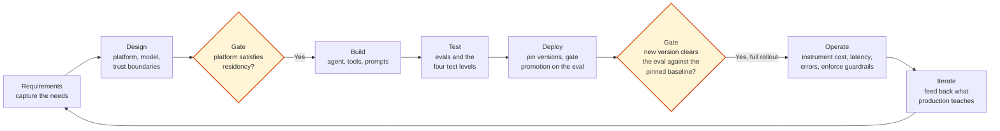

The first gate asks whether the platform satisfies residency, so the platform comes next.

### Choose the platform the customer can approve

The same model can run in several environments, and the customer's existing cloud usually decides which. For Claude, the table lists them.

| Platform | What sets it apart |
|---|---|
| First-party API | Anthropic's own. Usually gets new features first |
| Claude Platform on AWS | Reached through the customer's AWS account, with Anthropic's model IDs and lifecycle. Anthropic runs inference outside the AWS boundary |
| Amazon Bedrock | Data stays inside the customer's AWS boundary, under AWS identity. A Messages-API integration with broad feature parity, plus a legacy integration with its own versioned identifiers |
| Google Vertex AI | The same inside Google Cloud |
| Third-party platforms such as Microsoft Foundry | The model sits in a product the customer already uses. On Foundry, where inference runs depends on how that model is hosted, which matters for residency |

Regulated data narrows that list further. It decides the endpoint, credentials, and log destinations before you write the wiring.

| Data or rule | What it requires |
|---|---|
| Privileged legal material | Usually the API inside the firm's own application, through an approved gateway with full logging that the organization implements itself |
| Health data | A configuration covered by a Business Associate Agreement, which excludes consoles, beta features, and consumer plans |
| EU residency | A cloud route with the region pinned in client configuration, such as Bedrock or Vertex. The direct API does not currently offer EU-only processing. Within Bedrock, global or regional endpoints is the main residency control, and it can affect cost |
| Government workloads | An authorized environment. Development code must not drift onto the commercial endpoint |
| Internal policy | The cloud vendor the CIO has already cleared |

Still, the customer's cloud is a start, not yet an argument a procurement and security team will sign. Three measurements make it one:

- **Latency.** Measure from the customer's actual region with their actual payload, because a number from your laptop hides the round-trip penalty. An in-region cloud route often wins on round trip. The first-party API wins on earliest feature access.
- **Compliance.** It often ends the debate. A customer certified on one cloud rarely re-certifies on another. Residency and certifications differ by platform, and regulated customers treat them as pass or fail.
- **Cost.** Per-token cost is broadly similar across platforms. Total cost moves with data egress, platform fees, and integration effort. The cheapest token is not always the cheapest system.

Skip the measurements, and familiarity makes the choice. One team building for a regulated customer in eu-west picked the platform they had shipped on before. They measured latency from a developer laptop, at 180 milliseconds. The integration came together quickly and passed functional tests.

At the security review, the reviewer asked where data was processed. EU-only residency was required, and the data was processed outside the EU. A less familiar platform with a regional option would have met the rule. The build had to be redone.

**Lesson:** easy to build is not the same as allowed to ship. Checking during scoping costs one conversation. Checking at review costs a rebuild.

An approved platform passes the first gate of the lifecycle. The second gate checks every new version after the build ships.

### Pin what ships and promote through the eval

With the platform chosen, versioning keeps an upstream change from silently changing production. Aliases are convenient, but they move to new snapshots over time and can resolve differently on different platforms. A pinned full model ID is a fixed snapshot. Current Claude models pin with the model ID alone, while older ones needed a date suffix.

So pin the model, version the prompt and the asset with the code, and keep the previous version for rollback. Then a new version goes through the eval, which stops being a one-time test and becomes the deployment gate.

To promote, send the new version a share of traffic and compare it with the pinned baseline on your eval. If it clears the baseline, promote it. If not, roll back to the previous version.

Without the pin, there is nothing to roll back to. The log of one incident tells that story in six lines:

1. The app deployed against the "opus" alias.
2. The alias advanced to a new version with no application change.
3. The parser threw a KeyError because the output shape had changed.
4. A rollback was attempted, but no pinned prior version had been kept.
5. The parser was hot-fixed.
6. The root cause was recorded as an unpinned deployment, which the hotfix left in place.

The hotfix repaired the parser, but the deployment still follows the alias.

Pinning protects one component. The last limit appears when several are joined.

### Mark every seam between components as a boundary

Finally, the pieces come together in one application. An API request might start a Claude Code task that reaches a customer system through an MCP server, each component adding a capability the others lack. Every connection is a place where identity, secrets, and untrusted input can cross. So map which component does what before connecting anything.

A **trust boundary** is any point where data or instructions move from one deployment environment to another. The injection and access controls from the stage on production apply exactly there. The diagram shows the control at each seam.

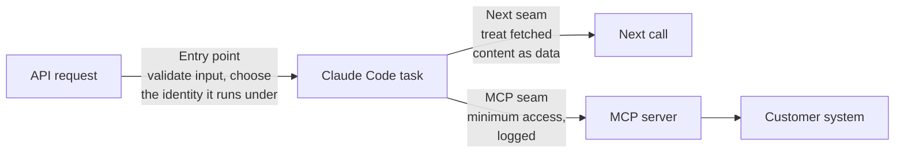

Least privilege applies to the whole application, which is only as contained as its most privileged seam. One over-scoped component is the weak point even if every other one is tight. If a seam cannot be secured, do not ship around it. Escalate to a human owner.

A seam is easy to miss. Two developers wired three components that each passed their own tests, and found the gap in one exchange. The coding task's fetched content went straight into the next call's prompt. If it carried instructions, the next component would follow them, because nobody had marked that seam as a boundary. Each component was trusted. The seam between them was not.

The end-to-end fix for a code-review accelerator on Bedrock, for a regulated AWS customer, shows this stage's main lessons in four steps:

<div class="example">

**Example · A code-review accelerator on Bedrock**

1. Parameterize the hardcoded repository path.
2. Pin the full Bedrock model ID and keep the previous version for rollback.
3. Wrap fetched content as data before it reaches the next call.
4. Gate promotion on the bundled eval against a baseline score.

Here are the four steps in code.

```python
def build_agent(repo_path):                         # set per engagement
    return Agent(model="us.anthropic.claude-opus-4-8",  # pinned, not an alias
                 system_prompt=SYSTEM_PROMPT,
                 repo_path=repo_path,
                 tools=[read_file, run_linter])

deploy(platform="amazon_bedrock", identity=aws_role_arn,
       retain_previous_pinned_version=True)          # rollback target

fetched = code_task.run(fetch_url=customer_page)
next_call(input=treat_as_data(fetched))              # untrusted is data

assert eval_suite.run(model="us.anthropic.claude-opus-4-8") >= baseline_score
```

</div>

Those few lines close the last stage. So what can you do this week? Write the one-page design document for the feature you are building now, and turn its success criteria into twenty eval cases with awkward inputs. Every other stage then has something to check against.

## Glossary

The terms used in this post, in alphabetical order.

| Term | Meaning |
| --- | --- |
| Accelerator | A working build packaged so the next engagement configures it instead of rebuilding it: parameters, documented assumptions, a bundled eval |
| Adaptive thinking | A reasoning mode where the model decides when and how much to think, tuned by an effort setting rather than a token budget |
| Agent | The model choosing its own sequence of tool calls toward a goal. The control flow lives inside the model |
| Agent SDK | A library that runs the same agent loop as Claude Code inside your own process, while your code executes the tools |
| Agentic search | Letting the model search and read across several rounds at query time instead of matching a pre-built index |
| CLAUDE.md | A project file loaded into every coding-agent session, holding universal constraints and conventions. It dilutes as it grows |
| Compaction | Summarizing accumulated conversation so a session can continue near the context ceiling |
| Context engineering | Deciding in advance what enters the context window, what is summarized, and what never enters |
| Context window | The total tokens a model can take in for one request, including prompts, history, tools, results, and the answer |
| Contribution readiness | What a maintainer needs to accept a contribution: focused code, a runnable example, a test, stated assumptions, and confirmed rights |
| Design document | A one-page record of success criteria, failure handling, cost and latency budget, and trust boundary, written before building |
| Eval | A set of input cases, expected behaviors, and grades that turns "done" into a trackable score |
| Exponential backoff | Retrying with growing waits, jitter, and a cap, honoring the server's wait header when present |
| Few-shot | Including several input-output examples in a prompt to show the exact shape of the answer |
| Files API | Uploading a file once and referencing it by ID in later requests |
| HITL | Human in the loop: a checkpoint that pauses an automated process for review before a consequential action |
| Hook | A script bound to a lifecycle event, such as before a tool call, that runs every time and can block the action |
| Integration test | A test that drives the handoff between two components with real data, where most silent failures hide |
| Least privilege | Giving each identity or component only the access its task needs, so a steered agent can do little harm |
| LLM-as-judge | Grading open-ended output with a second model and a rubric, trustworthy only after calibration against human labels |
| MCP | Model Context Protocol: an open standard for exposing tools, resources, and prompts from a server to any MCP client |
| Message Batches API | Submitting many requests at once for asynchronous processing at lower cost, with results matched by a custom ID |
| Model alias vs pinned ID | An alias moves to new snapshots over time. A pinned full model ID stays fixed until you change it |
| Non-determinism | Identical inputs can produce different outputs, so tests assert properties rather than exact text |
| Orchestrator-worker | A lead agent that splits work across parallel subagents and combines their results, at a large token multiplier |
| Output constraint | The part of a prompt that fixes the form of the response: fields, types, length, and what to do when data is missing |
| Permission mode | A coding-agent setting that controls how often the agent asks before acting, from asking before everything to asking for nothing |
| Plugin | A versioned bundle of skills, hooks, subagents, and MCP servers installed in one step from a marketplace |
| Prompt caching | Reusing the processing of a stable prompt prefix across requests at a fraction of the cost |
| Prompt injection | Instructions hidden in content the agent reads that it treats as commands. Defended by treating content as data and limiting actions |
| Retriable vs terminal error | Whether retrying the same request could succeed. Retriable errors get backoff, terminal ones fail fast |
| Rules file | A scoped instruction file that loads only when the agent works on matching paths |
| Sampling | Choosing each next token from a probability distribution, which is why the same prompt can return different text |
| SDK | A language library that wraps the REST API, handling authentication, retries, and parsing |
| Secret store | A managed service that holds credentials, returns them at runtime, logs access, and makes rotation a single change |
| Skill | A SKILL.md file of reusable instructions that loads on demand when a request matches its description |
| Stdio | A local MCP transport where the client launches the server as a subprocess |
| Streaming | Receiving a response as a series of events while it is generated, then assembling it yourself |
| Structured outputs | API-level schema enforcement for responses or tool arguments, so non-conforming output cannot be generated |
| Subagent | A separate agent with its own context that handles a delegated task and returns only a result |
| System prompt | The persistent behavioral contract for a session: role, scope, format, and rules that must not change |
| Systems lifecycle | Requirements, design, build, test, deploy, operate, and iterate, with gates between phases |
| Token | The unit a model reads, writes, and bills by. Its size depends on the model's tokenizer |
| Tool use | The loop in which the model asks for a tool, your code runs it, and the result goes back to the model |
| tool_use block | The content block naming a tool call, its ID, and its inputs, which must be answered by a matching result in the next turn |
| Trace | A record of each step of a run: prompts, tool calls, intermediate outputs, and timing |
| Trust boundary | Any seam where data or instructions cross from one environment to another, where incoming content is treated as data |
| Workflow | Steps orchestrated in your own code, some of which call the model |
| XML tags | Descriptively named tags that separate instructions from data and examples inside a prompt |
| Zero-shot | A prompt with instructions and no examples |

## References

**Anthropic partner training** (sign-in required)

- Anthropic, [Claude Certified Developer – Foundations](https://anthropic-partners.skilljar.com/path/claude-certified-developer-foundations): MSO Foundations, Production-Grade Prompting, Agents & Tool Use, Claude Code, MCP & Integration, Production Engineering, Evals & Security, and Accelerators & IP Contribution. The source of most of the examples here; this post reorders its material into the order a build grows.

**Documentation**

- [Claude platform documentation](https://platform.claude.com/docs). The reference for everything the API does: models and tiers, tool use, structured outputs, streaming events, prompt caching, token counting, vision, the Files API, the Message Batches API, errors and rate limits, model IDs and deprecations, and the cloud platform guides. Other vendors publish equivalent pages.
- [Claude Code documentation](https://code.claude.com/docs). How permission modes and settings, CLAUDE.md, rules, hooks, subagents, skills, plugins and marketplaces, MCP configuration, and sandboxing work in the coding agent.
- [Model Context Protocol](https://modelcontextprotocol.io/). The open specification for the tools, resources, prompts, and transports an MCP server can expose.

**Engineering writing**

- Anthropic, [Building effective agents](https://www.anthropic.com/engineering/building-effective-agents). Argues for the simplest workflow pattern that works, and says when an agent is worth its cost.
- Anthropic, [How we built our multi-agent research system](https://www.anthropic.com/engineering/multi-agent-research-system). How the orchestrator-worker pattern beat a single agent on research tasks, and why it spent about fifteen times the tokens of a chat to do it.
- [Claude Cookbooks](https://github.com/anthropics/claude-cookbooks). Focused reference implementations, including building evals, and a channel for contributions.
- [Anthropic Trust Center](https://trust.anthropic.com/). Certifications, data retention, and regulated-industry posture, for answering a customer's security review.

**Older ideas this post leans on**

- Claude Shannon, [A Mathematical Theory of Communication](https://people.math.harvard.edu/~ctm/home/text/others/shannon/entropy/entropy.pdf) (1948). Includes the "approximations to English" built by sampling each next word from real text statistics, the same mechanism a language model uses.
- [Mars Climate Orbiter](https://en.wikipedia.org/wiki/Mars_Climate_Orbiter) (1999). A spacecraft lost because two correct programs disagreed on units at the handoff between them.

**Related posts on this blog**

- [From Request to Running System](/blogs/blog/from_request_to_running_system/). The architect's view of the same territory: discovery, evals before the build, design, production, safety, running the system, and handing it to the team.
- [When Code Is Cheap](/blogs/blog/when_code_is_cheap/). Eleven questions to ask before and after putting AI into a project.
- [Migration is a harness](/blogs/blog/migration_is_a_harness/). Planner, orchestrator, generator, and evaluator applied to migrating a legacy system.
