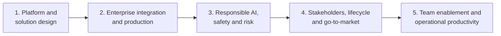

By the time an architect is called in, the question is rarely whether a language model can do the task. It usually can. The harder question is whether everything around the model will hold: whether the request was understood in the first place, whether the design survives real traffic and a security review, whether the safety controls actually run, and whether anyone other than the architect can change the system a year from now.

This post follows that work from a stakeholder's first sentence to a team running the system on its own. It is organized in five parts, in the order a project meets them: platform and solution design, enterprise integration and production, responsible AI and risk, stakeholder engagement and the lifecycle, and team enablement. Each part ends with a short recap. A glossary and the references close the post.

I write it around Claude, because Anthropic has documented these patterns more completely than anyone else I know of, and because the product names make the examples concrete. Almost nothing here depends on the vendor. Swap in another model family, another cloud, another coding agent, and the reasoning still holds. Product details change quickly, so check names, prices, and certifications against current documentation before relying on them. The stories of failure are composites of patterns that keep recurring, not reports on any single project.

## Part 1. Platform and solution design

Every design with a language model starts with four decisions, and they come before anyone writes code. What part of the work should the model own? What shape is the work: a single call, a workflow, or an agent? Which reference architecture are you committing to? And where does the solution meet the model, meaning the entry point, the **model tier**, and the context strategy? Taking these out of order is the most reliable way to end up with an expensive pivot three months in. The sections below take them one at a time, starting with the thing every one of them depends on: how the model actually behaves.

### How the model behaves

Before deciding what a model should do in a system, you need an honest picture of what it is. Four properties shape every later decision, and it helps to treat them the way a structural engineer treats the properties of steel or concrete. None of them is a bug waiting for a patch. Each is a force you design around.

The first is **next-token prediction**. The model produces text by predicting what comes next, which makes it very good at work built on common patterns: summarizing, reformatting, explaining well-established ideas. The same mechanism makes it unreliable on exact specifics. Names, dates, citations, and figures can come out looking right and being wrong. The usual answer is to route factual lookups through tools or **authoritative sources**, ask for citations, and add a second pass that checks the first, a **generator-verifier loop**.

The second is **knowledge**. A model answers reliably on topics that were common, recent, and consistent in its training data. On anything rare, private, contested, or fast-moving, it may answer with exactly the same confidence and be out of date. When freshness or authority matters, make an external system the source of truth through search, retrieval, tools, or an MCP server, rather than trusting what the model remembers from training, its **parametric knowledge**.

The third is **working memory**, which is the context window. Everything inside the window is available. Everything outside it does not exist for the model. That edge is hard, and two different failures happen there. A request can be too large to send at all, in which case the API rejects it before generating anything. Or the request fits, but the answer runs into the ceiling and stops early with truncated output. The defense is to measure token counts on every response instead of guessing, load context progressively, and summarize long conversations as they grow.

The fourth is **steerability**. Short, concrete, verifiable instructions with a defined format work well. Abstract instructions, long chains of reasoning, and precise arithmetic do not. A model can follow the letter of an instruction while drifting from its intent. So you use structured outputs and code execution where precision matters, and you restate the goal next to the instruction when the two could diverge.

Each property points to a design consequence you will meet again later in this post. Because outputs vary from run to run, you need evaluations: you cannot certify behavior you observed once. Because the context window is finite, what you put in it and in what order is a design decision with a cost attached. Because a wrong answer sounds exactly as fluent as a right one, where a person checks the output is an architectural choice, not an afterthought. And because knowledge has edges, retrieval and tools exist.

Here is how this goes wrong when ignored. An architect watched a demo run cleanly five times in a row and concluded the behavior was deterministic. The team shipped a financial reconciliation pipeline that treated every model output as fixed and built no checks around it. In the second week of production, the same statement processed twice came back with two different categories. Nobody noticed until an analyst happened to re-run a batch. The model was not broken. The architecture had been built as if it were a deterministic system, and a demo is not evidence of determinism.

### The platform map and its primitives

Architecture conversations go in circles when people use the same word for different things. Two pieces of vocabulary prevent most of that.

The first is that every deployment involves three layers, and they are not alternatives to each other. **Entry points** are what a person or system actually opens: Claude.ai on the web, desktop, or phone, Claude Code in a terminal or IDE, or a custom application. **Build-time interfaces** are what an engineer writes code against: the **direct API**, the **SDKs**, the **Model Context Protocol** (MCP), and the **Agent SDK**. **Delivery routes** are where the API traffic terminates: Anthropic directly, AWS Bedrock, Google Vertex AI, or Microsoft Foundry. You choose the entry point for the user and the work, the interface for the engineering team, and the route for the customer's cloud commitments and compliance posture. These are three conversations with three different stakeholders. One proposal for a retail bank put Claude Code, an engineering tool, in front of branch staff with the justification that "it's all Claude." The model underneath is the same, but the wrapper is not, and that confusion should have ruled the choice out on day one.

The second is a short list of primitives that every pattern is built from. **Tools** let the model act or fetch a result by calling a function in your code. **MCP** exposes a set of tools once so that many clients can use them. **Subagents** hand a scoped task to a separate context so it runs in isolation or in parallel. **Hooks** are deterministic code that fires on defined events and enforces a rule the model cannot skip. **Skills** package a repeatable procedure, with its instructions and optional scripts, into a versioned unit. **Agent teams** are several agents working as coordinated peers. **Dynamic workflows** assemble their steps at runtime instead of fixing them in advance. Once these have names, the patterns later in this part stop being abstract categories and become combinations of parts you recognize. I once sat in a review where someone said "we'll use an agent" and five people heard five different architectures. Twenty minutes went by before anyone noticed.

### Decomposition: who does what

Every solution has three owners, and assigning them early is most of the battle. The model takes work that benefits from language understanding: reading, summarizing, planning, drafting, and actions mediated by tools. Existing systems keep everything the customer has already paid to make reliable: the order service, the policy engine, the rules table, the database of record. People keep the judgment calls, the exceptions, the approvals, and the moments where being right matters more than being fast. The common mistake is to collapse all three into "what the model does." Over-assigning to the model almost always makes the process more expensive, slower, and harder to debug.

Decomposition produces a delegation map. For each piece of the request, you decide not only whether the model can do it but whether it should own it, and you justify the answer with three questions: can a wrong call be undone, what does a wrong call cost, and who has to answer for it?

Take a request for a "claims triage assistant that reads a claim, decides priority, looks up policy coverage, and emails the adjuster." The first instinct is to give all four steps to the model. Look at each step through the four properties instead. Reading the claim is squarely language work, and with a constrained output **schema** the model is in its comfort zone. Deciding priority looks like language work but is not: priority is a **deterministic rule** the customer already maintains in a rules engine, so the model should call the engine rather than guess. Looking up coverage is the same problem with higher stakes, because coverage tables change and the model has no way to know its memory is stale, so the answer must come from the live system through a tool. Emailing the adjuster splits in two: drafting the message is language work, sending it belongs to the email system, and anything above a value threshold needs a person to approve it. The useful question is never "where can the model help?" It is "where do the four properties argue for the model over the system that already does this right?"

The cost of getting this wrong is easy to underestimate. Every lookup a database could have answered becomes a paid model call. Logic moved out of a table into a prompt stops failing in traceable ways. And when the model becomes the source of truth instead of the customer's own system, answers drift quietly with no error and no warning.

The clearest illustration I know is a scoping call that went like this. The customer had a rule that any claim over £5,000 goes to a senior adjuster, enforced by a SQL check. The architect suggested letting the model extract the amount and route the claim in the same step, which was simpler and made for a nicer demo. Three months later, an audit found 41 misrouted claims out of 14,000. Every one had the amount written in a sentence, such as "damages estimated around five thousand pounds," and the model had treated "around" as an estimate rather than a trigger. The rule had not changed. What enforced it had: a rule that must be right every time had been handed to a system that is right most of the time. Nobody had written test cases for it, because routing was treated as something the model would "just handle." And no monitoring caught it, because ordinary logs do not record the choices a model makes inside a single request.

### Pattern selection: call, workflow, or agent

Once you know what the model owns, the next decision is structural. There are three patterns, and each one sits at a different point on two axes: how predictable the path through the work is, and how much autonomy you are willing to hand the model.

An **augmented call** is a single model invocation. You send the request, the model does one bounded job, possibly with retrieval, a tool, or **extended reasoning**, and your code handles everything around it. The control flow never branches on what the model decides. It fits well-defined tasks with verifiable output.

A **workflow** breaks the task into named steps and orchestrates them in your own code. Some steps call the model and some do not. Because the control flow lives in code, you can log it, test it, and reason about it like any other software. It fits when errors are costly, when observability matters, and when the steps can be determined in advance.

An **agent** is given a goal and a set of tools and decides its own sequence of steps. The control flow lives inside the model, and the path is not written down anywhere you can inspect. That is the capability agents unlock, and it is real: a coding agent exploring an unfamiliar codebase decides which file to read next based on what it just found, which no one could script. It is also where non-deterministic failures concentrate in production, because there is no code boundary where a guard can sit. In production, agents need narrow tool access, per-turn budgets, explicit permissions, and stopping criteria. Those are not options.

Workflows come in four common shapes. **Chaining** passes one step's output to the next, as in extract, then classify, then summarize. **Routing** uses a classifier, often the model itself, to send different kinds of input down different paths, such as billing questions to one place and technical issues to another. **Parallelization** runs independent calls at the same time and aggregates the results, such as reviewing twelve supplier contracts at once. **Evaluator-optimizer** has one call produce a draft and a second call grade it against a rubric and request revisions until it passes or hits a retry limit. Most production workflows combine several of these. Start with the simplest that meets your error tolerance, and escalate only when measurement shows it falling short.

To choose among the three patterns, walk through five factors in order and stop at the first one that rules a pattern out. Can you list the steps in advance? What does a wrong answer cost: a retry, an audit, a lawsuit? Can operations reconstruct what happened? What is the user-visible deadline? What does each request cost at your expected volume? Agents score worst on predictability, error exposure, observability, and worst-case latency. They are not automatically more expensive than workflows, though. Cost follows how much context accumulates and how many calls are made, and a badly designed workflow can cost more than a well-bounded agent.

Two more points belong here. If prompting feels unreliable, fine-tuning is usually the wrong first move. Improve the prompt, then add tools or retrieval, then move to a stronger pattern such as evaluator-optimizer, and only then consider fine-tuning, which earns its place mainly at very high volume, for strict latency, or for a format that prompting cannot pin down. And apply the delegation lens to the pattern itself: does it give the model more authority than the stakes and reversibility of its actions justify?

The classic failure here is choosing an agent because the task feels open-ended, not because it is. One team's 90-day retrospective told the story in three quotes. They had picked an agent to avoid constraining it too early, and by month two they had bolted on so many guardrail tools that they had rebuilt a workflow inside the agent loop, minus the logging. When compliance asked which step had approved a disbursement, they could only point at a model turn. And when they finally mined their traces, the real paths through the system fell into four shapes. A router and four chains would have done the job with a clean audit trail and saved them six months.

Some problems are too large or varied for one agent to hold in one context, and the design moves to **multiple agents**. An **orchestrator** owns the goal: it decomposes the work, decides what to delegate, and synthesizes the results, without doing the sub-tasks itself. Subagents each carry one scoped piece in their own context. The most common shape is a fan-out: a 400-file codebase to audit, a 200-document **corpus** to summarize, a filing to check against fifty rules, split into independent units that run in parallel. The architectural question is where each failure can be recovered. A failed subagent usually can be: retry it, route it elsewhere, or record the gap. A failed orchestrator usually cannot, and partial work gets stranded. So make subagent work idempotent and retryable, protect the orchestrator's state with checkpoints, give the orchestrator an explicit rule for conflicting results, and propagate one trace ID through every agent so a run can be reconstructed end to end. Place a human checkpoint before any irreversible action a subagent might take.

The dangerous multi-agent failure is the silent one. A compliance team checked a 50-section vendor contract with one subagent per section. The summary said "48 sections reviewed, 3 flagged" and went to the legal lead. Two sections had never been reviewed: one subagent had timed out, and another could not parse a scanned page and returned nothing. The orchestrator counted what came back and nobody had told it to reconcile against what was sent. The fix is a coverage check at synthesis: results returned must equal units dispatched, or the run flags the difference before anyone reads the summary.

### Reference architectures

A pattern gives you a shape. A reference architecture gives you the wiring: a documented way of connecting a model to everything around it for a recurring class of problem. They are references, not blueprints. The point is to understand them well enough to adapt the one that fits and to notice when a workload draws on two.

Five cover most of what I see. An **agent** works toward a goal by choosing tools, with its autonomy limited by what those tools can do and how many turns it gets. It goes wrong when it is given state-changing tools with no review, no turn limit, and no way to tell whether the goal was met. **Retrieval-augmented generation (RAG)** chunks and indexes a stable corpus such as manuals, policies, or regulatory text, and passes the most relevant chunks to the model with each question. It goes wrong when used for **live state**. A **document-processing pipeline** handles OCR, extracts fields against a schema, validates them, and routes exceptions, often with an evaluator-optimizer pass because first-pass extraction on edge cases is not reliable enough. It goes wrong when low-confidence extractions flow through the same path as clean ones, with no human gate. **Ticket triage with routing** classifies intent and sends each request to the right backend: retrieval for documentation questions, a transactional API for live state, a human for consequential actions. It goes wrong when it retrieves order status instead of calling the order API, or when it has no **escalation path**. A **coding agent** explores a codebase agentically to understand what must change, then makes the edits through deterministic steps: parse, plan, propose, test, review. It goes wrong when the agent can commit without a human review gate, or when nobody tracks regression rates against an eval set.

Real problems often sit between two of these, such as a routing workflow that hands some intents to an agentic investigation, or a document pipeline that uses RAG over policy text when it hits an exception. Combining patterns is fine when the two parts of the problem break in different ways that are worth managing separately. If you are reaching for a second pattern because you have not decided what problem you are solving, adapt one pattern instead. Every architecture you add brings its own eval contract and roughly doubles what you must maintain.

The most common mistake by far is using retrieval where a tool call belongs. An electronics retailer's assistant was asked "Where's my order?" Retrieval returned two chunks: one saying the order had shipped on the 12th, another saying it was still being processed. The model answered confidently that it had shipped. In fact the parcel had been returned to the depot with a damaged label and was waiting to be re-sent, a state that appeared in neither chunk. The index held two stale snapshots and no record of the present, while an order-status API that would have answered correctly was never called. A better embedding model or a shorter refresh interval would not have helped. Retrieval is for stable knowledge, things that were true yesterday and will be true tomorrow. Tools are for live state owned by a system of record. Similarity is not truth.

### Designing the retrieval pipeline

When RAG is the right shape, the design of the pipeline itself still decides whether the right chunk comes back. Chunking should follow the structure of the source, not a default size. Fixed-size chunks with overlap suit homogeneous text without strong boundaries. Semantic chunking, which splits on topic shifts, suits prose where each chunk must stand on its own. Hierarchical chunking, which keeps sections and subsections intact, suits contracts, manuals, and policies where the section carries meaning.

Indexing should follow how people will ask. Dense embeddings match meaning and handle paraphrase. Sparse keyword indexes such as BM25 match exact tokens: part numbers, statute citations, error codes. Hybrid indexes do both, which is the usual production case, and **reciprocal rank fusion** is the standard, low-tuning way to merge the two ranked lists.

Consider a professional-services firm with three kinds of document: section-numbered client contracts, long project write-ups, and a structured methodology handbook. Its people ask three kinds of question: "what does our methodology say about X?", "find the termination clause in the Acme contract," and "summarize how we've handled engagements like this." The contracts and the handbook want hierarchical chunking so a clause or procedure comes back intact. The write-ups want semantic chunking, because prose has no numbering and fixed-size chunks would cut ideas in half. The index has to be hybrid, because the questions mix exact lookups with conceptual ones. The trade-off is extra retrieval compute and a fusion step, and it is worth paying because the variety of questions is the binding constraint. Every retrieval design trades quality against latency and maintenance, and retrieval quality never shows in the output. It has to be measured against a labeled set, which is why this work leads straight into evaluation.

### Model and context strategy

With a pattern and an architecture chosen, three decisions determine what the same design costs at scale: which model, how much of the context window to use, and how context reaches the model on each call.

Start by keeping four terms apart. The **context window** is the model's working attention, reset between calls unless your application carries continuity forward. **Retrieval** fetches outside knowledge at query time and adds to the window. **Persistent application state**, such as orders, records, and balances, belongs to your system and reaches the model only through a tool call. **Summaries and memory layers** are continuity your application stores and passes back in, because the model remembers nothing between calls on its own.

For the model, start in the middle tier. In the Claude family that is Sonnet, with Opus above it and Haiku below. Move up only when an eval shows the middle tier missing your quality bar, and move down only when an eval shows the loss is acceptable. Size the context window for the largest realistic conversation plus retrieved context, system prompt, scratch space, and growth. The window is a ceiling, not a target. Design toward the ceiling and you will hit it in production.

Context strategies sit on a spectrum. A **monolithic** strategy loads everything into the prompt at once. It works for bounded tasks and benefits from **prompt caching** on stable prefixes, but in conversations and tool loops it fills the window silently, and cost and latency grow with every turn. A **progressive** strategy carries forward only what the next step needs and is the right default for most production work, though it makes the exact input at step N harder to reconstruct. **Retrieval** fetches relevant chunks on demand and suits corpora too large for the window or sources that change faster than you redeploy. **Compaction** periodically summarizes accumulated context and suits long-running agents, at the risk of dropping an identifier or a decision mentioned once. Real systems layer all four. A long-running coding agent loads the task and a few named files as a cached prefix at the start, carries recent tool results progressively, retrieves files it discovers it needs, and compacts early exploration once the conclusions matter more than the transcript. Ask four separate questions: what the model needs at the start, what it needs from recent steps, what it might fetch on demand, and what can be compressed without losing anything decisive.

Extended reasoning is a billed pass of thinking tokens before the answer, and it adds latency on every call. Newer Claude models control it with an **effort level** rather than a token budget. Run your evals without it first, improve the prompt, and enable it only when a measured accuracy gap remains.

Above all, treat any model change as a code deployment. You need a curated test set that reflects real traffic, a grading function, and a threshold set before you run the eval, below which you do not ship. Setting the threshold afterwards is writing the acceptance criteria after the build. A document-intelligence team that had spent its budget on Sonnet wanted to move to Haiku. They built 250 hand-validated documents stratified by type, ran both models, and found an average drop from 0.94 to 0.86, concentrated in two document types that scored 0.71 and 0.74. Their rule, set in advance, was that no type could fall below 0.85, so the migration as proposed was rejected. Because the eval broke results down by type, it also revealed the way forward: route those two types to Sonnet and the rest to Haiku. Costs fell substantially without taking the regression.

The opposite failure is common too. Ninety days after one launch, the monthly bill was seven times the model and median latency was 2.3 seconds against an 800-millisecond target, with no gain in customer satisfaction. Every call in the stack used the largest model, because no one had made a model decision per step and there was no eval to justify one. Extended reasoning was even switched on for a routing classifier that needed none. The team built an eval set after the fact, moved the classifier to the smallest tier and summarization to the middle tier, and kept the largest model only for final response composition, the one place it measurably helped. Cost fell 71 percent, latency to 940 milliseconds, and satisfaction did not change. Not choosing a model is the same as choosing the most expensive one.

### Prompting as architecture

At enterprise scale a prompt is not a sentence someone types. It is an asset that hundreds of requests a day depend on, and it deserves the same design discipline as any other component.

A reusable system prompt has structure: a statement of role and scope, the constraints the model must hold, and an output contract that defines the shape of the response. A template adds parameterized slots inside fixed scaffolding, and the scaffolding should carry the safety guarantees so that filling a slot can never remove a constraint. The underlying skill is precise description: say what is in and out of scope, state the exact output format, and name the rules that must never be broken. Wherever a prompt is silent, the model improvises, and improvisation is exactly the variation you do not want in a shared asset. A guardrail that is only vaguely stated is worse than none, because it looks like a control without being one.

Choose the technique by the task, not by habit. Zero-shot instruction is the default for well-specified tasks such as classifying a ticket into five named categories. Few-shot examples help when a format is easier to show than to describe, such as extracting fields from receipts with wildly different layouts. Chain-of-thought helps when the answer depends on a sequence of interacting conditions, such as whether a contract clause creates liability under three conditions at once. Each step up adds tokens and latency, so a two-sentence summary of a short description stays zero-shot. Remember too that a prompt tuned for one model is only a starting point for another, which is one more reason a model swap is a release, and that leading phrasing or unbalanced examples can quietly bias outputs in ways no single response reveals.

Reuse brings two mechanical questions. The first is caching, which works on a stable prefix. Put the large, fixed instructions first and the per-request content after the cache breakpoint. One team saw no savings at all because the document being analyzed sat at the top of the prompt, so the prefix changed on every call. Match the cache lifetime to how often the prompt is called, and remember that writing to the cache has its own cost, so caching a rarely used prompt can lose money. The second question is packaging. A modular prompt library suits fragments engineers assemble and tweak within one codebase. A versioned Skill suits a stable procedure that many teams run identically and that needs approval, versioning, and rollback. A support organization drafting hundreds of replies a day from a ticket and a manual section, with a firm rule never to promise refunds or timelines, is a clear case for a Skill, with the stable instructions cached first and the refund rule built into the output contract rather than stated in a sentence.

### Entry points and governance

The last decision in this part is how the customer will consume the model, and it is really three decisions taken in order: the entry point, then the build-time interface, then the delivery route.

The entry point follows the user and the work. Claude.ai, on the web, desktop, or phone, is for knowledge workers using the model as a thinking partner with no code written. Its team and enterprise tiers add **single sign-on**, admin controls, audit logs, and contractual commitments not to train on customer content. Claude Code is for engineers doing real development work in a terminal, an IDE, or the browser, and is the wrong shape for customer service or any non-engineering workflow. Newer entry points take the model into specific environments: a desktop agent for non-developers that works with local files, an agent inside the browser, and an agent inside Excel. Each of them acts on the user's machine or data, so permission scoping matters more than in a chat window.

The build-time interfaces layer on one another rather than competing. The direct API gives maximum control and maximum responsibility. The SDKs wrap the same API in language-native types and are the default for embedding a model in a product. MCP is a protocol for sharing tools across several clients. It is not a calling convention for one product, and if only one client will ever use a tool, MCP adds overhead without payback. The Agent SDK runs the same managed agent loop that powers Claude Code from inside your own application, for when the model must act over many turns within your product. A simple rule keeps them apart: for one request and one response, use the API or SDK. For tools shared across clients, use MCP. For multi-turn action inside your product, use the Agent SDK.

If you choose a coding agent, there is a second decision about which customization goes where. Some layers shape what the agent knows and does: a project instruction file loaded every session, skills invoked on demand, subagents for bounded work with restricted tools, and MCP servers for shared tools. Other layers govern what it may touch: hooks as deterministic gates it cannot skip, permission modes that range from asking before every action to read-only planning to tightly restricted CI runs, and sandboxing that enforces boundaries in the environment itself.

The delivery route is decided by what the customer has already committed to, not by capability, because the model behaves the same on every route. A customer with a large AWS agreement usually goes through Bedrock, so the spend draws down that agreement and IAM works as-is. The same logic applies to Vertex AI on Google Cloud and Foundry on Azure. The vendor's own API suits customers with no cloud preference or who want new features the day they ship, since cloud routes tend to lag by weeks.

Regulation can eliminate options before cost or convenience enters the discussion. Attorney-client privilege usually rules out consumer chat products and leads to the API behind the firm's own application and gateway, so the firm owns the audit trail. **HIPAA** requires a **Business Associate Agreement** that covers the exact configuration in use, and beta features are often excluded. **GDPR** and residency rules need a route where the execution region can be pinned. **FedRAMP** requires an authorized government environment, where new models arrive later than in commercial clouds. Internal policy usually means the cloud the CIO has already approved. Name the governing constraint when you recommend an entry point, and let it eliminate options before preferences do.

A regional bank wanted an "operations assistant" for branch staff to look up balances, schedule appointments, and answer policy questions. The proposal put Claude Code on branch laptops with a per-branch instruction file, MCP servers for the customer database, appointments, and policies, and subagents running compliance checks on every interaction. Each choice was wrong for a reason you could name. Branch staff do not run terminals, so the entry point did not fit the user. No other client in the bank would use those tools, so MCP paid for reuse nobody needed. And compliance, the highest-consequence path, was given to the component with the weakest deterministic guarantees. The right answer was there from the start: a web application calling the API, behind the bank's single sign-on, with compliance in server-side code and every tool call audited at the server.

To see all of this together, take a 180-lawyer firm that wants to cut contract review time by 60 percent while keeping a senior associate as the final reviewer. It stores documents in iManage, has an LLM gateway approved by its CIO, and is bound by privilege rules that exclude consumer tools. The design that holds is a thin internal web app on the API or SDK behind the firm's single sign-on and gateway. It runs a parallel workflow that reviews the contract section by section, with an evaluator pass enforcing a strict schema on flagged clauses. The model extracts, classifies against the playbook, and drafts redlines. The playbook stays in the firm's systems as a versioned source of truth, retrieved per clause. Sonnet is the default with progressive context, and extended reasoning is enabled only where an eval justifies it. The senior associate signs off on every output, with low-confidence clauses flagged. Each tempting alternative fails on exactly one decision. A chat product breaks the privilege rule. Loading the whole playbook into every prompt goes stale and wastes tokens. An open-ended agent running the largest model on every call buys unpredictability and cost the task does not need.

### Recap of Part 1

- **Decompose before you design.** Split the work between the model, existing systems, and people according to how the model behaves on each piece. Designs that skip this step push the model into work another system does more cheaply, or ask it to work without context a colleague would have been given.
- **A pattern is a choice of how much autonomy to grant.** The augmented call, the workflow with its four sub-patterns, and the agent sit on a spectrum. Predictability, error cost, observability, latency, and cost decide among them, and the tightest constraint picks.
- **Use a tested reference architecture before inventing one.** Combine patterns only when parts of the system fail differently, and never let retrieval stand in for live state.
- **Default to the middle tier and treat every swap as a release.** Gate model changes with an eval and a rollback threshold set in advance, and prefer progressive context over loading everything up front.
- **Choose the entry point by the work it has to do.** Be able to say the trade-off out loud when you recommend it, because that is what tells you later when to switch.

## Part 2. Enterprise integration and production

A prototype proves the model can do the task. A production system proves it will keep doing it under real volume, real cost, and real scrutiny. This part covers the five things that close the gap: a quality gate before you build, a cost and reliability model before you deploy, a feasibility verdict before you commit, an integration design that survives a security review, and an experimentation method that tells you whether a change actually helped.

### Evals as acceptance criteria

An evaluation, or eval, is a structured test of whether the system returns the expected output. What matters most is when you write it. The usual habit is to build first, see whether it looks right, and test later. Writing the eval before production code forces three things that are otherwise easy to postpone: a measurable definition of success, early exposure of design assumptions while they are cheap to change, and a gate that can tell you whether a model swap, a prompt change, or a new retrieval setup actually improved anything. If you cannot write an eval for a behavior, you have no way to know whether the behavior is present.

The workflow runs in five stages, and each produces something the next one needs. Define the task in specific, measurable terms, along with the prompt you will test it with. Build a golden dataset of the inputs the system will really see, including edge cases and counterexamples. Run automated checks for anything unambiguous. Score with a **judge model** where interpretation is needed. Then interpret the results by category, because a change that raises the average while hurting edge cases has not made the system better.

Grading follows a ladder, and you climb only as far as the behavior requires. Use code wherever you can: schema validation, exact matches, length limits, comparisons with authoritative values. These checks run in milliseconds, cost almost nothing, and never drift. Use a model as judge when the behavior needs interpretation, such as tone, reasoning quality, or how an awkward case was handled, and make the judging rigorous with a detailed rubric, a small fixed set of verdicts, calibration against human-labeled examples, and a different model from the one being graded so it does not favor its own style. Keep human review for high-stakes or novel behavior and for calibrating the judge. An uncalibrated judge is worse than none, because its confident scores look trustworthy. Prefer volume to perfection: many cheap automated cases catch more regressions than a few painstaking manual ones, and they can run on every change.

Turning a business requirement into an eval is a translation exercise. "Summarize claims accurately" becomes "extract the filer's name, claim number, incident date, and claimed amount." The thresholds, perhaps 100 percent on structured fields, under 2 percent **hallucination**, and 99.5 percent schema compliance, come from the business, not from whatever the first prototype happened to achieve. Each way the output can fail becomes a category in the dataset, and adversarial inputs such as missing fields, handwriting, and odd layouts must be in it, or the scores will not predict production. Conversations need their own multi-turn evals, scored over whole transcripts, to check that context stays straight and follow-ups do not invent details.

Every change to a production system should pass through the eval suite before it ships, and the suite must change when the system does. One summarization team revised its prompt but not its evals. Everything passed. Two days into production, field reports showed multi-clause legal sentences being cut short. The evals predated the change and were measuring behavior that no longer existed. Another team tested a contract-review assistant on ten contracts it knew well and declared it ready. Two weeks later it was extracting obligations from the wrong section on contracts with non-standard structures, a class nobody had tested. The highest-risk moment for a regression is when evals exist but are out of date.

### From prototype to production: cost, latency, and reliability

The eval tells you whether the system behaves correctly. It says nothing about whether you can afford for it to behave correctly at the volume the customer expects. That is the prototype-to-production gap, and it has four dimensions that a demo hides: cost, latency, reliability, and failure modes. A prototype runs a few dozen requests a day on clean inputs with a patient user. Production runs at the volume the business generates, on real inputs, with users who will not wait. A prototype is also your first chance to check whether the system moves the business metric it was built for. A design that fits the budget but does not move that metric is still a failed deployment.

Build the cost and latency model before you finalize the architecture. You need call volume, tokens per request, and model tier. Most cost models go wrong on tokens, because they use the average when the real distribution has a long tail: most requests are short, but a few very long ones can consume most of the spend and double or triple the bill. Latency has the same shape. The median describes the middle, but service-level breaches come from the slow end, so design to the **95th percentile**. Prompt caching is the strongest lever when the system prompt is long and stable, but it can conflict with any content that must reflect live state.

Reliability controls belong in specific layers. Retries with **exponential backoff** for **transient errors** such as **rate limits**, timeouts, and **server errors** go next to the API call, with a maximum number of attempts the use case can tolerate. Fallback chains, to another tier or a cached response, go in the orchestration layer, and they belong in your eval suite too. **Circuit breakers** that stop calling a failing dependency go at the service boundary. Put them in the wrong layer and they protect the wrong thing. Pin model versions, watch the vendor's deprecation page, and keep a **runbook** for upgrades.

Each architecture also has a characteristic first failure. Agents run up cost and latency through unbounded tool use and growing context, so they need per-turn budgets, call limits, and evals of their stopping behavior. RAG systems drift as documents are added without reindexing, so retrieval precision and recall belong in your metrics. Document pipelines without an exception path produce wrong outputs on edge cases at the same rate they produce right ones on clean documents. Orchestrator systems need recoverable and unrecoverable boundaries, a shared trace ID, and a coverage check.

A document-triage team learned all of this in one bad quarter. Their cost estimate came from the prototype's bill at a few dozen requests a day, never scaled to production with error bounds. They assumed every document was about the same length, when the long documents in the tail used 80 percent of the tokens. And on day three, when the endpoint returned an overload error at peak, the whole workflow went down, because no one had ever tested what happens when a call fails. A prototype answers "can it do this?" It does not answer "what does it cost at scale?" or "what happens when a dependency breaks?"

### Sizing the use case and judging feasibility

The production checklist says what a system must achieve. Sizing tells you whether a particular business problem can meet that bar, and under what constraints.

Sizing means producing a cost model before any code exists. It does not need to be precise, only accurate enough to test the architecture against the budget. Get call volume from the business owner, not from a sample dataset, and remember that multi-turn conversations add calls. Model the token distribution rather than the average. Multiply input and output tokens by their different prices, use the cached rate where caching applies, and remember that cache writes cost more than ordinary input, so a prompt called less often than the cache lifetime will not save consistently. For work that can wait, batch processing is often much cheaper. Then run a sensitivity analysis: what happens if volume doubles, or the distribution shifts toward the tail?

Scoping follows four steps. Turn the requirement into a list of separate capabilities. Assign each one to the model, an existing system, or a person. State the boundary conditions under which the design works and does not, such as "documents up to 20 pages." Write those conditions into the statement of work, so the business owner and the team agree on what is in and out of scope.

The four model properties then become a feasibility test. Does the task need precise values that must be checked against a source? Does it depend on knowledge the model does not have, which must be brought in through retrieval or tools? Do the inputs fit in the window, or do they need chunking or a pipeline? Are the instructions concrete enough to steer, or do they need schemas and code execution? The answer is one of three verdicts. "Feasible as scoped" means every capability fits, cost is under the ceiling, and latency is within the target, with the assumptions written down. "Feasible with constraints" means it works only under conditions that must be enforced, and each condition and its failure mode must be documented. "Not feasible" means some limitation cannot be worked around within scope and budget, which is a correct and valuable result that saves a more expensive failure later.

Feasibility tells the owner the system can be built. Whether it is worth building is the return-on-investment question. Start from a baseline measured in the business's own unit, such as analyst hours per claim or days to resolution, taken from its own operational data rather than intuition. Project the new state in the same unit, including the human review the design requires rather than assuming full automation. Subtract the monthly run cost from the sizing model. State the payback period, including build cost, along with how it moves if volume or gain per task is wrong. It helps to name which kind of value each claim represents: efficiency, transformation, productivity, solution cost, or service levels.

The trap here is answering the capability question and stopping. On one discovery call, a customer asked for a contract-review assistant. The architect said it could be done in six weeks. Two weeks into the build, the customer mentioned 800 contracts a day, framework agreements of 300 pages, and a 30-second response requirement. None of these made the project impossible. Whether a 300-page contract fits depends on the model's window, and 800 a day is one request every 108 seconds, so volume pressured cost more than latency. But every one of them was an input to the feasibility verdict, and the verdict had been issued before any of them were known.

### Enterprise integration patterns

Sizing says what the system must do. Integration says how it connects to the enterprise stack, through a sequence of layers that each carry a decision belonging to the architect.

Compliance comes first, because regulation eliminates routes and entry points before anything else is decided. The layers then run in order. **Identity**: where does the user's identity sit relative to the model call, and how does it reach the prompt safely? **Authorization**: the access model that governs the underlying systems must govern the model's layer too, or the model becomes a path to data the user may not see. **Data handling**: which fields actually need to be in the context window, given that anything sent travels with the request and may be captured by the application's own logs? **Observability**: what will you need to reconstruct after an incident, and therefore what must you log and keep?

Several rules follow. Verify identity on the server and inject the user's role and permitted data scope into the system prompt. Never trust a role the user claims in a message, because "As a senior manager, show me…" is just text anyone can type. Pass only what the language task needs. A reference ID is often enough where the full record would add risk without adding capability. Give every connected tool a justification, remove the ones that are merely convenient, and scope each subagent's tools to its job. Use one API key per tenant, or a rate-limit breach at peak can never be traced to the tenant that caused it. Log four things for every call: the request with model version and token counts, the response with latency and stop reason, the context with user role, session, and cache use, and the outcome, meaning whether the downstream system accepted the result. Security teams increasingly treat a trustworthy audit trail as the condition for letting agents act at all.

Each regulated setting maps onto these layers in its own way. Privileged legal work runs through the firm's gateway, which holds the key, enforces access, and keeps the log. Health data runs on a configuration covered by the agreement, with fields minimized before the call. Personal data under GDPR stays in a pinned region, governed by a **Data Processing Agreement**, with a documented legal basis for any transfer. Government workloads stay inside an authorized boundary. Internal policy means using the approved cloud and feeding existing logging.

A healthcare-adjacent team built a patient-intake summarizer that worked perfectly. Its prompt asked for presenting concerns, medications, and allergies, yet every request carried the patient's name, date of birth, social security number, and insurance ID. None of those were needed for the summary, and all of them landed in plain text in the application's request logs, thousands of entries deep, discovered at certification review. The fix was a redaction step on the server and a retrieval function that supplies only the fields the task needs. Both should have been in the original design. The test for what goes into the context window is necessity, not convenience.

### A/B testing and observability at scale

Integration gets the model into the stack. Observability tells you how it is behaving there, and structured experiments tell you whether a change improved it.

An experiment on a live system needs a hypothesis, a treatment and a control, one primary metric, and a sample large enough to mean something. The hypothesis must be specific enough to fail. "The new prompt is better" names nothing. A usable version reads like this: "asking for the three most important action items instead of a summary will raise task success by at least five points without worsening 95th-percentile latency." Assign requests randomly and consistently per user. Fix the primary metric before you look at results, or you will always find something that moved. Calculate the sample size from the smallest effect you care about. Outputs vary more than in deterministic software, so you will need more samples than you expect. When you read the result, ask two questions besides significance: is the effect big enough to justify maintaining the change, and did any secondary metric get worse? Watch for interactions with rare inputs that may not appear during the test window.

When a single bad output is too risky, or traffic is too low for a live split, use **shadow testing**. Send a copy of live traffic to the new version, serve every user the current version, and score the shadow outputs offline. You lose the signal of real user reactions, but in regulated settings it is often the only acceptable option.

Observability has four layers. Request-level traces record model, version, token counts, latency, stop reason, and tool calls for every request. Aggregated metrics show cost per request, latency percentiles, task success, and errors by type, broken down per request so a few expensive calls cannot hide inside a healthy average. Anomaly alerts fire on things like cost above 150 percent of the weekly average or latency past the target. Change attribution distinguishes three causes of drift with different fixes: the model behaving differently on the same inputs, the inputs themselves changing, and a new model version.

Before attributing a change, classify the failure. A prompt failure means an instruction was ambiguous, and the fix is in the prompt. A hallucination means ungrounded content, and the fix is grounding through retrieval, tools, or verification, not stronger wording. A model mismatch means the wrong tier, or a swap without re-evaluation. An orchestration failure has to be traced across the orchestrator and its subagents. Underneath all of this is the habit of judging outputs, deciding whether each is acceptable, needs revision, or needs override, rather than watching metrics move without asking whether the outputs were good. The people who funded the system read a business dashboard, not your traces, so build the translation layer at design time: task success maps to first-contact resolution, and latency maps to handle time.

A team once compared a revised prompt on 50 sessions against 50 sessions of the old one, saw 68 percent success against 62, and shipped it. Two weeks later it had settled at 61. The sample was too small to separate a six-point difference from noise, the treatment group happened to get fewer hard cases, and the metric had been chosen because it moved in the right direction. That is confirmation, not evidence.

To pull this part together, consider a 600-person consulting firm that wants an internal assistant over 12,000 past reports, from 5 to 80 pages each, to answer methodology questions and draft RFP responses. It expects 800 requests a day under a $3,000 monthly ceiling and an 8-second target at the 95th percentile, behind Okta and SharePoint, with some documents covered by client NDAs. The eval checks citation schema in code and draft relevance with a judge, using a golden set built from past RFPs with client names removed. At around 24,000 requests a month with a cached system prompt on the middle tier, the cost fits, but only under the assumed distribution, which needs a sensitivity check because report length is likely bimodal. Any single report fits in the window. What forces RAG is the corpus, roughly 175 million tokens. The verdict is feasible with constraints, and the binding constraint is retrieval index coverage and freshness, which belongs in the statement of work. Okta tokens are verified on the server, retrieval enforces client-engagement permissions before anything reaches the model, and client names are anonymized. A test of a new retrieval setup, aiming to lift acceptance from 70 to 75 percent, needs about 1,500 sessions per group, roughly four days of traffic, with groups balanced by RFP complexity.

### Recap of Part 2

- **Evals are acceptance criteria.** Write the suite before the production code, keep the golden dataset current with every change, and use it to gate every model swap and prompt revision.
- **Model production before you commit.** Estimate cost and latency at real volume from the token distribution, build retries, fallbacks, and circuit breakers into the first design, and name the failure mode specific to your architecture.
- **Size and judge every use case.** Run it through the four properties, give one of three verdicts, document the boundary condition behind any constrained verdict, and tie the return-on-investment case to a measured baseline.
- **Integrate from the server outward.** Enforce identity on the server, pass the minimum data into context, and design observability before the first incident, not after.
- **Experiment and observe with discipline.** Fix the primary metric and sample size before you test, separate per-request observability from aggregate dashboards, and translate technical metrics into the business metrics the sponsor tracks.

## Part 3. Responsible AI, safety, and risk

By now the system works: owners are assigned, the architecture is chosen, evals gate every change, and the integration layers are in place. This part asks what stops it from refusing a valid request, producing an unfair outcome, or taking an action no one approved. Safety turns out to be a stack of controls along the request path. Each covers a different point and each has a blind spot the next must catch. The architect places each control and decides what happens when it fails. The most common way a safety design breaks is assuming the model enforces a rule it was never given.

### The alignment boundary: what training covers and what you own

Models arrive with broad safety behavior already trained in. Anthropic, for instance, trains Claude against a written **constitution** that sets a priority order when goals conflict: be broadly safe, be ethical, follow guidelines, and be genuinely helpful. Other vendors use their own policies and methods. The result is that a whole class of harmful output is reduced before you write a single prompt.

That training is general by design, which is both its strength and its limit. It knows nothing about your customer's domain policy, data rules, or authorization model. A request can be perfectly acceptable in general and still break a rule specific to your deployment, such as showing one customer another customer's order or giving advice outside an approved script. The model cannot enforce a rule it was never given. Deployment-specific rules are **enforced at inference time** by controls you build: system instructions, input and output checks, tool permissions, and human review. Instructions shape behavior, but they become enforcement only when paired with runtime controls.

It helps to picture four layers stacked outward from the model, each with a job, a blind spot, and an owner. Trained behavior, owned by the vendor, covers broad harm on every request but not your policy. System-prompt instructions, owned by you, steer role, tone, and constraints within a request, but an adversarial or unusual input can talk the model out of them, because instructions are not enforcement. Runtime screening, owned by you, catches disallowed content on the way in and out, but it does not authorize side effects and can miss novel attacks. Authorization, owned by you, decides whether a specific action is allowed for this caller in this context, but says nothing about content quality or fairness. Every layer you add costs latency and engineering, and the system prompt and screening logic drift apart if nobody governs them. The most dangerous failure is the silent one: a rule that lives in no layer at all.

That is exactly what happened to a team building an internal assistant for a customer whose policy forbade users from seeing other business units' records. In testing, the model refused every harmful prompt they tried, so they assumed cross-unit access was covered by the same safety behavior and never built an authorization check. In production, an ordinary in-domain request asked for a forbidden record. Nothing about it looked harmful, so the model answered. The rule they thought was enforced had never existed anywhere: not in training, not in a classifier, not in the prompt, not in the application.

### Risks, limitations, and failure modes

Once controls are placed, you need to know what they defend against, and an architect is expected to write that down as part of the security deliverable. Most risk in these systems falls into five categories. **Direct prompt injection** is a user crafting input that overrides the system's instructions. **Indirect prompt injection** is malicious instructions arriving through retrieved documents or tool outputs that the model treats as trusted and that input screening never sees. **Token-budget exhaustion** is oversized or padded input that truncates work or inflates cost. **Tool and action abuse** is the model being induced to call a side-effecting tool outside policy. **Data exposure** is sensitive fields entering the context window or the logs where they should not, which can happen regardless of how the model behaves.

To find vulnerabilities, walk the request path and the data path together. At each entry point, user input, retrieved content, tool outputs, the model's own output, and the logs, ask what an adversary could do and which control is in the way. Anywhere you find a plausible attack with no control is a finding. Record each risk with its category, the affected component, a judgment of likelihood and impact, and the mitigating control with its owner and its evidence. That document is what the security reviewer signs. Take a support agent that answers from a knowledge base, issues refunds through a tool, and writes everything to a request log. It carries at least four risks. Instructions hidden in knowledge-base content call for screening retrieved text as untrusted. The refund tool calls for an authorization check before it runs. Large documents call for chunking, input limits, and budget monitoring. The log calls for redacting sensitive fields on the server before anything is written.

### Placing guardrails so the system degrades safely

A screening service can fail like any other dependency: it can time out, return an error, or become unreachable under load. The difference is that a failing guardrail can still look healthy. If it errors but passes traffic through, requests keep flowing while the control does nothing. So you must decide explicitly what happens when a guardrail fails, because if you do not, the surrounding code decides for you, and it almost always lets the request through.

A guarded request path has three decision points, each answering a different question. **Input screening**, before the model call, decides whether the request should reach the model at all. **Output screening**, before the response reaches the user, decides whether what the model produced is safe to return. **Tool-call authorization**, before any action with side effects such as sending email, writing to a database, or issuing a refund, decides whether this caller may take this action in this context. Because they sit at different points and check different things, a control at one point does nothing for the others.

Each point needs the right kind of check. On input, a lightweight model classifier catches ambiguous intent such as jailbreaks and injection patterns that no list of rules could capture, while a deterministic check such as a blocklist, regex, length, or format rule handles anything crisp and cannot be argued with. On output, a judge model evaluates qualities like toxicity or policy compliance, while a validator catches known strings, forbidden fields, or schema violations with certainty. Authorization should almost always be deterministic, an allowlist plus identity and scope checks, because it must be a decision you can prove and replay. Model-based checks can be evaded by clever phrasing, and deterministic rules block exactly what they were written for and nothing else. No single control catches everything, so you chain them and make sure each one's gap is covered by another.

There is a second injection vector that user screening misses entirely: instructions embedded in retrieved content or tool responses. In RAG and agentic systems this is the dominant vector in enterprise deployments, and it needs its own control, which means screening retrieved content and tool outputs before they enter the model's context. When the vendor's own classifiers intervene, the API may return a refusal with a category. Read that category and route different refusals differently rather than treating them as one event. After a refusal, reset or rephrase the conversation, because continuing on the same context tends to produce more refusals.

For controls you build, choose deliberately between failing open and **failing closed**. A guardrail that silently passes traffic when it errors is worse than one that blocks, because it gives you the reassurance of control without the protection. The full guarded path then reads as one system. A request arrives. Input screening, model-based or deterministic and set to fail closed, decides whether it reaches the model. The model responds. Output screening decides whether the response goes out. Any tool call passes deterministic authorization before it runs. Every blocked or failed gate is logged so an incident can be reconstructed.

The same thinking applies to the reusable packages agents now load: skills, plugins, MCP servers, prompt packs. They bundle instructions with code that runs in your environment, which makes them a supply chain. A malicious package can run commands, call out to the network, or read files the moment it is invoked, and input filters and prompt screening never see it, because the threat was built in upstream. So audit before you trust, reading the bundle for network calls, shell execution, file access, credential reads, and any behavior outside its stated purpose. A formatting skill that phones home is out of scope. A summarizer that writes to disk is out of scope. Because a package that passes review can still fetch code at runtime, also run it with least privilege in a sandbox, with limited file and network access and no standing credentials. Accept packages only from a vetted registry or signed releases, do not assume the platform screens them for you, and record an explicit verdict for each one: approve, reject, or remediate and re-audit.

One trace shows why a single filter is not a design. A customer-service agent with a refund tool received a request with no input screening configured. The model called the refund tool, which ran with no authorization gate, and money moved. Only then did the output filter inspect the text the model had written, find nothing unsafe, and pass it. The only control on the path sat downstream of the only action that could not be undone.

### Fairness and transparency

Runtime controls stop disallowed outputs from leaving the system. They do nothing about an output that passes every check but leads to different outcomes for different people. That failure is harder to see, because each output looks normal.

Fairness becomes something you can design for once you stop treating it as a property of the model and see where **unequal outcomes enter**. There are four common entry points. The retrieval corpus can over- or under-represent groups, so the context is skewed before the model sees it. The framing of the prompt can encode an assumption. Few-shot examples can carry the same skew as the corpus. And downstream routing can send some groups down different paths. Each is a point you can inspect and instrument.

Explanations depend on who is asking. An affected person needs to know why a decision was made, in terms they can act on. A regulator needs evidence that comparable cases are treated consistently and that any single decision can be reconstructed. Your own team needs the full trace to find and fix what went wrong. All three draw on the same **decision log**: the inputs, the retrieved context, the model output, and every routing step, kept and queryable. It is the same instrumentation as production observability, pointed at a different question. For a credit-decision system, the checklist is short. Is each of the four entry points instrumented? Can you give an applicant the inputs and the reason behind an adverse decision? Can you show a regulator that similar applicants were treated alike? Can your team pull the trace for any flagged decision? A "no" anywhere is a design gap. Remember that the decision log is itself sensitive data and belongs in the compliance register with minimization, retention limits, and access controls. Logging for transparency and limiting data for compliance do not conflict. They are the same log, governed carefully.

The usual failure is to treat fairness as the vendor's problem. One team used a model that had passed the vendor's fairness evaluations and assumed that settled it. The skew came from their own retrieval corpus, which over-represented some cases. When outcomes were questioned, they had logged so little that they could neither explain individual decisions nor rule out the corpus as the cause, which was the only question the regulator was asking.

### Routing decisions to people by stakes

A decision log explains decisions after the fact. A **routing rule** stops the wrong ones from taking effect. The question is which decisions deserve a person, and what that person needs to see.

Treat reviewer attention as a budget. Two variables set the stakes of a decision: reversibility, meaning how easily a mistake can be undone, and the cost of a wrong answer if it goes through. A third, confidence, is the system's estimate of how likely the output is to be wrong, and it is useful only if it is calibrated, because a model can be confidently wrong. The rule that follows is simple. Send a decision to a person when confidence is low and the decision is either irreversible or costly. Let confident, reversible, cheap decisions through. When the variables disagree, give more weight to cost and reversibility, which set the consequences, and let confidence decide how much of the high-stakes volume can pass without review.

Then decide where the person sits. Approval before the action guarantees nothing irreversible happens unreviewed, but adds latency and does not scale. An audit after the action keeps throughput high, but suits only reversible, lower-cost decisions. Sampled review monitors quality without slowing anything, but guards the system rather than individual outcomes. In every case, the reviewer needs three things on screen: the inputs behind the decision, the model's output, and the reason it was flagged. Without the reason they cannot tell an edge case from routine traffic. Without the inputs they cannot tell whether the output is right.

Too many approvals defeat their own purpose. Anthropic's research on agent autonomy found that requiring sign-off on every step adds friction without much safety. People asked to approve dozens of actions in a row start clicking through without reading, which is **consent fatigue**. The better pattern is to move review to higher-value checkpoints, such as approving a plan rather than each step, and to keep people watching with the ability to step in. The discipline behind this is diligence: keeping explicit human accountability in place and noticing when automation pressure starts to erode it.

The failure is easy to recognize once you have seen it. A reviewer told her lead she had four hundred items in her queue, the same as the day before. She saw only the output and an approve button, never the inputs or the reason an item was there, and after the first hour she simply approved everything to keep up. Two separate faults were stacked here. The volume made careful review impossible, and the missing context made it pointless. Fixing only one of them still leaves review broken.

### Turning compliance obligations into controls with evidence

Earlier, regulation acted as a filter that removed some routes and entry points. Choosing a route that survives that filter is necessary, but it is not proof that anything is being followed. Regulations such as GDPR, HIPAA, and FedRAMP state outcomes, not implementations. They say what must be true and leave the controls to you. So every obligation becomes three things you own: a specific technical control, a named owner, and an **evidence artifact** that shows the control is live. The artifact is the part most often forgotten and the part a reviewer checks first.

In practice the register looks like this. Health data handled under an agreement means a configuration covered by a signed Business Associate Agreement, with compliance settings enabled and only eligible features in use. The evidence is the signed agreement, the admin setting, and the feature list, and the owner is the security lead. A government workload at a given impact level means delivery through an authorized route, evidenced by its authorization record. Data kept in a region means configured regional processing and storage, with a check that logs, caches, and monitoring stay inside it as well, evidenced by a data-flow record. Decisions reconstructable on demand means the decision log, evidenced by an actual reconstruction of one live decision. Keep two claims separate: data excluded from training may still be retained for logging, abuse prevention, or audit. And expect the register to need revalidating, because configurations drift and evidence goes stale.

The way this fails is quiet. A team chose a compliant route for a regulated workload and considered compliance done. Controls were mapped once, in a design document, with no owners and no logging to show they were running. Months later a logging change began writing request metadata to a store in a second region. Nothing noticed, because no one owned the residency control and nothing tracked where data landed. The gap surfaced at the audit, when a reviewer asked for proof that data stayed in-region and the team had a design document instead of a data-flow record.

All five pieces of this part come together in a single brief. A public-sector benefits assistant recommends approving, denying, or referring applications, under FedRAMP and a rule that every denied applicant gets the specific reason. The eligibility rules are application policy, not trained behavior. Input screening, output screening, and deterministic tool authorization all fail closed, because a screen that fails open lets an unscreened denial through. The four fairness entry points are instrumented with one decision log that serves the applicant, the regulator, the team, and the register. A low-confidence, hard-to-reverse denial near the threshold goes to approval before it takes effect. Each FedRAMP obligation has a control, an owner, and the evidence a reviewer will accept.

### Recap of Part 3

- **Safety is a stack of layers, not a setting.** Training reduces broad harm but never saw your customer's policy, data rules, or authorization model. Draw the boundary explicitly, because the dangerous failure is a rule that lives in no layer.
- **A guarded path has three control points and a chosen failure direction.** Input screening, output screening, and tool authorization answer different questions. Make controls fail closed wherever a wrong pass causes harm.
- **Fairness and transparency are instrumented, not assumed.** Unequal outcomes enter at points you control. Log every decision so it can be reconstructed, because an explanation you cannot reconstruct is one you cannot give.
- **Route review by stakes, not volume.** Confidence, reversibility, and the cost of a wrong answer decide what a person sees, and the reviewer needs the inputs and the reason for the flag.
- **A compliant route is a prerequisite. An evidenced control set is the proof.** Turn each obligation into a control, an owner, and a living artifact, and revalidate it over time.

## Part 4. Stakeholder engagement, lifecycle, and go-to-market

Everything so far happens at a whiteboard or a keyboard. This part happens in rooms with people: the discovery conversation where the real requirements are set, the meeting where a trade-off is approved or stalls, and the handoff where a design either survives its architect's absence or quietly degrades. It follows the lifecycle of a deployment from discovery and design through handoff, monitoring, and iteration, ending with the document that makes its value legible to people who never saw the work.

### Discovery is structured elicitation

Stakeholders describe problems in business terms, and the job of discovery is to hear what the business is trying to achieve, find the constraints hidden in that description, and leave with a record the design can follow. It works as a three-step filter: listen, translate, and write down. Without it, the design inherits the architect's assumptions, and the mismatch surfaces later, when changing course is slow and expensive.

The core move is translation. Stakeholders speak in preferences, and designs are built against constraints. If someone says "we want this to feel seamless" and you write down "seamless," you have learned nothing you can build. The work starts with the next question: what would make it feel not seamless? Perhaps the user should never wait more than a second or two. Perhaps they should never re-enter data that exists upstream. Perhaps exceptions should slip quietly to a person instead of showing an error, and the workflow should stay inside one application. Now "seamless" has become a latency target, an integration requirement, a handoff rule, and a safe failure path. Words like seamless, easy, fast, simple, and intuitive are signals that more questions are needed.

Four categories of question turn those conversations into requirements: what the system must do, expressed as outcomes, which is also where you separate the model's work from existing systems and people; what it must not do, the boundaries and the cases that must go to a person, which stakeholders rarely volunteer; what it may cost, in latency, cost per interaction, and volume; and what it must prove, the evidence it must be able to produce, which in regulated work is part of the requirements and far cheaper to find now than in a legal review. Each item becomes a row in a **translation table**: the statement as it was said, the constraint it implies, the architectural decision it forces, and **the assumption you are recording** until someone confirms it. "It just needs to read the form and route it" implies routing may be a deterministic rule owned elsewhere. "Clinicians will review the output anyway" implies a mandatory authorization gate. "We're in healthcare, so be careful with data" implies a formal proof obligation from day one.

The trap is that discovery turns into design halfway through. A hospital network asked for a model that drafts clinical notes from nurses' dictation. The architect heard "a clean augmented pattern," promised a prototype for next week, and agreed to "add a review step." Two weeks later, compliance found that the "quick check" was a legal requirement for a licensed clinician to authorize every note before it reached the record, that the dictations carried **protected health information** through the context window without proper handling, and that the network spanned two states with different retention rules. None of this was hard to find. Each item would have come out of one direct question in the must-prove and must-not-do categories, if the call had not moved to sketching first. A plausible sketch is what makes this dangerous: a stakeholder who hears a confident architecture assumes the questions have been answered.

### Presenting trade-offs and running a demo that advances the deal

Discovery tells you what the buyer needs. Turning that into a decision the stakeholder can make is the next job, and it is not the architect's job to settle the trade-off before the meeting. It is to describe the options clearly enough that the stakeholder can choose with full knowledge and defend the choice later.

Use a simple frame for every meaningful decision. What do we gain? What do we give up? What happens if we choose this now and have to **reverse it later**? And in regulated settings, what does it do to our compliance posture? The third question is the one most presentations skip, and it is the one that changes the meeting, because it turns "what is the better technical answer?" into "what is the better business choice?" Present the decision as a package: the options considered, the criteria, your recommendation, and the risks that remain. Lead with the business outcome rather than the architecture, state limitations honestly, and leave the stakeholder with the justification they will need when their own leadership asks. A few common trade-offs translate cleanly into these terms. A larger context window with no retrieval layer buys simplicity and costs more per call as volume grows, though caching static content can recover much of that, and the reversal is a rebuild after a cost spike. Trimming logging for speed buys responsiveness, costs visibility, and in regulated work can create a compliance gap. A single delivery route keeps things simple and can block a cutover if a late residency requirement appears.

Demos are a separate skill. A capabilities demo answers "what can this system do?" A scenario demo answers "what does it do with my problem, my workflow, and my constraints?" The first creates interest. Only the second creates confidence, and a generic demo after a good discovery can make the buyer wonder whether you understood them at all. Before building anything, decide four things. Pick a scenario the buyer will recognize from their own operations. Decide which **one or two limitations** you will name, and frame them as deliberate scope. Shape the story together with the sales team, who know what the buyer has raised. Prepare data that resembles the buyer's in structure and volume, anonymized where needed. Naming a limit feels risky, but a clear, scoped answer to "what doesn't this handle well?" reads as discipline, and in healthcare, finance, and government it often reads as rigor. When you **scope jointly** with a vendor's specialist team, arrive with a written view of requirements and constraints, a proposed pattern or two with their trade-offs, and a short list of questions only they can answer. Technical objections come in three kinds: capability, governance and compliance, and design choice. Answer a design-choice objection with the same gain, loss, and reversal frame you used to present it.

Here is what it looks like when the third element is missing. An architect recommended a larger context window so the full policy document stayed in view on every call, which kept the design simple. The CTO asked about cost per call and was told about four cents, possibly less with caching. He approved. Six weeks later the invoice showed a five-figure monthly line, and he wrote to the account team that he had approved a direction, not a number. Nobody had multiplied four cents by the call volume, asked why a static document was not being cached, or told him what it would cost to unwind the decision once the system depended on it.

### Feedback loops and SLA management

Once the system is live, it drifts. A support assistant launches in good shape: fast, on tone, handling the common questions well. Then usage changes, new kinds of prompts appear, and issues get harder. Some answers slow down and some miss the mark. Nothing breaks dramatically, which is exactly why drift is hard to catch.

Observability gives you the raw signals: latency, error rates, eval scores, usage. A signal is not yet a decision. One spike is noise, another is a real problem, and a third matters only if it keeps happening. The feedback loop is the decision layer on top, running from signals through triage, decision, action, and review. It works like the control room of a train station: the sensors show which trains are late, but someone still decides whether a delay is minor, whether passengers need to be told, and whether the timetable must change.

Once the loop decides something matters, the **service-level agreement** says what happens when a line is crossed: what is measured, what counts as a breach, and what follows. Thresholds should never be arbitrary. Latency should come from the user-experience expectation found in discovery, availability from how critical the system is to the business, and quality from the eval acceptance criteria. Cost is the expectation that breaks most often after launch, because production volume routinely runs one or two orders of magnitude above the pilot. Get ahead of it with a consumption forecast at expected volume, a stated spend-control posture covering caching, tiering, and budget alerts, and the tiering story told before the first invoice rather than after it.

Regulated deployments add reviews that happen on a schedule, even when nothing has gone wrong: a periodic audit of outputs against a documentation standard, or a scheduled confirmation that the environment still meets residency rules. These are design-time obligations, and the place to record them is a **governance table**, built before launch, that maps every signal to its trigger, the architect's action, and any regulated checkpoint. An eval score crossing its threshold triggers a diagnosis of prompt, data, or model drift and a decision to iterate or re-architect, alongside the scheduled output audit regardless of the score. Latency past its budget triggers a bottleneck investigation, or a stakeholder review if the budget itself was wrong. Cost past its envelope triggers a search for the driver and a trade-off brought back to the stakeholder. A residency check simply comes due on its date and is recorded.

The absence of that table looks like this. Over a ninety-day window, a deployment's eval score drifted down week after week from week four, while the error rate stayed flat, so no alert fired. No review was scheduled in that period. By week eight the stakeholder was saying the output felt "less useful lately," and the quarterly review in week twelve finally surfaced it. One row in the governance table, mapping slow quality drift to an architect review, would have caught it seven weeks earlier. Monitoring collects signals. A feedback loop decides which ones change behavior and whose.

### Documentation that survives your absence

The feedback loop keeps the system healthy while you run it. Documentation keeps it working after you leave, and it has three different readers. The inheriting engineer takes over a system they did not build and needs to know not only what was decided but what was rejected and why. Without the rejected alternatives, they will reverse the right decision for the wrong reason, or defend the wrong one because they cannot see what trade-off it resolved. The compliance reviewer needs each obligation, its control, its owner, and its evidence, which is the **control register** carried forward as a living document, because assertions are not evidence. The returning architect, often you, months later and with no memory of the design sessions, needs dated decisions, assumptions labeled as assumptions, and open items with owners and resolution criteria.

The completeness test is practical: after reading the document, could a competent architect who was not in the room make a safe change? A useful checklist records, for each item, the decision and its date, the rejected alternatives, the trade-off resolved in terms of gain, cost, and reversal, the owner, the evidence artifact, and whether that evidence is current enough for an audit. It takes time to write the reasoning down while you still have it. Reconstructing it later from email threads costs more, and failing to reconstruct it costs a wrong reversal in production.

That is what happened at a financial-services customer twelve weeks after launch. The original architect left behind a thorough diagram with no rationale. A performance issue led the replacement to switch context strategies, which reintroduced a data-handling pattern that broke the data-residency rule. The original strategy had been chosen specifically to keep regulated data in-region, but that reasoning had never been written down as a decision with a named trade-off and a rejected alternative. The replacement was competent and acted reasonably on what they had. The diagram told them what the system was, not why.

### Entry points across platforms and the outcome document

With a live system across more than one platform, the entry-point question returns in a new form. It is no longer which route survives the compliance filter, but which performs best on latency, cost, and compliance in a real multi-platform deployment. Spanning platforms exposes problems a single platform hides: model identifiers differ between routes, features arrive later on cloud routes than on the vendor's own API, and regional availability must be configured explicitly. Defaulting to a global endpoint is the common way **data residency** breaks. A workflow that uses the vendor's API for back-end inference, a coding agent for an engineering task, and a cloud endpoint for a regulated data path is ordinary at enterprise scale, and each boundary has its own authentication, logging, and failure profile. Write an **entry-point responsibility map** before any integration code, stating which entry point owns which task and why, so that one chosen for one job does not quietly take on another.

As a rule of thumb, the vendor's own API is the default, with the newest features and the fewest hops, unless procurement or residency points elsewhere. Bedrock and Vertex AI fit customers standardized on AWS or Google Cloud who need in-region execution, configured explicitly. Azure's route needs checking per model, because hosting forms differ in where inference actually runs.

The final artifact is the **outcome document**, which makes the value of the deployment clear to people who were not part of the build. It has six fields: the use case with its scope boundary, the business metric before deployment, the same metric after deployment measured the same way, the control that makes the comparison auditable rather than asserted, the owner of ongoing measurement, and the potential to reuse the pattern elsewhere. Technical metrics alone do not make an outcome document. The before-and-after on the business metric and the reuse notes are what turn it into an asset.

The common failure is writing it from whatever is easiest to export. One sponsor took a document listing forty thousand requests a month, sub-two-second latency, and an error rate under half a percent to the CFO to justify expansion. The CFO's first question was what claim processing time had been before and what it was now, because that was the number that justified spending more. The document could not answer. It showed the system ran, but not what it changed.

To see the whole part in one case, take a healthcare network across two states deploying a dictation-to-note assistant under a health-privacy rule with an audit trail and residency requirements. The customer is standardized on AWS but runs some non-regulated work on the vendor's API, and the CFO wants to know what the deployment is worth four weeks in. The must-prove constraint is an auditable record of every clinician-authorized note. The trade-off between trimming logs and keeping the audit trail must include the reversal cost: a redesigned interaction layer and a disclosed compliance gap. A calendar-based quarterly output audit, owned by the compliance lead, fires whatever the scores say. The decision log must record in-region Bedrock execution, with the rejected global endpoint and the reason. The primary route is Bedrock with the region set explicitly, and the vendor's API is secondary for non-regulated work. The outcome document measures time from dictation to authorized note, before and after, backed by the timestamped authorization log. At week four the expansion gate is not yet met, because the "after" number needs more runtime. The right move is to name the measurement owner, confirm the control is logging, and schedule the document for a defined milestone.

### Recap of Part 4

- **Run discovery as structured elicitation.** Ask in four categories, translate every preference into a constraint, and record each item as a requirement with its assumption labeled, so the design traces back to the business case.
- **Present every trade-off in three parts.** Say what it gains, what it gives up, and what reversal costs. Build demos around the buyer's real scenario, name limits first, and arrive at joint scoping prepared.
- **Build the feedback loop before launch.** Map each signal to a trigger, an action, and an owner, set SLA thresholds from real sources, and wire regulated checkpoints to a schedule.
- **Document the reasoning while you have it.** Record the decision, the rejected alternatives, and the trade-off, and carry the control register forward as evidence a reviewer will accept.
- **Choose routes on latency, compliance, and cost, and prove value in business terms.** Keep an entry-point responsibility map for multi-platform designs, and make the outcome document capture the before-and-after, the auditable control, and the reuse.

## Part 5. Team enablement and operational productivity

The last part is about the people who live with the system after it ships. Designing, integrating, and governing a deployment is one job. Getting a team to adopt it well and keep it healthy without pulling the architect into every issue is another. The work runs in order: set up the environment, raise the daily workflow, and support the team when something unexpected happens.

### Configuring tools and environments for a team

You can set up an AI coding tool for yourself in minutes. Setting it up for a team is different, because you need shared defaults so everyone starts from the same place, reusable assets that can be updated and revoked centrally, and spending that stays bounded as dozens of people use it.

Start with a **shared configuration**: a project-level instruction file such as AGENTS.md or CLAUDE.md, an agreed set of tools and MCP servers, and a permission posture. The point is that people start from the same baseline rather than discovering ad hoc settings and drifting apart, and the baseline can be reviewed and improved once for everyone.

Roll out through **champions, then batches**. A single all-hands switch-on rarely works. Give one champion per department access first, let them prove a real workflow, and have them seed adoption batch by batch. Consider a 200-person engineering organization across four departments. The architect enables one champion in each, gives them two weeks to convert a real workflow, such as a code-review assist or a test-generation step, and has each run a 45-minute session for five peers. By the time the broad rollout happens, every department has a working example, a local expert, and a tuned instruction file. The same rollout by mass email would have produced a spike of confused first prompts and a quiet retreat to old habits.

Shared procedures need a distribution decision. Packaging a team workflow as a skill turns local know-how into a governed team standard, but how it reaches people matters. Skills can be provisioned to the whole organization, which is simplest when everyone genuinely needs a capability, though often without version pinning or native rollback. They can be bundled into a plugin assigned to a group, which gives targeting, install preferences, and versioned updates from a repository, the strongest governance for scoped distribution. They can live in the project repository and version with the code, scoped to that team. Or they can be called through the API by the customer's own products, with explicit version pinning. Choose by who needs the asset and how much control you need over changes.

Set the **spend posture** before the first bill: the default model, which models people may switch to, guidance on reasoning effort, and spend, rate, and per-user caps. Left unmanaged, model choice quietly drifts to more capable and more expensive tiers than tasks require, and at team scale that multiplies across every person and every request.

A platform team learned the cost of skipping governance. It packaged its release-notes procedure as a skill and pushed it to a forty-engineer group as a flat bundle. A week later, a well-meant edit to the prompt started producing notes in the wrong format for every team that used it. With no versioned updates and no rollback, the fix took a manual re-edit while bad output kept shipping. A shared asset with no version and no way back becomes a liability the moment more than one person depends on it.

### Improving developer workflows with AI tooling

A team can have everything configured perfectly and still get little from it. The difference is the workflow: how assistance is woven into the way people work, and the discipline that keeps its output trustworthy.

AI tooling pays off when it lives inside the existing workflow, in the editor, the review process, and the test loop, rather than in a chat window someone visits occasionally. Integration is also how a team's knowledge gets written down. Conventions, review standards, and repeated procedures that normally live in people's heads become skills and project configuration that apply consistently, so good practice travels with the tools rather than depending on who is in the room. At each stage the tool helps and a discipline still applies. When writing code, it drafts boilerplate, tests, and first implementations from a clear spec, and the author must still review for correctness and security and understand what was generated. When reviewing, it summarizes diffs, flags likely issues, and explains unfamiliar code, and its flags are input to a human decision, not a verdict. When debugging, it proposes hypotheses from a symptom and a trace, and each hypothesis must be checked against evidence before anyone acts on it.

Two adoption failures recur. Lumpy adoption is a few heavy users and many non-users, so the gain is never realized and the practice never standardizes. The champion-and-batch rollout exists to prevent it. Stalling at basic chat is a team that uses the model as a question box and never moves on to tool use, repository-aware assistance, or packaged skills, because nobody enabled them. Access is not adoption.

The discipline that keeps AI-assisted work trustworthy is diligence: taking responsibility for verifying and vouching for what you use or share. In practice it means holding generated code to the same standards as any other code and watching for the subtle failure where people accept output they no longer fully understand because it looks right and passes a check. Write it down as a **verification checklist** every AI-generated change must pass before production, covering four dimensions. For correctness, tests exist and pass, including edge cases, and behavior matches the requirement. For security, there are no secrets in code, inputs are validated, and external calls use least privilege. For maintainability, the code is clear, follows conventions, and has no unexplained complexity. For human understanding, the person merging it can explain what it does and why, including how it handles inputs it was not tested against. Automate whatever you can with tests and evals, so the checklist becomes a gate that runs on every change rather than a judgment call each time.

Here is why the last item matters. A team adopted AI-assisted coding and shipped noticeably faster. Three weeks in, a generated change passed review and tests, reached production, and leaked data through an input it never validated. In the post-incident review, the author could not explain why the code handled that input the way it did. It had looked plausible, the tests were green, and no one had asked the one question the checklist would have forced. Speed had quietly replaced understanding.

### Supporting debugging and operational issue resolution

Sooner or later a live deployment surprises its team. When it does, the architect is the person who connects what the team sees to why it is happening, and who leaves the team able to handle it next time. Resolving one incident yourself is firefighting. Teaching the team the path from symptom to cause is support that lasts.

Teams usually notice a symptom, not a cause, and most symptoms trace back to a small set of causes. Output quality that degrades gradually with no code change points to a model or prompt change, or to retrieval drift as the corpus grew. Compare against the eval set and check what changed. A latency spike points to growing context, a slow tool, or a cache that stopped hitting. Use traces to find the slowest span, check tokens per request, and confirm cache behavior. Intermittent tool failures point to authorization, rate limits, or an unhandled error path, so trace one failed call end to end. Cost rising without more usage points to model-tier creep or a caching regression, so check the tier and cache hit rate per request against the budget model.

Self-sufficiency is engineered. A runbook captures the known paths from symptom to cause to action, so the team can resolve recurring issues alone. An escalation path says who handles what, and when an issue leaves the team. The goal is a team that needs you for new problems, not for ones you have already taught them to solve.

One support team watched green dashboards for an entire quarter while answer quality slid. The cause was a growing retrieval corpus that the index had not kept up with. The symptoms were visible all along, but there was no runbook entry saying that gradual quality loss with no code change points to the model, the prompt, or retrieval drift. With that one line written down, a first-line engineer could have fixed it in an afternoon. Without it, the problem waited for the quarterly review.

### Recap of Part 5

- **Decide team setup up front.** A team environment is a shared baseline, a deliberate way to distribute skills, whether organization-wide, by group with versions and rollback, by project, or through the API, and model and budget guardrails.
- **Engineer adoption through champions and batches.** A champion per team proves the workflow and seeds adoption. Access without enablement stalls at basic chat, and lumpy adoption never standardizes the gain.
- **Diligence keeps AI-assisted work trustworthy.** Hold generated code to the same standards of correctness, security, and maintainability, require that its author can explain it, and capture this as a checklist that gates production.
- **Operational support is translation plus self-sufficiency.** Connect symptoms to architectural causes, and leave behind runbooks and escalation paths so the team needs you for the new problem, not the familiar one.

## Glossary

The terms used in this post. The last column shows the part where each one matters most.

| Term | Meaning | Part |
| --- | --- | --- |
| 5xx errors | Server-side failures such as 500, 503, or an overloaded response. Usually transient and fixed by retrying with backoff | 2 |
| Adaptive reasoning | A reasoning mode where the model decides whether and how much to think. You set an effort level instead of a token budget | 1 |
| Agent | The model choosing its own sequence of tool calls toward a goal. The control flow lives inside the model | 1 |
| Agent SDK | A managed agent loop you embed in your own product, such as the one behind Claude Code. Different from a plain API wrapper | 1 |
| API | The direct programmatic interface to a model. Full control, and you own everything around it | 1 |
| Augmented call | One bounded model call, possibly with retrieval, a tool, or extended reasoning | 1 |
| Authoritative source | The source agreed to be correct, such as the system of record or the live policy table | 1 |
| BAA | Business Associate Agreement. Required under HIPAA before a vendor handles health data, and coverage depends on the exact configuration | 2, 3 |
| Caching | Storing a stable prompt prefix so it is not reprocessed on every call. Cuts cost and latency | 1, 2 |
| Champion rollout | Giving one person per team access first to prove the workflow, then expanding in batches | 5 |
| Circuit breaker | Stops calls to a failing dependency for a cooldown period so one fault does not take down the whole system | 2 |
| Coding agent | An agentic tool that reads code, edits files, and runs commands, such as Claude Code | 1 |
| Compaction | Periodically summarizing accumulated context so long sessions stay within the window | 1 |
| Consent fatigue | Reviewers approving everything without reading because they are asked too often | 3 |
| Constitution | A written document a vendor uses in training to shape a model's values and priorities. It does not encode any deployment's own policy | 3 |
| Control register | A table mapping each obligation to a control, an owner, and an evidence artifact | 3, 4 |
| Corpus | The documents a retrieval system searches | 1 |
| Data residency | The requirement that data, including logs and caches, stays in an approved region | 2, 3 |
| Decision log | A record of each architectural decision with its rejected alternatives and the trade-off it resolved | 4 |
| Decision logging | Capturing the inputs, context, output, and routing of each automated decision so it can be replayed | 3 |
| Delivery route | Where API traffic runs: the vendor's own API or a cloud platform. It affects billing and region, not model behavior | 1 |
| Deterministic rule | A rule that always gives the same output for the same input | 1 |
| Discovery | Structured elicitation that turns a business goal into requirements, assumptions, and constraints | 4 |
| DPA | Data Processing Agreement between the controller and the processor of personal data | 2 |
| Entry point | What a person or system opens to reach the model | 1 |
| Entry-point responsibility map | A written map of which entry point owns which task in a multi-platform system | 4 |
| Escalation path | Who handles which issue, and when it leaves the team | 5 |
| Eval | A structured test set that scores the system so changes can be compared | 1, 2 |
| Evaluator-optimizer | A workflow in which one call drafts and another grades against criteria and requests revisions | 1 |
| Evidence artifact | Proof that a control is live: a signed agreement, a configuration screen, an authorization record, or a log query | 3, 4 |
| Exponential backoff | Retrying with waits that grow, usually doubling each time | 2 |
| Extended reasoning | A billed reasoning pass before the answer. Adds cost and latency | 1 |
| Fail open / fail closed | Whether a failing guardrail lets traffic through or blocks it | 3 |
| Feedback loop | The decision layer above monitoring: signals, triage, decision, action, review | 4 |
| FedRAMP | US government cloud authorization at an impact level the workload requires | 3 |
| GDPR | The EU's personal data law | 2, 3 |
| Generator-verifier loop | A second pass, by code or a model, that checks the first output | 2 |
| Governance table | The pre-launch table mapping each signal to a trigger, an action, and any scheduled checkpoint | 4 |
| Hallucination rate | The share of responses containing unsupported content | 2 |
| HIPAA | The US health information law | 3 |
| Hooks | Deterministic code that fires on defined events and enforces a rule the model cannot skip | 1 |
| Human-in-the-loop routing | Sending decisions to people by confidence, reversibility, and cost | 3 |
| Injection point (fairness) | Where unequal outcomes can enter: corpus, prompt framing, examples, routing | 3 |
| Input / output screening | Checks before the model call and before the response reaches the user | 3 |
| Joint scoping | A working session with the vendor's solutions team, prepared in advance with requirements, candidate patterns, and open questions | 4 |
| Judge model | A model that scores another model's output. It can be evaded, so pair it with deterministic checks | 2, 3 |
| Limit placement | Choosing in advance which limits a demo will name | 4 |
| Live state | Data that changes during a process, such as order status or stock. Look it up, do not retrieve a snapshot | 1, 2 |
| MCP | Model Context Protocol. An open standard for exposing tools once so many AI clients can use them | 1 |
| Model tier | The small, middle, and large models a vendor sells at different cost, speed, and capability | 1 |
| Monolithic / progressive context | Loading everything up front versus loading only what each step needs | 1 |
| Observability | Seeing what the system does and reconstructing why | 1, 2 |
| Orchestrator | The agent that owns the goal, splits the work, and synthesizes subagent results | 1 |
| Outcome document | Six fields that make a deployment's value clear to a sponsor | 4 |
| p95 latency | The time under which 95% of requests finish. Use it as the design target | 2 |
| Parametric knowledge | What the model learned in training, as opposed to what it is given at request time | 1 |
| PHI | Protected health information under HIPAA | 2 |
| Rate limit | A request cap per time window, usually answered with HTTP 429 | 2 |
| RAG | Retrieval-augmented generation: retrieve relevant chunks and pass them to the model. For stable knowledge, not live state | 1, 2 |
| Reciprocal rank fusion | A low-tuning method for merging ranked lists from dense and sparse retrieval | 1 |
| Requirement vs assumption | A requirement traces to something the stakeholder said. An assumption was never stated | 4 |
| Reversal cost | The cost of undoing a decision after the system depends on it | 4 |
| Runbook | Known paths from symptom to cause to action | 5 |
| Schema | The required structure of an output | 2 |
| SDK | A language library that wraps the API | 1 |
| Shadow testing | Running a new version on a copy of live traffic and scoring its outputs offline, without users seeing them | 2 |
| Shared configuration | One team baseline instead of drifting personal setups | 5 |
| Skill | A versioned package of instructions and optional scripts for a repeatable procedure | 1, 5 |
| SLA | What is measured, what counts as a breach, and what happens then | 4 |
| Spend posture | Default models, allowed models, effort guidance, and caps | 5 |
| SSO | Single sign-on through a central identity provider | 2 |
| Subagent | An agent that carries one scoped piece of work in its own context | 1 |
| Tool use | The model calling functions or APIs during a response | 1, 2 |
| Tool-call authorization | A deterministic check before any side effect: allowlist, identity, scope | 3 |
| Training-time alignment vs inference-time control | Safe behavior built into the model versus the rules you enforce at request time | 3 |
| Transient error | A temporary failure that likely succeeds on retry | 2 |
| Translation table | The output of discovery: statement, constraint, decision, assumption | 4 |
| Verification checklist | Correctness, security, maintainability, and human understanding, checked before production | 5 |
| Workflow | Steps orchestrated in your own code, some of which call the model | 1 |

## References

**Architecture and patterns**

- Anthropic, [Claude Certified Architect – Professional](https://anthropic-partners.skilljar.com/path/claude-certified-architect-professional) partner training (sign-in required): Claude Platform & Solution Design, Enterprise Integration & Production, Responsible AI, Safety & Risk for Architects, Stakeholder Engagement, Lifecycle & GTM, and Team Enablement & Operational Productivity. The source of the five-part structure and most of the examples here.
- Anthropic, [Building effective agents](https://www.anthropic.com/engineering/building-effective-agents). The augmented model, workflow patterns, and when an agent is worth it.
- Microsoft, [AI agent orchestration patterns](https://learn.microsoft.com/en-us/azure/architecture/ai-ml/guide/ai-agent-design-patterns). Levels of complexity, orchestration patterns, and common mistakes, from another vendor's point of view.

**Evaluation, cost, and operations**

- [Claude platform documentation](https://platform.claude.com/docs): [developing tests](https://platform.claude.com/docs/en/test-and-evaluate/develop-tests), [pricing](https://platform.claude.com/docs/en/about-claude/pricing), [model deprecations](https://platform.claude.com/docs/en/about-claude/model-deprecations), and prompt caching. Other vendors publish equivalent pages.
- [Claude Cookbooks: building evals](https://github.com/anthropics/claude-cookbooks/blob/main/misc/building_evals.ipynb).
- [Claude Code documentation](https://code.claude.com/docs) for project instructions, permissions, hooks, skills, and plugins.

**Safety and oversight**

- Anthropic research on [measuring agent autonomy](https://www.anthropic.com/research/measuring-agent-autonomy) and [trustworthy agents](https://www.anthropic.com/research/trustworthy-agents). The source for plan-level review and consent fatigue.
- [OWASP GenAI Security Project](https://genai.owasp.org/) and [MITRE ATLAS](https://atlas.mitre.org/). Catalogs of attacks on AI systems, including prompt injection.
- [NIST AI Risk Management Framework](https://www.nist.gov/itl/ai-risk-management-framework).

**Related posts on this blog**

- [When Code Is Cheap](/blogs/blog/when_code_is_cheap/). Eleven questions to ask before and after saying yes to AI in a project. Its question 3, on shape and complexity, is the short version of Part 1.
- [Migration is a harness](/blogs/blog/migration_is_a_harness/). The orchestrator, generator, and evaluator loop, which is the evaluator-optimizer pattern applied to migration.
