By the time an architect is called in, the question is rarely whether a language model can do the task. It usually can. The harder question is whether everything around the model will hold. Was the request understood? Will the design survive real traffic and a security review? Do the safety controls actually run? Can anyone but the architect change the system a year from now?

This post follows that work in the order a project meets it, from a stakeholder's first sentence to a team running the system on its own. Four sections work one case through their decisions, and a glossary and references close the post.

I write it around Claude, because Anthropic has documented these patterns in detail and the product names make the examples concrete. Almost nothing depends on the vendor: swap in another model family, cloud, or coding agent, and the reasoning holds. Product details change quickly, so check names, prices, and certifications against current documentation. The failure stories are composites of recurring patterns, not reports on any single project.

The diagram shows the eight steps in order.

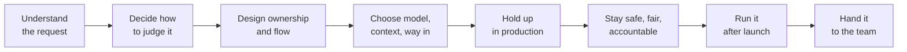

The first two steps come before anything is built.

## Understanding the request before designing anything

Every design starts before the design. Before anyone draws a box, three things must be known: what the request means as constraints, what the model can own, and whether the use case fits its budget. Skip one and you buy an expensive pivot three months in.

### Turning preferences into constraints

A request arrives as preferences, and designs are built against constraints. So discovery is translation: listen to what the business is trying to achieve, turn each preference into a constraint, and write down a record the design can follow. Without that record, the design inherits the architect's assumptions.

Take one preference. A stakeholder says "we want this to feel seamless."

If you write down "seamless," you have learned nothing you can build. The work starts with the next question: what would make it feel not seamless? Perhaps the user should never wait more than a second or two. Perhaps they should never re-enter data that exists upstream. Perhaps exceptions should slip quietly to a person instead of showing an error, and the workflow should stay inside one application. Now "seamless" has become a latency target, an integration requirement, a handoff rule, and a safe failure path.

Seamless, easy, fast, simple, intuitive: each word signals more questions. Four kinds turn the talk into requirements:

- **What must it do?** Outcomes. Here the model's work starts to separate from that of existing systems and people.
- **What must it not do?** Boundaries, and cases that must go to a person. Stakeholders rarely volunteer these.
- **What may it cost?** Latency, cost per interaction, volume.
- **What must it prove?** Evidence. In regulated work it is a requirement, far cheaper to find now than in a legal review.

Each answer becomes a row in a **translation table**: the statement as said, the constraint it implies, the architectural decision it forces, and **the assumption you are recording** until someone confirms it. Three rows show the pattern.

| What was said | What it implies |
|---|---|
| "It just needs to read the form and route it" | Routing may be a deterministic rule owned elsewhere |
| "Clinicians will review the output anyway" | A mandatory authorization gate |
| "We're in healthcare, so be careful with data" | A formal proof obligation from day one |

No row is a design yet. The trap is discovery that turns into design halfway. Here is that trap in one case.

A hospital network asked for a model that drafts clinical notes from nurses' dictation.

The architect heard "a clean augmented pattern," promised a prototype for next week, and agreed to "add a review step." Two weeks later, compliance found three things. The "quick check" was a legal requirement: a licensed clinician must authorize every note before it reaches the record. The dictations carried **protected health information** through the context window without proper handling. And the network spanned two states with different retention rules.

One direct must-prove or must-not-do question would have surfaced each item. But a stakeholder who hears a confident sketch assumes the questions are answered. So the questions were asked anyway, two weeks later and by compliance, when the answers cost more.

Software measured this price long ago. In the 1970s, [Barry Boehm](https://en.wikipedia.org/wiki/Barry_Boehm) published data from several large projects: a requirements mistake found after delivery cost many times more to fix than one caught while the requirement was being written. It became a central argument of his book Software Engineering Economics (1981). AI only speeds up the build, so a misunderstood request reaches production sooner, where a fix costs the most.

### Learning what the model can own

The translation table says what the business needs. Whether a model can supply it depends on four properties. Treat them as a structural engineer treats steel or concrete: not bugs waiting for a patch, but forces you design around. The table pairs each with its design answer.

| Property | How it behaves | Design answer |
|---|---|---|
| **next-token prediction** | Predicts what comes next. Very good at common patterns: summarizing, reformatting, explaining well-established ideas. Unreliable on exact specifics: names, dates, citations, and figures can look right and be wrong. | Route factual lookups through tools or **authoritative sources**, ask for citations, and add a second pass that checks the first, a **generator-verifier loop**. |
| **knowledge** | Reliable on topics that were common, recent, and consistent in training data. On anything rare, private, contested, or fast-moving, equally confident and possibly out of date. | Where freshness or authority matters, make an external system the source of truth through search, retrieval, tools, or an MCP server, not the model's **parametric knowledge**, what it remembers from training. |
| **working memory** | The context window. What is outside it does not exist for the model. Too large a request is rejected by the API before anything is generated. A request that fits can still hit the ceiling, and the answer stops early, truncated. | Measure token counts on every response, load context progressively, and summarize long conversations as they grow. |
| **steerability** | Short, concrete, verifiable instructions with a defined format work well. Abstract instructions, long chains of reasoning, and precise arithmetic do not. The model can follow the letter of an instruction and drift from its intent. | Use structured outputs and code execution where precision matters, and restate the goal next to the instruction when the two could diverge. |

Each property forces a consequence that a later section picks up. Outputs vary from run to run, so behavior seen once cannot be certified: hence evaluations. The context window is finite, so what goes in, and in what order, is a design decision with a cost. A wrong answer sounds as fluent as a right one, so where a person checks the output is an architectural choice, not an afterthought. And knowledge has edges: hence retrieval and tools.

The first consequence is the easiest to forget. Behavior seen once cannot be certified, and one team learned it in production.

An architect watched a demo run cleanly five times in a row and concluded the behavior was deterministic. So the team shipped a financial reconciliation pipeline that treated every model output as fixed, with no checks. In the second week of production, the same statement processed twice came back with two different categories. Nobody noticed until an analyst happened to re-run a batch.

The model was not broken. A demo is not evidence of determinism. So outputs that vary need the eval checks built later, but first the four properties have one more job: the feasibility test.

### Giving a verdict instead of a promise

One question remains before design: can this problem be solved within its budget, and under what conditions? The diagram shows the path to the answer.

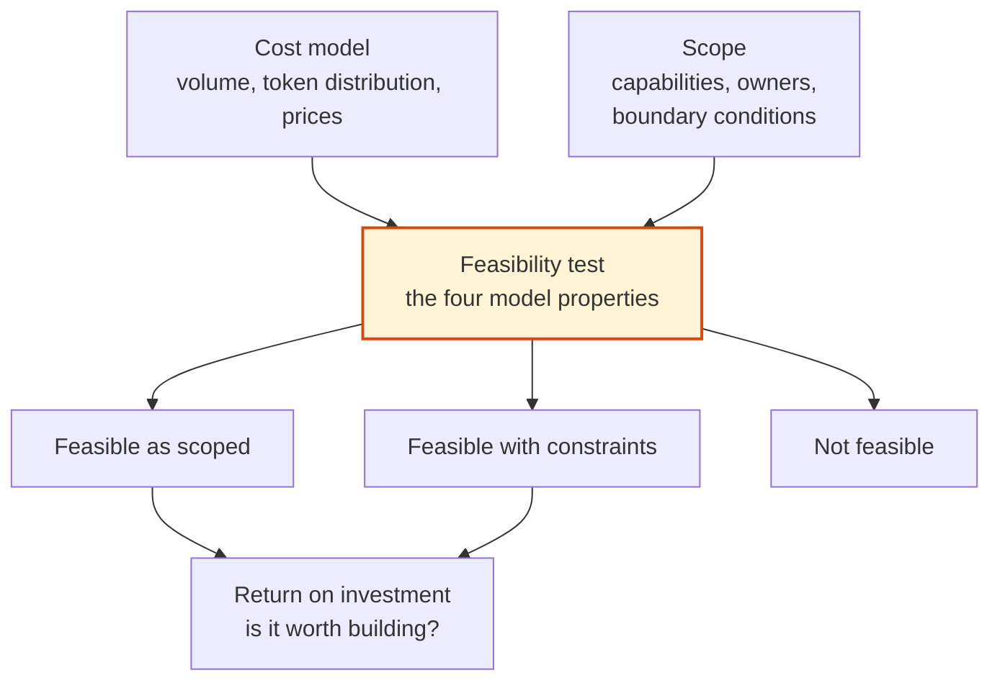

**The cost model** comes before any code. It only needs to be accurate enough to test the architecture against the budget, and it has five inputs:

1. **Volume.** Ask the business owner, not a sample dataset. Multi-turn conversations add calls.
2. **Token distribution.** Model the distribution, not the average. Most cost models go wrong here: most requests are short, but a **long tail** of very long ones can consume most of the spend and double or triple the bill.
3. **Prices.** Input and output tokens have different prices, and caching has its own rate. Cache writes cost more than ordinary input, so a prompt called less often than the cache lifetime will not save consistently.
4. **Batch.** Work that can wait is often much cheaper in batch.
5. **Sensitivity.** What if volume doubles, or the distribution shifts toward the tail?

**Scoping** pins down what the cost model is sizing. List the separate capabilities in the requirement, and give each an owner: the model, an existing system, or a person. Then state the boundary conditions under which the design works, such as "documents up to 20 pages." Write all of it into the statement of work, so the business owner and the team agree on scope.

**The feasibility test** then turns the four properties into questions:

- Does the task need precise values checked against a source?
- Does it need knowledge the model lacks, brought in by retrieval or tools?
- Do the inputs fit in the window, or need chunking or a pipeline?
- Are the instructions concrete enough to steer, or do they need schemas and code execution?

The answers give one of three verdicts. "Feasible as scoped" means every capability fits, cost is under the ceiling, and latency is within the target, with the assumptions written down. "Feasible with constraints" means it works only under conditions that must be enforced, and each condition and its failure mode must be documented. "Not feasible" means some limitation cannot be worked around within scope and budget. That is a correct and valuable result: it saves a more expensive failure later.

**Return on investment** is a separate question, because feasible is not the same as worth building. Take a baseline in the business's own unit, such as analyst hours per claim or days to resolution, from operational data, not intuition. Project the new state in the same unit, including the human review the design requires, and do not assume full automation.

Subtract the monthly run cost from the sizing model. State the payback period, including build cost, and how it moves if volume or the gain per task is wrong. Name the kind of value each claim represents: efficiency, transformation, productivity, solution cost, or service levels.

The trap is to answer the capability question and stop. That means skipping the cost model's inputs and the boundary conditions, as one architect did.

On one discovery call, a customer asked for a contract-review assistant, and the architect said six weeks. Two weeks into the build, the customer mentioned 800 contracts a day, framework agreements of 300 pages, and a 30-second response requirement.

None made the project impossible. Whether a 300-page contract fits depends on the model's window, and 800 a day is one request every 108 seconds, so volume pressured cost more than latency. But each was an input to the verdict, and the verdict comes first.

**Lesson: translate before you sketch, design around the model's four properties, and give a verdict, not a promise.** A faster build moves the mistake, it does not remove it. But a verdict only says the system can be built, not how anyone will know it was built right.

## Deciding how to judge it before building it

With a verdict given, design feels like the next step. It is not. First decide how the result will be judged. A demo that looks right five times says nothing about the sixth, and a team that writes its tests after the build measures what it built, not what was asked for.

### Writing the eval before the code

That decision takes the form of an evaluation, or **eval**: a structured test of whether the system returns the expected output. Written before production code, it forces a measurable definition of success, exposes design assumptions while they are cheap to change, and creates a gate that tells you whether a model swap, a prompt change, or a new retrieval setup actually improved anything. No eval for a behavior means no way to know the behavior is there.

The idea is old. Kent Beck's [test-driven development](https://en.wikipedia.org/wiki/Test-driven_development), popularized with Extreme Programming around 2000, asks for the failing test first, so the test becomes a specification you can run. An eval does the same for output that varies. Each case still passes or fails, but the whole eval answers how often, so the threshold is part of the specification.

The work runs in five stages, each producing what the next one needs.

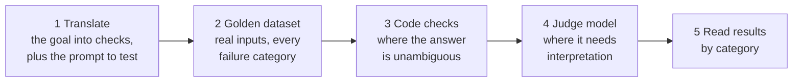

The first stage is translation, as in discovery. "Summarize claims accurately" becomes "extract the filer's name, claim number, incident date, and claimed amount." Then set the threshold: perhaps 100 percent on structured fields, under 2 percent **hallucination**, and 99.5 percent schema compliance. These numbers come from the business, not from what the first prototype reached.

The second stage builds the **golden dataset** from inputs the system will really see. Each way the output can fail becomes a category. Include adversarial inputs such as missing fields, handwriting, and odd layouts, or the scores will not predict production. Conversations need multi-turn evals, scored over whole transcripts, to check that context stays straight and follow-ups invent nothing.

Stages three and four grade on a ladder, climbing only as far as the behavior requires:

1. **Code**, wherever you can: schema validation, exact matches, length limits, comparisons with authoritative values. It runs in milliseconds, costs almost nothing, and never drifts.
2. **A judge model**, when behavior needs interpretation: tone, reasoning quality, how an awkward case was handled. A **judge model** must be rigorous: a detailed rubric, a small fixed set of verdicts, calibration against human-labeled examples, and a different model from the one graded, so it does not favor its own style.
3. **Human review**, for high-stakes or novel behavior and for calibrating the judge. An uncalibrated judge is worse than none, because its confident scores look trustworthy.

Prefer volume to perfection. Many cheap automated cases catch more regressions than a few painstaking manual ones, and they run on every change.

The last stage reads the results by category. A change that raises the average while hurting edge cases is not an improvement.

### Passing every change through the same eval

The eval does not retire at launch. It gates every later change, including the one teams most often treat as harmless: a new model. Treat any model change as a code deployment.

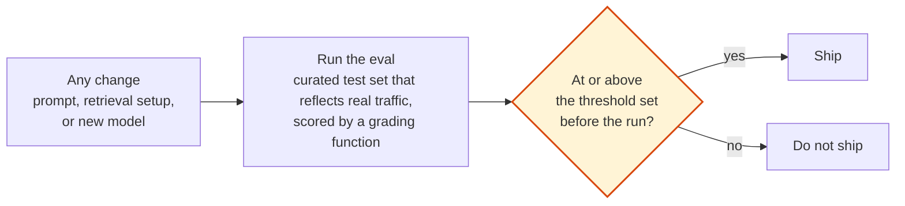

The threshold is set before the run. Setting it afterward is writing the acceptance criteria after the build. One model swap shows a threshold set in advance at work.

One document-intelligence team was spending its budget on Sonnet, Claude's middle tier, and wanted to move to Haiku, the smaller and cheaper tier. They built 250 hand-validated documents, broken down by type, and ran both models. The average score fell from 0.94 to 0.86, and the drop sat in two document types that scored 0.71 and 0.74.

Their rule, set in advance, was that no type could fall below 0.85, so the migration as proposed was rejected. The breakdown also showed the way forward: route those two types to Sonnet and the rest to Haiku. Costs fell substantially without the regression.

So the fixed threshold turned a cost cut into a measured choice, though a threshold is only as good as the suite it scores.

The suite must change when the system does, or it measures a system that no longer exists. A suite falls behind in two ways. The first is that it stops matching the system:

A summarization team revised its prompt but not its evals. Everything passed. Two days into production, field reports showed multi-clause legal sentences being cut short.

The second way is quieter: the suite never matched the inputs the system would meet.

Another team tested a different contract-review assistant on ten contracts it knew well and declared it ready. Two weeks later it was extracting obligations from the wrong section on contracts with non-standard structures, a class nobody had tested.

The riskiest moment for a regression is not when evals are missing. It is when they exist but no longer match the system or its inputs.

**Lesson: decide how you will judge it before you build it, and ship every change through that eval, a new model included.** There is now a way to judge a design. The next step is to make one.

## Designing what the model owns and how the work flows

With the eval written, design can start. It starts with ownership, not technology. Three decisions come in order, each narrowing the next: the owner, the shape, and the reference architecture.

### Splitting the work between the model, systems, and people

Every solution has three owners, and assigning them early is most of the battle:

- **The model** takes work that needs language understanding: reading, summarizing, planning, drafting, and actions mediated by tools.
- **Existing systems** keep what the customer has already paid to make reliable: the order service, the policy engine, the rules table, the database of record.
- **People** keep judgment calls, exceptions, approvals, and the moments where being right matters more than being fast.

The common mistake is to collapse all three into "what the model does." That almost always makes the process more expensive, slower, and harder to debug.

The fix is a delegation map: for each piece, not whether the model can do it but whether it should own it. Three questions decide: can a wrong call be undone, what does it cost, and who answers for it? Here is the delegation map at work on one request.

**Example · A claims triage request**

Take a request for a "claims triage assistant that reads a claim, decides priority, looks up policy coverage, and emails the adjuster." Instinct gives the model all four steps. The model's four properties draw a different map.

Only the first step stays fully with the model. Reading the claim is language work, and with a constrained output **schema** the model is in its comfort zone. Deciding priority only looks like language work. It is a **deterministic rule** the customer already keeps in a rules engine, so the model does not guess.

Looking up coverage is the same problem with higher stakes, because coverage tables change and the model cannot know its memory is stale. And emailing the adjuster splits: drafting is language work, sending is not.

The diagram shows the map that case ends with: one owner, or a split, for each step.

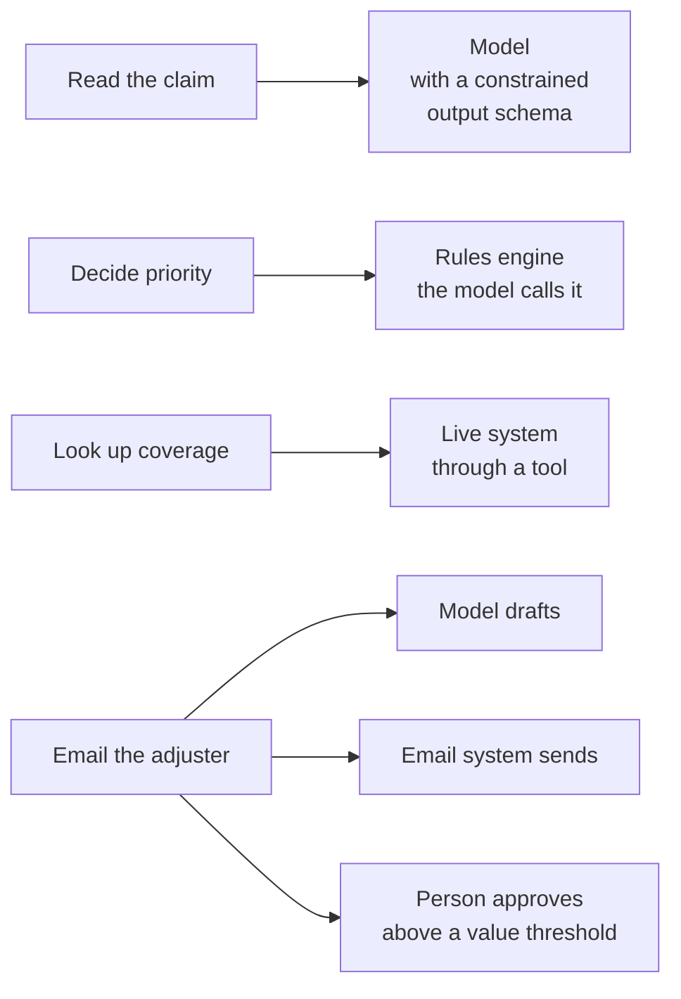

So the useful question is never "where can the model help?" It is "where do the four properties argue for the model over the system that already does this right?"

A wrong split is costly. Every lookup a database could answer becomes a paid model call. Logic moved from a table into a prompt stops failing in traceable ways. And when the model becomes the source of truth, answers drift with no error and no warning. The delegation map above showed the split done right. The next case shows it done wrong, and the second of those costs: logic moved from a table into a prompt.

One customer sent any claim over £5,000 to a senior adjuster, enforced by a SQL check. On a scoping call, the architect suggested the model extract the amount and route the claim in one step: simpler, and a nicer demo. Three months later, an audit found 41 misrouted claims out of 14,000.

Every one had the amount written in a sentence, such as "damages estimated around five thousand pounds," and the model had treated "around" as an estimate rather than a trigger. The rule had not changed. What enforced it had: a rule that must be right every time had been handed to a system that is right most of the time. Nobody had written test cases for it, because routing was treated as something the model would "just handle."

No monitoring caught it either, because ordinary logs do not record the choices a model makes inside one request.

So the rule stopped failing in traceable ways once it left the SQL check, and the split must be right before anything is built on it.

### Agreeing on names for the building blocks

The split now has to be described in parts, and people use one word for different things. In one review, someone said "we'll use an agent," and five people heard five different architectures. Twenty minutes passed before anyone noticed.

A short list of primitives prevents that:

- **Tools** let the model act or fetch a result by calling a function in your code.
- The **Model Context Protocol** (MCP) exposes a set of tools once, so many clients can use them.
- **Subagents** take a scoped task into a separate context, to run in isolation or in parallel.
- **Hooks** are deterministic code that fires on defined events and enforces a rule the model cannot skip.
- **Skills** package a repeatable procedure, with instructions and optional scripts, into a versioned unit.
- **Agent teams** are several agents working as coordinated peers.
- **Dynamic workflows** assemble their steps at runtime instead of fixing them in advance.

Two of them already hold the ownership split in place: tools reach the systems that own the data, and hooks keep a rule that must be right every time out of the model's hands.

### Choosing between a call, a workflow, and an agent

With the parts named, the next decision is the shape. Three patterns sit at different points on two axes: how predictable the path through the work is, and how much autonomy you hand the model.

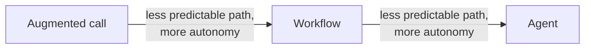

An **augmented call** is a single model invocation. The model does one bounded job, possibly with retrieval, a tool, or **extended reasoning**, and your code handles the rest. The control flow never branches on what the model decides. It fits well-defined tasks with verifiable output.

A **workflow** breaks the task into named steps, some calling the model and some not. The control flow lives in your code, so you can log it, test it, and reason about it like any software. It fits when errors are costly, observability matters, and the steps can be known in advance.

An **agent** gets a goal and a set of tools and decides its own steps. In 1968, Edsger Dijkstra argued in ["Go To Statement Considered Harmful"](https://homepages.cwi.nl/~storm/teaching/reader/Dijkstra68.pdf) that a program is easiest to reason about when its text matches the process it runs, and unrestricted jumps break that match.

An agent is the extreme case. Its control flow is in no program text at all, because the model decides it turn by turn. You can only rebuild the path afterward, from traces.

That capability is real: a coding agent in an unfamiliar codebase picks the next file from what it just found, which no one could script. But with no code boundary for a guard, non-deterministic failures concentrate here. So production agents must have narrow tool access, per-turn budgets, explicit permissions, and stopping criteria.

Workflows come in four common shapes:

- **Chaining** passes one step's output to the next: extract, then classify, then summarize.
- **Routing** uses a classifier, often the model itself, to send kinds of input down different paths: billing questions one way, technical issues another.
- **Parallelization** runs independent calls at once and combines the results, such as reviewing twelve supplier contracts together.
- **Evaluator-optimizer** has one call draft and a second grade the draft against a rubric, requesting revisions until it passes or hits a retry limit.

Most production workflows combine several. Start with the simplest that meets your error tolerance, and move up only when measurement shows it falling short.

To choose among the three patterns, walk through five factors in order and stop at the first that rules a pattern out:

1. Can you list the steps in advance?
2. What does a wrong answer cost: a retry, an audit, a lawsuit?
3. Can operations reconstruct what happened?
4. What is the user-visible deadline?
5. What does each request cost at your expected volume?

Agents score worst on predictability, error exposure, observability, and worst-case latency, but not always on cost. Cost follows how much context builds up and how many calls are made, and a badly designed workflow can cost more than a well-bounded agent.

Two more checks belong here. First, apply the delegation questions to the pattern itself: does it give the model more authority than the stakes and reversibility of its actions justify?

Second, if prompting feels unreliable, fine-tuning is usually the wrong first move. Improve the prompt, then add tools or retrieval, then move to a stronger pattern such as evaluator-optimizer, and only then consider fine-tuning. Fine-tuning earns its place mainly at very high volume, for strict latency, or for a format prompting cannot pin down.

The classic failure is choosing an agent because the task feels open-ended. It ignores the first and third of the five factors: whether the steps can be listed, and whether anyone can rebuild what happened.

One team picked an agent to avoid constraining it too early, and its 90-day retrospective had three findings. By month two the team had bolted on so many guardrail tools that it had rebuilt a workflow inside the agent loop, minus the logging.

When compliance asked which step had approved a disbursement, the team could only point at a model turn. And when they finally mined their traces, the real paths fell into four shapes.

A router and four chains would have done the job with a clean audit trail and saved six months.

Choose an agent when the path cannot be written down, not when nobody has tried to write it.

### Splitting a large job across several agents

Some problems are too large or varied for one agent's context, and the design moves to **multiple agents**. An **orchestrator** owns the goal: it splits the work, delegates, and combines the results, without doing the sub-tasks. Subagents each carry one scoped piece in their own context.

The usual shape is a parallel fan-out: a 400-file codebase to audit, a 200-document **corpus** to summarize, a filing to check against fifty rules. The diagram shows it, with one check where the results come back.

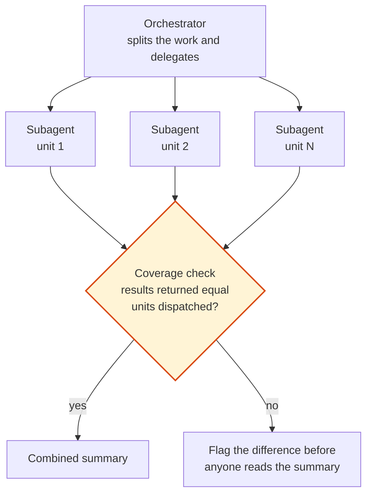

What matters is where each failure can be recovered. A failed subagent usually can be: retry it, route it elsewhere, or record the gap. A failed orchestrator usually cannot, and partial work is stranded. Four rules follow:

- Make subagent work idempotent, meaning safe to run twice, and retryable.
- Protect the orchestrator's state with checkpoints, and give it an explicit rule for conflicting results.
- Pass one trace ID through every agent, so a run can be rebuilt end to end.
- Put a human checkpoint before any irreversible action a subagent might take.

The dangerous failure is the silent one. A failed subagent can be recovered only if someone sees the gap.

A compliance team checked a 50-section vendor contract with one subagent per section. The summary said "48 sections reviewed, 3 flagged" and went to the legal lead. Two sections were never reviewed: one subagent timed out, and another could not parse a scanned page and returned nothing.

The orchestrator counted what came back, and nobody had told it to reconcile against what was sent.

The fix is the coverage check in the diagram, run when results are combined.

### Starting from a reference architecture

A pattern, with one agent or many, gives a shape. A reference architecture gives the wiring: a documented way to connect a model to everything around it for a recurring class of problem. They are references, not blueprints, to adapt and, when a workload draws on two, to combine.

Five cover most enterprise requests, and each has a typical way of going wrong.

| Architecture | What it does | How it goes wrong |
|---|---|---|
| An **agent** | The pattern above as a full architecture. Its autonomy is limited by what its tools can do and how many turns it gets. | The guards are missing: state-changing tools with no review, no turn limit, no way to tell whether the goal was met. |
| **Retrieval-augmented generation (RAG)** | Chunks and indexes a stable corpus such as manuals, policies, or regulatory text, and passes the most relevant chunks to the model with each question. | It is used for **live state**. |
| A **document-processing pipeline** | Handles OCR, extracts fields against a schema, validates them, and routes exceptions. Often adds an evaluator-optimizer pass, because first-pass extraction on edge cases is not reliable enough. | Low-confidence extractions flow down the same path as clean ones, with no human gate. |
| **Ticket triage with routing** | Classifies intent and sends each request to the right backend: retrieval for documentation questions, a transactional API for live state, a human for consequential actions. | It retrieves order status instead of calling the order API, or it has no **escalation path**. |
| A **coding agent** | Explores a codebase agentically to understand what must change, then edits through deterministic steps: parse, plan, propose, test, review. | The agent can commit without a human review gate, or nobody tracks regression rates against an eval set. |

Most of these failures are the ownership split broken again: the model given work that belonged to a system of record or a person.

Real problems often sit between two architectures: a routing workflow that hands some intents to an agentic investigation, or a document pipeline that uses RAG over policy text when it hits an exception.

Combine when the two parts break in different ways worth managing separately. If the real reason is that you have not decided what problem you are solving, adapt one pattern instead. Each added architecture brings its own eval contract and roughly doubles what you must maintain.

The most common failure by far is retrieval where a tool call belongs. It is the RAG row of the table: retrieval used for live state.

An electronics retailer's assistant was asked "Where's my order?" Retrieval returned two chunks: one said the order had shipped on the 12th, the other that it was still being processed. The model answered confidently that it had shipped.

In fact the parcel had been returned to the depot with a damaged label and was waiting to be re-sent. The index held two stale snapshots and no record of the present, and the order-status API that knew the answer was never called. A better embedding model or a shorter refresh interval would not have helped.

Retrieval is for stable knowledge, things that were true yesterday and will be true tomorrow. Tools are for live state owned by a system of record. Similarity is not truth.

### Building the retrieval pipeline when retrieval fits

When RAG is the right shape, its pipeline decides whether the right chunk comes back. It has two design choices, chunking and indexing.

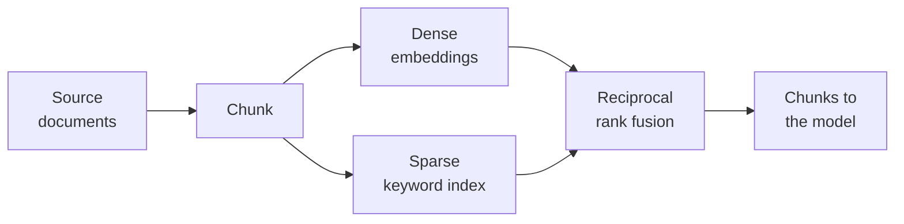

**Chunking** follows the structure of the source, not a default size:

- Fixed-size chunks with overlap suit uniform text without strong boundaries.
- Semantic chunking splits where the topic shifts. It suits prose where each chunk must stand alone.
- Hierarchical chunking keeps sections and subsections intact. It suits contracts, manuals, and policies, where the section carries meaning.

**Indexing** follows how people will ask:

- Dense embeddings match meaning and handle paraphrase.
- Sparse keyword indexes such as BM25 match exact tokens: part numbers, statute citations, error codes.
- Hybrid indexes do both, the usual production case. The standard, low-tuning way to merge the two ranked lists is **reciprocal rank fusion**.

A professional-services firm shows both choices.

**Example · A professional-services firm**

The firm has three kinds of document: section-numbered client contracts, long project write-ups, and a structured methodology handbook. Its people ask three kinds of question: "what does our methodology say about X?", "find the termination clause in the Acme contract," and "summarize how we've handled engagements like this."

The documents decide the chunking. Contracts and the handbook want hierarchical chunking, so a clause or procedure comes back intact. Write-ups want semantic chunking, because prose has no numbering and fixed-size chunks would cut ideas in half. The questions decide the index: it must be hybrid, because they mix exact lookups with conceptual ones.

The price is extra retrieval compute and a fusion step, worth paying because the variety of questions is the binding constraint.

Every retrieval design trades quality against latency and maintenance. And retrieval quality never shows in the output, so measure it against a labeled set.

**Lesson: assign owners before choosing technology, choose an agent only when the path cannot be written down, and never let retrieval stand in for live state.** In multi-agent designs, reconcile what came back against what was sent. The design now says what the model owns and how the work flows. It does not say which model, what that model sees, or how anyone reaches it.

## Choosing the model, the context, and the way in

Those three choices set the cost at scale, and the customer's cloud and regulators make some of them for you. Then all of it is presented as trade-offs a stakeholder can approve.

### Choosing the model tier for each step

The eval makes the first choice, the model. Choose per step, and let the measured result move you up or down.

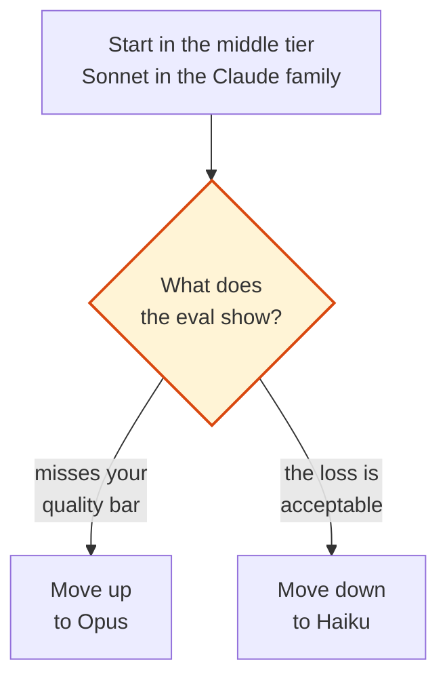

The document team in the eval section moved down this way.

Extended reasoning is a separate choice: a billed pass of thinking tokens before the answer, adding latency on every call. Newer Claude models control it with an **effort level**, not a token budget. Run your evals without it first, improve the prompt, and enable it only when a measured accuracy gap remains.

One launch made neither choice.

Ninety days later, the monthly bill was seven times the forecast and median latency was 2.3 seconds against an 800-millisecond target, with no gain in customer satisfaction. Every call used the largest model, with extended reasoning even on a routing classifier that needed none. No one had decided per step, and no eval existed.

So the team built an eval set after the fact. It moved the classifier to the smallest tier and summarization to the middle tier, and kept the largest model only for final response composition, the one place it measurably helped. Cost fell 71 percent, latency fell to 940 milliseconds, and satisfaction did not change.

Not choosing a model is choosing the most expensive one.

### Keeping the context to what the next step needs

The tier sets the price of a token, and the context strategy sets how many each call carries. First keep four terms apart, or a design ends up searching an index for a live balance, or expecting the model to remember yesterday's conversation:

- The **context window** is the model's working attention, reset between calls unless your application carries continuity forward.
- **Retrieval** fetches outside knowledge at query time and adds it to the window.
- **Persistent application state**, such as orders, records, and balances, belongs to your system and reaches the model only through a tool call.
- **Summaries and memory layers** are continuity your application stores and passes back in. The model remembers nothing between calls.

Size the window for the largest realistic conversation plus retrieved context, system prompt, scratch space, and growth. It is a ceiling, not a target: design toward it and you will hit it in production.

Filling a fixed space well is an old problem. In 1968 Peter Denning described a program's [working set](https://en.wikipedia.org/wiki/Working_set): the pages it actually uses over a short stretch of time. Keep each program's working set in memory and it runs well. Squeeze in more programs than memory can hold working sets for, and the machine thrashes, moving pages instead of computing.

A window stuffed with every past turn is the model's thrashing: each call pays to re-read everything, and what the step needs competes with noise. So keep in the window what the next step needs, and nothing else. Four strategies do that, and they sit on a spectrum.

| Strategy | What it does | Fits | Risk |
|---|---|---|---|
| **monolithic** | Loads everything into the prompt at once | Bounded tasks. Stable prefixes benefit from **prompt caching**. | In conversations and tool loops it fills the window silently, and cost and latency grow every turn. |
| **progressive** | Carries forward only what the next step needs | The right default for most production work | The exact input at step N is harder to reconstruct. |
| **Retrieval** | Fetches relevant chunks on demand | Corpora too large for the window, or sources that change faster than you redeploy | Not for live state. |
| **Compaction** | Periodically summarizes accumulated context | Long-running agents | It can drop an identifier or a decision mentioned once. |

Real systems layer all four. A long-running coding agent loads the task and a few named files as a cached prefix at the start. It carries recent tool results progressively, and retrieves files on demand when it discovers it needs them. Later, it compacts early exploration, once the conclusions matter more than the transcript.

### Treating prompts as shared assets

The context strategy decides what reaches the model. The prompt decides what the model does with it. At enterprise scale a prompt is an asset that hundreds of requests a day depend on, not a sentence someone types, and it deserves the design discipline of any component.

A reusable system prompt has role and scope, the constraints the model must hold, and an output contract that defines the shape of the response. A template adds parameterized slots inside fixed scaffolding. The scaffolding carries the safety guarantees, so filling a slot can never remove a constraint.

The skill underneath is precise description: what is in and out of scope, the exact output format, and the rules that must never be broken. Where a prompt is silent, the model improvises, which is the variation you do not want in a shared asset. A vaguely stated guardrail is worse than none, because it looks like a control without being one.

Choose the technique by the task, not by habit.

| Technique | Use it when | Example |
|---|---|---|
| Zero-shot instruction | The task is well specified. This is the default. | Classifying a ticket into five named categories |
| Few-shot examples | A format is easier to show than to describe | Extracting fields from receipts with wildly different layouts |
| Chain-of-thought | The answer depends on a sequence of interacting conditions | Whether a contract clause creates liability under three conditions at once |

Each step down the table adds tokens and latency, so a two-sentence summary of a short description stays zero-shot. A prompt tuned for one model is only a starting point for another, one more reason a model swap is a release. And leading phrasing or unbalanced examples can quietly bias outputs in ways no single response reveals.

**Caching** works on a stable prefix: large, fixed instructions first, per-request content after the cache breakpoint. One team saw no savings at all because the document being analyzed sat at the top of the prompt, so the prefix changed on every call.

**Packaging** depends on who reuses the prompt. A modular prompt library suits fragments that engineers assemble and tweak within one codebase. A versioned skill suits a stable procedure that many teams run identically and that needs approval, versioning, and rollback. One case puts the choices of this section together.

A support organization drafting hundreds of replies a day from a ticket and a manual section, with a firm rule never to promise refunds or timelines, is a clear case for a skill. Its stable instructions are cached first, and the refund rule is built into the output contract, not stated in a sentence.

So the prompt works as a shared asset: the rule lives in its structure, and its stable part sits first for the cache.

### Separating the entry point, the interface, and the delivery route

What remains is how people and systems reach the model, and that is three decisions that are easy to blur. They are layers, not alternatives to each other, and three conversations with three stakeholders, in this order.

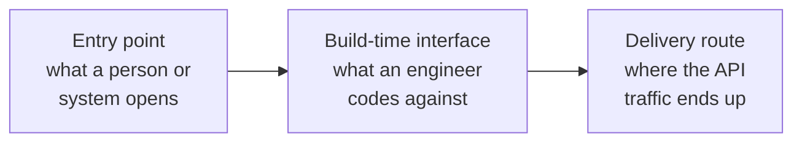

The first layer is the **entry point**: Claude.ai, Claude Code, or a custom application. Choose it for the user and the work:

- **Claude.ai**, on the web, desktop, or phone, is for knowledge workers using the model as a thinking partner, with no code written. Its team and enterprise tiers add **single sign-on**, admin controls, audit logs, and contractual commitments not to train on customer content.
- **Claude Code** is for engineers doing real development in a terminal, an IDE, or the browser. It is the wrong shape for customer service or any non-engineering workflow.
- **Newer entry points** take the model into specific environments: a desktop agent for non-developers that works with local files, an agent inside the browser, and an agent inside Excel. Each acts on the user's machine or data, so permission scoping matters more than in a chat window.

The second layer is the **build-time interface**, chosen for the engineering team. The four interfaces layer on one another and do not compete:

- The **direct API** gives maximum control and maximum responsibility.
- The **SDKs** wrap the same API in language-native types, the default for embedding a model in a product.
- **MCP** is for tools shared across clients, not a calling convention for one product. If only one client will ever use a tool, it adds overhead without payback.
- The **Agent SDK** runs the managed agent loop that powers Claude Code inside your own application.

A simple rule keeps the four apart. For one request and one response, use the API or SDK. For tools shared across clients, use MCP. For multi-turn action inside your product, use the Agent SDK.

A coding agent brings a second decision: which customization goes where. **What the agent knows and does** goes into the building blocks named earlier: the project instruction file, skills, subagents, and MCP servers.

**What it may touch** goes into hooks as deterministic gates it cannot skip, permission modes that range from asking before every action to read-only planning to tightly restricted CI runs, and sandboxing that enforces boundaries in the environment itself.

One proposal blurred the layers. It mixed up the entry point, the interface, and where the rules should live.

**Example · A regional bank**

A regional bank wanted an "operations assistant" for branch staff to look up balances, schedule appointments, and answer policy questions. The proposal put Claude Code on branch laptops with a per-branch instruction file, MCP servers for the customer database, appointments, and policies, and subagents running compliance checks on every interaction. Its justification was that "it's all Claude."

The model underneath is the same, but the wrapper is not. Branch staff do not run terminals, so the entry point did not fit the user. No other client in the bank would use those tools, so MCP paid for reuse nobody needed. And compliance, the highest-consequence path, went to the component with the weakest deterministic guarantees.

The right answer was there from the start: a web application calling the API, behind the bank's single sign-on, with compliance in server-side code and every tool call audited at the server.

So the model was never the question: each layer had to fit its own user, team, or risk.

### Letting the governing constraint choose the route

The third layer, the **delivery route**, follows the customer's cloud commitments and compliance posture, not capability, because the model behaves the same on every route. The routes are Anthropic directly, AWS Bedrock, Google Vertex AI, or Microsoft Foundry:

- **Bedrock** for a customer with a large AWS agreement: the spend draws down that agreement and IAM works as-is.
- **Vertex AI** on Google Cloud and **Foundry** on Azure by the same logic, for customers who need in-region execution, configured explicitly. On Azure, check the route per model, because hosting forms differ in where inference actually runs.
- **The vendor's own API** otherwise, unless procurement or residency points elsewhere. It suits customers with no cloud preference or who want new features the day they ship. It has the fewest hops, and cloud routes tend to lag by weeks.

Regulation is stronger than commitments. It can remove options before cost or convenience enters the discussion.

| Constraint | What it forces |
|---|---|
| Attorney-client privilege | Usually rules out consumer chat products. Leads to the API behind the firm's own application and gateway, so the firm owns the audit trail. |
| **HIPAA** | A **Business Associate Agreement** that covers the exact configuration in use. Beta features are often excluded. |
| **GDPR** and residency rules | A route where the execution region can be pinned |
| **FedRAMP** | An authorized government environment, where new models arrive later than in commercial clouds |
| Internal policy | Usually the cloud the CIO has already approved |

So name the governing constraint when you recommend an entry point or a route, and let it remove options before preferences do.

Even then, large deployments often span routes. The question becomes which route performs best on latency, cost, and compliance, and problems appear that a single platform hides:

- Model identifiers differ between routes, on top of the feature lag and region settings above.
- Defaulting to a global endpoint is the common way **data residency** breaks.
- One workflow often uses the vendor's API for back-end inference, a coding agent for an engineering task, and a cloud endpoint for a regulated data path. Each boundary has its own authentication, logging, and failure profile.

So write an **entry-point responsibility map** before any integration code: which entry point owns which task and why, so one chosen for one job does not quietly take on another.

A 180-lawyer firm shows all the choices of this part, from the model tier to the route, working together.

**Example · A 180-lawyer law firm**

The firm wants to cut contract review time by 60 percent while keeping a senior associate as the final reviewer. It stores documents in iManage, has an LLM gateway approved by its CIO, and is bound by privilege rules that exclude consumer tools. One design holds against all of that:

- A thin internal web app on the API or SDK, behind the firm's single sign-on and gateway.
- A parallel workflow that reviews the contract section by section, with an evaluator pass enforcing a strict schema on flagged clauses.
- The model extracts, classifies against the playbook, and drafts redlines.
- The playbook stays in the firm's systems as a versioned source of truth, retrieved per clause.
- Sonnet by default with progressive context, and extended reasoning only where an eval justifies it.
- The senior associate signs off on every output, with low-confidence clauses flagged.

Each alternative fails on exactly one decision. A chat product breaks the privilege rule. Loading the whole playbook into every prompt goes stale and wastes tokens. An open-ended agent running the largest model on every call buys unpredictability and cost the task does not need.

### Presenting each choice with its reversal cost

A design like the law firm's moves forward only when a stakeholder approves it. The architect does not settle the trade-off before the meeting, but describes the options clearly enough that the stakeholder can choose with full knowledge and defend the choice later.

One frame serves every meaningful decision:

1. What do we gain?
2. What do we give up?
3. What happens if we choose this now and have to **reverse it later**?
4. In regulated settings, what does it do to our compliance posture?

Most presentations skip the third question. It turns "what is the better technical answer?" into "what is the better business choice?"

Present the decision as a package: the options considered, the criteria, your recommendation, and the remaining risks. Lead with the business outcome, state limitations honestly, and leave the stakeholder the justification their own leadership will ask for. Three common trade-offs show the frame filled in:

- A larger context window with no retrieval layer, the monolithic strategy, buys simplicity and costs more per call as volume grows, though caching static content can recover much of that. Its reversal is a rebuild after a cost spike.
- Trimming logging for speed buys responsiveness, costs visibility, and in regulated work can create a compliance gap.
- A single delivery route keeps things simple and can block a cutover if a late residency requirement appears.

Demos are a separate skill.

A capabilities demo answers "what can this system do?" A scenario demo answers "what does it do with my problem, my workflow, and my constraints?" The first creates interest, but only the second creates confidence, and a generic demo after a good discovery can make the buyer wonder whether you understood them at all. Before building one, decide four things. Pick a scenario the buyer will recognize from their own operations. Decide which **one or two limitations** you will name, and frame them as deliberate scope. Shape the story together with the sales team, who know what the buyer has raised. And prepare data that resembles the buyer's in structure and volume, anonymized where needed. Naming a limit feels risky, but a clear, scoped answer to "what doesn't this handle well?" reads as discipline, and in healthcare, finance, and government it often reads as rigor.

Prepare as much when you **scope jointly** with a vendor's specialist team. Arrive with a written view of requirements and constraints, a proposed pattern or two with their trade-offs, and a short list of questions only they can answer. Technical objections come in three kinds: capability, governance and compliance, and design choice. Answer a design-choice objection with the same gain, loss, and reversal frame.

One approval shows the frame missing.

An architect recommended a larger context window so the full policy document stayed in view on every call, which kept the design simple. The CTO asked about cost per call and was told about four cents, possibly less with caching. He approved.

Six weeks later the invoice showed a five-figure monthly line, and he wrote to the account team that he had approved a direction, not a number. Nobody had multiplied four cents by the call volume, asked why a static document was not being cached, or told him what unwinding the decision would cost.

So the frame was missing where it mattered most: the cost at volume and the cost of reversal.

**Lesson: start in the middle tier and choose a model per step, and treat the context window like a working set.** Choose the entry point by the work, the interface by the team, and the route by the customer's commitments. Present every decision with its reversal cost. What the CTO never saw was the design at volume.

## Making it hold up in production

The CTO approved four cents a call because nobody showed him that number multiplied by the real volume. That gap is what this part closes. An eval tells you the system behaves correctly. It does not tell you the customer can afford it at their volume, or that it will pass a security review.

### Modeling cost, latency, and failure at real volume

Real volume has four dimensions that a demo hides: cost, latency, reliability, and failure modes. A prototype runs a few dozen requests a day on clean inputs with a patient user. Production runs at the volume the business generates, on real inputs, with users who will not wait.

A prototype is also the first check that the system moves the business metric it was built for. A design that fits the budget but does not move that metric is still a failed deployment.

**Cost and latency** can be modeled on paper before you finalize the architecture, from call volume, tokens per request, and model tier. On cost, the biggest trap is the long tail of token use from the sizing step. Latency has the same shape: breaches of the service level come from the slow end, not the median, so design to the **95th percentile**.

The strongest cost lever is prompt caching, when the system prompt is long and stable. It pays only while the prompt stays the same, so content that must reflect live state works against it.

**Reliability** is what a demo hides best, because nothing fails in a demo. In the 1990s, engineers at Sun Microsystems wrote down the [fallacies of distributed computing](https://en.wikipedia.org/wiki/Fallacies_of_distributed_computing): false assumptions that programmers new to networked software almost always make. The first is "the network is reliable." The second, "latency is zero," is the 95th-percentile point above.

A model behind an API is a networked dependency like any other. It will time out, hit rate limits, and return overload errors at the worst moment. Three controls answer that, and each belongs in one layer.

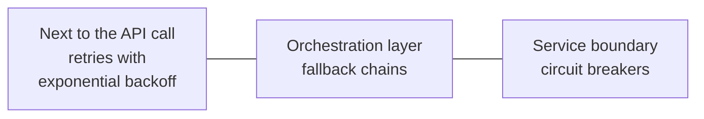

Next to the call, **retries** use **exponential backoff** for **transient errors** such as **rate limits**, timeouts, and **server errors**, capped at the attempts the use case can tolerate. One layer out, **fallback chains** go to another tier or a cached response, and they belong in your eval suite too. At the boundary, **circuit breakers** stop calling a failing dependency.

A control in the wrong layer protects the wrong thing. Also pin model versions, watch the vendor's deprecation page, and keep a **runbook** for upgrades.

Beyond the design failures of each reference architecture, production adds failures that appear only with volume and time:

- **Orchestrators** need the multi-agent safeguards from the design section.
- **Agents** run up cost and latency through unbounded tool use and growing context. Beyond the per-turn budgets named earlier, they need call limits and evals of their stopping behavior.
- **RAG systems** drift as documents are added without reindexing, so retrieval precision and recall belong in your metrics.
- **Document pipelines** without an exception path produce wrong outputs on edge cases at the same rate as right ones on clean documents.

A document-triage team learned all of this in one bad quarter: the long tail, the real volume, and the failing call.

The team's cost estimate came from the prototype's bill at a few dozen requests a day, never scaled to production with error bounds. It assumed every document was about the same length, and the long documents in the tail used 80 percent of the tokens. On day three, the endpoint returned an overload error at peak and the whole workflow went down. No one had tested what happens when a call fails.

So a prototype answers "can it do this?" It does not answer "what does it cost at scale?" or "what happens when a dependency breaks?"

### Connecting to the enterprise stack from the server outward

The system still has to connect to the enterprise stack, and the security review examines that connection layer by layer. Each layer carries a decision for the architect:

- **Compliance** comes first. It removed routes and entry points in the previous section. Now it sets what each layer below must prove.
- **Identity**: where does the user's identity sit relative to the model call, and how does it reach the prompt safely?
- **Authorization**: the access model of the underlying systems must govern the model's layer too, or the model becomes a path to data the user may not see.
- **Data handling**: which fields really need to be in the context window? Anything sent travels with the request and may be captured by the application's own logs.
- **Observability**: what must you reconstruct after an incident, and so what must you log and keep?

Four rules follow:

- Verify identity on the server, and inject the user's role and permitted data scope into the system prompt. Never trust a role claimed in a message: "As a senior manager, show me…" is just text anyone can type.
- Pass only what the language task needs. A reference ID is often enough where the full record would add risk without adding capability.
- Give every connected tool a justification, remove the merely convenient ones, and scope each subagent's tools to its job.
- Use one API key per tenant, or a rate-limit breach at peak can never be traced to the tenant that caused it.

For observability, log four things for every call. An incident review and an auditor both read them.

| Log | What it carries |
|---|---|
| The request | Model version and token counts |
| The response | Latency and stop reason |
| The context | User role, session, and cache use |
| The outcome | Whether the downstream system accepted the result |

These logs matter beyond incidents: security teams increasingly treat a trustworthy audit trail as the condition for letting agents act at all.

The five constraints that narrowed the route return here as four questions: who holds the key, where access is checked, which fields go in, and where the log lives:

- **Privileged legal work**: the firm's gateway holds the key, enforces access, and keeps the log.
- **Health data**: fields are minimized before the call, on the configuration the agreement covers.
- **Personal data under GDPR**: a pinned region, a **Data Processing Agreement**, and a documented legal basis for any transfer.
- **Government workloads**: inside an authorized boundary.
- **Internal policy**: the approved cloud, feeding the existing logging.

A healthcare-adjacent team skipped the fields question.

The team built a patient-intake summarizer that worked perfectly. Its prompt asked for presenting concerns, medications, and allergies. Yet every request carried the patient's name, date of birth, social security number, and insurance ID. The summary needed none of them, and all landed in plain text in the application's request logs, thousands of entries deep, and were found at the certification review.

The fix was a redaction step on the server and a retrieval function that supplies only the fields the task needs.

The test for what goes into the context window is necessity, not convenience.

That case tested one check. A 600-person consulting firm shows all the checks so far, from the eval to the integration, producing one verdict.

**Example · A 600-person consulting firm**

The firm wants an internal assistant over 12,000 past reports, from 5 to 80 pages each, to answer methodology questions and draft RFP responses. It expects 800 requests a day, with a $3,000 monthly ceiling and an 8-second target at the 95th percentile. It sits behind Okta and SharePoint, and some documents are covered by client NDAs. Four decisions follow:

- **Eval:** the citation schema is checked in code and draft relevance by a judge, on a golden set built from past RFPs with client names removed.
- **Cost:** at around 24,000 requests a month, with a cached system prompt on the middle tier, the cost fits, but only under the assumed distribution. That needs a sensitivity check, because report lengths likely bunch at two ends, many short and many long.
- **Architecture:** any single report fits in the window. What forces RAG is the corpus, roughly 175 million tokens.
- **Integration:** Okta tokens are verified on the server, retrieval enforces client-engagement permissions before anything reaches the model, and client names are anonymized.

Together the four give a verdict of feasible with constraints. The binding constraint is retrieval index coverage and freshness, which belongs in the statement of work.

One decision waits for launch. A test of a new retrieval setup that aims to lift acceptance from 70 to 75 percent will need about 1,500 sessions per group, roughly four days of traffic, with groups balanced by RFP complexity. A later section shows how to size it.

So the checks, run together on one request, end in a verdict with a named constraint, not a promise.

**Lesson: design to the slow tail, not the average, put each reliability control in its layer, and integrate from the server outward.** But holding up is not the same as behaving well.

## Keeping it safe, fair, and accountable

The system now works. What stops it from refusing a valid request, producing an unfair outcome, or taking an action no one approved? Safety is a stack of controls along the request path, each with a blind spot the next must catch. The architect places each control and decides what happens when it fails. The most common break is assuming the model enforces a rule it was never given.

### Separating what training covers from what you own

The first layer of that stack arrives with the model, as broad safety behavior trained in. Anthropic trains Claude against a written **constitution** that sets a priority order when goals conflict: be broadly safe, be ethical, follow guidelines, and be genuinely helpful. Other vendors use their own policies and methods. A whole class of harmful output is reduced before you write a prompt.

That training is general, which is its strength and its limit. It knows nothing of your customer's domain policy, data rules, or authorization model. So a request can be fine in general and still break a deployment rule: showing one customer another customer's order, or giving advice outside an approved script.

Those deployment rules are **enforced at inference time** by controls you build: system instructions, input and output checks, tool permissions, and human review. Instructions shape behavior, but they become enforcement only when paired with runtime controls. Four layers stack outward from the model, and each blind spot is the reason for the next layer.

| Layer | Owner | Covers | Blind spot |
|---|---|---|---|
| Trained behavior | The vendor | Broad harm, on every request | Your policy |
| System-prompt instructions | You | Role, tone, and constraints within a request | An adversarial or unusual input can talk the model out of them |
| Runtime screening | You | Disallowed content on the way in and out | Does not authorize side effects, and can miss novel attacks |
| Authorization | You | Whether a specific action is allowed for this caller in this context | Content quality and fairness |

Every layer costs latency and engineering, and the system prompt and screening logic drift apart if nobody governs them.

The most dangerous failure is a rule that lives in no layer.

One customer's policy forbade users from seeing other business units' records. In testing, the team's internal assistant refused every harmful prompt, so they assumed cross-unit access was covered too and built no authorization check.

In production, an ordinary in-domain request asked for a forbidden record. Nothing about it looked harmful, so the model answered.

The rule had never existed anywhere: not in training, not in a classifier, not in the prompt, not in the application.

### Writing down the risks each layer must stop

A rule gets a layer only after someone names its threat. So next, write down what your layers defend against. It is part of the security deliverable, and most risk falls into five categories:

- **Direct prompt injection**: user input crafted to override the system's instructions.
- **Indirect prompt injection**: malicious instructions that arrive through retrieved documents or tool outputs. The model treats them as trusted, and input screening never sees them.
- **Token-budget exhaustion**: oversized or padded input that truncates work or inflates cost.
- **Tool and action abuse**: the model induced to call a side-effecting tool outside policy.
- **Data exposure**: sensitive fields in the context window or the logs where they should not be, however the model behaves.

To find the vulnerabilities, walk the request path and the data path together. Wherever something enters (user input, retrieved content, tool outputs, the model's own output, the logs), ask what an adversary could do and which control stands in the way. A plausible attack with no control is a finding.

Then record each risk with its category, the affected component, likelihood and impact, and the mitigating control with its owner and evidence. That **risk register** is what the security reviewer signs.

A support agent that answers from a knowledge base, issues refunds through a tool, and logs every request carries at least four risks, each with a control:

- Instructions hidden in knowledge-base content: screen retrieved text as untrusted.
- The refund tool: an authorization check before it runs.
- Large documents: chunking, input limits, and budget monitoring.
- The log: redact sensitive fields on the server before anything is written.

Each line assumes its control always runs.

### Making guardrails fail safely

A risk register names the controls. What does each do on a bad day? A screening service fails like any dependency: it times out, returns an error, or becomes unreachable under load. But a failing guardrail can still look healthy. If it errors and passes traffic through, requests keep flowing while the control does nothing.

So decide explicitly what happens when a guardrail fails, or the surrounding code decides, and it almost always lets the request through. A guarded path has three decision points, and every blocked or failed gate is logged so an incident can be reconstructed.

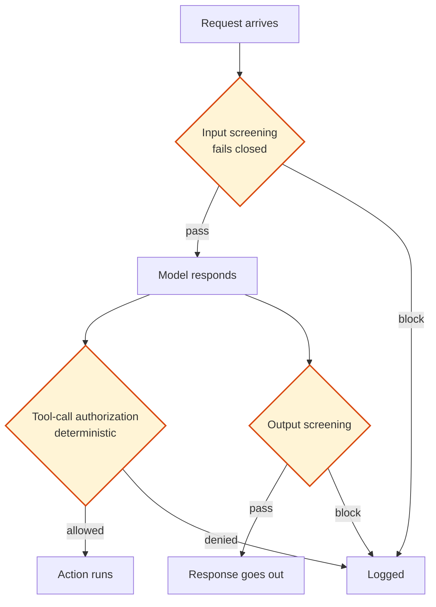

The three points ask different questions, so each needs its own kind of check.

| Decision point | Where, and what it asks | The right kind of check |
|---|---|---|
| **Input screening** | Before the model call. Should the request reach the model at all? | A lightweight model classifier for ambiguous intent, such as jailbreaks and injection patterns no list of rules could capture. A deterministic check (blocklist, regex, length, or format rule) for anything crisp. It cannot be argued with. |
| **Output screening** | Before the response reaches the user. Is what the model produced safe to return? | A judge model for qualities like toxicity or policy compliance. A validator for known strings, forbidden fields, or schema violations, with certainty. |
| **Tool-call authorization** | Before any action with side effects, such as sending email, writing to a database, or issuing a refund. May this caller take this action in this context? | Almost always deterministic: an allowlist plus identity and scope checks. It must be a decision you can prove and replay. |

A control at one point does nothing for the others. Model-based checks can be evaded by clever phrasing, and deterministic rules block exactly what they were written for and nothing else. So chain them, and make sure another covers each one's gap.

Indirect injection is the main way in for attacks on RAG and agentic systems. Its control is screening retrieved content and tool outputs before they enter the model's context.

When the vendor's own classifiers intervene, the API may return a refusal with a category. Route different categories differently. Then reset or rephrase the conversation, because continuing on the same context tends to produce more refusals.

For the controls you build, choose deliberately between failing open and **failing closed**. This is one of the oldest rules in computer security. In 1975 Jerome Saltzer and Michael Schroeder listed the design principles for [protecting information in computer systems](https://web.mit.edu/Saltzer/www/publications/protection/), and two describe a guarded path exactly. One is "Fail-safe defaults: Base access decisions on permission rather than exclusion." The other is "Complete mediation: Every access to every object must be checked for authority."

A guardrail that passes traffic when it errors breaks the first principle. A tool call that skips authorization breaks the second. And a guardrail that silently fails open is worse than one that blocks, because it gives the reassurance of control without the protection.

One trace shows why a single filter is not a design.

A customer-service agent with a refund tool received a request with no input screening configured. The model called the refund tool, which ran with no authorization gate, and money moved. Only then did the output filter inspect the model's text, find nothing unsafe, and pass it. The only control sat downstream of the only action that could not be undone.

That is why the checks must be chained: an output filter alone arrives after the action, too late.

### Auditing skills and plugins as a supply chain

Every control so far screens the request path. Some threats arrive before any request, inside the reusable packages agents load: skills, plugins, MCP servers, prompt packs. They bundle instructions with code that runs in your environment, which makes them a supply chain. A malicious package can run commands, call out to the network, or read files the moment it is invoked, and input filters and prompt screening never see it.

Review catches the common cases, so audit before you trust, in four steps:

- **Read the bundle** for network calls, shell execution, file access, credential reads, and any behavior outside its stated purpose. A formatting skill that phones home is out of scope. So is a summarizer that writes to disk.
- **Sandbox it with least privilege**: limited file and network access, no standing credentials. Passing review is not proof, and a package can still fetch code at runtime.
- **Control the source.** Accept packages only from a vetted registry or signed releases. Do not assume the platform screens them for you.
- **Record a verdict** for each one: approve, reject, or remediate and re-audit.

The second step says passing review is not proof, and the reason is old. Ken Thompson made the general point in his Turing Award lecture, published in 1984, ["Reflections on Trusting Trust"](https://www.cs.cmu.edu/~rdriley/487/papers/Thompson_1984_ReflectionsonTrustingTrust.pdf): "You can't trust code that you did not totally create yourself." He showed it with a compiler that planted a back door no review of the source code could find. A skill or plugin is code you did not create, loaded into an agent that acts with your permissions.

### Sending decisions to people by stakes

Guardrails and audits block what is clearly wrong. Many decisions are neither clearly wrong nor right, and need a person. Which ones, and what must that person see?

Treat reviewer attention as a budget, spent by three variables. Two of the ownership questions set the stakes: reversibility, and the cost of a wrong answer that goes through. The third, confidence, is the system's estimate that the output is right. It is useful only if calibrated, because a model can be confidently wrong.

The **routing rule** follows. Send a decision to a person when confidence is low and the decision is irreversible or costly. Let it through when it is confident, reversible, and cheap. When the variables disagree, weigh cost and reversibility more, because they set the consequences. Confidence then decides how much high-stakes volume passes without review.

Then decide where the person sits.

| Placement | What it gives | Its limit |
|---|---|---|
| Approval before the action | Nothing irreversible happens unreviewed | Adds latency and does not scale |
| Audit after the action | Keeps throughput high | Suits only reversible, lower-cost decisions |
| Sampled review | Monitors quality without slowing anything | Guards the system, not individual outcomes |

Wherever they sit, the reviewer needs three things on screen: the inputs behind the decision, the model's output, and the reason it was flagged. Without the reason, they cannot tell an edge case from routine traffic. Without the inputs, they cannot tell whether the output is right.

Too many approvals defeat their purpose. Anthropic's research on agent autonomy found that requiring sign-off on every step adds friction without much safety: people asked to approve dozens of actions in a row start clicking through without reading. That is **consent fatigue**.

The better pattern moves review to higher-value checkpoints, such as approving a plan instead of each step, and keeps people watching with the ability to step in. The discipline is diligence: keeping explicit human accountability in place, and noticing when automation pressure erodes it.

One queue shows both faults at once: too many approvals, and too little context on screen.

A reviewer told her lead she had four hundred items in her queue, the same as the day before. She saw only the output and an approve button, never the inputs or the reason an item was there, and after the first hour she approved everything to keep up.

The volume made careful review impossible, and the missing context made it pointless. Fixing only one fault still leaves review broken.

### Tracing unequal outcomes through a decision log

Guardrails and reviewers stop wrong or disallowed outputs. They miss an output that passes every check but leads to different outcomes for different people, because each output looks normal.

So fairness is not a property of the model. Look at where **unequal outcomes enter**. Each of the four common **fairness entry points** can be inspected and instrumented:

- The retrieval corpus can over- or under-represent groups, so the context is skewed before the model sees it.
- The framing of the prompt can encode an assumption.
- Few-shot examples can carry the same skew as the corpus.
- Downstream routing can send some groups down different paths.

Unequal outcomes then have to be explained, and the explanation depends on who is asking:

- **An affected person** needs to know why a decision was made, in terms they can act on.
- **A regulator** needs evidence that comparable cases are treated consistently, and that any single decision can be reconstructed.
- **Your own team** needs the full trace to find and fix what went wrong.

All three draw on the same **decision log**: for every automated decision, the inputs, the retrieved context, the model output, and every routing step, kept and queryable. It is production observability pointed at a different question.

For a credit-decision system, the checklist is short, and a "no" anywhere is a design gap:

- Is each of the four fairness entry points instrumented?
- Can you give an applicant the inputs and the reason behind an adverse decision?
- Can you show a regulator that similar applicants were treated alike?
- Can your team pull the trace for any flagged decision?

The applicant, the regulator, and the team behind those questions all draw on that one decision log. The decision log is itself sensitive data and belongs in the compliance register, with minimization, retention limits, and access controls. Logging for transparency and limiting data for compliance do not conflict. They are the same log, governed carefully.

The usual failure is treating fairness as the vendor's problem.

One team used a model that had passed the vendor's fairness evaluations and assumed that settled it. The skew came from their own retrieval corpus, which over-represented some cases. When outcomes were questioned, they had logged so little that they could neither explain individual decisions nor rule out the corpus as the cause, the only question the regulator was asking.

So the vendor's tests settled nothing: the skew entered through the corpus, and only the decision log, governed in the compliance register, could have traced it.

### Turning compliance into controls with evidence

That compliance register is the last piece of the stack. A route that survived the regulatory filter is necessary, but it is not proof that anything is being followed. Regulations such as GDPR, HIPAA, and FedRAMP state outcomes, not implementations: what must be true, with the controls left to you.

So every obligation becomes a row in a **compliance register**, with three things you own.

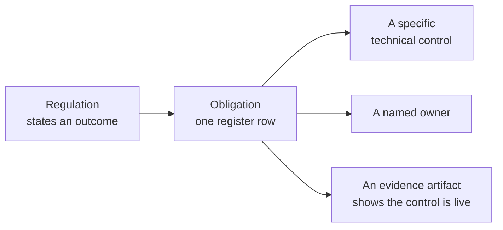

The **evidence artifact** is the part most often forgotten and the part a reviewer checks first. The routes and regulated settings chosen earlier already name most controls.

| Obligation | Control | Evidence |
|---|---|---|
| Health data handled under an agreement | A configuration covered by a signed Business Associate Agreement, with compliance settings enabled and only eligible features in use | The signed agreement, the admin setting, and the feature list. The owner is the security lead. |
| A government workload at a given impact level | Delivery through an authorized route | Its authorization record |
| Data kept in a region | Configured regional processing and storage, with a check that logs, caches, and monitoring stay inside it too | A data-flow record |
| Decisions reconstructable on demand | The decision log | An actual reconstruction of one live decision |

Two cautions keep these rows honest. Data excluded from training may still be retained for logging, abuse prevention, or audit, so keep those two claims separate. And the register needs revalidating, because configurations drift and evidence goes stale.

This fails quietly. A register that is never revalidated shows nothing when a configuration drifts.

A team chose a compliant route for a regulated workload and considered compliance done. Controls were mapped once, in a design document, with no owners and no logging to show they were running. Months later, a logging change began writing request metadata to a store in a second region.

Nothing noticed, because no one owned the residency control and nothing tracked where data landed. At the audit, a reviewer asked for proof that data stayed in-region, and the team had a design document, not a data-flow record.

So a control with no owner and no evidence is a control on paper only.

That case broke one control. A public-sector benefits assistant shows the whole stack in one design, from policy to compliance evidence.

**Example · A benefits assistant**

The assistant recommends approving, denying, or referring applications, under FedRAMP and a rule that every denied applicant gets the specific reason. Each part of this section becomes one decision:

- **Policy:** the eligibility rules are application policy, not trained behavior.
- **Guardrails:** input screening, output screening, and deterministic tool authorization all fail closed, because a screen that fails open lets an unscreened denial through.
- **Fairness:** the four fairness entry points are instrumented with one decision log that serves the applicant, the regulator, the team, and the compliance register.
- **Review:** a low-confidence, hard-to-reverse denial near the threshold goes to approval before it takes effect.
- **Compliance:** each FedRAMP obligation has a control, an owner, and the evidence a reviewer will accept.

No single line would be enough alone, and that is the point of a stack.

**Lesson: safety is a stack of layers, not a setting.** A guarded path has three control points and a chosen failure direction. Route review by stakes, not volume. Instrument fairness and evidence compliance, because an explanation you cannot reconstruct is one you cannot give. But every control here is set for the system as it launches.

## Running it after launch

Launch is where the design meets a world that keeps changing: traffic grows, the corpus grows, and the vendor ships new models. Running the system well takes four habits: experiments, a feedback loop, documentation, and proof of value.

### Running experiments that can prove you wrong

Every change after launch is a claim that the system got better, and claims need experiments. A live experiment needs a hypothesis, a treatment and a control, one primary metric, and a sample large enough to mean something.

The hypothesis must be specific enough to fail. "The new prompt is better" names nothing. A usable version reads like this: "asking for the three most important action items instead of a summary will raise task success by at least five points without worsening 95th-percentile latency."

The rest of the design protects you from yourself:

- Assign requests randomly and consistently per user.
- Fix the primary metric before you look, or you will always find something that moved.
- Size the sample from the smallest effect you care about. Model outputs vary more than deterministic software does, so you need more samples than you expect.
- Beyond significance, ask whether the effect is big enough to justify maintaining the change, and whether any secondary metric got worse.
- Watch for interactions with rare inputs that may not appear in the test window.

When one bad output is too risky, or traffic is too low for a live split, use **shadow testing**. Send a copy of live traffic to the new version, serve every user the current version, and score the shadow outputs offline. You lose real user reactions, but in regulated settings it is often the only acceptable option.

Why so much protection? Richard Feynman named the reason in his 1974 Caltech commencement talk, ["Cargo Cult Science"](https://calteches.library.caltech.edu/51/2/CargoCult.htm): "The first principle is that you must not fool yourself—and you are the easiest person to fool." Whoever wrote the new prompt wants it to win, so any choice left open until the data arrives will lean their way. One team's prompt test shows those open choices leaning toward the new prompt.

A team once compared a revised prompt on 50 sessions against 50 sessions of the old one, saw 68 percent success against 62, and shipped it. Two weeks later it had settled at 61. The sample was too small to separate a six-point difference from noise, the treatment group happened to get fewer hard cases, and the metric was chosen because it moved in the right direction.

That is confirmation, not evidence.

### Turning signals into decisions

Experiments test the changes you make. Drift is the change nobody made. A support assistant launches fast, on tone, and good on the common questions. Then usage changes, new kinds of prompts appear, and issues get harder. Some answers slow down and some miss the mark. Nothing breaks dramatically, which is why drift is hard to catch.

Observability gives the raw signals, in four layers:

- **Request-level traces**: the per-call log from the integration step, plus every tool call.
- **Aggregated metrics**: cost per request, latency percentiles, task success, and errors by type, broken down per request so a few expensive calls cannot hide inside a healthy average.
- **Anomaly alerts**: for example, cost above 150 percent of the weekly average, or latency past the target.
- **Change attribution**: three causes of drift with different fixes. The model behaves differently on the same inputs, the inputs themselves change, or a new model version arrives.

But a signal is not yet a decision. One spike is noise, another is a real problem, and a third matters only if it keeps happening. The **feedback loop** is the decision layer on top of monitoring.

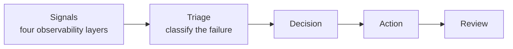

The loop works like the control room of a train station. The sensors show which trains are late, but someone still decides whether a delay is minor, whether passengers must be told, and whether the timetable must change.

Triage classifies the failure before blaming any of the three causes above, because each class has a different fix:

- **Prompt failure**: an instruction was ambiguous. The fix is in the prompt.
- **Hallucination**: ungrounded content. The fix is grounding through retrieval, tools, or verification, not stronger wording.
- **Model mismatch**: the wrong tier, or a swap without re-evaluation.
- **Orchestration failure**: trace it across the orchestrator and its subagents.

Underneath that classification is the habit of judging outputs: for each one, decide whether it is acceptable, needs revision, or needs override. Do not just watch metrics move.

Once the loop decides something matters, the **service-level agreement** says what happens when a line is crossed: what is measured, what counts as a breach, and what follows. Its thresholds should never be arbitrary:

- Latency comes from the user-experience expectation found in discovery.
- Availability comes from how critical the system is to the business.
- Quality comes from the eval's acceptance criteria.

Cost is the expectation that breaks most often after launch, because production volume routinely runs one or two orders of magnitude above the pilot. So prepare a consumption forecast at expected volume and a stated spend-control posture covering caching, tiering, and budget alerts, and tell the tiering story before the first invoice.

Write all of this down before launch in a **governance table**. It maps every signal to its trigger, the architect's action, and any regulated checkpoint.

| When this happens | This follows |
|---|---|
| An eval score crosses its threshold | Run the classification and attribution above, then decide whether to iterate or re-architect. The scheduled output audit runs anyway. |
| Latency passes its budget | Investigate the bottleneck, or call a stakeholder review if the budget itself was wrong |
| Cost passes its envelope | Find the driver and bring a trade-off back to the stakeholder |
| A residency check comes due on its date | It is recorded |

No signal triggers the last row. Regulated deployments add scheduled reviews that run even when nothing has gone wrong, such as a periodic audit of outputs against a documentation standard, or a check that the environment still meets residency rules. As design-time obligations, they belong in the table too. One case shows what a missing row costs.

Over a ninety-day window, one deployment's eval score drifted down week after week from week four. The error rate stayed flat, so no alert fired, and no review was scheduled. By week eight the stakeholder said the output felt "less useful lately," and the quarterly review in week twelve finally surfaced it.

One row mapping slow quality drift to an architect review would have caught it seven weeks earlier. Monitoring collects signals. A feedback loop decides which ones change behavior, and whose.

### Writing documentation that survives your absence

A governance table keeps the system on course while its architect is watching. Documentation keeps it working after the architect leaves. It has three readers:

- **The inheriting engineer** needs what was decided, what was rejected, and why. Without the rejected alternatives, they will reverse the right decision for the wrong reason, or defend the wrong one because they cannot see what trade-off it resolved.
- **The compliance reviewer** needs each obligation, its control, its owner, and its evidence. That is the compliance register, carried forward as a living document, because assertions are not evidence.
- **The returning architect** is often you, months later, with no memory of the design sessions. You need dated decisions, assumptions labeled as assumptions, and open items with owners and resolution criteria.

In 2011 Michael Nygard proposed [architecture decision records](https://cognitect.com/blog/2011/11/15/documenting-architecture-decisions): one short document per decision, with its context, the decision, its status, and its consequences. A reversed decision is kept and marked superseded, not deleted.

This post builds on that form and calls it a **design decision record**, to keep it apart from the decision log of automated decisions. It adds what an audit needs: the date, the rejected alternatives, the trade-off resolved in terms of gain, cost, and reversal, the owner, the evidence artifact, and whether that evidence is current enough for an audit.

The completeness test: after reading the documents, could a competent architect who was not in the room make a safe change? Writing the reasoning down takes time. Rebuilding it from email threads costs more, and failing to rebuild it costs a wrong reversal in production.

That wrong reversal happened at a financial-services customer twelve weeks after launch.

The original architect left a thorough diagram with no rationale. A performance issue led the replacement to switch context strategies, which brought back a data-handling pattern that broke the data-residency rule. The original strategy had been chosen to keep regulated data in-region, but that was never written down as a decision with a named trade-off and a rejected alternative.

The replacement was competent and acted reasonably. The diagram told them what the system was, not why.

With a design decision record, changing the strategy would have meant marking the old record superseded, and reading why it existed.

### Proving what the system changed

Documentation serves the people who maintain the system. The people who funded it read a business dashboard, not your traces. So build the translation layer at design time: task success maps to first-contact resolution, and latency maps to handle time.

Every sponsor eventually asks: what did this change? The **outcome document** answers, for people who were not part of the build, in six fields:

1. The use case with its scope boundary.
2. The business metric before deployment.
3. The same metric after deployment, measured the same way.
4. The control that makes the comparison auditable, not asserted.
5. The owner of ongoing measurement.
6. The potential to reuse the pattern elsewhere.

Technical metrics alone do not make an outcome document. The before-and-after on the business metric and the reuse notes turn it into an asset.

The common failure is writing the document from whatever is easiest to export.

One sponsor took a document listing forty thousand requests a month, sub-two-second latency, and an error rate under half a percent to the CFO to justify expansion. The CFO asked what claim processing time had been before and what it was now, because that number justified spending more. The document could not answer.

That document showed the system ran, not what it changed.

The "before" number the CFO wanted is the baseline from the sizing step. If nobody measured it before launch, no later document can supply it.

That sponsor had a document but no baseline. A two-state healthcare network shows the habits of running a system on one deployment, including how its value gets measured.

**Example · A two-state healthcare network**

The network deploys a dictation-to-note assistant under a health-privacy rule, with an audit trail and residency requirements. The customer is standardized on AWS but runs some non-regulated work on the vendor's API. Four weeks in, the CFO wants to know what the deployment is worth. Six decisions lead to the answer:

- **Discovery:** the must-prove constraint is an auditable record of every clinician-authorized note.
- **Trade-off:** trimming logs against keeping the audit trail must include the reversal cost: a redesigned interaction layer and a disclosed compliance gap.
- **Governance:** a calendar-based quarterly output audit, owned by the compliance lead, fires whatever the scores say.
- **Route:** Bedrock is primary, with the region set explicitly. The vendor's API is secondary, for non-regulated work.
- **Documentation:** the design decision record keeps the rejected global endpoint and the reason, so no one later reverses it blind.
- **Value:** the outcome document measures time from dictation to authorized note, before and after, backed by the timestamped authorization log.

At week four the expansion gate is not yet met, because the "after" number needs more runtime. The right move is to name the measurement owner, confirm the control is logging, and schedule the document for a defined milestone.

So the expansion waits until the "after" number exists, however keen the sponsor is.

**Lesson: run experiments that can prove you wrong, turn signals into decisions, write down what you rejected, and prove value in business terms.** All four habits still lean on the architect. Who keeps them up when the architect moves on?

## Handing it to the team

The outcome document proves the system was worth building. Whether it stays worth it depends on the people who live with it. Getting a team to adopt it well and keep it healthy, without pulling the architect into every issue, is its own job. It has three parts: the setup, the daily work, and the surprises.

### Setting shared defaults and rolling out in stages

The setup comes first. You can set up an AI coding tool for yourself in minutes. A team needs three things a single user does not: shared defaults, reusable assets that can be updated and revoked centrally, and spending that stays bounded as dozens of people use it.

Shared defaults start with a baseline. A **shared configuration** is a project-level instruction file such as AGENTS.md or CLAUDE.md, an agreed set of tools and MCP servers, and a permission posture. People start from the same place and do not drift apart on ad hoc settings, and the baseline can be reviewed and improved once for everyone.

Reusable assets come next. Packaging a team workflow as a skill turns local know-how into a governed team standard. There are four ways to distribute it:

- **Provisioned to the whole organization.** Simplest when everyone genuinely needs the capability, though often without version pinning or native rollback.
- **Bundled into a plugin assigned to a group.** This gives targeting, install preferences, and versioned updates from a repository, the strongest governance for scoped distribution.
- **In the project repository.** It versions with the code, scoped to that team.
- **Called through the API by the customer's own products.** With explicit version pinning.

Choose by who needs the asset and how much control you need over changes.

A platform team skipped that choice.

The team packaged its release-notes procedure as a skill and pushed it to a forty-engineer group as a flat bundle. A week later, a well-meant edit to the prompt started producing notes in the wrong format for every team that used it.

With no versioned updates and no rollback, the fix took a manual re-edit while bad output kept shipping.

A shared asset with no version and no way back becomes a liability the moment more than one person depends on it.

Bounded spending is the third need, so set the **spend posture** before the first bill. It covers the default model, which models people may switch to, guidance on reasoning effort, and spend, rate, and per-user caps. Left unmanaged, model choice drifts to more capable and more expensive tiers than tasks require, multiplied across every person and every request.

Then roll out in stages. A **staged rollout** goes to first users, then batches, because a single all-hands switch-on rarely works. First users prove a real workflow, then bring in their peers batch by batch. Here it is for a 200-person engineering organization across four departments.

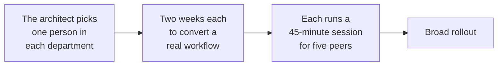

The real workflow might be a code-review assist or a test-generation step. By the broad rollout, every department has a working example, a local expert, and a tuned instruction file.

The same rollout by mass email would have produced a spike of confused first prompts and a quiet retreat to old habits.

Adoption research found the reason long ago. In [Diffusion of Innovations](https://en.wikipedia.org/wiki/Diffusion_of_innovations) (1962), Everett Rogers pulled together hundreds of studies. Announcements make people aware of a new practice, but peers persuade them to adopt it. The people who carry it are early adopters others already respect, not the most eager enthusiasts. So pick each first user for their standing in the team, not their excitement about AI.

### Working with AI without losing understanding

A rollout gives everyone access, but a team can have everything configured perfectly and still get little from it. The difference is the workflow: how assistance is woven into the way people work, and the discipline that keeps its output trustworthy.

AI tooling pays off inside the existing workflow, in the editor, the review process, and the test loop, not in a chat window someone visits occasionally. Integration also writes down a team's knowledge. Conventions, review standards, and repeated procedures that live in people's heads become skills and project configuration that apply consistently, so good practice does not depend on who is in the room.

At each stage the tool helps, and a discipline still applies.

| Stage | The tool | The discipline |
|---|---|---|
| Writing code | Drafts boilerplate, tests, and first implementations from a clear spec | The author still reviews for correctness and security, and understands what was generated |
| Reviewing | Summarizes diffs, flags likely issues, and explains unfamiliar code | Its flags are input to a human decision, not a verdict |
| Debugging | Proposes hypotheses from a symptom and a trace | Each hypothesis is checked against evidence before anyone acts on it |

Two adoption failures keep a team from ever working this way:

- **Lumpy adoption**: a few heavy users and many non-users. The gain is never realized and the practice never standardizes. The staged rollout exists to prevent it.
- **Stalling at basic chat**: the team uses the model as a question box and never moves on to tool use, repository-aware assistance, or packaged skills, because nobody enabled them. Access is not adoption.

That discipline is the diligence that keeps reviewers accountable: you verify and vouch for what you use or share. Hold generated code to the same standards as any other code, and watch for people accepting output they no longer fully understand because it looks right and passes a check.

Write it down as a **verification checklist** that every AI-generated change must pass before production:

- **Correctness**: tests exist and pass, including edge cases, and behavior matches the requirement.
- **Security**: no secrets in code, inputs are validated, and external calls use least privilege.
- **Maintainability**: the code is clear, follows conventions, and has no unexplained complexity.
- **Human understanding**: the person merging it can explain what it does and why, including how it handles inputs it was not tested against.

Automate whatever you can with tests and evals, so the checklist becomes a gate that runs on every change, not a judgment call each time.

The last item of the checklist matters most.

A team adopted AI-assisted coding and shipped noticeably faster. Three weeks in, a generated change passed review and tests, reached production, and leaked data through an input it never validated.

In the post-incident review, the author could not explain why the code handled that input the way it did. It had looked plausible, the tests were green, and no one had asked the one question the checklist would have forced.

Speed had quietly replaced understanding.

### Teaching the path from symptom to cause

A checklist guards the team's own changes. Sooner or later a live deployment still surprises its team. Resolving the incident yourself is firefighting. Teaching the team to connect what it sees to why it happens is support that lasts.

Teams notice a symptom, not a cause. Most symptoms trace back to a small set of causes.

| Symptom | Points to | Check |
|---|---|---|
| Output quality degrades gradually with no code change | A model or prompt change, or retrieval drift as the corpus grew | Compare against the eval set and check what changed |
| A latency spike | Growing context, a slow tool, or a cache that stopped hitting | Use traces to find the slowest span, check tokens per request, and confirm cache behavior |
| Intermittent tool failures | Authorization, rate limits, or an unhandled error path | Trace one failed call end to end |
| Cost rising without more usage | The tier drift the spend posture was meant to stop, or a caching regression | Check the tier and the cache hit rate per request against the budget model |

Self-sufficiency is engineered, not hoped for, and two documents do it.

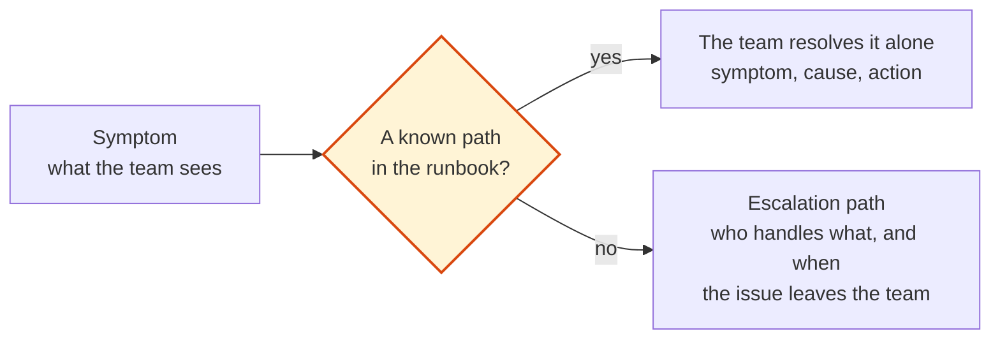

A **runbook** captures the known paths from symptom to cause to action, for recurring issues. An **escalation path** covers the rest. The goal is a team that needs you for new problems, not for the ones you have already taught them to solve. The first row of the symptom table shows what a missing runbook entry costs.

One support team watched green dashboards for an entire quarter while answer quality slid. The cause was a growing retrieval corpus that the index had not kept up with. The symptoms were visible all along, but no runbook entry said that gradual quality loss with no code change points to the model, the prompt, or retrieval drift.

With that one line written down, a first-line engineer could have fixed it in an afternoon. Without it, the problem waited for the quarterly review.

A governance table tells someone quality is sliding. A runbook tells the team what to do about it.

**Lesson: settle the team setup before rollout, roll out through first users, then batches, keep understanding in the loop, and leave runbooks, not dependence.**

The path from a request to a running system ends where it began: with something written down before it is needed. So the first step this week is small. Take one request on your desk and write its translation table: what was said, what it implies, and which assumptions nobody has confirmed. Every later step starts from that page.

## Glossary

The terms used in this post, in alphabetical order.

| Term | Meaning |
| --- | --- |
| 5xx errors | Server-side failures such as 500, 503, or an overloaded response. Usually transient and fixed by retrying with backoff |
| Adaptive reasoning | A reasoning mode where the model decides whether and how much to think. You set an effort level instead of a token budget |
| Agent | The model choosing its own sequence of tool calls toward a goal. The control flow lives inside the model |
| Agent SDK | A managed agent loop you embed in your own product, such as the one behind Claude Code. Different from a plain API wrapper |
| API | The direct programmatic interface to a model. Full control, and you own everything around it |
| Augmented call | One bounded model call, possibly with retrieval, a tool, or extended reasoning |
| Authoritative source | The source agreed to be correct, such as the system of record or the live policy table |
| BAA | Business Associate Agreement. Required under HIPAA before a vendor handles health data, and coverage depends on the exact configuration |
| Caching | Storing a stable prompt prefix so it is not reprocessed on every call. Cuts cost and latency |
| Circuit breaker | Stops calls to a failing dependency for a cooldown period so one fault does not take down the whole system |
| Coding agent | An agentic tool that reads code, edits files, and runs commands, such as Claude Code |
| Compaction | Periodically summarizing accumulated context so long sessions stay within the window |
| Compliance register | A table mapping each obligation to a control, an owner, and an evidence artifact |
| Consent fatigue | Reviewers approving everything without reading because they are asked too often |
| Constitution | A written document a vendor uses in training to shape a model's values and priorities. It does not encode any deployment's own policy |
| Corpus | The documents a retrieval system searches |
| Data residency | The requirement that data, including logs and caches, stays in an approved region |
| Decision log | A record of each automated decision: its inputs, retrieved context, output, and routing, kept so the decision can be replayed |
| Delivery route | Where API traffic runs: the vendor's own API or a cloud platform. It affects billing and region, not model behavior |
| Design decision record | A record of one design decision with its date, rejected alternatives, the trade-off it resolved, its owner, and its evidence |
| Deterministic rule | A rule that always gives the same output for the same input |
| Discovery | Structured questioning that turns a business goal into requirements, assumptions, and constraints |
| DPA | Data Processing Agreement between the controller and the processor of personal data |
| Entry point | What a person or system opens to reach the model |
| Entry-point responsibility map | A written map of which entry point owns which task in a multi-platform system |
| Escalation path | Who handles which issue, and when it leaves the team |
| Eval | A structured test set that scores the system so changes can be compared |
| Evaluator-optimizer | A workflow in which one call drafts and another grades against criteria and requests revisions |
| Evidence artifact | Proof that a control is live: a signed agreement, a configuration screen, an authorization record, or a log query |
| Exponential backoff | Retrying with waits that grow, usually doubling each time |
| Extended reasoning | A billed reasoning pass before the answer. Adds cost and latency |
| Fail open / fail closed | Whether a failing guardrail lets traffic through or blocks it |
| Fairness entry point | Where unequal outcomes can enter: corpus, prompt framing, examples, routing |
| FedRAMP | US government cloud authorization at an impact level the workload requires |
| Feedback loop | The decision layer above monitoring: signals, triage, decision, action, review |
| GDPR | The EU's personal data law |
| Generator-verifier loop | A second pass, by code or a model, that checks the first output |
| Governance table | The pre-launch table mapping each signal to a trigger, an action, and any scheduled checkpoint |
| Hallucination rate | The share of responses containing unsupported content |
| HIPAA | The US health information law |
| Hooks | Deterministic code that fires on defined events and enforces a rule the model cannot skip |
| Human-in-the-loop routing | Sending decisions to people by confidence, reversibility, and cost |
| Input / output screening | Checks before the model call and before the response reaches the user |
| Joint scoping | A working session with the vendor's solutions team, prepared in advance with requirements, candidate patterns, and open questions |
| Judge model | A model that scores another model's output. It can be evaded, so pair it with deterministic checks |
| Limit placement | Choosing in advance which limits a demo will name |
| Live state | Data that changes during a process, such as order status or stock. Look it up, do not retrieve a snapshot |
| Long tail | The few very long requests that use most of the tokens and decide the real cost |
| MCP | Model Context Protocol. An open standard for exposing tools once so many AI clients can use them |
| Model tier | The small, middle, and large models a vendor sells at different cost, speed, and capability |
| Monolithic / progressive context | Loading everything up front versus loading only what each step needs |
| Observability | Seeing what the system does and reconstructing why |
| Orchestrator | The agent that owns the goal, splits the work, and combines subagent results |
| Outcome document | Six fields that make a deployment's value clear to a sponsor |
| p95 latency | The time under which 95% of requests finish. Use it as the design target |
| Parametric knowledge | What the model learned in training, as opposed to what it is given at request time |
| PHI | Protected health information under HIPAA |
| RAG | Retrieval-augmented generation: retrieve relevant chunks and pass them to the model. For stable knowledge, not live state |
| Rate limit | A request cap per time window, usually answered with HTTP 429 |
| Reciprocal rank fusion | A low-tuning method for merging ranked lists from dense and sparse retrieval |
| Requirement vs assumption | A requirement traces to something the stakeholder said. An assumption was never stated |
| Reversal cost | The cost of undoing a decision after the system depends on it |
| Runbook | Known paths from symptom to cause to action |
| Schema | The required structure of an output |
| SDK | A language library that wraps the API |
| Shadow testing | Running a new version on a copy of live traffic and scoring its outputs offline, without users seeing them |
| Shared configuration | One team baseline instead of drifting personal setups |
| Skill | A versioned package of instructions and optional scripts for a repeatable procedure |
| SLA | What is measured, what counts as a breach, and what happens then |
| Spend posture | Default models, allowed models, effort guidance, and caps |
| SSO | Single sign-on through a central identity provider |
| Staged rollout | Giving one person per team access first to prove the workflow, then expanding in batches |
| Subagent | An agent that carries one scoped piece of work in its own context |
| Tool use | The model calling functions or APIs during a response |
| Tool-call authorization | A deterministic check before any side effect: allowlist, identity, scope |
| Training-time alignment vs inference-time control | Safe behavior built into the model versus the rules you enforce at request time |
| Transient error | A temporary failure that likely succeeds on retry |
| Translation table | The output of discovery: statement, constraint, decision, assumption |
| Verification checklist | Correctness, security, maintainability, and human understanding, checked before production |
| Workflow | Steps orchestrated in your own code, some of which call the model |
| Working set | The part of a program's memory, or a model's context, that the next steps actually need |

## References

**Architecture and patterns**

- Anthropic, [Claude Certified Architect – Professional](https://anthropic-partners.skilljar.com/path/claude-certified-architect-professional) partner training (sign-in required): Claude Platform & Solution Design, Enterprise Integration & Production, Responsible AI, Safety & Risk for Architects, Stakeholder Engagement, Lifecycle & GTM, and Team Enablement & Operational Productivity. The source of most of the examples here; this post reorders its material into the order a project meets it.
- Anthropic, [Building effective agents](https://www.anthropic.com/engineering/building-effective-agents). Argues for the simplest pattern that works, and describes the augmented model, the workflow patterns, and when an agent is worth its cost.
- Microsoft, [AI agent orchestration patterns](https://learn.microsoft.com/en-us/azure/architecture/ai-ml/guide/ai-agent-design-patterns). The same territory from another vendor: levels of complexity, orchestration patterns, and common mistakes.

**Evaluation, cost, and operations**

- [Claude platform documentation](https://platform.claude.com/docs): [developing tests](https://platform.claude.com/docs/en/test-and-evaluate/develop-tests) explains how to define success criteria and build test cases before building; [pricing](https://platform.claude.com/docs/en/about-claude/pricing) gives the per-token and caching rates that a sizing model needs; [model deprecations](https://platform.claude.com/docs/en/about-claude/model-deprecations) lists retirement dates to plan upgrades against; the prompt caching page explains how a stable prefix is reused. Other vendors publish equivalent pages.
- [Claude Cookbooks: building evals](https://github.com/anthropics/claude-cookbooks/blob/main/misc/building_evals.ipynb). A worked notebook that builds an eval with code-based and model-based grading.
- [Claude Code documentation](https://code.claude.com/docs). How project instructions, permissions, hooks, skills, and plugins are configured for a team.

**Safety and oversight**

- Anthropic research on [measuring agent autonomy](https://www.anthropic.com/research/measuring-agent-autonomy) and [trustworthy agents](https://www.anthropic.com/research/trustworthy-agents). The source for plan-level review and consent fatigue: approving every step adds friction without much safety.
- [OWASP GenAI Security Project](https://genai.owasp.org/) and [MITRE ATLAS](https://atlas.mitre.org/). Catalogs of attacks on AI systems, including prompt injection, to check a risk register against.
- [NIST AI Risk Management Framework](https://www.nist.gov/itl/ai-risk-management-framework). A structured way to identify, measure, and manage AI risks across an organization.

**Older ideas this post leans on**

- [Barry Boehm](https://en.wikipedia.org/wiki/Barry_Boehm), Software Engineering Economics (1981). Requirements mistakes found after delivery cost many times more to fix than those caught early.
- Kent Beck, [test-driven development](https://en.wikipedia.org/wiki/Test-driven_development) (around 2000, with Extreme Programming). Write the failing test first, so the test is a specification you can run.
- Edsger Dijkstra, ["Go To Statement Considered Harmful"](https://homepages.cwi.nl/~storm/teaching/reader/Dijkstra68.pdf) (1968). Programs are easiest to reason about when their text matches the process they run.
- Peter Denning, [working set](https://en.wikipedia.org/wiki/Working_set) (1968). Keep what a program actually uses in memory, or the machine thrashes.
- [Fallacies of distributed computing](https://en.wikipedia.org/wiki/Fallacies_of_distributed_computing) (Sun Microsystems, 1990s). The false assumptions programmers new to networked software make, starting with "the network is reliable."
- Jerome Saltzer and Michael Schroeder, [The Protection of Information in Computer Systems](https://web.mit.edu/Saltzer/www/publications/protection/) (1975). Design principles for protection, including fail-safe defaults and complete mediation.
- Ken Thompson, ["Reflections on Trusting Trust"](https://www.cs.cmu.edu/~rdriley/487/papers/Thompson_1984_ReflectionsonTrustingTrust.pdf) (1984). A compiler back door no source review could find, and why you cannot fully trust code you did not write.
- Richard Feynman, ["Cargo Cult Science"](https://calteches.library.caltech.edu/51/2/CargoCult.htm) (1974). Scientific integrity starts with not fooling yourself.
- Michael Nygard, ["Documenting Architecture Decisions"](https://cognitect.com/blog/2011/11/15/documenting-architecture-decisions) (2011). One short record per decision, with context, status, and consequences, kept even when superseded.
- Everett Rogers, [Diffusion of Innovations](https://en.wikipedia.org/wiki/Diffusion_of_innovations) (1962). New practices spread through peers: announcements inform, respected early adopters persuade.

**Related posts on this blog**

- [When Code Is Cheap](/blogs/blog/when_code_is_cheap/). Eleven questions to ask before and after saying yes to AI in a project. Its question 3, on shape and complexity, is the short version of this post's design sections.
- [Migration is a harness](/blogs/blog/migration_is_a_harness/). The orchestrator, generator, and evaluator loop, which is the evaluator-optimizer pattern applied to migration.
