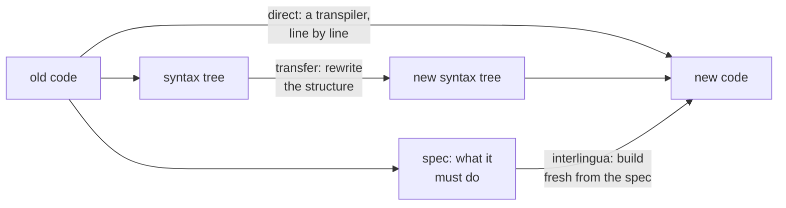
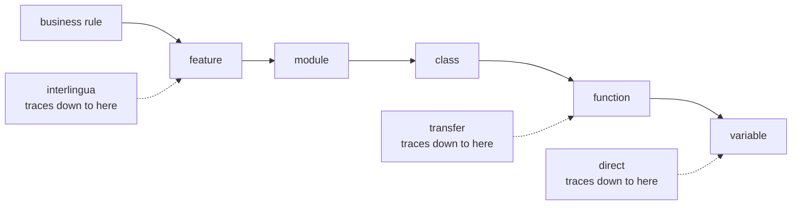

When people talk about migration, they talk about migration: lift and shift, the 7 R's, a cutover date. When they do say "translation," they mean a dictionary job. I think migration is translation in the full sense.

That changes one request that every migration meets. Sooner or later, someone asks for a trace: for every variable in the old code, show the variable it became in the new code, so nothing is lost. It sounds careful. On many migrations it is impossible, because some variables don't move. They vanish. Translators have known why for a long time.

## How high a migration climbs

Machine translation drew the map in 1968, when [Bernard Vauquois proposed a triangle](https://en.wikipedia.org/wiki/Bernard_Vauquois) of the ways to build a translation system. The [Vauquois triangle](https://en.wikipedia.org/wiki/Comparison_of_different_machine_translation_approaches), drawn on this page that compares the approaches, has three heights: **direct** (word by word), **transfer** (change the structure), and **interlingua** (pull out the meaning, then write it fresh). Migration has the same three: a transpiler, a syntax-tree rewrite, and "write a spec, then build from the spec." So most "port or rewrite?" fights are one question: **how high should we climb?**



Each height has its own failure. Stay low and you get [JOBOL](https://intellyx.com/2022/07/16/modernizing-your-mainframe-cobol-beware-the-jobol-pitfall/): Java that only a COBOL programmer can maintain. Climb high and the spec is usually plain English, so every rule it forgets is lost for good.

So which height is right? Translators answer that with purpose. [Skopos theory](https://en.wikipedia.org/wiki/Skopos_theory) says the purpose of a translation decides its method. A contract is translated close to the words, and an advertisement is rewritten for the new market. In the same way, a migration that only has to leave an old platform can stay low, and a migration meant to make the code easy to change for the next ten years has to climb. So decide why you migrate before you decide how.

> **Lesson:** the purpose of a migration tells you how high to climb.

## What you can still trace

The height you choose decides more than the method. It also decides what you can still trace. **On a high migration, the trace is not one to one. It is a spectrum.** You can always say which level a piece of the old code belonged to: a business rule, a feature, a module, a class, a function. But below the height you climbed to, you can't always name its exact counterpart, because some of it vanished.

Take a small piece of COBOL that counts the paid invoices in a file and adds up their amounts:

```cobol
       01  WS-EOF      PIC X        VALUE 'N'.
       01  WS-COUNT    PIC 9(5)     VALUE 0.
       01  WS-TOTAL    PIC 9(9)V99  VALUE 0.

           PERFORM UNTIL WS-EOF = 'Y'
               READ INVOICE-FILE
                   AT END MOVE 'Y' TO WS-EOF
                   NOT AT END
                       IF INV-STATUS = 'P'
                           ADD 1 TO WS-COUNT
                           ADD INV-AMOUNT TO WS-TOTAL
                       END-IF
               END-READ
           END-PERFORM.
```

A migration that climbs to the meaning writes it like this:

```java
List<Invoice> paid = invoices.stream().filter(Invoice::isPaid).toList();
long count = paid.size();
BigDecimal total = paid.stream().map(Invoice::amount).reduce(BigDecimal.ZERO, BigDecimal::add);
```

Now try the variable trace. `WS-COUNT` became `count`, and `WS-TOTAL` became `total`. Those two map one to one. But `WS-EOF` is gone. Its job was to stop the loop at the end of the file, and the stream stops by itself, so nothing in the new code holds that flag. And the rule `INV-STATUS = 'P'` did not become a variable at all. It moved up a level, into a method on the `Invoice` class, where the letter `'P'` may not even appear.

So in one small loop, the trace splits three ways. Two variables map cleanly. One dissolves into the structure of the new code. One rule climbs into a different place. **A variable is how the old code said something. When the new code says it another way, the variable has nowhere to go.**

Translators have a name for this: the [unit of translation](https://en.wikipedia.org/wiki/Unit_of_translation), the stretch of text a translator treats as one piece when looking for an equivalent. It can be a single word, a phrase, a sentence, or more. Studies of translators found that learners tend to work word by word, while experienced translators work with phrases and clauses. Asking a migration for a variable-by-variable trace is asking it to translate like a learner.

Computer science found the same shape when it learned to prove data structures correct. The idea is usually traced to [Tony Hoare's 1972 paper, "Proof of Correctness of Data Representations"](https://www.cs.ox.ac.uk/publications/publication8221-abstract.html): to prove a data structure right, relate the data as the program stores it to the value it stands for. That relation runs one way, from many details to one meaning. Some stored variables, like an end-of-file flag or a cache, stand for nothing in that value at all. They are part of how the program works, not part of what it means.

So the lowest level you can still trace depends on the height. A transpiler keeps variables and lines. A syntax-tree rewrite keeps functions and classes. A rebuild from a spec keeps only features and business rules:



> **Lesson:** the higher you climb, the less detail you can trace.

## Trace where the meaning lives

If the variable can vanish, what should a careful team trace instead? **Trace at the level where the meaning lives, and prove each piece with a test, not with a mapping.** The useful question is not "where did this variable go?" It is "where did the rule it carried go, and which test shows the rule survived?"

That question matters most where the variable vanished. When `WS-EOF` disappears, no harm is done, because the rule it served, "process every invoice in the file," lives on in the stream. But a variable can also carry a rule nobody wrote down. Look again at `WS-TOTAL`. It has no sign and only nine digits before the point, so it can't hold a negative total, and if the total grows past nine digits, COBOL quietly drops the digits that don't fit unless the code checks for it. The Java `BigDecimal` does neither. Was that old behavior a bug, or something a report downstream relied on? The same goes for a field that rounds amounts a certain way, or a flag that skips a special kind of customer. Each can vanish with its rule, and no variable trace will notice, because there is no new variable to compare against. This is the plain-English spec problem from the first section, seen from below.

Legacy work already has a tool for this. Michael Feathers, in *Working Effectively with Legacy Code*, calls it a [characterization test](https://en.wikipedia.org/wiki/Characterization_test): a test that records what the existing software actually does, right or wrong, before you change it. Run the same tests against the old system and the new one, and a rule that vanished shows up as a test that fails, at the level where the rule lives.

So the trace document changes shape. Down to the level you climbed to, keep a map: this feature became that feature, this function became that function. Below that level, stop mapping and start testing. One row per business rule, with the old place it lived, the new place it lives, and the test that proves it. A trace like that is shorter than a variable list, and it catches the losses that matter.

> **Lesson:** the higher you climb, the higher you must trace, and the higher you must test.

## One step for this week

Pick one feature of the system you are migrating. Write down its business rules, not its variables. For each rule, name where it lives in the old code, where it will live in the new code, and the test that will prove it moved. If a rule has no test yet, that rule is the one most likely to vanish.
