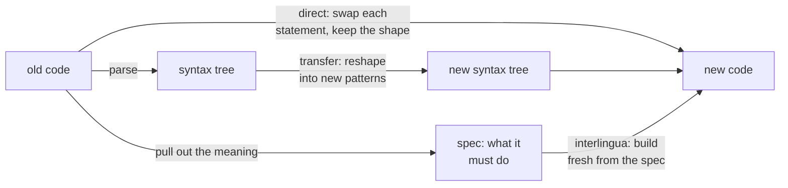
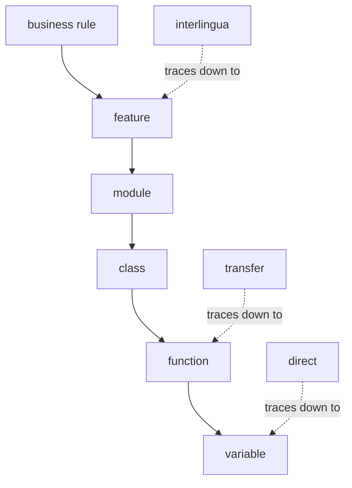

When people talk about migration, they use the words of moving house: lift and shift (move the code as it is), the 7 R's (a checklist of ways to move or retire each system), a cutover date. When they do say "translation," they mean a dictionary job: swap each word for its match. I think migration is translation in the full sense: carrying meaning from one language to another.

That changes one request that every migration meets. Sooner or later, someone asks for a trace: for every variable in the old code, show the variable it became in the new code, so nothing is lost. It sounds careful. On many migrations it is impossible, because some variables don't move. They vanish. Translators have known why for a long time.

## How high a migration climbs

Machine translation drew the map in 1968, when [Bernard Vauquois proposed a triangle](https://en.wikipedia.org/wiki/Bernard_Vauquois) of the ways to build a translation system. The [Vauquois triangle](https://en.wikipedia.org/wiki/Comparison_of_different_machine_translation_approaches), drawn on this page that compares the approaches, has three heights: **direct** (word by word), **transfer** (change the structure), and **interlingua** (pull out the meaning, then write it fresh). Migration has the same three:

- **Direct:** a tool swaps each old statement for its closest new one, line by line, and keeps the old shape: the same loops, flags, and jumps.
- **Transfer:** the code is parsed into a syntax tree (the program's grammar as a tree), and the tree is reshaped into the new language's own patterns.
- **Interlingua:** write a spec, a plain description of what the code must do, then build fresh from it.

So most "port or rewrite?" fights are one question: **how high should we climb?** Each path goes further away from the old code's words before it comes back down to new code:



The two ends fail in opposite ways. Stay low and you get [JOBOL](https://intellyx.com/2022/07/16/modernizing-your-mainframe-cobol-beware-the-jobol-pitfall/): Java that still keeps COBOL's shape, so only a COBOL programmer can maintain it. Climb high and you build only from the spec, which is usually plain English. Any rule the spec forgets never reaches the new code, and once the old system is switched off, that rule is lost for good.

So which height is right? Translators answer that with purpose. [Skopos theory](https://en.wikipedia.org/wiki/Skopos_theory) says the purpose of a translation decides its method. A contract is translated close to the words, and an advertisement is rewritten for the new market. In the same way, a migration that only has to leave an old platform can stay low, and a migration meant to make the code easy to change for the next ten years has to climb. So decide why you migrate before you decide how.

> **Lesson:** the purpose of a migration tells you how high to climb.

## What you can still trace

The height you choose decides more than the method. It also decides what you can still trace. Two scales matter here, and they are easy to mix up. The **height** is how you migrate: direct, transfer, or interlingua. The **level** is how big a piece of code is: a business rule, a feature, a module, a class, a function, a variable. Each height can trace down only to a certain level. **Below that level, the trace is no longer one to one.** You can still say which business rule, feature, module, class, and function a piece of old code belonged to. But you can't always name its exact partner in the new code, because some of it vanished.

Take a small piece of COBOL that reads a file of invoices, counts the paid ones, and adds up their amounts:

```cobol
       01  WS-EOF      PIC X        VALUE 'N'.
       01  WS-COUNT    PIC 9(5)     VALUE 0.
       01  WS-TOTAL    PIC 9(9)V99  VALUE 0.

           PERFORM UNTIL WS-EOF = 'Y'
               READ INVOICE-FILE
                   AT END MOVE 'Y' TO WS-EOF
                   NOT AT END
                       IF INV-STATUS = 'P'
                           ADD 1 TO WS-COUNT
                           ADD INV-AMOUNT TO WS-TOTAL
                       END-IF
               END-READ
           END-PERFORM.
```

A migration that climbs to the meaning writes it like this, starting from a list of invoices that other code has already loaded from the file:

```java
List<Invoice> paid = invoices.stream().filter(Invoice::isPaid).toList();
long count = paid.size();
BigDecimal total = paid.stream().map(Invoice::amount).reduce(BigDecimal.ZERO, BigDecimal::add);
```

Now try the variable trace. `WS-COUNT` became `count`, and `WS-TOTAL` became `total`. By name, those two map one to one. But `WS-EOF` is gone. Its job was to stop the loop at the end of the file. In the Java, the code that loads `invoices` reads the file, and the stream stops by itself at the end of the list, so nothing in this new code holds that flag. And the rule `INV-STATUS = 'P'` ('P' is the old code for "paid") did not become a variable at all. It left the loop and moved into the `Invoice` class, as an `isPaid()` method, where the letter `'P'` may not even appear.

So in one small loop, the trace splits three ways. Two variables seem to map cleanly. One dissolves into the structure of the new code. One rule moves to a different place. **A variable is how the old code said something. When the new code says it another way, the variable has nowhere to go.**

Translators have a name for this: the [unit of translation](https://en.wikipedia.org/wiki/Unit_of_translation), the stretch of text a translator treats as one piece when looking for an equivalent. It can be a single word, a phrase, a sentence, or more. Studies summed up on that page found that learners tend to work word by word, while experienced translators work with phrases and clauses. A variable-by-variable trace forces a migration back to the learner's unit. If every variable must have a partner, the new code has to keep the old code's shape.

Computer science found the same pattern when it learned to prove data structures correct. The idea is usually traced to [Tony Hoare's 1972 paper, "Proof of Correctness of Data Representations"](https://www.cs.ox.ac.uk/publications/publication8221-abstract.html): to prove a data structure right, relate the data as the program stores it to the value it stands for. That relation runs one way. Many different ways of storing the data can stand for the same value, so you can go from the stored data to its meaning, but not from the meaning back to one exact set of variables. And some stored variables, like an end-of-file flag or a cache, stand for nothing in that value at all. They are part of how the program works, not part of what it means.

So the lowest level you can still trace depends on the height. A transpiler (direct) keeps variables and lines. A syntax-tree rewrite (transfer) keeps functions and classes. A rebuild from a spec (interlingua) keeps only features and business rules. Read the chart from top to bottom as big to small: a business rule contains features, a feature contains modules, and so on down to variables. Each dotted arrow shows the smallest piece that height can still trace:



> **Lesson:** the higher you climb, the less detail you can trace.

## Trace where the meaning lives

If the variable can vanish, what should a careful team trace instead? **Trace at the level where the meaning lives, and prove each piece with a test, not with a mapping.** The useful question is not "where did this variable go?" It is "where did the rule it carried go, and which test shows the rule survived?"

When `WS-EOF` disappears, no harm is done, because the rule it served, "process every invoice in the file," lives on in the code that loads the list. But a variable can also carry a rule nobody wrote down, even when the variable itself survives. Look again at `WS-TOTAL`, one of the two that seemed to map cleanly. Its picture, `PIC 9(9)V99`, means nine digits, an implied decimal point (`V`), and two decimals. There is no `S` at the front, so the field has no sign.

- If the total ever drops below zero, for example after a credit note, COBOL drops the minus sign and stores -5.00 as 5.00.
- If the total grows past nine digits, most COBOL compilers quietly cut off the leftmost digits, so 1,000,000,000.50 becomes 0.50. Only an `ON SIZE ERROR` clause would catch it, and this code has none.

`WS-COUNT` has the same kind of limit: five digits, so it can count only up to 99,999. The Java `long` and `BigDecimal` have none of these limits. Was the old behavior a bug, or something a report downstream relied on? The same goes for a field that rounds amounts a certain way, or a flag that skips a special kind of customer. Each of these rules can vanish, and a variable trace will not notice. The trace only checks that `WS-TOTAL` has a partner called `total`. It does not check that `total` behaves the same way. This is the plain-English spec problem from "How high a migration climbs," a rule nobody wrote down getting lost, seen here in the code itself.

Legacy work already has a tool for this. Michael Feathers, in *Working Effectively with Legacy Code*, calls it a [characterization test](https://en.wikipedia.org/wiki/Characterization_test): a test that records what the existing software actually does, right or wrong, before you change it. Run the same tests against the old system and the new one, and a rule that vanished shows up as a test that fails, at the level where the rule lives.

So the trace document changes shape. Down to the level your height can still trace, keep a map: this feature became that feature, this function became that function. Below that level, the code no longer matches piece by piece, so stop mapping variables. Instead, list the business rules that the low-level code carried, and write one row per rule: where it lived in the old code, where it lives in the new code, and the test that proves it. A trace like that is shorter than a variable list, and it catches the losses that matter.

> **Lesson:** the higher you climb, the sooner the map stops, and the more you must rely on tests of business rules.

## One step for this week

Pick one feature of the system you are migrating. Write down the business rules you know. Then run the old code on edge cases, such as an empty file, a huge total, or a negative amount, and record what it does. Each surprise is a rule nobody wrote down, so add it to the list. For each rule, name where it lives in the old code, where it will live in the new code, and the test that will prove it moved.
