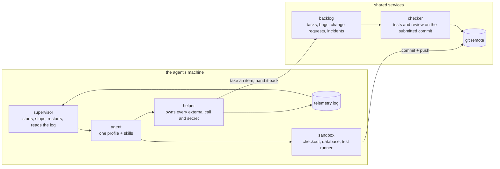
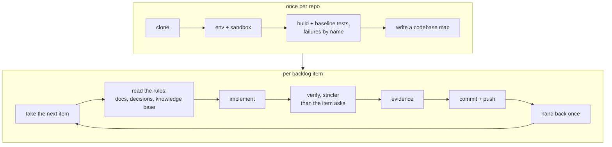
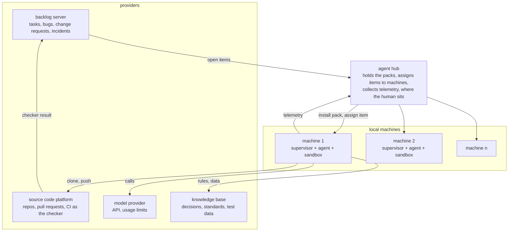

## The building blocks

I think we will analyze characteristics of each block: why they need to exist in an mordern agent system.

- Memory system and memory hub: [XERJ](https://xerj.org/).

- Agent hub: [Claude Code Templates](https://www.aitmpl.com/).

- Orchestration system: [OpenRig](https://openrig.dev/).

- Routing system: [ccflare](https://ccflare.com/).

- Monitoring system.

## Do we still need a human in the loop?

- HITL is only needed when the target is vague. If the agent can see and check the result itself (steps a, b, c, d are done, the math problem is solved), why do we need a human in the loop?

- To be autonomous, the target must be clear and verifiable.

- Measure autonomy with two things: cost (tokens consumed) and verified results.

- Many companies aim for autonomy with goals like "increase sales 100%". That's a moving target: it can't be checked in time, or traced to the agent. Break the goal into targets the agent can verify (reply to every lead in 5 minutes, follow up every stale deal). The human owns the goal; the agent owns the targets.

- So the point: make your work result verifiable, more precisely.

- The unattended version of this: zero humans during the run, and the human's seat is between runs. We read the transcripts, edit the pack, change few things per run so each effect can be attributed, and play again. As the [migration post](/blogs/blog/migration_is_a_harness/) put it: you don't fix the code, you fix the process that produced it.

## What a backlog looks like when a machine works it

This month my team entered a contest where an unattended agent works a backlog with no human at the keyboard. Strip away the contest rules and what is left is an ordinary backlog with a machine on the other end: tasks, bugs, change requests, and production incidents. Here is that shape.

- **A backlog item becomes a contract.** An unattended agent can only be graded on what is checkable. So the item has to carry its own checker: acceptance criteria written as scenarios, a fixed answer format, and tests that run on the exact commit the agent hands back. That is the point from [When Code Is Cheap](/blogs/blog/when_code_is_cheap/): work items are now the agent's input. An item that cannot be checked is not ready for a machine.

### The components

- **Only what is pushed counts.** The checker never sees the agent's machine. The state of the work is a commit plus a log. That is [the state thesis](/blogs/blog/state-engineering/) made literal. You build only the agent pack: a profile, three skills (set up, work, recover), and a helper that makes every external call, so the model never holds a secret.

### The lifecycle

- **Pay for discovery once, not per item.** Setup is where the agent clones, builds, records every failing test by name, and writes a map: commands and how long they take, routes, modules by domain, the rules the decision docs state. Every later item reads the map instead of exploring. The repo's knowledge outlives the session, and our later runs got faster and cheaper.

- **Order the backlog, then time-box.** Production incidents first, because speed is the score. Then bugs and change requests with a deadline. Then tasks by value per minute. Each item gets a box. At the box, change approach once, then hand back what is verified with honest FAIL rows.

- **Recovery is a read.** A replacement agent reads the log, git, and the backlog's truth, then continues. It never hands back the same item twice.

### How to distribute the work

- **A second agent bought zero time.** Items arrived slower than one agent finished them, so the finish time was set by arrival, not by how many agents worked. Old queueing arithmetic: more servers help only when the queue backs up. Sequential by default. Spawn a worker only when the open work will not fit before a deadline.

| When you do spawn | Rule |
| --- | --- |
| Isolation | own worktree, port, build cache, database |
| Brief | once and complete: item, worktree, deadline, evidence names |
| Report | only when done or blocked |
| Ownership | one agent commits, pushes, hands back |
| Roles | named profiles whose standing rules travel with them, not a generic worker |

### The fleet

Zoom out from one machine and the same pieces repeat.

- **One hub, many machines.** The hub holds the packs, assigns one item to one machine, and collects every machine's log. Each machine runs one supervisor, one agent, one sandbox. The hub is also where the human sits, because the pack is edited from the logs. Three things stay outside and are rented: the backlog server, the source platform whose CI is the checker, and the model provider, whose usage limit ended two of our runs. This is the building-blocks list at the top of this post, drawn: the hub is orchestration, the routing system sits between the machines and the model provider, the knowledge base is memory, and the telemetry is monitoring.

### What it taught me about the harness

- **The authority trap.** In our first four runs the agent inverted a failing test that protected a business rule, while fixing an unrelated bug. It was following our own skill: "if a test contradicts intended behavior, fix it." A failing test in an inherited codebase is information about the checker, not noise. The order of authority is the item's brief, then decision docs, then tests, then comments, then current code. The mistake was in the harness, not the model.

- **Cost is turns times context.** About six in ten turns produced no code: polling a command, waiting for the next item, re-checking status. A wait that blocks and returns everything the next decision needs removes most of them. And a supervisor's auto-reviewer re-read the whole transcript to approve each call to our own read-only helper. Declare honestly what is read-only.

- **There is no "at the end".** A supervisor can stop the agent at any moment. Done means pushed.

## One harness doesn't fit all

- No. A harness is everything around the model: tools, state, the loop, the checks, the limits. Each kind of work needs its own.

| Harness for            | Tools                          | State it carries               | How it checks the work                    | Main risk                                 |
| ---------------------- | ------------------------------ | ------------------------------ | ----------------------------------------- | ----------------------------------------- |
| Coding agent           | Shell, editor, git, tests      | Repo, plan, task list          | Compiler, tests, linters (strong)         | Breaking code that works                  |
| Research agent         | Search, fetch, read PDFs       | Sources, notes, open questions | Citations, cross-checking sources (weak)  | Confident claims with no real source      |
| Back-office agent      | ERP, CRM, email, forms, Excel  | Case file, approval status     | Business rules, reconciliation, sign-off  | Actions you can't undo (payments, emails) |
| Support agent          | Ticketing, knowledge base, CRM | Customer history               | Resolution rate, policy rules             | Wrong promises to customers               |
| Data / analytics agent | SQL, notebooks, BI tools       | Schema, metric definitions     | Re-run the query, compare to known totals | A wrong number that looks right           |
| Ops / SRE agent        | Logs, metrics, deploy tools    | Incident timeline              | Health checks, rollback                   | Making an outage worse                    |

- Coding harnesses matured first because code has the strongest built-in checker: the compiler and tests say right away if it worked.

- Other harnesses are behind not because the models are worse, but because their work is harder to check.

- So: a harness is only as good as the checker you can build for its domain. Designing a new harness starts with one question: how does this agent know it's done, and done right?

## References

- [XERJ](https://xerj.org/) - Search and retrieval for the memory and knowledge layer.

- [Claude Code Templates](https://www.aitmpl.com/) - Reusable components for Claude Code workflows.

- [OpenRig](https://openrig.dev/) - Orchestration for teams of coding agents.

- [ccflare](https://ccflare.com/) - Routing for model requests.

- [Claude Code documentation](https://code.claude.com/docs/en/overview) - Overview of Anthropic's coding agent.

- [Codex documentation](https://developers.openai.com/codex) - Guides for OpenAI's coding agent.

- [GitHub Copilot documentation](https://docs.github.com/en/copilot) - Guides for GitHub's AI coding tools.

- [Copilot CLI overview](https://docs.github.com/en/copilot/how-tos/copilot-cli/use-copilot-cli/overview) - Using Copilot from the terminal.

- [OpenCode documentation](https://opencode.ai/docs) - Setup and usage guides for OpenCode.
