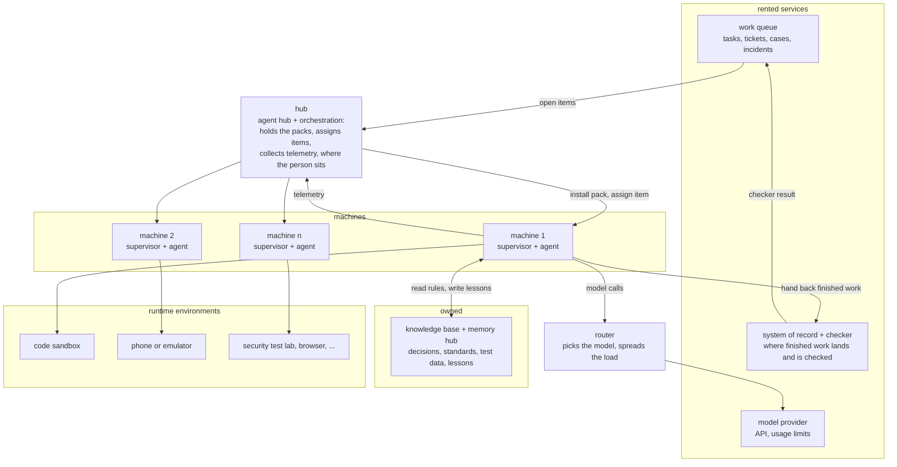

Today most people meet AI agents in one shape: one person with one coding agent. A developer works with [GitHub Copilot](https://docs.github.com/en/copilot) in the editor or [in the terminal](https://docs.github.com/en/copilot/how-tos/copilot-cli/use-copilot-cli/overview). Or each person on a team runs [Claude Code](https://code.claude.com/docs/en/overview), [Codex](https://learn.chatgpt.com/docs/codex/cli), or [OpenCode](https://opencode.ai/docs) on their own machine. I think this is only the first step. A coding agent is one worker, and it still needs a person at the keyboard. The system I have in mind is larger. Call it a **fleet**: many agents on many machines, run from one hub. It works for a whole organization, on every kind of work, not only code, and most of the time nobody watches it run. This post is my picture of that system. Each section stands on its own, so you can read them in any order.

## Six building blocks and why each must exist

Each block below exists because something specific breaks when it is missing. That gives a simple test for any new tool in this space: which failure does it remove? If nobody can name the failure, the tool is not a building block yet.

1. **Memory system and memory hub.** A model forgets everything when its session ends. Without memory, every run pays again to learn the same things: where things live, which tool is slow, which rule failed last time. Memory keeps what one run learned for the next one. The hub goes one step further and shares it across agents and machines, so a lesson learned on one machine is read on all of them. [XERJ](https://xerj.org/) is one example of the memory part: a search engine built for agents that also keeps a separate memory for each agent. Sharing across machines is still the hub's job. Memory is also where the agent system meets the context system, which has its own section below.

2. **Agent hub.** An agent is more than a model. Around the model sit a profile, its standing rules, and its skills. Call that bundle a **pack**. Without a hub, every machine is set up by hand, and the machines slowly drift apart. A hub stores packs the way a package registry stores libraries: versioned, installable, and the same on every machine. [Claude Code Templates](https://www.aitmpl.com/) is a catalog of ready-made agents, commands, skills, and hooks, each installed with one command. [ECC](https://github.com/affaan-m/ecc) bundles skills, instincts, and memory into one pack that installs into several coding agents. Both serve coding agents today. The hub I have in mind serves every kind of agent.

3. **Orchestration system.** Someone must decide which item goes to which machine. That is the orchestrator's job. Someone must also start the agent, stop it, and restart it when it crashes. On each machine, that job belongs to a **supervisor**. Without them, a crashed run just sits there, and nobody notices until the deadline. [OpenRig](https://openrig.dev/) shows the shape for coding agents. A lead agent hands work to specialist agents and tracks it. The team is built to keep running on projects that take weeks.

4. **LLM provider and routing system.** The model is rented. Every provider has outages and a different price for each model, and its usage limit can stop a long run halfway. A routing layer sits between the agents and the providers. It sends each call to the right model, spreads the load, and switches when a provider fails. [ccflare](https://github.com/snipeship/ccflare) does part of this for Claude and OpenAI calls. It spreads requests across several accounts and moves to another account when one hits its limit.

5. **Monitoring system.** When nobody watches the run, its logs and traces are the only witnesses. Without them, nobody can say why a run failed, what it cost, or which step wasted the most turns. The person who improves the system then has nothing to read. [Langfuse](https://langfuse.com/) traces agent runs so they can be evaluated and improved. [OpenTelemetry](https://opentelemetry.io/) is the open standard for collecting traces, metrics, and logs from any service.

6. **Sandbox and runtime environment.** An agent acts, and its actions need a place where they are safe and can be checked. That place depends on the work. Code runs in a sandbox, and [E2B](https://e2b.dev/) gives every agent session its own small virtual machine. A mobile app needs a phone or an emulator, and a tool like [Appium](https://appium.io/) drives the app on it. Some work needs a copy of a whole system that nobody may touch for real. [GIBSON](https://offensivesec.org/GIBSON) simulates an IBM mainframe, and it is vulnerable on purpose, so people can learn mainframe security without attacking a real one. An agent doing security work needs the same kind of practice lab. Without this block, the agent practices on the real thing.

## One hub, many machines

A fleet grows by adding machines, not people. Zoom out from one machine and the same pieces repeat on every machine, with one hub above them. The person stays in one place: the hub, where the logs come in and the packs go out.

The **hub** holds the packs, assigns one item to one machine, and collects every machine's logs. Each machine runs one supervisor and one agent. Next to them sits a runtime environment that fits the work: a code sandbox on one machine, a phone on another, a security test lab on a third. Three things stay outside and are rented: the work queue, the system of record where finished work lands, and the model provider. Next to the system of record sits a **checker**, the part that says whether the work is right. For code it is the tests and CI. For back-office work it is business rules or reconciliation. The knowledge base is different. It is the one part nobody can sell you, and every machine both reads it and writes lessons back.

The diagram is the building-block list drawn out. The hub and the supervisors are orchestration, and the hub is also the agent hub. The router is the routing system. The knowledge base is memory. The logs are monitoring. The runtime environments are the sandboxes.

## Where the context system fits

A fleet multiplies whatever context it is given, good or bad. That is why the context system matters more here. [When Code Is Cheap](/blogs/blog/when_code_is_cheap/) splits today's work into two kinds: building the agent system, and building the context system around it. The other sections of this post are about the first kind. The second kind decides what the agents are given. That post explains why it is hard, and how the hard part changes as an organization grows. Here I only want to show where it sits in the fleet.

It sits in the knowledge base and the memory hub. That is where the two kinds of work meet, and a fleet raises the stakes. With one developer and one agent, a stale fact gives one wrong answer, and the developer usually catches it. With a fleet, the same stale fact is read by every machine, on every item, until someone fixes it. So the knowledge base needs an owner, and a fact is fixed once, at the source, not in a hundred transcripts. The same holds for the lessons the machines write back. A wrong lesson spreads as fast as a right one, so the owner reviews a lesson before every machine reads it as a rule.

The flow also runs the other way. The logs that reach the hub show which facts each agent used and where it went wrong. That makes the fleet the strictest test of the context system: every checked run is also a test of what the agents were given.

## Do we still need a human in the loop?

A person is needed to check the work only where the target is vague. Say the agent can check the result itself: steps a, b, c, and d are done, or the math problem is solved. Then why do we need a human in the loop? So autonomy has one condition: the target must be clear and checkable. A checkable target also makes autonomy measurable, with two numbers: the cost, in tokens, and the number of results that passed the check.

Many companies aim for autonomy with goals like "increase sales 100%". That is a moving target. It cannot be checked in time, and the result cannot be traced back to the agent. The fix is to break the goal into targets the agent can check: reply to every lead within five minutes, follow up every deal that has gone quiet. **The human owns the goal; the agent owns the targets.**

The unattended version takes this all the way: zero people during the run. The person's seat moves to between runs. We read the transcripts and edit the pack (the agent's profile, rules, and skills). We change only a few things per run, so each effect can be traced to its cause. Then we run again. An earlier post, on [migration as a harness](/blogs/blog/migration_is_a_harness/), quotes the rule behind this: *"you don't fix the code — you fix the process that produced the code."*

A clear target takes the person out of checking, not out of approving. What the agent may do alone is a separate question, about authority, and it is decided per action. [When Code Is Cheap](/blogs/blog/when_code_is_cheap/) gives the rule: reading can be logged, writing needs a person to confirm, and anything destructive needs separate approval. In a fleet, a person can hand the confirming seat to the checker for writes it can test. The push lands only if CI passes, and the form is filed only if the business rules pass. When Code Is Cheap says the same for migration: commit only what the judge passed. Every other write waits for a person between runs.

> **Lesson:** make the result of your work precise and checkable before you ask for autonomy.

## How to distribute work across agents

A second agent saves real time only when the queue backs up, that is, when the first agent is busy most of the time. If items arrive well apart, each one is done soon after it arrives. The finish time is then set by when the last item arrives, not by how many agents work, and a second agent buys almost no time. This is old queueing arithmetic. In 1917, [A. K. Erlang](https://en.wikipedia.org/wiki/Agner_Krarup_Erlang) published formulas for lost and delayed calls. Engineers used them to work out how many lines a telephone exchange needs for a given flow of calls. Extra lines pay off when the ones you have are busy most of the time. When they are mostly idle, nobody is waiting, so the new ones sit idle too.

So the work is sequential by default. Spawn a worker only when the open work will not fit before a deadline. This holds for any queue, not only code: support tickets, invoices to match, test runs on phones. A fleet grows by the same rule: it adds a machine when a queue backs up, not before.

When you do spawn, five rules keep the workers out of each other's way:

| When you do spawn | Rule |
| --- | --- |
| Isolation | its own workspace: a worktree, port, build cache, and database for code; its own device or test account for other work |
| Brief | once and complete: the item, the workspace, the deadline, the names of the evidence to return |
| Report | only when done or blocked |
| Ownership | one agent writes the final result (a commit and push, a ticket update, a filed form) and hands back |
| Roles | named profiles whose standing rules travel with them, not a generic worker |

The five rules share one idea: workers never talk to each other. Each one gets a brief and hands back a result, and anything else it learns goes to the memory hub.

## Why one harness doesn't fit all

A harness is only as good as the checker you can build for its domain. By harness I mean everything around the model: tools, state, the loop, the checks, the limits. Each kind of work needs its own, because each kind of work is checked in a different way.

| Harness for            | Tools                          | State it carries               | How it checks the work                    | Main risk                                 |
| ---------------------- | ------------------------------ | ------------------------------ | ----------------------------------------- | ----------------------------------------- |
| Coding agent           | Shell, editor, git, tests      | Repo, plan, task list          | Compiler, tests, linters (strong)         | Breaking code that works                  |
| Research agent         | Search, fetch, read PDFs       | Sources, notes, open questions | Citations, cross-checking sources (weak)  | Confident claims with no real source      |
| Back-office agent      | ERP, CRM, email, forms, Excel  | Case file, approval status     | Business rules, reconciliation, sign-off  | Actions you can't undo (payments, emails) |
| Support agent          | Ticketing, knowledge base, CRM | Customer history               | Resolution rate, policy rules             | Wrong promises to customers               |
| Data / analytics agent | SQL, notebooks, BI tools       | Schema, metric definitions     | Re-run the query, compare to known totals | A wrong number that looks right           |
| Ops / SRE agent        | Logs, metrics, deploy tools    | Incident timeline              | Health checks, rollback                   | Making an outage worse                    |

Coding harnesses matured first because code has the strongest built-in checker: the compiler and the tests say right away whether it worked. The other harnesses are behind not because the models are worse, but because their work is harder to check. So designing a new harness starts with one question: how does this agent know it's done, and done right?

## References

**The building blocks**

- [XERJ](https://xerj.org/). A search engine built for AI agents, with a separate memory for each agent.
- [Claude Code Templates](https://www.aitmpl.com/). A catalog of ready-made Claude Code agents, commands, skills, and hooks, installed with one command.
- [ECC](https://github.com/affaan-m/ecc). A pack of skills, instincts, memory, and subagents that installs into several coding agents.
- [OpenRig](https://openrig.dev/). Runs several coding agents as one long-lived team, with a lead agent handing work to specialists.
- [ccflare](https://github.com/snipeship/ccflare). A proxy for Claude and OpenAI API calls that spreads requests across accounts and fails over when one hits its limit.
- [Langfuse](https://langfuse.com/). Open-source tracing and evaluation for agent runs.
- [OpenTelemetry](https://opentelemetry.io/). The vendor-neutral standard for collecting traces, metrics, and logs and sending them to any backend.
- [E2B](https://e2b.dev/). Cloud sandboxes that give each agent session its own isolated virtual machine.
- [Appium](https://appium.io/). Open-source automation for apps on phones, browsers, and desktops, run on devices or emulators you provide.
- [GIBSON](https://offensivesec.org/GIBSON). A free IBM mainframe simulator, vulnerable on purpose, for learning mainframe security.

**Coding agents today**

- [Claude Code documentation](https://code.claude.com/docs/en/overview). Anthropic's overview of its coding agent for the terminal, the IDE, the desktop, and the web.
- [Codex CLI documentation](https://learn.chatgpt.com/docs/codex/cli). OpenAI's coding agent, which reads, edits, and runs code from the terminal.
- [GitHub Copilot documentation](https://docs.github.com/en/copilot). GitHub's guides for its AI coding tools, from getting started to reference.
- [Copilot CLI overview](https://docs.github.com/en/copilot/how-tos/copilot-cli/use-copilot-cli/overview). How to use Copilot from the terminal: sessions, tool permissions, custom instructions, and MCP.
- [OpenCode documentation](https://opencode.ai/docs). How to install and set up OpenCode, an open-source coding agent.

**On this blog and in history**

- [When Code Is Cheap](/blogs/blog/when_code_is_cheap/). Eleven questions for deciding on AI in a project. Its closing notes split today's work into the agent system and the context system, and its question on authority sets what an agent may do alone.
- [Migration is a harness](/blogs/blog/migration_is_a_harness/). An earlier post arguing that migration is a long process run through a harness, not a one-time AI task. It quotes a migration kit's rule: fix the process that produced the code, not the code.
- [Agner Krarup Erlang](https://en.wikipedia.org/wiki/Agner_Krarup_Erlang). His 1909 paper showed that telephone traffic follows the Poisson distribution. His 1917 paper gave the formulas for lost and delayed calls that were used to size telephone exchanges.
