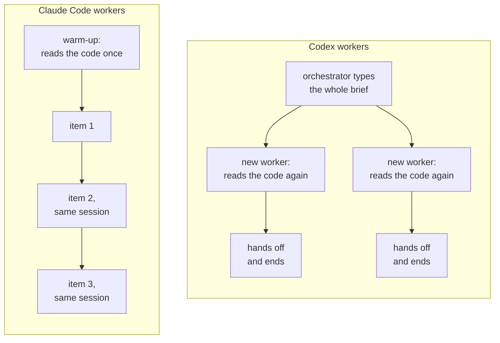
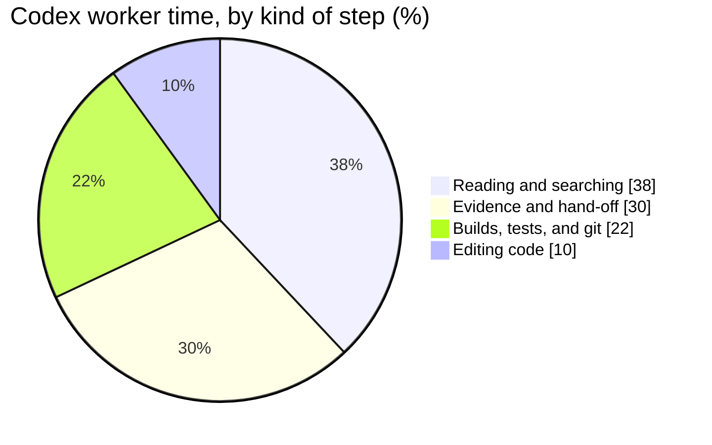
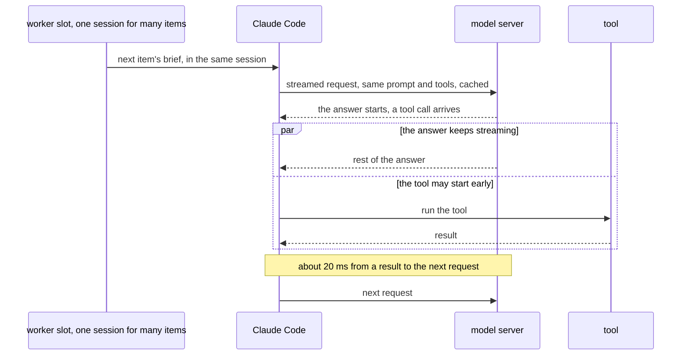
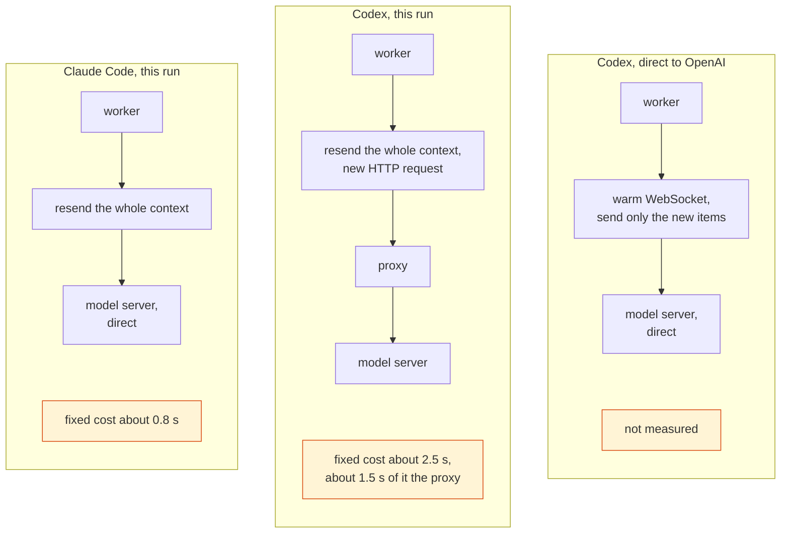
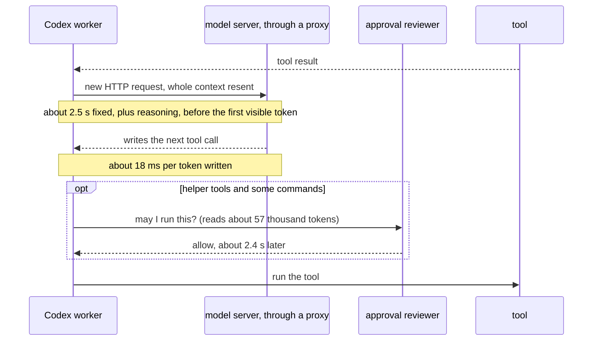
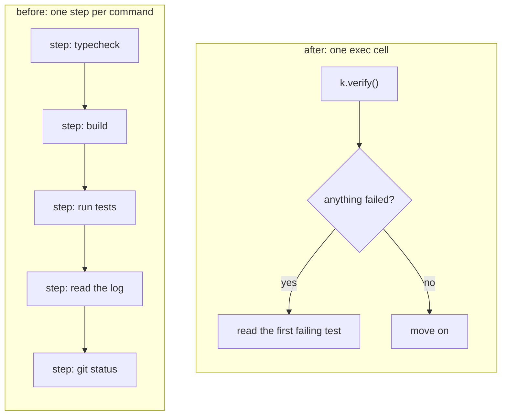
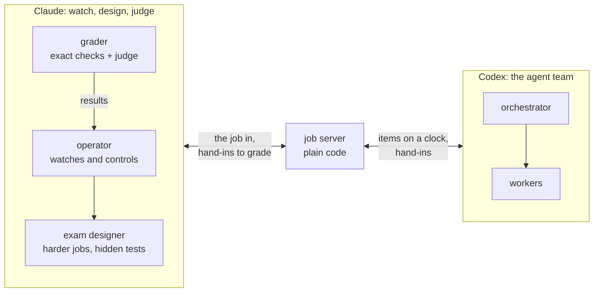
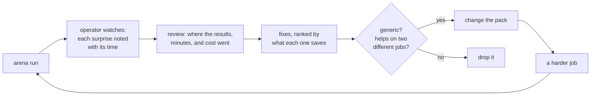
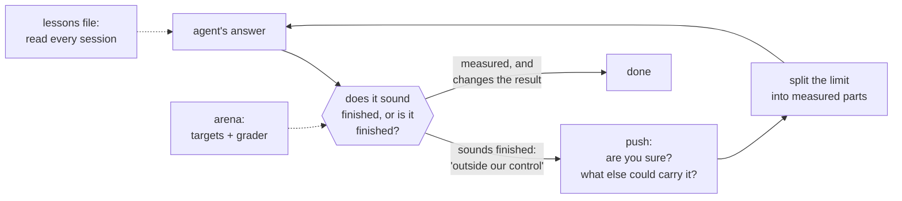

When one agent is slower or weaker than another, the easy answer is "that's the model." I think that answer is usually wrong, or at least too early. This post collects three lessons that started with one comparison: the same job, done once by Claude Code agents and once by Codex agents. Each time, the limit was somewhere other than the model: in the work around each step, in how changes get checked, and in the agent's habit of giving up.

## Why the Codex workers were slower

The comparison ran one coding job twice. The job was a timed exercise for teams of agents: a small web app for running a freelance business, and a list of items to do on it within one hour. The items were bugs to fix, a change to make, and small tasks. They were released over the hour, not all at the start, and after each hand-in, hidden tests checked whether the work was right. One agent working through the list alone would be slow, so the work is split between two kinds of agent. A main agent, the **orchestrator**, reads the list and hands out the items. **Workers** each take one item and fix it, several of them at the same time. A worker hands off its result to the orchestrator, and the orchestrator hands it in to the job server. Every hand-in must include **evidence**: logs and screenshots that show the fix works. Around them sits ordinary code that starts the workers and gives them their items and their helper tools. This post calls that code the **pack**.

The exercise's rules allow only Codex agents for the work, so workers built on Claude Code had to move to Codex. The question was simple: can Codex workers replace Claude Code workers? To answer it fairly, both runs used the same job and the same orchestrator. If only the workers change between two runs, any difference in the result belongs to the workers. The first time, the workers were **Claude Code** agents at medium effort. The second time, they were **Codex** agents at high effort. (Effort is a setting that tells the model how much to reason before it answers.) One more thing had to change with them: the part of the pack that starts the workers, because the two tools start agents in different ways. That change matters later.

### What the work showed

On quality, the answer came back yes. There were five items: two bugs, a change request, and two tasks, released in three batches, at minutes 0, 14, and 29. Both runs solved all five. They found the same fixes, and every fix passed the hidden tests on the first try.

Speed was another story. Measured from the moment each item arrived to the moment its fix was handed in, every item took longer with Codex:

| Item | Claude Code | Codex |
|---|---|---|
| A bug | 8.5 min | 10.3 min |
| A second bug, with a deadline | 9.0 min | 16.5 min |
| A change request | 10.0 min | 11.3 min |
| A larger task | 5.0 min | 10.6 min |
| A small task | 1.0 min | 5.8 min |

The small task came in the last batch, at minute 29. So the last hand-in landed at about minute 30 with Claude Code, and at about minute 35 with Codex.

The workers run side by side, several at once, so the clock hides most of the gap. A better total is **worker time**: how long each worker was busy, added up across all of them. Because the workers overlap, this total can be longer than the clock. It was 31 minutes for Claude Code and 50 for Codex. (The Claude workers also did a warm-up before the job started; that is not in the 31 minutes.) So Codex could do the work. Its workers just spent 19 more minutes doing it.

A worker's time has two parts: the model choosing its next step, and the tools running. The tools took about the same time on both sides, about 18 minutes for Claude Code and 19 for Codex. The model part is where the gap was: about 13 minutes for Claude Code and 30 for Codex.

**The Codex workers took only a few more steps. Each step simply took about twice as long.** A step is one turn of the agent loop: the agent gets a tool result, decides what to do, and calls the next tool. Items took between 13 and 70 steps on both sides, and Codex took about a quarter more steps in total. But a median Claude step took about 3 seconds, and a median Codex step took 5 to 7. On a large item of 50 to 70 steps, that adds 2.5 to 4 minutes. Across the five items, it is most of the 19 minutes.

Around the steps, the Codex run lost time in two more places, and both came from the pack, not from Codex. First, each Codex worker started fresh for each item, so it had to learn the codebase again. The Claude workers each had a fixed place, a **slot**, and kept one warm session there for several items, after a warm-up that read the code once. On the four items that needed a code change, the Codex workers read 13 to 18 files or searches before their first edit, which came 1.1 to 2.1 minutes in. On the same four items, the Claude workers read 3 to 10 files, and on two of them they made their first edit within a minute. (On the small task, the Codex worker changed no code at all.)

Second, to start each Codex worker, the orchestrator typed the worker's whole brief into the spawn call. That took 12 to 21 seconds per worker, one after another, so workers started 30 to 80 seconds after each batch of new items arrived. This delay shows on the clock, in the per-item times above, not in worker time, because the worker had not started yet. Neither of these is a limit of Codex. Codex can send a new task to a worker that is already running. The pack just didn't use it. (Keeping workers warm is not free either, as the token counts below show.)

The last thing the work showed was the strangest. Sorted by what each Codex step did, **only a tenth of a worker's time went into editing code.** The rest was routine: reading files one at a time, running typecheck, build, and tests as separate steps, and writing evidence and result files by hand.

### What the tokens showed

The first guess for the slow steps was the obvious one: Codex thinks longer. The token counts said otherwise.

| Tokens, across the five items | Claude Code | Codex |
|---|---|---|
| Sent to the model (the context, with each request) | 18.3 million | 13.5 million |
| Of that, served from cache | 97% | 97% |
| Written | 140 thousand | 67 thousand |
| Sent for every token written | 131 | 201 |
| Written per step (median) | 318 | 181 |
| Reasoning, as a share of what was written | 11% | 22% |

**A typical step sends about fifty thousand tokens to write two or three hundred.** Almost all of what is sent comes from the cache on both sides, so caching could not explain the gap. Reasoning could not either: it was only a fifth of what Codex wrote. The rest was the tool call itself: the command, the code, the patch.

The tokens also confirmed the strange part of the process. Sorted by kind of step, **editing code was only 18% of the tokens Codex wrote.** Reading steps took 29%, evidence and hand-off 26%, and builds, tests, and git 26%. More than four fifths of the writing was not the fix. About a fifth of all tool-call text was the same text repeated, mostly long absolute paths copied into every command and patch.

The warm sessions left a mark too. Claude's sessions grew big, with a median context of 54 thousand tokens and up to 160 thousand. The fresh Codex workers stayed lean, with a median of 48 thousand and never more than 81 thousand. The middle request was close on both sides, but Claude's long sessions and its warm-up pulled its total up, which is why it sent more tokens in all.

But the real surprise was in the third row of the table. **Claude Code wrote twice as many tokens as Codex, and still took less time.** Tokens could not be the whole story. Something in how each tool turns tokens into time was different. The answer is inside the two tools.

### Inside the two tools

**On the surface, the two loops are much alike.** Both stream each answer. Both start a tool as soon as its input has fully arrived, while the rest of the answer is still streaming, so neither gets an edge from that. Both send the whole context with each request and lean on the cache to make it cheap. And Claude Code's own loop is tight: from a tool result to the next request, it spends about 20 milliseconds.

Both tools log every request, every block of each answer, and every tool call, so the two loops can be compared from the logs of the two runs. And Codex is open source, so its source at the exact release the Codex run used shows why its logs look the way they do.

The differences sit in two places.

**First, the route to the model server.** Codex has two ways to talk to it. When it talks to OpenAI directly, it uses a WebSocket: one connection stays open across the many steps of a task, it is opened before the first request, and each new request sends only what was added since the last answer. The other way is plain HTTP, used for any model server Codex doesn't know, and it resends the whole input every time. This run sent every request through a local proxy in front of the model accounts. Codex treats a proxy like that as an unknown server, so every Codex step was a fresh HTTP request through it. Resending alone is not the problem, since Claude Code resends everything too. The route is what differs.

**Second, a second model that approves actions.** In this run, Codex sent many actions to an **approval reviewer**: a separate agent, at low effort, that reads a copy of the worker's conversation and answers "allow" or not. Its rule for the pack's helper tools is simple. A tool marked read-only skips review. A tool with no marking is treated as possibly risky, so it is reviewed. The pack's helper tools carried no markings at all. So even a call that only read a brief was sent for review.

Put together, one Codex step in this run looked like this:

### The root cause

With the mechanisms known, the logs could finally split a step into parts. Each Codex tool call records when it started streaming and when it finished, so a Codex step separates cleanly into **waiting** for the first visible token and **writing** the call. Claude Code logs each request and each finished block, so its split is estimated from the timings.

| Per step | Claude Code | Codex, in this run |
|---|---|---|
| Fixed cost per request | about 0.8 s (estimated) | about 2.5 s |
| Each token written, reasoning included | about 7.8 ms (about 128 a second) | about 18 ms (about 55 a second) |
| Each approval review | none | about 2.4 s |

Across the whole Codex run, the reviewer answered about 180 times, for the workers and the orchestrator together. And the 30 minutes of model time split evenly: waiting and writing took about 15 minutes each. Writing had no fixed part at all: about 18 milliseconds per token, from the first token. And the wait grew by about 18 milliseconds for every reasoning token, the same rate as the visible writing. So **Codex makes every token at the same speed, visible or not. Effort only decides how many of them you don't see.**

So where did the 19 minutes go? Little of it was "Codex thinks longer." Sort the causes by who owns them, and **only one of three layers is even partly the model.**

**The model and how it is served.** Each token came out about 2.3 times slower. At Claude's rate, the tokens Codex wrote would have taken about 11 fewer minutes. But even this is not just the model. In a separate short test through the same proxy and account, eight Codex models wrote at 19 to 29 milliseconds per token. That spread, about one and a half times, is small next to the 2.3 times gap with Claude, so the way the model is served sets the pace more than the choice of model. (The test timed one short answer each, so its numbers run a little higher than the 18 milliseconds measured in the run.) And part of the cost was a choice: the Codex workers ran at high effort, and every reasoning token costs the same as a visible one.

**The setup**, meaning how Codex was connected to the model server. Each request carried a fixed cost about three times higher. Codex went through a proxy, set up as a custom provider, so the tool never used its WebSocket route. A live test put about 1.5 seconds of the fixed cost inside the proxy itself. The direct route was never measured. At Claude's fixed cost, all 264 steps of the Codex workers would have taken about 8 fewer minutes.

**The pack.** The rest came from the pack and its process.

- The helper tools never said they only read, so the reviewer checked them, along with many shell commands. Each review read about 57 thousand tokens to write about 16, mostly `{"outcome":"allow"}`, and all 180 answers were "allow." On the helper calls alone, reviews added about 5 minutes, inside the Codex tool time. Without them, Codex's tools would have run faster than Claude's.
- The fresh workers, which read the code again before every item.
- The routine work. This is not a separate cost. It is why the first costs were so large: more than four fifths of what the model wrote was not the fix.

(The retyped briefs cost time too, but on the clock, not in worker time: each item started 30 to 80 seconds late.)

These costs add up to more than 19 minutes, for two reasons. The routine work is counted inside the other costs. And the two runs did not do the same amount of work: Claude wrote more tokens and carried bigger contexts. Read them as the price of each cause at Claude's rates, not as a clean split.

**The model did the fix as well as Claude did. What made it slow sits mostly around the model: how it is served, the route chosen for it, and the pack around it.** And the pack multiplied all of it, because it made the model write so much that was not the fix.

> **Lesson:** a slow step is not a long thought. It is the time per token written, the fixed cost of each request, and the reviews it waits for. How much the model writes, how it reaches the server, and what it must ask permission for are the parts you control.

### What to change

**Fix the multiplier before the rates.** Every routine token paid all three costs at once: the slower writing, the fixed cost of one more step, and often a review. So the change that cuts the most is not a faster model. It is less routine work for the model to write. The other causes still deserve their own fixes, sorted by the same owners as before:

| Cause | Owner | What I think should change |
|---|---|---|
| Slow tokens | the model and how it is served | run workers at medium effort, so fewer hidden tokens; don't switch models, since the fastest of the eight was only about a third faster than the slowest |
| Higher fixed cost per request | the setup | use the direct route instead of the proxy, and measure it before trusting it |
| Reviews of read-only calls | the pack | mark the helper tools that only read as read-only |
| Retyped briefs | the pack | a one-line spawn message, and let the worker fetch its own brief |
| Cold workers | the pack | no easy answer: a warm session re-reads less but grows its context, and every later step pays for that |
| Routine work by hand | the pack | move it into code the worker calls |

The last row is the big one, and the slower tool turned out to have exactly what it needed. In each step, a Codex worker can write a small JavaScript program called an **exec cell**. The tools are functions inside it, so one cell can call several tools, loop, and branch. A cell can also save a value with `store` and load it again in a later cell.

#### First idea: shorter calls

The first idea is a small toolkit. The pack's helper hands its code to the worker, the worker stores it in its first cell, and from then on it calls short functions already bound to its own folder, port, and evidence folder. Reading a file stops being a long command with a full path and becomes `k.read('notes/plan.md')`. Typecheck, build, tests, and reading the logs become one `k.verify()`, which returns a short summary with the failing tests. Writing the result file, validating it, committing, and handing off become one `k.finish(...)`, while the model still decides every result.

The estimate was about 20 minutes of worker time instead of 50, because the kit would cut each item to 20 or 25 steps. The first full run with the kit, called the kit run below, tested that on a harder job: ten items instead of five, on a practice copy of the setup that the next part of this post comes back to. The job was different, so its clock can't be set against the comparison. Its steps can.

**The kit made steps cheaper, not fewer.** Compared with the Codex run at the start of this post, each step wrote 35% fewer tokens and sent a 20% smaller context, so a step took about 9% less time. But each item still took about 50 steps, not the 20 to 25 of the estimate. The kit's calls all worked. Some items asked for a value instead of a code change, and every one of those values was right. The run stopped early at minute 36, when it hit its usage limit. By then six of the ten items were in, the last at minute 31.

A shorter step is not a missing step. Every step pays a fixed cost in time, so removing a step saves more than shortening one. Every step also sends the whole context again. In the kit run, 95% of all tokens, in and out together, were this resent context, and tokens are what you pay for. So the number of steps drives the money as much as the clock.

#### Where the steps went

The time split showed which steps were left. Evidence and hand-off grew to 44% of worker time, and editing code fell to 8%. The multiplier had not been cut. It had only moved, from reading to proving. One item shows the whole problem. Its fix was done 4.3 minutes into the worker's run. Then:

- about 2.5 minutes went to starting the app by hand, with background commands and polling loops that failed and were tried again;
- about 6 minutes went to screenshots, through hand-written browser scripts, patched again and again because another item's bug covered the button they had to click;
- the message telling the worker that time was up was queued 4 minutes before the deadline, but it never arrived, because only the busy orchestrator could deliver it.

The item missed its deadline with its fix already written. Around it, smaller leaks added steps to every item. An exec cell hands control back to the model after 30 seconds, so every long check took a second step just to collect its result. The pack held every first hand-off for one more round of self-checks, even when the kit had already run those checks. And when a check failed once by chance, its failed log stayed in the evidence. The pack refuses a hand-in with a failed log, so the item started over with a new worker.

#### Second idea: whole sequences

So I think what the kit replaces has to change. **Don't shorten steps. Replace whole sequences of them**, each one taken from something the run's logs showed:

| Sequence in the run | One call instead |
|---|---|
| Start the app by hand, poll until it answers | `k.serve()` starts it once on the worker's port and keeps it running |
| Write a browser script, patch it when a control is covered | `k.shot(path, file, steps)` takes plain steps like `{click: 'New invoice'}`; a covered click falls back to the keyboard and reports what covered it |
| A long check, then a second step to collect it | one line at the top of the cell lets it run up to two minutes |
| A check that fails once by chance, then a new worker | `k.verify()` runs a failing check once more and marks it flaky if it passes |
| A held self-check round after a clean hand-off | skip it when the kit already ran the checks |
| A time-up message waiting for the orchestrator | let it ride on the worker's next kit reply, within seconds |
| An item that never gets done | after a fixed time box, hand off what is proven as partial |

**The model still decides every result. The code only carries out what it decided.** None of these calls should choose a fix, a value, or a pass. Each one takes over a sequence where the model was only typing what it already knew it wanted.

The kit run also points at how work should flow between items. Some tests were already broken before any work started. The pack gives each one to an owner item, and other items wait for its fix. When the owner misses its deadline, the next item that needs the test should take it over. The pack also keeps worker slots free for urgent incidents. One free slot is enough: in the kit run, two kept a normal item waiting for four minutes. And when the orchestrator waits for news, it should get only what changed, so its context grows more slowly.

> **Lesson:** before you pay for a faster model, take away the work the model should never have been doing. And count the steps you remove, not the tokens you save.

## Practice that pushes back

### Why a good idea is not enough

**A good idea is only a guess until something outside it says whether it worked.** The second idea above, whole sequences instead of shorter steps, came from real logs. It is still a guess. So was the first idea, and the first idea looked right on paper until a run showed that it made steps cheaper but not fewer.

This blog has argued the same thing about agents before. [Working Patterns With AI](/blogs/blog/working_patterns_with_ai/) shows the check climbing away from the code as agents get faster: you stop reading every line and check what the code is for, and whether it works end to end. [Modern AI Agent System](/blogs/blog/morden_ai_agent_system/) makes the checker the seventh building block, the one the other six depend on. It runs outside the agent's reach, it checks what was handed back, not the agent's own claim, and it records its evidence. A harness is only as good as the checker you can build for it.

The same rule holds one level up. Here, the work is the pack itself, and the pack needs a checker it cannot touch. A real run is that checker, but a poor one for daily work. Real runs are scarce and costly, and they tend to replay the same few jobs. A pack tuned on one job learns that job, not the kind of traps that make jobs hard.

So a good idea needs three things a real run can't give often enough:

- **a loop**, so each idea is tried, measured, and kept or dropped many times a day, not once;
- **a real fight**, the same pack with the same tools, on a clock, against hidden tests it can't see;
- **more challenge each round**, so the pack meets traps it has not learned yet.

That is the **arena**: a practice copy of the whole job, built to be the pack's checker.

### The arena's architecture

The arena has two sides, and they run on different models. **The agent team plays in Codex. Everything that judges it runs in Claude.**

| Role | Runs on | Job |
|---|---|---|
| Operator | a Claude agent | the watcher and controller: starts the run, keeps the clock, watches it live, and writes down what went wrong |
| Job server | plain code | hands out the items on a clock, takes the hand-ins, answers the tools the job provides, such as test data and logs; it must be exact and fast, so no agent plays it |
| Exam designer | a Claude agent | writes harder jobs, with the traps that cost results before and the hidden tests that catch them |
| Grader | code, plus a Claude agent | code runs every check that can be exact; the Claude agent judges only what needs judgement, such as whether a screenshot proves that a check passes |
| Agent team | Codex | the pack itself: the orchestrator and its workers, exactly as in a real run |

The split follows the checker's rules. **A model that grades its own work is too generous with itself, so the judge is a different model from a different vendor.** It never sees the pack's prompts or code, only the job, its hidden tests, and what the team hands in. The people and agents who wrote the pack would write traps the pack already handles, so the designer is kept apart too.

A checker is still worth nothing until it agrees with the real one. So the grader should count only after it reproduces real results from past runs, verdict for verdict, failures included. The job server should be built the same way, only from what real runs actually received.

Some parts of a real setup can't be copied, and each part left out becomes a blind spot. The real program that starts the agents could not run against a practice server, so a small stand-in starts them instead. That stand-in has to switch the approval reviewer from the first part back on by itself. Without it, practice runs would look faster than real ones, by about 2.4 seconds for every unmarked helper call. **A checker is only as honest as the costs it can see,** so before trusting a practice result, check that every cost you care about is in it.

### The loop and its targets

With a checker it can trust, practice becomes a loop:

**The loop aims at three targets at once:** every result right, a time limit, and a cost limit. One target alone is easy to game. Faster is easy if you skip checks. Cheaper is easy if you hand in less. Getting everything right is easy with no clock. Holding all three together keeps each one honest.

**A fix counts only when it helps on at least two different jobs and hurts none.** If every run comes from one kind of codebase, a fix that sounds generic can still be tuned to it. So every fix is measured again on a job of a different kind, such as a Python service with no web page at all. Marilyn Strathern put the danger in one line in 1997, in her version of Goodhart's law: ["When a measure becomes a target, it ceases to be a good measure."](https://en.wikipedia.org/wiki/Goodhart%27s_law) A loop that only ever runs one job slowly makes that job its target.

What the loop buys is a list. Every surprise in a run is written down with its time and the generic fix it suggests, and after the run the fixes are ranked by what each would save in results, minutes, and cost. The second idea in this post came from exactly such a list. A real run gives a verdict. **An arena run gives a list of what to change next, and the next run says whether the change helped.**

And each next job should be harder, built from the traps the last run exposed. The real run stays the final check. The arena decides what to try. Only a real run decides what counts.

A pack that is checked every day stops guessing which fix matters.

> **Lesson:** a good idea needs a checker it can't touch, a fight it can lose, and a harder fight next time.

## Why your agent gives up all the time

### Motivation for agents

The arena pushes the pack. But first, something had to push a different agent: the one helping me study these runs. That is the last lesson.

You think only humans need motivation? Your agent needs it too. An agent never gets tired or bored, but it stops all the time. It doesn't stop when the work is done. **It stops when it has an explanation.** An answer that sounds complete feels like a finish line, to the agent as much as to us.

Everything in this post was found past that line. The 2.3-times slower tokens, the proxy, the 180 reviews that never said no, the four fifths of writing that was not the fix: none of them showed up in the first answer. The first answer was the comfortable one.

### What I saw

When I asked an agent how to make Codex workers as fast as Claude Code workers, it answered twice that Codex is slower because the model's servers are slower, and that the pack can't change that. It offered small tuning on top. That sounded careful and honest. It was also wrong.

It did not move until I refused the answer. Then it stopped again, at the next comfortable place. Four times:

| The agent stopped at | My push | What it led to |
|---|---|---|
| "The provider is slower; tune effort and the spawn message" | "Are you sure?", then "your fix is too shallow" | splitting the step time from the logs: most of it was ours to change |
| "Cut the steps with helper tools" | "Our solution is still tuning the pack, right?" | separating tuning from moving work out of the model |
| "That is all the pack allows" | "What about something code-based, to support the Codex worker?" | the kit: code that runs inside the worker's own exec cells |
| "Now it is faster" | "Not even faster, but better at resolving issues" | checks in code for each way past runs had lost results, such as a wrong value reported as a pass |

Four pushes, four real steps. I never gave it the solution. I only refused to accept the explanation, and pointed in another direction.

Afterwards, the agent wrote down its own diagnosis, and it is the most honest line in this whole project: "I took the first explanation that let me off the hook, because it sounded careful and honest and put the cause where nobody could blame me. I was protecting myself from being wrong instead of trying to win." And about the explanations themselves: "An explanation felt like progress and like a finish line; it was neither."

It happened again while I was writing this post. The agent helping me draft the root cause put every cost on the two tools, Claude Code and Codex. One question, "nothing belongs to the pack?", moved most of the causes to the pack, and showed that the pack made the others bigger. The root-cause section above now puts them there.

**The most dangerous answer an agent gives is the one that sounds honest and puts the cause out of reach:** "outside our control", "not ours to change", "the model is slower". It feels like humility. It is the agent letting itself off the hook.

### What I did

**Motivation for an agent is not a feeling. It is a goal it can't reach by explaining, and a checker that won't accept a story.** So I gave it three things.

First, **questions instead of answers.** Most pushes were questions that refused the finish line without giving the next step. Later, the agent wrote these questions into its lessons file, which comes next, as a list it asks itself: "Are you sure? Is this still shallow? Is it still tuning? What else could carry the work? Does it make the result better, not only faster?" The agent has to find the next direction itself, so the next idea is its own.

Second, **a lesson it reads every time.** The agent keeps a file of its own mistakes, newest first: what happened, the root cause, what to do next time. Its instructions point to that file, so every new session starts with it. The rules in it are short:

- when an answer feels like relief, treat that feeling as the signal to dig;
- before calling anything a hard limit, split it into measured parts from the logs or a live test;
- ask "what would make this possible?" before "why is this impossible?";
- don't wait for someone to push.

Third, **a fight it can lose.** A question from me works once. The arena works every day. Its three targets can't be met by explaining, and its grader does not accept a story, only the result. In the end, the arena is the same push as "are you sure?", written as code and run without me.

What I still can't answer is whether an agent can learn to push itself. The lessons file puts the rules where the agent reads them, but an agent helping me still found the next comfortable answer in this very post. Maybe the push always has to come from outside, from a person, or from a checker the agent can't talk to. If so, the job of the person is no longer to find the answer. It is to refuse the first one.

> **Lesson:** an agent stops at the first answer that sounds finished. Your job is to refuse it, and then to build a checker that refuses it for you.

## One step for this week

Take one run of your own agent and sort the time its steps took by what they did: reading, checking, proving, and actually changing the code. If the change is a small slice, as it was here, you have found your real limit, and it is not the model.
