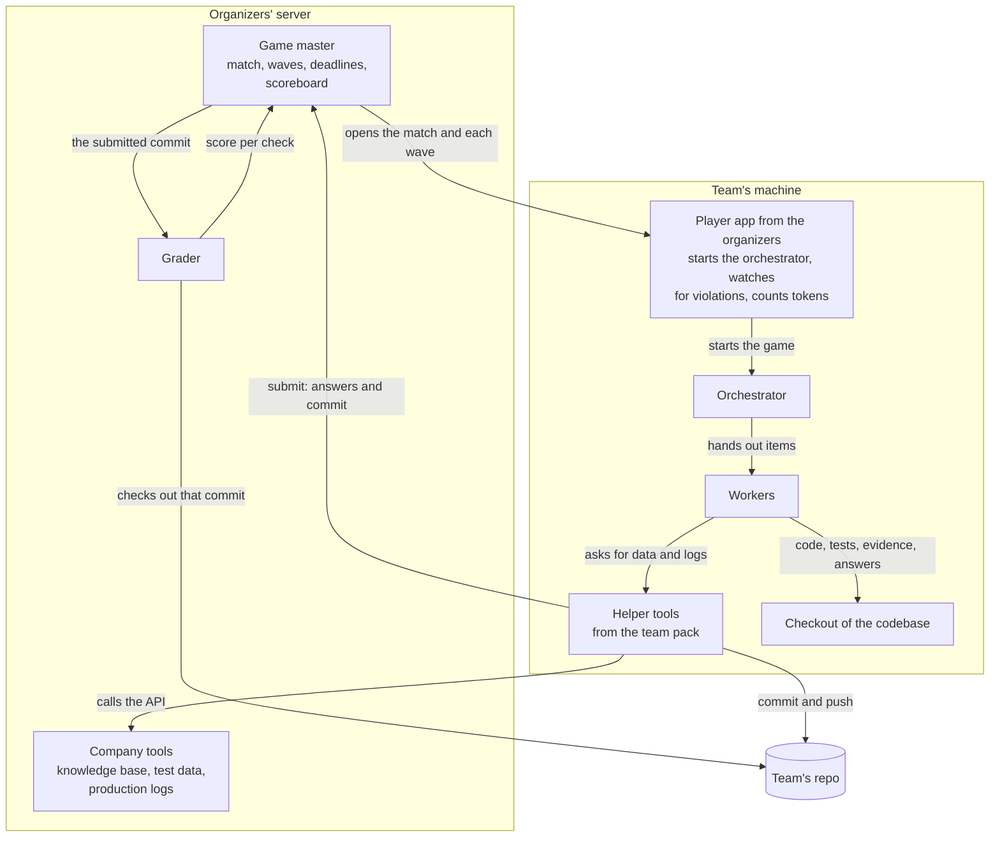
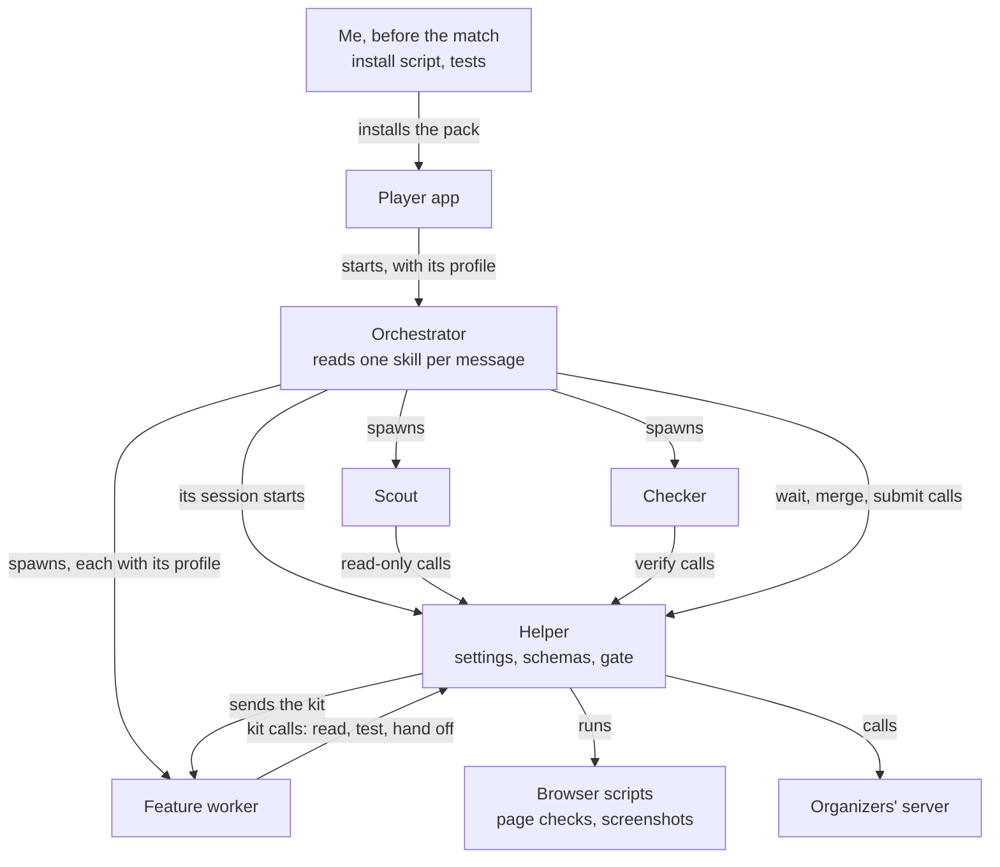
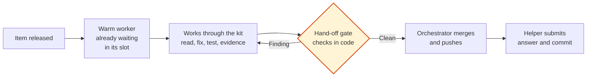
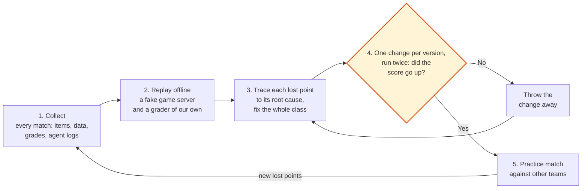
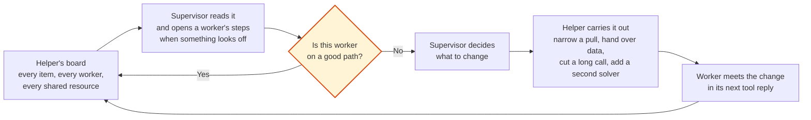
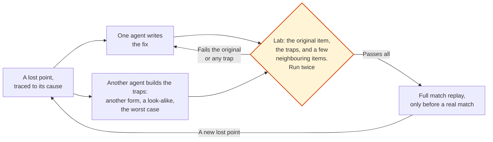

## A contest where nobody may touch the machine

This year I joined a software engineering contest where the agents do the work. Each team builds a **team pack**: an orchestrator, its worker agents, and the tools and workflow around them. They get a real codebase and a backlog of items, and nobody may touch the machine during the match. A grader scores each item on the commit submitted, once. Ties go to the team that spent fewer model credits.

The codebases were TypeScript web apps of different sizes. Here are three of them.

| # | Codebase | Domain | Shape | Items |
| --- | --- | --- | --- | --- |
| 1 | A freelance project manager | CRM, boards, time tracking, invoices | One Next.js app with PostgreSQL | 12 |
| 2 | A personal finance app | Accounts, budgets, rules, bank imports | Mid-size monorepo with SQLite | 16 |
| 3 | A B2B commerce platform | Tiered pricing, tax, stock, shipping, returns | Large monorepo with NestJS and GraphQL | 17 |

The backlog mixed five kinds of task.

| # | Task | What it asks | Example |
| --- | --- | --- | --- |
| 1 | Bug | Fix one defect from a support ticket | A fully paid invoice still shows "partly paid" |
| 2 | Change request | Add or change a feature to a business standard, sometimes with a page | An aged-debt report |
| 3 | Production incident | Find the bad release in the logs, its first moment and its reach, then fix it. Short deadline, ranked by who submits first | Stock reserved beyond the order |
| 4 | Task | Compute or analyze from data, logs, or images, or write a test suite | Read the numbers off a voucher image |
| 5 | Heavy task | Audit a large dataset under stacked rules | Check four months of computed prices |

Nothing was scored on the team's word. The grader checked each item in one or more of these ways.

| # | Check | How the grader verifies it | Items (of 45) |
| --- | --- | --- | --- |
| 1 | Exact answer | Compares each field of the submitted answer, no AI | 40 |
| 2 | Replay and hidden tests | Reruns the checks the team reported as passing, plus hidden tests | 25 |
| 3 | Mutants | The team's tests must pass on correct code and fail on each broken copy | 11 |
| 4 | Incident fix | The incident's answers, plus a fix test and a no-regression test | 9 |
| 5 | Page and screenshot | A screenshot as evidence, and the page flow replayed | 6 |
| 6 | Script on second data | The team's script is rerun on a different dataset of the same kind | 6 |
| 7 | Organizers' tests | Their test suite runs on the team's code | 4 |

A wrong answer format scored zero for the whole item.

The diagram shows how one item travels, from the organizers' server to the team's machine and back to the grader.



So the grader sees only what was committed. Anything left in a temp folder on the team's machine does not exist for it.

## The pack: one orchestrator, many workers, and a helper in code

The pack is the only part a team builds. Mine is one orchestrator, three kinds of worker, and a helper that does everything a model should not have to remember. On disk it is a small folder with no dependencies.

```text
team-orchestrator-pack/
├── agents/                         # who each agent is. The agent runtime loads one file per agent it starts
│   ├── team-orchestrator.toml      # loaded when the player app starts the orchestrator
│   ├── team-feature-worker.toml    # loaded when the orchestrator spawns a worker for one item
│   ├── team-repo-scout.toml        # loaded when the orchestrator spawns a read-only second opinion
│   └── team-quality-checker.toml   # loaded when the orchestrator spawns a checker for a finished item
├── skills/                         # read by the orchestrator only, one per message from the player app
│   ├── game-preparation/SKILL.md   # on "prepare": clone, build, create the slots
│   ├── team-orchestrator/SKILL.md  # on "start": the loop during the match
│   └── team-recovery/SKILL.md      # on "resume": pick up after a restart
├── bin/                            # programs, started by the agent runtime or by the helper
│   ├── runtime-server.mjs          # the helper. The runtime starts it, and every agent calls its tools
│   └── browser-*.mjs               # run by the helper when a worker asks for a page check or a screenshot
├── src/                            # code the helper loads
│   ├── runtime-session.mjs         # the helper's own logic: server calls, hand-off gate, submit
│   ├── kit.mjs                     # sent by the helper to each worker, which runs it in its own cells
│   ├── worker-launcher.mjs         # the helper's record of each worker, and what the orchestrator must spawn or close
│   └── mutate.mjs                  # run by the helper when a worker asks to test its tests
├── config/
│   └── workers.json                # read by the helper at start: slots, time boxes, holds
├── contracts/                      # schemas the helper checks: a worker's result, a line of the progress log
├── docs/                           # read by every agent: the match card first, a playbook recipe when needed
├── tests/                          # run by me after each change to the pack, never during a match
└── scripts/install.mjs             # run by me once, before a match, to copy the pack into the workspace
```

The diagram shows the same files in use: who starts whom, and who calls what.



So every agent talks to the outside only through the helper. That is the one place where the rules can be enforced in code.

The table says what each part does.

| # | Part | What it is | Its job |
| --- | --- | --- | --- |
| 1 | Orchestrator | One agent session, started by the player app | Reads the backlog, hands each item to a worker, merges, pushes, submits. It does not fix items itself |
| 2 | Workers | Subagents of that same session, in three profiles | A feature worker owns one item from brief to commit. A scout investigates read-only and gives a second opinion. A checker verifies a finished item |
| 3 | Slots | One git worktree per worker, with its own app, port, and database | Workers run side by side without touching each other's files or data |
| 4 | Helper | A small local tool server, in plain Node | Makes every call to the organizers' server, writes the progress log, checks each hand-off, submits. It keeps the credentials in memory only |
| 5 | Kit | A short JavaScript toolkit the helper serves to each worker | One call replaces several steps: read files, run the checks, start the app, take a screenshot, fill the answer, hand off |
| 6 | Skills | Three instruction files for the orchestrator | One for preparing the game, one for playing it, one for recovering after a restart |
| 7 | Prompts | One profile per agent, and a brief per item | The profile says what the agent may do. The brief carries the item, its slot, and a hand-off checklist |
| 8 | Config and contracts | One settings file, and two schemas | Switches for slots, time boxes, and holds. Schemas for a worker's result and for a progress event |

Three of those parts did most of the work.

**Warm workers.** A worker spawned when an item arrives starts late, because the orchestrator needs a turn to spawn it, and that turn can sit behind a context compaction. So the workers are spawned before the items and wait on the helper. In practice matches an item then reached its worker in about 20 seconds. Before, some waited over a minute.

**The kit.** A worker's steps were not too many, they were too slow. Each hand-written command with long paths is one more model request. The kit turns a sequence into one call, so the worker spends its requests on the item, not on plumbing.

**The hand-off gate.** A worker's word is not enough for the grader, so it is not enough for the helper either. On every hand-off the helper runs its own checks in code: is the evidence there, is the answer filled, does a fix come with a new test? A finding refuses the hand-off once, with the reason. Rules the model had to remember became rules the code enforces.

The diagram shows one item passing through the pack.



So the model does the thinking on the item, and code does the waiting, the checking, and the submitting.

### The timeline of the pack

The pack went from the organizers' empty sample to what you see above in about 70 versions over two weeks. Every change came from a real match or an arena run. We wrote down the lost points, traced them to the root cause, and fixed the pack in a way that works for any exam, never as a patch for one item.

Three forces kept coming back:

- **Following the rules.** The official environment allows only subagents inside the same session, so the whole worker design had to be rebuilt once.
- **Speed.** The target was to submit everything before minute 25 and an incident within a few minutes, because incidents are ranked by submission order.
- **Never scoring zero.** An item that runs out of time without a submission is worth 0 points.

Step by step, mechanical work moved from the agent, which costs steps and tokens and can forget, to the helper's code, which is fast, certain, and costs no credit.

| # | What we changed | The problem it solved |
| --- | --- | --- |
| 1 | Nothing yet. This is the sample pack the organizers give every team: a few instruction files and no program of our own | The starting point |
| 2 | We split the work between agents. One orchestrator agent reads the backlog and gives each item to a worker agent. Up to 5 workers run at the same time, each in its own copy of the code | A single agent that does the items one after another cannot finish the backlog in 40 minutes |
| 3 | We wrote a helper program and gave it the jobs an agent kept forgetting. It checks every finished item before accepting it: are the evidence files there, is the answer filled in? When new items open, it starts them and gives them to free workers by itself. It submits finished items by itself, even if the orchestrator has crashed. Just before the match ends, it submits whatever is done. We also keep one worker free for production incidents, and one shared notes file that every worker reads | In practice matches we lost points because finished items were never submitted, were submitted without evidence, or sat waiting for the orchestrator to act |
| 4 | We rebuilt how workers run. Before, the helper started each worker as a separate program. Now the orchestrator starts each worker inside its own session, as a subagent | The organizers' rules allow only subagents in the same session. Starting another agent program during a match is forbidden |
| 5 | We built our own copy of the contest, with a fake server and made-up exams, so we could run and score the pack any time. We also wrote the **kit**: a small set of functions a worker calls. One call reads files, another runs the tests, another takes a screenshot, another hands in the item. Before, the worker typed each shell command itself. And for an item whose answer is exact numbers, the helper now starts a second agent to compute the same answer separately, so the two can be compared | An item was slow because it took many steps, and each step is one request to the model. Most steps were not thinking. They were re-reading files and running commands |
| 6 | We put every fix that had proven itself in our test runs into one version. We moved to the strongest model the organizers allow. If that model answers "overloaded", workers switch to the next allowed model by themselves. And a screenshot is accepted as evidence only if it shows the expected value on the page | We needed a stable version for the real match. Once, an overloaded model had left a whole match stuck |
| 7 | We start the workers before any item exists, and they wait. These are the **warm workers**. When an incident opens, the helper gives it to a waiting worker within seconds. We limited how many tool calls a worker sends at once, because more than 128 at once crashes the session for every agent. When the organizers' server refuses a call for "too many requests", the helper waits and sends it again. Every agent first reads a one-page card that says what scores and what scores zero. And workers think at the highest effort level, which takes fewer steps | Incidents are ranked by who submits first. In real matches our incidents started late, and that was the main loss |
| 8 | The helper now watches every deadline. 240 seconds before an item's deadline, it hands in what the worker has proven so far. 75 seconds before, it submits the best version it holds. An incident is handed in as soon as its fix and its test pass, without the slower checks. Workers run their code on the organizers' official test data and keep the output as evidence. And every test must keep its data inside the committed code | In one match an item scored zero because it was handed in 1 second late. In another, a test read a file that the grader does not have, so it failed there |
| 9 | We told the workers they are racing other teams: do what the helper says at once, and hand in early. We removed steps that take time and earn no points, such as a full type check. We added two rules: zoom in to read numbers from a document image, and compute an answer with a script, not by hand. And we fixed our log search to match how the organizers' server really searches | The result: three practice matches in a row with every item submitted, then the official match at 779 of 1000, first of 8 teams |

The lesson after the official match sets the next step. The points still lost all sit where the agent must do by itself what the helper could do in code: gathering the data for an incident, judging its own test suite, and finding every rule in the knowledge base.

### The problems we hit

Now let me tell you which problems we hit on the way, and what each one cost.

| # | Problem | What happened | Root cause | Cost | Solution |
| --- | --- | --- | --- | --- | --- |
| 1 | A worker's "done" taken as fact | A worker built an invoice export. One invoice came out as "overdue" while the app's screen showed it as "sent". The worker saw the mismatch, wrote it into its record, and kept its own value | The export recomputed the status from today's date, as one knowledge-base rule suggests. The task wanted the status the app stores and shows. Nothing made the worker settle the conflict before handing off | 40 points, the only loss in a 960 match | A self-check before each hand-off: output against the screen, against the official test data, with fresh evidence. Later, a second agent computes exact answers on its own |
| 2 | Finished work never sent | Two items were right and never reached the grader. One had its answer at minute 21 and an 8-minute deadline. The other was done, merged, and held | For the first, the helper merged the commit, the push failed, and nothing retried it. For the second, one test failed once under load, so the gate passed the decision to the orchestrator. The orchestrator was down: the proxy had moved it to an account whose login was revoked | 190 points: 50 for the missed deadline, 140 for the held item | The helper retries a failed push, reruns once a suite that failed once, and hands waiting items to workers without the orchestrator |
| 3 | Credentials written to a file | At the start of a match the host's safety review refused the helper's first tool call. The team never started | The helper wrote the whole start message to a session file, password and API key included, and the tool's description said so | A whole match: 0 points | Credentials stay in memory and reach workers through their environment. The file holds only fields that are not secret |
| 4 | Fixes that broke their neighbours | Eight versions in a row never beat the one before them. On one day, two fixes each caused a new loss: one made preparation skip a login, the other made three places read "the log exists" as "the step finished" | Each change was judged only against its own target. Its unit tests were green because they covered the new code, not the code that reads what it changed | Days of work, and trust in each new version | One change per version, run twice on a graded run. Before a change, list every place that reads what it touches. A fresh reviewer reads the diff |
| 5 | The orchestrator's memory | A wave of four ordinary items opened, and their workers began 2 minutes 15 seconds later. An incident in the same wave reached its waiting worker in 24 seconds | Ordinary items needed an orchestrator turn to spawn a worker. That turn sat behind a 64-second context compaction, which fell exactly on the wave | Over 2 minutes on four items, in a 40-minute match | Every worker is spawned at the start and waits on the helper, as incident workers already did. An item goes straight to a waiting worker |
| 6 | One agent took the others down | The session's code host ended for every agent at once. Cells in flight were lost and every agent's kit was gone. Three times in one match | The host exits when one cell starts more than 128 tool calls at once. Incident workers were pulling 144, 192, or 320 log queries in parallel | Every running agent had to reload and redo its last step, on the incident waves | The kit puts every tool call of a cell through one queue, 32 in flight, 24 of them for bulk pulls |
| 7 | The organizers' rate limit | Two agents sent log searches one after another at the same time, and most were refused. A third agent's single call was refused too | The organizers limit a team's calls per time. The helper did not wait or try again, and the kit returned the refusal as if it were data | Broken cells and lost minutes on incidents, where rank is by who submits first | The helper waits as long as the refusal says and sends the call again, with one paced gate for all agents. The kit throws if it still fails |
| 8 | An item with a 15-minute deadline | The same kind of item lost points three matches in a row. First it was handed off 1 second after its deadline, with the page, report, and export built 9 minutes earlier. Then it went in half done. Then the worker's right answer came 9 seconds after the helper had closed its run | The item depended on another item's fix, which landed late. The worker committed nothing until the end. And the helper's last-minute hand-off ended the run, so the worker's better answer had no slot | 0 of 70, then 20, then 30 | Four minutes before a deadline the helper hands in what is proven by evidence and keeps the run open. The worker hands in again if it gets further |
| 9 | The pack's own procedure | Items spent minutes on steps no grader reads: a type check of whole packages, a test of the tests, a self-check round, long engineering records | The hand-off gate enforced the pack's procedure, not the item's grading section | Minutes per item, and rank on every item with a deadline | The gate blocks only what feeds a check in the item's grading. Everything else is a note, never a refusal |
| 10 | **Workers ignored the helper** | "Take the capture NOW" was sent at minute 1.5 and never done. Two incident workers recounted answers a second agent had already sent them. Others kept working after "time is up" | Stronger wording does not change what an agent does next. The agent follows its own plan and its built-in instructions first | The page cases of one item, and minutes on two incidents | What must happen is done by the helper itself: it takes the capture, and it hands in at the deadline mark |
| 11 | A test that passed only at home | A worker's test passed on my machine and failed on the grader's checkout, for the item that wrote it and for two others that ran the same suite | The test read its data from a folder that is never committed. The brief itself had pointed the worker at the helper's copy and said nothing about where test data must live | 31 points over three items, from one file | A test carries its own data inside the committed source |
| 12 | **Official match: incident answers late** | One worker wrote its fix in the first minute, then spent 5.2 minutes in a single log pull over a month, with no service filter. Another was inside a 115-second analysis when the helper handed in its empty template. One named the root cause in a message and never wrote it into the answer file | The worker gathers everything first and answers last, and no gathering step has a budget. What it knows lives only in its context. The log pull had been fixed two hours earlier, but tested only on six days of one service | 71 points on two incidents |  |
| 13 | **Official match: tests with no large-volume case** | The grader ran my test suites on code broken only for large inputs: hundreds of order lines, thousands of units, large amounts. The suites stayed green | The brief asked for one test per numbered rule, on typical input. The check that breaks code on purpose and expects a red test had been switched off for speed | 63 points over 7 items |  |
| 14 | **Official match: knowledge base read in part** | One worker saw 17 clearance items in the data and never searched "clearance". Another missed two sections of a work instruction: a request is handled once, and one office's requests are not handled at all | The worker stops searching once it has enough to compute. It reads what its first searches return, and the search returns only the best few articles | 68 points on two tasks |  |

The rows in bold are the ones we have not fixed. Row 10 is only partly fixed: the helper now does two things itself, but a worker can still ignore any other message. Rows 12 to 14 come from the official match, which ended at 779 of 1000, first of eight teams. They are the 202 points that were our own fault, and each has a fix written down but not yet built.

Read down the Fix column and one direction shows. A rule starts in a prompt, costs points, and moves into code.

### Six factors that helped us win

The official match had 17 items in 40 minutes. We submitted all 17, the last at minute 34, and scored **779 of 1000, first of 8 teams**, 12 points ahead of the second. It used 198 credit, with no violation recorded.

| # | Factor | Role | Supporting numbers from the official match |
| --- | --- | --- | --- |
| 1 | **Working in parallel** (9 worker slots, at most 10 threads) | Enough capacity to finish the whole backlog in time | 17 items submitted in 34 minutes. One after another, that cannot be done |
| 2 | **Warm workers** | Items and incidents reach a worker in seconds, without waiting for the orchestrator's turn | After wave 1, workers started within 0.2 to 1.1 minutes. On two incidents we were the first to submit |
| 3 | **The kit** | The worker works in code inside one cell, not one shell command at a time, so each item takes fewer steps | Plausible from earlier measurements. This match has no separate measurement of it |
| 4 | **The strongest allowed model** (workers at the highest reasoning effort) | The quality of each step | Not an advantage of ours alone: the model is on the organizers' allowed list, and any team could use it |
| 5 | **A helper in code** | It hands out work, integrates, submits, and submits for the worker when time is nearly up, so every item has a submission | Two items were handed off at the deadline mark and got full points. Two incidents were submitted for the worker and kept the 62 points for their code fix, while the winning margin was only 12 points |
| 6 | **The measure-then-fix loop** (real matches and the arena, always fixed at the general level) | The road that led to the five factors above | About 70 versions in two weeks. The faults that once cost 190, 80, and 70 points in practice matches did not come back |

The first four factors are "work fast and get it done". The fifth is "never score zero". The sixth is how we got the other five. The numbers support factors 1, 2, and 5 most clearly.

We have no test that isolates each factor in a real match, and we do not know the other teams' packs. So these are factors with evidence behind them, not proven causes.

**What we did not get done.** We still lost 221 points. 202 came from three fault classes of our own pack: incidents submitted with empty fields (71), test suites that did not catch the grader's broken versions (63), and missing business rules (68). The other 19 came from submitting incidents after another team.

All three fault classes sit where the agent still has to do by itself what the helper could do in code. So the next step is to widen the fifth factor: the helper gathers and narrows the data for an incident, measures how well a test suite catches faults, and follows every rule in the knowledge base to its source.

## The loop that turned lost points into fixes

The pack did not get better because I had good ideas. It got better because the contest gives a clear score, and I built a loop around that score. The grader computes the score, per check, on the exact commit, and says why each check failed. So every change to the pack could be judged by a number that nobody on the team can argue with.

The loop has five steps. The diagram shows them in order, and where a change is kept or thrown away.



**1. Collect the matches and their backlogs.** After every match I saved everything: the text of each item, the knowledge-base articles, the test data, the grader's result for each check, and the full log of every agent. A lost point is only useful if you can go back and see exactly what the agent did in the minute it lost it.

**2. Replay a match offline.** A real match needs the organizers' server and other teams, and practice slots are limited. So I built a copy of the contest: a fake game server that opens the items in waves, and a grader that scores the result the way the real one does. Now any change to the pack can be run and scored on a saved exam, any time, before the next real match.

**3. Trace each lost point to its root cause.** For every lost check I asked why, until the answer was about the pack and not about the item. "The worker forgot the screenshot" is not a cause. "Nothing checks that the evidence exists before hand-off" is one. Then I fixed that cause for every exam, never as a patch for one item, because the next match has different items.

**4. One change per version, run twice.** Each version changes one thing. I run it twice on a graded exam, because the same pack can score differently from one run to the next. I keep the change only if the whole score goes up, not only the item I was fixing.

**5. Test in a real practice match.** The offline copy is not the real thing. It has no other teams, no real rate limit, and no real clock pressure. So a version that passes offline still has to hold in a practice match against other teams. Whatever it loses there goes back to step 1.

The loop has limits, and each one cost me points before I learned it.

- **A change judged only against its own target looks good and is not.** Eight versions in a row fixed their item and never beat the version before them. That is why step 4 scores the whole run.
- **One run is not a measurement.** The same item scored 100 in one run and 36 in another, on the same model. That is why step 4 runs twice.
- **The loop only fixes what a score has already shown.** No practice exam punished test suites that had no large-volume case. The official match did, and it cost 63 points.
- **A fix tested on an easy case is not tested.** The log search was fixed and checked on six days of logs from one service. In the official match the workers asked for a month from every service.

So a clear score makes the loop possible. What makes it work is scoring the whole run, twice, on a case harder than the friendly one.

## What the matches taught us

These are the lessons we took from the match records, the reviews after each match, and the grading of the official match. Some we are sure of, because they repeated many times. Others come from one run only, and I say so.

### About the model

**1. Balance rules in code against work given to the model.** Code runs the same way every time and costs no tokens, but it only knows the cases its author thought of. The model can handle a case nobody planned for, but it can forget an instruction. Faults we fixed in code never came back. A fault we fixed only with an instruction came back twice: 16 points, then 63. But a wrong rule in code is wrong on every item at once, and that hurt us too. So code gets the mechanical parts, the model gets the judgment, and a rule may only block an item over something the grader scores.

**2. The newer model (gpt-6.1-sol) was both better and cheaper than the older one (gpt-6-sol).** Same pack, same exam: 963 points against 853, and 176 credit against 325. It needs fewer steps per item, each step answers faster, and its cached input costs half. The downside is that it is often overloaded, so we test it before each match and keep a backup model ready. This is one run on each side. Whether each of its steps is more often right, and how it compares with another vendor's model, we have not measured.

**3. Time is the number of steps times the seconds per step.** A higher reasoning effort makes each step slower, but it cuts the number of steps by more. On one incident, the highest effort took 12 requests where it had taken 28. Each request took 11 seconds, up from 6, and the total still fell from 2.8 minutes to 2.2. So we judge a model or an effort level by total steps and total time, never by the delay of one step. This is one run.

**4. Writing code is not where the points are lost.** In the official match, on a codebase we had never seen, every check that graded the code directly got full points: 507 of 507. We lost points on answers computed from data (47 percent), on tests that missed faults at large volume (0 of 11 caught), and on getting submissions in. Code has tests that tell the model it is wrong. Nothing tells it "one rule is still missing" or "time is almost up". So the next investment is in reading documents and in tests that try to break the code.

### About how an agent works

**5. An instruction in the prompt is not yet a behaviour.** We told the orchestrator to wait 110 seconds in one call. It never did, because the platform it runs on has its own base instructions, and they forbid waiting more than 60 seconds. When ours and theirs conflict, theirs win. So before asking for a behaviour, we read the platform's base instructions, and we call a change "measured" only after reading a real run.

**6. The agent often already knows. It lacks a way to act on it.** In many lost points, the deciding fact was in the agent's own output before it submitted. One worker wrote down a conflict and submitted anyway. One wrote "it could be 3000" and submitted 0. One saw 17 product codes with an odd prefix and never looked them up. The doubt sat in a note, and the steps after it read only the structured fields. So everything known is written at once into the place that gets submitted, and a doubt becomes a field the hand-off check can read.

**7. Checking at the end and sending work back is expensive.** In one practice match, 30.7 of 160 worker-minutes were rework after the first hand-in. Each refusal is a full round: read the reason, redo, recheck, hand in again. And an instruction deep in a 31,000-character prompt gets less attention than a short list at the top. So "what scores" goes first in the brief, and we check during the work, not only at the end.

### About a system of many agents

**8. Running in parallel buys speed, then each shared resource becomes a way to lose points.** Each worker acts as if it were alone. Ten shared things failed on us, among them the main branch, the test suite under load, the organizers' rate limit, the limit on tool calls, the thread limit, and the build folder. None was on a list beforehand. We found each one by losing points or time. Now, before adding agents, we list every shared resource and give it an owner, a queue, or a budget.

**9. The backup disappears exactly when it is needed.** We added a second agent to compute the same answer separately. In the official match one incident had none, because the threads ran out, and the other's came too late, because it competed with the worker for the same rate-limited logs. With the same model and the same brief, it also tends to make the same mistake. In the records we could read, it never once turned a wrong answer into a right one before submission. A backup needs resources of its own, reserved in advance.

**10. Points fall off a cliff, so design for the worst case.** The score does not drop slowly with lateness. One second late cost a whole item, 70 points. In practice our incidents took 3 to 7 minutes against a 10-minute deadline. The real match had an 8-minute deadline and three times the logs, so the margin was zero. We now test at the worst case, and always keep a valid answer ready to submit.

### About how the team improves

**11. We removed the very safety check the real match needed.** An early match cost us 16 points for tests with no large inputs, so the pack got a check for it. On the practice exams that check did not raise the score, and two days before the official match we switched it off to go faster. The official match then had 11 items of that kind where practice had 1. We missed all 11 and lost 63 points, in a match we won by 12. Before dropping a check, ask which kind of fault it guards against, and whether your exams even contain that kind.

**12. The score on a new exam is the real measure.** On exams we had played many times we reached 1000. The first time we met each exam we scored 960, 984, 928, and then 779. Each replay fixes the faults that one exam exposes, and a new exam exposes others. So readiness is measured on an exam we have not seen.

**13. A practice environment can teach the wrong thing.** Our own offline grader was written from guesses. It marked a screenshot of demo data as wrong, and the real grader gave it full points. One rule in the pack had been written because of that lost point, which never existed. We no longer build a rule on a fake grader's verdict when the real records say otherwise.

**14. The first diagnosis after a match is often wrong.** Our records have more than ten places where a first explanation was later corrected. Every time, the correction came from reading the agent's own session, not from timings or log values. So a post-match analysis is a hypothesis until it is checked against the source.

**15. Every step forward came from a person refusing the first answer.** Four times the analysis stopped at "the provider is slower, the pack cannot change that". Four times I asked again: are you sure, is this still shallow? All four led to a real step: breaking down where the time goes, the kit, and checks in code. When an answer brings relief, that is the signal to dig further.

## Open ideas for the next match

None of these ideas is built or tested yet. They come in two groups. The first group is borrowed from how other people run agents. The second group is our own: what our review of the official match already planned, and what we worked out afterwards when we asked how to win a match we have never seen.

We can test them properly now. Our offline copy of the contest has an exam rebuilt from the official match: the same 17 items, 40 minutes, and five waves. So each idea becomes one change in one version, run twice on that exam, and judged on three numbers: points on the three unfixed faults, credit, and the minute of the last submission.

### Ideas borrowed from other people's systems

These ideas are not ours. Each one is a principle taken from someone else's system and fitted to our pack. The table lists the six sources we read: what each one is about, its main idea, and what we learn from it.

| # | Source | What it is about | Its main idea | What we learn from it |
| --- | --- | --- | --- | --- |
| 1 | Steve Yegge, [Welcome to Gas Town](https://steve-yegge.medium.com/welcome-to-gas-town-4f25ee16dd04) (January 2026), and the [Gas Town repository](https://github.com/gastownhall/gastown) | A system for running 20 to 30 coding agents at once. Seven roles: one agent takes the requests, worker agents do the tasks, one agent merges their branches one at a time, and watcher agents check on the others. A background process pings the top watcher every few minutes | "An agent is not a session." A worker's identity and its task are stored outside the session, so when a session crashes or fills its context, the next one finds the task and carries on. A long job is stored as a chain of small tasks that the agent checks off one by one. His rule is "If there is work on your hook, YOU MUST RUN IT" | He found what we found. The agent sometimes ignores that rule and "just sits there", so a separate mechanism nudges every new session 30 to 60 seconds after it starts. Wording did not fix it for him either. We take ideas 1, 2, and 4. We do not take his trade: he accepts that "some work gets lost" and calls it "expensive as hell". Our scoring punishes one lost item, and credit breaks ties |
| 2 | [Beads](https://github.com/gastownhall/beads) | A task tracker made for agents, which Gas Town is built on. It began as one line per task in a file tracked by git. The current version keeps tasks in a versioned database, and the file is only an export | Tasks form a graph. A task can be blocked by another, and one command lists only the tasks that nothing blocks. An agent claims a task in one step, so two agents never take the same one. Its page tells agents not to keep task lists in markdown | Our link between items is found by matching sentences in a notes file. A typed link is something code can act on, and free text is not (idea 6) |
| 3 | [StateM](https://github.com/henryqin1997/statem) | A command-line tool that keeps the steps of a long agent run in a file: a list of states, the allowed moves between them, and the checks for each move | The procedure lives outside the model. At any moment the agent can ask the tool what to do now, which moves are allowed, and what proof is needed first. A move is "a transaction": the checks run, and if one fails the agent stays where it is, with the failure recorded. A move can have a maximum number of tries. After the context is cleared, the agent asks again and continues | This is our main lesson, built as a tool: what the model can forget goes into code. We take the step map with a check on every move (idea 2). Its own comparison table marks the difference from a plain to-do list: a to-do list also survives a restart, but it does not block a move that should not happen |
| 4 | [Claude DevFleet](https://github.com/LEC-AI/claude-devfleet) | A platform that sends coding agents to work on tasks it calls missions, each in its own git worktree, with at most 3 running at once by default | Every mission carries its own limits (a maximum number of turns and a maximum cost in dollars) and the list of missions it waits for. A watcher starts a mission only when those are done. Each agent ends by filing a report with fixed fields: files changed, what was done, what is open, what was tested, what was not tested | We take the fixed field for "what was not tested" (idea 3). Its own notes admit a gap we know: its completion check "only checks work happened, not that it's correct" |
| 5 | TypeSafe AI, [Patterns](https://docs.typesafe.ai/patterns) | Six ways to use a small, fast model for decisions inside a larger program. The model answers a fixed question, and the answer is always one of the options the program listed, with a probability | Ask for "one snap judgment per question", and combine the answers in code. Ask a cheap yes-or-no question first to decide whether an expensive step is needed. A multiple-choice question always picks something, so pair it with a second question that asks whether any option fits. Act only above a set probability, and send the uncertain middle to a slower path | We take the fixed form filled in when an item opens (idea 5), and the split behind it: the model judges one small thing, and code decides what happens. We cannot take the probabilities, because as we read the match rules only the agents in our session may call a model |
| 6 | [The handbook's Codex page](https://locchh.github.io/handbook/ai/tool_tip/codex/) | A guide to the Codex coding agent, built around six habits, with a table that maps each Claude Code feature to its Codex version | Most features exist in both tools under other names. A few differ: Codex sets the sandbox and the approval policy as two separate dials, and its rules files are enforced, not advice. A hook that fires when the agent tries to stop can block it and make it continue | Our pack runs on Codex and uses none of its hooks. A stop hook could keep a worker from ending its turn before it has handed in, which today is only a line in the prompt. Two things to check first: a hook must be approved before it runs, and the match rules must allow it. The page also warns that hooks are "a guardrail, not a complete enforcement boundary" |

Six ideas came out of that reading. The "From" line of each one links back to its source.

**1. Write each answer to disk the moment it is known.**

- **Today:** a worker keeps its answers in its own context until its final hand-in. When time runs out, the helper submits whatever is in the answer file. In the official match, two items that had written their answers to the file got full points. Two incidents whose answers were still in the worker's context got 0 for the answer.
- **Change:** one new kit call, `k.set(field, value)`, writes one answer field into the answer file at once. The brief tells the worker to call it the moment a value is known, even a first guess. When the deadline hand-in fires, the helper also runs the item's own script on the official data, if the worker has written one.
- **From:** [Gas Town](https://steve-yegge.medium.com/welcome-to-gas-town-4f25ee16dd04)'s rule that "an agent is not a session". A session can end at any moment, so the work must live outside it.
- **Cost:** one short call per field. This is the cheapest idea on the list, and it aims at the 71 points lost on incidents.

**2. Keep the steps of an item in the helper, and let the worker ask where it is.**

- **Today:** the order of work lives in the worker's prompt. One incident worker wrote its fix in the first minute and then gathered data for five. Nothing in the helper tracks which step a worker is on.
- **Change:** one small file per kind of item lists its steps and the check for leaving each step. For an incident: find the window, write a first answer to disk, fix the code and its test, refine the answer, hand in. The helper stores the current step in the record it already keeps for each worker. Two new kit calls do the rest. `k.step()` returns the current step and one paragraph of instruction. `k.next()` asks the helper to run that step's check, which is a command or a look at a file. The helper then moves to the next step, or returns the reason it did not. Each step has a time budget and a limit on tries.
- **From:** [StateM](https://github.com/henryqin1997/statem), which calls a move between steps "a transaction": the checks run first, and the move is recorded only if they pass. [Gas Town](https://steve-yegge.medium.com/welcome-to-gas-town-4f25ee16dd04) does the same with chains of small tasks. Yegge writes that on his 20-step release process agents "would always skip steps", until each step became its own task to check off.
- **Why it helps twice:** after the worker's context is compressed, it calls `k.step()` and knows where it is.
- **Risk:** our own first lesson. A wrong rule in code is wrong on every item, and the pack's own procedure once slowed every item down. So the chain stays under six steps, a check may only test something the grader scores, and it starts with incidents only.

**3. Make doubt a field, not a word search.**

- **Today:** the helper searches the worker's hand-in summary for words such as "not sure" or "could also be". The hand-in also has a list called `risks`, which is stored and never read by any code. A worker who phrases its doubt another way passes straight through.
- **Change:** the hand-in takes two typed lists. `unsure` holds an answer field, the other value the worker considered, and one line of why. `untested` holds what the tests do not cover. Code then acts on them. An unsure answer field waits for the second agent, for at most the 60 seconds the pack already allows, and never past the deadline hand-in. An `untested` entry about large inputs starts the helper's test-strength check, described under our own ideas below.
- **From:** [Claude DevFleet](https://github.com/LEC-AI/claude-devfleet), where every agent must end with a report that has fixed fields, among them "what tested" and "what untested".
- **What we will not do:** hold an item because the worker marked something as not met. We tried that. It held a finished item for five minutes over something the grader never reads, and we switched it off.

**4. Give the second agent a different job from the worker.**

- **Today:** the second agent gets the same brief and computes the same answer again. In the records we could read, it never once turned a wrong answer into a right one. It was also the first thing cut when the 10 threads ran out.
- **Change:** its brief becomes an attack on the worker's result, from another direction. It starts from the knowledge base and the data, not from the worker's method. It looks for a code in the data that no cited article explains, and for one large input that should break the tests. One of the 10 threads is reserved for it. To stay out of the worker's way, it reads only what the helper has already stored and makes no searches of its own.
- **From:** the "Rule of Five", an observation by Jeffrey Emanuel that Yegge builds into [Gas Town](https://steve-yegge.medium.com/welcome-to-gas-town-4f25ee16dd04): a review repeated five times, with a different focus each time, gives a better result than the same review run again.
- **To measure:** if the helper's own checks on test strength and on knowledge-base references work, this agent may not be worth its credit. Run it with them and without.

**5. Decide when an item opens which checks it needs.**

- **Today:** a check runs on every item or on none. The check for large inputs cost time on every item, so we switched it off for all of them, and then lost 63 points on the items that needed it. Every one of those items had said so in its own text.
- **Change:** when an item opens, the helper fills in a short fixed form. Does the item ask for tests that must fail on broken code? Does it name documents or codes? Does it have a page to capture? Is its deadline under ten minutes? Plain text search answers most of these. Where the search is unsure, a waiting worker answers with yes, no, or unsure, and the code counts unsure as yes. The form decides which of the helper's three new jobs, described under our own ideas below, run for that item.
- **From:** TypeSafe AI's [patterns](https://docs.typesafe.ai/patterns): ask one small fixed question at a time, allow only the listed answers, and let code combine them. One of its patterns asks a cheap question first to decide whether an expensive step is needed at all.
- **What does not carry over:** TypeSafe's answers are probabilities from its own small model, and its code acts above a set line such as 0.7. As we read the match rules, only the agents in our session may call a model, so the helper cannot ask a model by itself. We get yes, no, or unsure, not a number.

**6. Record "this item waits for that one" as data.**

- **Today:** the helper already tracks it, but by matching sentences like "X depends on Y" in the shared notes. In one test run the worker worded it differently and nothing was recorded.
- **Change:** a kit call, `k.blockedBy(item)`, records the link directly. When items open, the helper also scans each item's text for the names of other items, and starts the blocking item first.
- **From:** [Beads](https://github.com/gastownhall/beads), where "blocked by" is a link between two tasks and one command lists only the tasks that nothing blocks.

Ideas 1 and 3 need no extra model requests, so they go first. Idea 2 is the largest change and the one most likely to hurt if it is wrong, so it gets the most test runs.

One idea did not survive checking: finding a bad merge by testing half the batch at a time, as the merge queue in the [Gas Town repository](https://github.com/gastownhall/gastown) does. On one codebase our full test suite took about five minutes, so several rounds of it do not fit in a 40-minute match.

### Our own ideas

The borrowed ideas above each fix one thing. Our own ideas start from a bigger worry, so I state the worry first.

**The worry: fixing after every match never ends.** Every new match brings a new codebase and a new kind of problem in the team, the kit, or the helper. We fix it, and the next match brings another. Our first score on each new exam shows it: 960, 984, 928, then 779, while on exams we had replayed we reached 1000.

The loop makes the pack good at exams it has already seen. A final is an exam it has not seen. So we need another way, not one more round of fixes.

Looking back, our problems were of two kinds, and only one kind runs out.

| Kind of problem | Examples | Does fixing it converge? |
| --- | --- | --- |
| How the team runs | The crash at 128 tool calls, the rate limit, the thread limit, the orchestrator's memory | Yes. It is a short list tied to the platform, and we have found most of it |
| What this exam grades | Tests run on code broken for large inputs, a rule hidden in an annex, a month of logs | No. Each exam grades something new, so each fix is a fix for the last exam |

All 202 points we gave away in the official match were the second kind. The ideas below are aimed at it.

**Three jobs the helper takes from the worker.** These come from our review of the official match. Each one moves work from the worker into the helper's code, and each one starts the moment an item opens, before any worker has spent a request.

**A. The helper prepares the logs for an incident.**

- **Today:** the worker pulls the logs itself. In the official match one worker asked for 35 days from every service: 840 searches and 5.2 minutes.
- **Change:** when an incident opens, the helper finds the incident's window with a few searches, using the release entries and the first error. It pulls only that window and that service, waits when the organizers' server says "too many requests", and does this once per match. The worker receives a small stored dataset.
- **Not known yet:** whether the helper's own pull stays under the rate limit when three incidents open at once. That has to be measured on the rebuilt exam.

**B. The helper measures how well the tests catch faults.**

- **Today:** nobody measures it. The worker writes tests and judges them itself.
- **Change:** after the worker's first passing check, the helper runs two things in the background. It runs the item's own tests on scaled-up inputs: many lines, large amounts, deep nesting. And it makes a few broken copies of the changed functions, each with one small change, and runs the tests on each. The worker gets one message listing the broken copies that no test noticed.
- **Not known yet:** the grader reports only the names of its broken versions, not what they change. So our probe may catch some of them and miss others.

**C. The helper follows every reference in the knowledge base.**

- **Today:** the worker reads the few articles its first searches return, and stops when it has enough to compute.
- **Change:** when an item opens, the helper collects every code, prefix, customer group, and document name that appears in the item text and in its data. It searches the knowledge base for each one. Every article that comes back can name new references, so it repeats until nothing new appears. The worker gets a list of article titles, and opens the ones it needs.
- **Risk:** an item with hundreds of codes would flood the rate limit, so the search needs a budget.

**1. More mock codebases and harder challenges, with some we never replay.** We need more unseen material to practice on, built from what we now know about how the organizers grade. Four conditions keep it honest:

- Vary the kind of grading, not only the codebase. Our losses came from grading we had not met, not from code we had not met.
- Build each mock exam around a worst case: long noisy logs with a short deadline, or a rule that only an annex states.
- Have someone other than the pack's author plant the faults, or the exam only holds faults we already think of.
- Hold some exams back and run each one once. The number to watch is the first score on an exam we have not seen, not the best score on one we know.

**2. Make the work visible.** Most of our hard problems were invisible while they happened: a worker pulling logs for five minutes, a main branch broken for nine. So the helper should record every event as data: a step change, a hand-in, a refusal, a wait.

A screen then reads that record and shows three things on one clock: where each item is, what each worker is doing, and how full each shared resource is. The first use is replaying a finished match to debug it, because our first diagnosis after a match was often wrong. Watching a live run comes almost free after that. The record matters more than the screen. With it, even plain text is enough to debug.

**3. Pay more credit, but for thinking, not for running longer.** We spent 198 credit for 779 points. Credit only breaks a tie, and we gave away 202 points, so 250 or 300 credit is a good trade if it buys judgment. Our weakest area needed judgment: code graded directly scored 507 of 507, and answers computed from data scored 47 percent. The extra credit would go to four things:

- A reading step when an item opens, before any code is touched: what will be graded, what is unusual here, what could go wrong.
- Two solvers on an item whose answer is computed from data, kept apart and started from different ends, one from the documents and one from the data.
- A challenger that runs only where there is doubt.
- The supervisor described next.

Credit is not the tightest limit, though. The session has 10 threads, the match has 40 minutes, and the organizers' server limits our calls. So "smarter" has to mean thinking early and thinking in place of something else. And every thinking step must end in a typed result that code reads, or it is credit burned.

**4. A supervisor that adjusts the workers while they run.** The helper is code. It can only react to what someone wrote a rule for. A supervisor is an agent with one goal, the best score for this match. It decides for itself what to look at, forms its own picture of this exam, and steps in when a worker is going the wrong way on something nobody has seen before.

The helper stays, and does three jobs around it: it shows the supervisor the whole match, it carries out what the supervisor decides, and it keeps the deadlines whatever the supervisor does. The diagram shows the loop.



The hard part is reaching a worker in time. A message attached to its next tool reply lands in seconds, but not while the worker is inside one long call. In the official match one log pull was a single call of 5.2 minutes. Only the helper, which runs that call, can cut it short. So adjusting in time depends on the helper being able to interrupt, more than on how clever the supervisor is.

Would a supervisor have saved the official match? Only part of it, because it sees behaviour, not omissions.

| Fault | Points | Could a watcher see it happen? | Would a supervisor have helped? |
| --- | --- | --- | --- |
| Incident answers late | 71 | Yes. A worker with its fix done started a month-long log pull with minutes left | Probably, for a good part of it |
| Tests with no large-volume case | 63 | No. The workers looked healthy and their tests passed | Only if it read the item texts itself and saw that many said the same thing |
| Knowledge base read in part | 68 | No. The worker ran four searches, computed, and looked finished | Unlikely |

So a supervisor is the right tool for a worker doing the wrong thing, which was 71 of our 202 points. For a worker that leaves something out, the right tool is an agent that reads the item and the data by itself and looks for what is missing. That is the reading step and the challenger from the idea above about paying for thinking.

Adding a supervisor is also a trap. It touches every other part, so it has more ways to break the team than anything we have added before. Yegge's system shows where that leads: he added an agent to watch the workers, then helpers for that agent, then one more agent to check on the watcher. Five rules keep us out of it:

- It talks only to the helper. It never messages a worker, never searches the organizers' server, and never writes an answer.
- One setting turns it off, and with it off the pack runs exactly as today.
- It watches first and only writes down what it would have done. It gets one power at a time after that.
- Who wins a disagreement is settled beforehand: the helper's deadlines beat the supervisor, and the supervisor beats a worker's own plan.
- Before it is switched on, we list everything it will share: a thread, the model quota, and the workers' attention.

We can also check its judgment before building the live part. We replay the official match, show it the board minute by minute, and record what it would have done. That tells us how many of the 71 points it really catches.

**5. A new split of the ten threads.** Today the session runs one orchestrator and nine worker slots, and second agents share those nine threads. The split we want to try is in the table.

| Thread | Count | What it does |
| --- | --- | --- |
| Orchestrator | 1 | Starts, messages, and closes agents for the helper, and nothing else, so it stays fast |
| Incident-first workers | 3 | Take an incident the moment it opens. The official match had three open at once. While none is open, they challenge or re-solve other items |
| General workers | 5 | All other items |
| Supervisor | 1 | Watches the whole match. Its own thread means its slow thinking never holds up the orchestrator |

Two things have to be measured before we trust it. With five general workers, is every item still submitted, and at what minute is the last one? The official match had 13 items that were not incidents, and an unsubmitted item scores zero. And how many minutes do the three incident threads sit idle, which is the time they have for challenging other items?

**6. Change the loop: every fix must also pass traps it has never seen.** Today a fix is tested on the item that lost the points, sometimes in a small run and often in a whole replayed match. That has two weak spots. A fix can pass its own item and still be a patch for that one form of the problem. And a whole match costs about 200 credit and 40 minutes to learn something about one fix.

The new rule: a fix is a claim about a whole kind of problem, so it is tested on members of that kind it has not seen. When we fix a lost point, a separate agent, not the one writing the fix, builds three sorts of test item from it.

| Test item | What it is | What a good fix does |
| --- | --- | --- |
| The same fault in another form | The same kind of problem, on another codebase or with other names, files, and numbers | Fixes it there too. A fix that only matches the original form fails here |
| A look-alike that is not the fault | An item that resembles the problem, where the fix must do nothing | Leaves it alone. A fix that fires here will fire on every item in a real match |
| The worst case | The same problem at full size: a month of logs, hundreds of codes, a deadline of a few minutes | Still works. Our log fix passed on six days of one service and failed on a month of all of them |

The fix counts only if it passes the original and all three. If it passes the original and fails a trap, it is a patch, and it does not go in. The agent that writes the fix never sees the traps beforehand, or it would tune the fix to them too.

The second change is where the test runs. We stop replaying a whole match for one fix. A **lab** is a small run with one item, or a few. The diagram shows the new loop.



The saving is large. A match of 17 items cost us 198 credit, so one item costs about 12. A lab of five items is about 60 credit and a few minutes, where a full match is about 200 credit and 40 minutes. Run twice, the lab still costs less than one match.

A lab has one danger, and we have met it before. Eight versions in a row each fixed their own item and broke something else, because each was judged only against its own target. A lab that holds only the fixed item repeats that mistake. So every lab also holds a few neighbouring items: ones that use the part of the pack the fix changes. And the full match replay stays, as the last gate before a real match, not as the test for every fix.

Parts of this exist already. We run labs today, and our plan for harder practice exams already says each kind of problem should appear "each time in a different form". What is new is the rule: no fix is accepted without its traps, and the traps are written by someone else and kept from the fixer.
