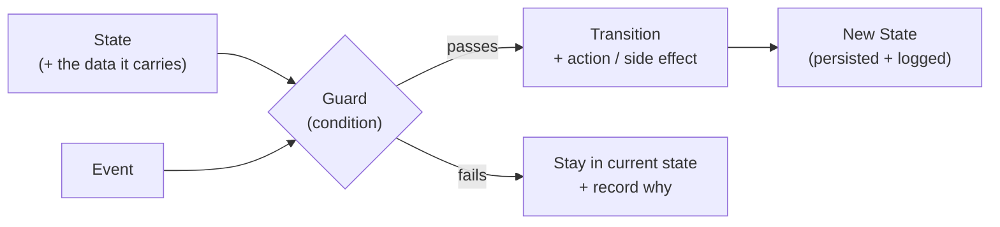
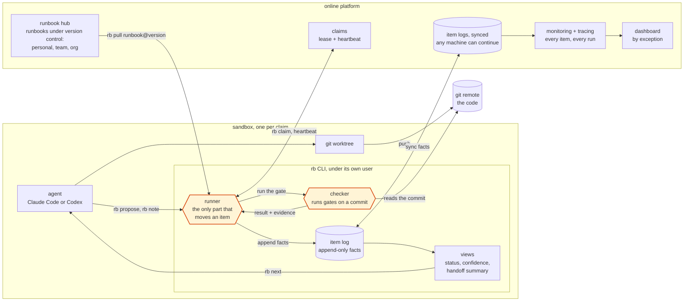
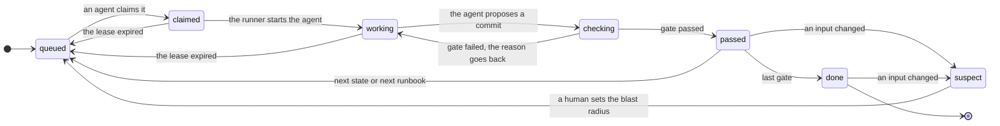
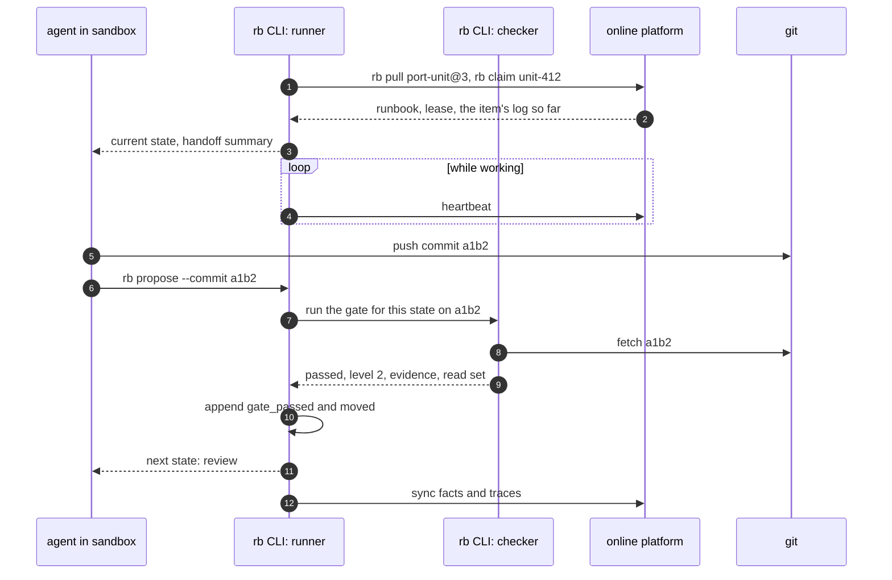

## Overview of State

**State** is what a system knows about where it is right now: the step it is on, and the data it carries with it.

Every part of an AI system has state:

- A **workflow** is on some step.
- A **request** is awaiting approval or not.
- A **model version** is active or deprecated.
- An **agent** has made some amount of progress.

Most production failures trace back to state that:

- changed without a clear reason,
- changed without a record, or
- lived somewhere nobody owned.

---

### The Core Model

> A state changes only when an **event** arrives and a **guard** allows it.



| Part | What it is | Example |
|---|---|---|
| **State** | Where the system is now, plus the data it holds | `awaiting_review`, with the draft attached |
| **Event** | Something that happened and asks for a change | Reviewer clicks approve |
| **Guard** | The condition that must hold for the change to be allowed | Reviewer has authority for this risk level |
| **Transition** | The move itself, and any action it triggers | Publish the document, send a notification |
| **New State** | Where the system ends up, saved so it survives restarts | `published` |

---

### Two Rules That Hold the Model Together

**1. A failed guard means no move.**
The system stays where it is and records why. This is the fail-safe default: decisions are based on permission, not on the absence of a reason to refuse.

**2. Every transition is persisted and logged.**
If you cannot reconstruct how the system reached its current state, you cannot debug it, audit it, or resume it.

---

### Where the Risk Lives

> **The action on a transition is where the risk lives.**

A state label is harmless. Sending an email, writing to a database, or calling a tool may not be reversible. This is why human review is routed by **stakes** and **reversibility**.

##  My Concerns

I think the state of the object or a work can be hidden from what we can see. And what is see can be not true or don't reflect the real state underneath.

- ***Seen state versus real state.** An agent never holds the real state, only a belief about it ([Kaelbling, Littman & Cassandra 1998](https://people.smp.uq.edu.au/YoniNazarathy/Control4406_2014/resources/KaelblingLittmanCassandra1998.pdf), POMDP belief state). Even the model's reasoning text can leave out what really drove its answer ([Turpin et al. 2023](https://arxiv.org/abs/2305.04388)). Insight: treat every status as an estimate, and record where it came from.*
  - The most likely state "is not sufficient in general." A belief is a probability over states, and an agent that is lost "might" take "sensing actions," like reading a map.
  - In Turpin's study, only 1 of 426 explanations for biased answers mentioned the bias. So an agent's own report is never proof. Only a check that someone else runs counts.
  - Checking has a price. It pays only when knowing is worth more than the check costs, so run cheap checks often and expensive ones when it matters.
  - A good summary is enough. Kaelbling calls a well-computed belief "a sufficient statistic for the past history," so the next agent needs the summary, not the whole log.
  - Limit: the paper's belief is exact only with a correct model of the world and one agent. Use it as a way to think, not as machinery to run.

I am also curious about these questions:

- The characteristics of state, and what manipulations we can do with it?
  - ***The verbs of state.** Read, write, fork, merge, snapshot, rollback, replay. Each verb needs a different guarantee. For merge, link back to [State Engineering](/blogs/blog/state-engineering/) instead of repeating it.*
  - **Read** comes from a view that says how sure it is. A "no" from an old snapshot is already out of date.
  - **Write** only adds facts, and each kind of fact has one kind of writer. The agent proposes, and something else decides. GitHub Agentic Workflows writes this into its work-queue docs: "Assignment input, a successful Actions run, or an output artifact alone cannot establish authority or Result."
  - **Fork** makes a new item with a link to its parent. **Merge** follows the write rules, and a collision becomes a conflict for a human.
  - **Snapshot, rollback, and replay** belong to the last question below.
  - Insight: most of these verbs are safe only because facts are never edited.

- How does state transition from one step to the next, and what triggers each move?
  - ***What triggers a transition.** An event, a guard condition, a timer, or a new observation ([Harel 1987, statecharts](https://web.archive.org/web/2015/http://www.inf.ed.ac.uk/teaching/courses/seoc/2006_2007/resources/statecharts.pdf): states with hierarchy, concurrency, communication). Insight: a move without a named trigger is only an agent's opinion. This echoes "demote by dependency, never by opinion" in State Engineering.*
  - Harel's rule: "when event α occurs in state A, if condition C is true at the time, the system transfers to state B." The condition is checked only when the event arrives. If it is false, the event is simply dropped. So every gate needs an explicit trigger and an explicit fail branch.
  - Harel splits instant actions from activities that "take some time." The agent's work is an activity that the runner starts and stops, and the agent's "I'm done" must come back as an event.
  - A timeout belongs to the state. It can be a limit (give up after two hours) or a minimum wait.
  - Careful with two words. In a statechart, depth means one exit that covers all the inner states, not "call a child runbook." And history means pause and resume, not crash recovery.

- How we can maintain state of work cross sessions, agents, and machines?
  - ***One state across sessions, agents, and machines.** No one can read a distributed system all at one instant. [Chandy & Lamport 1985](https://www.cs.princeton.edu/courses/archive/fall17/cos418/papers/chandy_lamport.pdf) record a global state that may never have existed at one moment. It is still consistent with the order of messages, and that is enough for checkpoints.*
  - It is also enough for **stable properties**: "once a stable property becomes true it remains true thereafter." So "has this ever passed?" is safe to read from a snapshot, but "is this still valid now?" needs a fresh check. This is the same split as "ever passed" and "currently valid" in State Engineering.
  - The snapshot must "run concurrently with, but not alter" the work. A dashboard should never pause the agents to look at them.
  - Messages in flight are part of the state. An item being handed between agents must be counted once: held by one agent, in transit, or held by the next.
  - Insight: state belongs to the work, not the session. Yegge says the same about Gas Town: "an agent is not a session."

- Snapshot and replay: can we save state, roll it back, and run it again?
  - ***Snapshot and replay with an unpredictable worker.** You can't re-run an LLM and get the same output twice. Durable execution ([Temporal](https://docs.temporal.io/workflows)) records each call's result and replays the history instead of calling again. Insight: replay the record, not the model. Rollback is cheap for files (git) and hard for side effects like a sent email.*
  - Temporal calls its event history "the source of truth," and it "doesn't restore memory from a snapshot." It replays the history. Its docs list "LLM invocations" among the calls whose result is "reused, not recomputed."
  - So a snapshot is a position in the log, not a copy of memory.
  - Rollback adds a fact and never deletes one. Files go back with git. A side effect outside git needs its own undo step.
  - A long-running item must remember which version of the runbook it ran under, the way Temporal versions workflows that run for months or years.

- ***Personal thought, an open question.** How can an agent notice that its belief has drifted from the real state before someone else does?*
  - *A first answer, still open: mark an item suspect when something it read has changed, and run cheap checks again on a schedule. But that only catches drift in what was recorded. The world outside the log stays hidden.*

## My vision: a state CLI and an online platform

I think the next step is a system that owns the state, so the agents don't have to. It has two parts, and they do different jobs.

The first part is a **CLI** that keeps the state and changes it. It runs where the work runs, in the sandbox next to the agent. **State belongs to the work item, not to the workflow or the agent.** One migration unit may pass through a port runbook, then a review runbook, then a release runbook, handled by different agents on different machines. The CLI keeps a log of facts for it: what passed, against which runbook version, with what evidence. The platform keeps a copy of that log, so the next agent, on any machine, continues the same log. The status is just a view over that log, so snapshot and replay come for free. The CLI also runs the steps. **The agent proposes, and the CLI decides.** A rule engine inside it owns the moves between steps, and the agent can only ask to move. The CLI should stay thin, though. It stores only what git doesn't hold, and points to commits instead of copying them, because the repo is still its own best state.

The second part is an **online platform**, and it has several jobs. One of them is the **runbook hub**. A runbook is a workflow written down once: the steps, the check at each gate, and who may write which part of the state. The hub keeps runbooks under version control at three scales, like packages in a registry: light ones for one person, shared ones for a team, and versioned, audited ones for an organization. The CLI pulls a runbook from the hub at a fixed version. The platform is also where the work is watched. Every CLI sends its facts and traces up, so one dashboard shows every item, and a person only opens the ones that failed or are waiting for approval.

Parts of this already exist. [StateM](https://github.com/henryqin1997/statem) checks steps and gates for one long agent run, but the agent can get around them. [Gas Town](https://steve-yegge.medium.com/welcome-to-gas-town-4f25ee16dd04) and its successor, Gas City, keep work state across many agents, but they trust the agent's own report. [GitHub Agentic Workflows](https://github.github.com/gh-aw/) runs agents in a sandbox and checks every write before it lands, but only on GitHub Actions. What I haven't found is a work item whose log of facts spans many runbooks, with the runbook version stamped on each fact, checked by a runner the agent can't touch, and a hub that shares runbooks at all three scales.

One question I can't answer yet. [State Engineering](/blogs/blog/state-engineering/) says you don't know the steps of a piece of work when you start. So can a runbook fix the gates without fixing the path?

## From questions to a design

The vision ended on an open question. This design is my bet on the answer, and the first build below is how to test it. Each question above turns into one part of the design. Most of them land in the CLI, because that is where the state lives. Here is the map from question to rule to the part that enforces it:

| Question | Design rule | Part that enforces it |
| --- | --- | --- |
| Seen state versus real state | Every status is an estimate with a confidence level and a pointer to its evidence. An agent's own claim never passes a gate. | CLI: the views and the checker |
| The verbs of state | Read, write, fork, merge, snapshot, rollback, and replay are CLI commands, each with its own rule. Facts are only added, never edited. | CLI: the item log |
| What triggers a transition | A move needs a named event and a gate that passes at that moment. Every gate has a fail branch. | CLI: the runner |
| One state across sessions, agents, and machines | State belongs to the work item. An item has one holder at a time, through a claim that expires. Facts sync to the platform. | platform: claims and synced logs |
| Snapshot and replay | A snapshot is a position in the log. Replay rebuilds views from recorded facts and never calls the model again. | CLI: the item log |
| How an agent notices drift | When an input changes, the items that depend on it become **suspect**. Cheap checks run again on a schedule. | CLI: the runner, told of changes by the platform |

### The parts



- **The `rb` CLI** keeps the state and changes it. It holds the item log, the views, the runner, and the checker. Every verb of state is one of its commands: `rb claim`, `rb next`, `rb propose`, `rb snapshot`, `rb replay`, `rb revert`, `rb fork`.
- **The runner** is the only part that moves an item. The agent calls `rb` like any command, but the CLI keeps its log and runs its checks as a separate process under its own user, so the agent can ask but cannot write. This is the lesson from [StateM](https://github.com/henryqin1997/statem), whose checks run in the agent's own shell and can be skipped.
- **The checker** runs each gate against a commit, not against the agent's working copy. It records what it read, so a later change can be traced back.
- **The item log** is the source of truth. Status, confidence, and the handoff summary are all views computed from it.
- **The online platform** has several parts. The **runbook hub** is one of them: it keeps runbooks under version control, stored by content hash, at three scopes: personal, team, and organization. The platform also hands out claims, because giving out work is the one thing that needs coordination across machines. It keeps a synced copy of every item log, so a claim on another machine starts from the same facts. And it collects the facts and traces from every CLI, for monitoring, tracing, and a dashboard that shows only what needs a person.
- **Git** keeps the code. Neither part copies it. They only store pointers to commits, because the repo is still its own best state.

### A runbook fixes the gates, not the path

A runbook is a statechart. Each state is a milestone with an exit gate. The text inside a state is a hint, not a fixed path, so the agent can find its own way to the gate. Unlike [Gas Town](https://steve-yegge.medium.com/welcome-to-gas-town-4f25ee16dd04), which fixes the steps and lets agents judge the work, this fixes the judgment and lets the agent choose the steps.

```yaml
runbook: port-unit
version: 3                  # the runbook hub stores it by content hash
initial: plan
inputs: [rules/port.md, fixtures/]   # a hint for the checker about what to watch
states:
  plan:
    hint: "Read the old unit and write plan.md."
    exit:
      gate: { run: "test -s plan.md", level: 1 }
      on_pass: implement
      on_fail: plan
  implement:
    hint: "Port the unit. Propose when you think it works."
    timeout: 2h
    exit:
      gate: { run: "pytest -q tests/unit_412", level: 2 }
      on_pass: review
      on_fail: implement
  review:
    exit:
      gate: { human: approve }
      on_pass: done
      on_fail: implement
  done: { final: true }
writes:
  agent:  [proposed, note, heartbeat]
  runner: [gate_passed, gate_failed, moved, suspect]
  human:  [approved, blast_radius]
```

Three rules come from [Harel](https://web.archive.org/web/2015/http://www.inf.ed.ac.uk/teaching/courses/seoc/2006_2007/resources/statecharts.pdf). A gate is checked only when an event arrives, so the agent must send a `proposed` event. Every gate needs a fail branch, or a failed check just disappears. And the agent's work is an activity that the runner starts and stops. The `writes` block is the Authority rule from [State Engineering](/blogs/blog/state-engineering/): each kind of fact has exactly one kind of writer.

### The log of facts

Every fact is one line, added and never changed:

```json
{"item": "unit-412", "seq": 57, "at": "2026-11-04T10:12:03Z",
 "type": "gate_passed", "by": "runner",
 "runbook": "port-unit@sha256:ab12", "state": "implement", "level": 2,
 "evidence": {"commit": "a1b2c3", "run": "ci#88",
              "read": ["rules/port.md@v7", "fixtures@3f9"]}}
```

The `by` field matters most. A `proposed` or `note` fact from an agent is kept for the record, but it never satisfies a gate. Only the runner writes `gate_passed`. The `read` field is the dependency edge: when `rules/port.md` changes, the platform finds every item that read the old version, and each item's runner marks it `suspect`. The runbook's `inputs` list is only a hint. What marks an item suspect is what the checker actually read, recorded in `read`, because a hand-written list can leave things out.

### The life of one work item



An item always has exactly one holder: the queue, one claim, or the checker. So an item being handed between agents is counted once, never twice and never zero times, which is the lesson from [Chandy and Lamport](https://www.cs.princeton.edu/courses/archive/fall17/cos418/papers/chandy_lamport.pdf). When a lease expires, the item goes back to the queue, and the next agent starts from the handoff summary, not from the whole log. If the lease expired while a gate was running, the fail reason is stored on the item, so the next agent sees it in the summary.

### One step, end to end



### Snapshot, replay, and rollback

- **Snapshot** is a position in the log. It safely answers stable questions, like "has this ever passed?" or "is this run done?" A question like "is this still valid now?" always needs a fresh check.
- **Replay** rebuilds every view from the log. Agent output is recorded as commits and facts, so replay never calls the model again, the same idea as [Temporal](https://docs.temporal.io/workflows).
- **Rollback** adds a `reverted` fact and runs `git revert`. Nothing is deleted. A side effect outside git, like a sent email or a deploy, needs its own undo step in the runbook.
- **Fork** creates a new item with a link to its parent. **Merge** follows the `writes` rules. If two writers collide on the same fact, the CLI records a conflict for a human to settle.

### What to build first

1. **v0, the CLI on one machine:** one runbook in a local file, the item log in SQLite, and the `rb` CLI running its runner and checker under its own user, with its own git clone. Add a Claude Code hook that reminds the agent to propose instead of declaring itself done. This proves the agent can't skip a gate. It also tests the open question: does the agent reach each gate when the runbook gives only hints, not a fixed path?
2. **v1, the platform:** a small web service with the runbook hub, so the CLI pulls runbooks by version, and with monitoring, so every CLI sends its facts and traces to one dashboard that shows only failures and items waiting for approval. This proves the platform.
3. **v2, many machines:** claims with leases and heartbeats from the platform, and inputs that mark items suspect. Two agents on two machines carry one item through several runbooks. This proves state across agents and machines.

Don't write it all from scratch:
- From [StateM](https://github.com/henryqin1997/statem) (Apache-2.0): the order of checks before a move, and its check types.
- From [GitHub Agentic Workflows](https://github.github.com/gh-aw/): the pattern of "propose, then a separate job checks and applies."
- From [Beads](https://github.com/gastownhall/beads): the lease and heartbeat rules.

## References

- [Planning and acting in partially observable stochastic domains](https://people.smp.uq.edu.au/YoniNazarathy/Control4406_2014/resources/KaelblingLittmanCassandra1998.pdf) - Kaelbling, Littman, and Cassandra (1998). An agent that can't see the whole world keeps a **belief**: a probability over the states it might be in, updated from what it did and what it saw. The single most likely state is not enough. What I learn: a status in the CLI is an estimate, not a fact. It should say how sure it is and where the evidence came from, and it should be checked again only when knowing is worth more than the check costs.

- [Language Models Don't Always Say What They Think: Unfaithful Explanations in Chain-of-Thought Prompting](https://arxiv.org/abs/2305.04388) - Turpin et al. (2023). A model's step-by-step explanation can sound right and still leave out what really drove its answer. Of 426 explanations for biased answers, only one mentioned the bias. What I learn: an agent's own report is never evidence. Only checks that the runner runs itself should count.

- [Statecharts: A Visual Formalism for Complex Systems](https://web.archive.org/web/2015/http://www.inf.ed.ac.uk/teaching/courses/seoc/2006_2007/resources/statecharts.pdf) - Harel (1987). State diagrams stay readable for big systems once you add depth, parallel parts, and signals between them. A move happens when an event arrives and a condition holds at that moment. Long activities are started and stopped by instant actions. What I learn: a runbook can be written as a statechart. Each gate needs a trigger and a fail branch, and the agent's work is an activity that the runner starts and stops.

- [Distributed Snapshots: Determining Global States of Distributed Systems](https://www.cs.princeton.edu/courses/archive/fall17/cos418/papers/chandy_lamport.pdf) - Chandy and Lamport (1985). You can record a consistent picture of many processes without stopping them. The picture may match no real moment, but it is safe for **stable properties**, the ones that stay true once they become true. What I learn: a dashboard can answer "has this ever passed?" from a snapshot, but "is this still valid now?" needs a fresh check.

- [Temporal Workflow](https://docs.temporal.io/workflows) - Temporal's docs. The event history is the source of truth. After a crash, the code replays the history, and calls to the outside world, including LLM calls, run once and their results are reused, not recomputed. What I learn: replay the record, never the model.

- [State Engineering](/blogs/blog/state-engineering/) - My earlier post. You don't know the steps of a piece of work when you start, so you declare where the state lives, who may write which part, and what makes an entry expire. What I learn: this post starts where that one stops, with what we can actually do with state.

- [StateM](https://github.com/henryqin1997/statem) - A command-line runbook for long agent runs: states, allowed moves, and checks that must pass before each move, with a saved history. What I learn: the shape is right, but the checks run inside the agent's own shell, so the agent can get around them. The runner must live where the agent can't reach it.

- [StateM: Reaching 95.3% Raw Accuracy, or a $15 Frontier Run, on Terminal-Bench 2.1 via Harness Scaling](https://arxiv.org/abs/2608.15089) - The StateM paper. Moving the state out of the model and checking each move makes the same models score higher, without new training. What I learn: structure outside the model pays off, but these results come with a runbook tuned for the benchmark.

- [Welcome to Gas Town](https://steve-yegge.medium.com/welcome-to-gas-town-4f25ee16dd04) - Steve Yegge's post on running 20 to 30 coding agents at once. Work is a fixed chain of steps stored as issues in git, so it survives crashes, and the outcome is "guaranteed" even though the path is not. What I learn: Gas Town fixes the path and guarantees that work finishes, not that it is right. My idea is the inverse: fix the gates, and loosen the path.

- [Gas Town: from Clown Show to v1.0](https://steve-yegge.medium.com/gas-town-from-clown-show-to-v1-0-c239d9a407ec) - Yegge's follow-up. Gas Town is now in maintenance mode, and new work goes to its successor, Gas City, where you can build your own orchestrators from the same parts. What I learn: even the person who built it moved from one fixed orchestrator to a kit of parts.

- [Beads](https://github.com/gastownhall/beads) - The issue tracker under Gas Town, built for agents and synced through git. It has claims that expire, typed links between items, and a view of the work that is ready. What I learn: a claim with a time limit and a heartbeat is the right way to hand work between agents.

- [GitHub Agentic Workflows](https://github.github.com/gh-aw/) - Agent workflows written in markdown and run on GitHub Actions, in a locked-down container. The agent only proposes its writes, and a separate job checks them and applies them. What I learn: this is the clearest working example of "the agent proposes, the runner decides."
