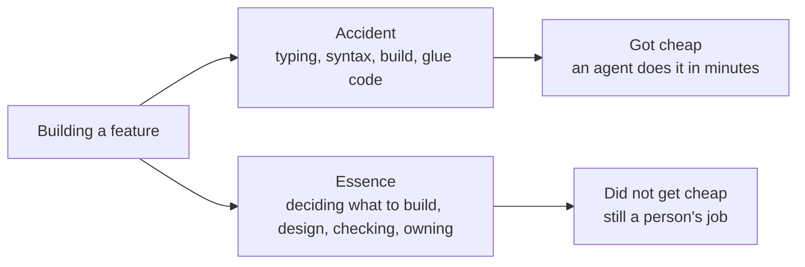
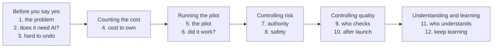
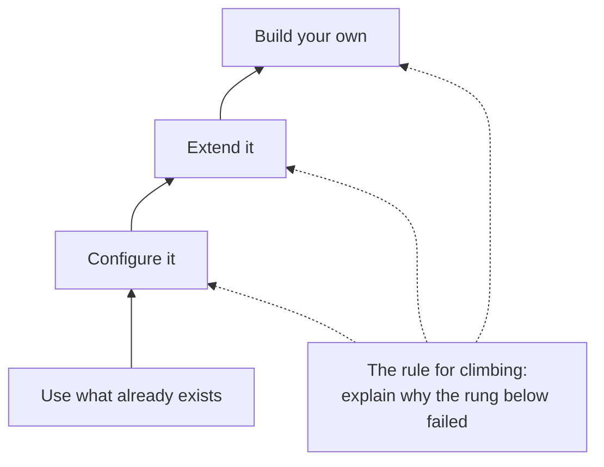
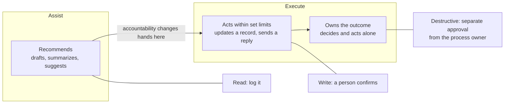
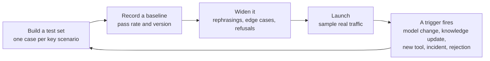

A feature that used to take an afternoon now takes an agent twenty minutes. For a few years that was my problem to enjoy. Now it is a different problem. People bring me a project and ask whether we should put AI in it. I have to say yes or no, and then live with the answer.

Fred Brooks saw this coming in 1986. In [No Silver Bullet](https://worrydream.com/refs/Brooks_1986_-_No_Silver_Bullet.pdf) he split software work into the **essence**, the ideas and rules a program must get right, and the **accident**, the labor of typing those ideas into a machine. Then he said which part is hard: "the specification, design, and testing of this conceptual construct, not the labor of representing it." Agents made the labor cheap. The essence is now the whole job. And the first piece of it is the one he called hardest: "deciding precisely what to build."

This post is the list I keep for that job. Twelve questions I ask before and after I say yes to AI in a project. The first ten each have a reason from the fundamentals of our field and a reason from Microsoft's own guidance for people who make this decision, with links to go deeper. The last two are my own, and they lean on older thinkers instead. I wrote it to use, not to admire. If you only have five minutes, read the table near the end.

One honesty note before the list. Two kinds of Microsoft sources appear here. The [Cloud Adoption Framework](https://learn.microsoft.com/en-us/azure/cloud-adoption-framework/ai/strategy), the [Well-Architected Framework](https://learn.microsoft.com/en-us/azure/well-architected/ai/), and the [Agents hub](https://learn.microsoft.com/en-us/agents/) are official documentation. The [Microsoft AI Decision Framework](https://microsoft.github.io/Microsoft-AI-Decision-Framework/) is a practitioner's guide published on Microsoft's GitHub. It says itself that Microsoft's AI products change weekly and that production decisions should be checked against official sources. I quote it because its sentences are the sharpest, and I say which is which.

## Part one: before you say yes

### 1. What is the problem, before AI?

Microsoft's [planning guide](https://learn.microsoft.com/en-us/azure/cloud-adoption-framework/ai/plan) opens with a sentence I wish every request came with: start with business problems, and look for where results miss expectations "before you consider AI at all."

Most requests arrive as a solution. Someone asks for a chatbot because a chatbot is the solution they can picture. Users know what they want. They rarely know what their problem is. So go and watch the work first. Maybe staff cannot find the answer. Maybe they find it in seconds and then wait a day for a manager's approval. A chatbot fixes one of those and does nothing for the other. The people doing the work know where the delay is.

Then measure the work as it is today: how long each case takes, how many are finished, how many come back. Without that number there is nothing to compare against later, and every result will look like success. The [business plan guidance for agents](https://learn.microsoft.com/en-us/azure/cloud-adoption-framework/ai-agents/business-strategy-plan) says the same thing in one line: record today's performance to create a baseline, before any development begins.

> **Lesson:** describe the delay or the loss before you describe the tool. If you cannot name what gets better, you are not ready to build.

Go deeper:

- [Plan for AI adoption](https://learn.microsoft.com/en-us/azure/cloud-adoption-framework/ai/plan). Business problems first, then use cases, then an honest look at skills and data.
- [Business plan for AI agents](https://learn.microsoft.com/en-us/azure/cloud-adoption-framework/ai-agents/business-strategy-plan). When not to use an agent, how to score ideas, how to set a baseline.
- [AI adoption overview](https://learn.microsoft.com/en-us/azure/cloud-adoption-framework/ai/strategy). The executive view: where AI creates value and whether that value justifies the investment.

### 2. Does it need AI at all, and does something already exist?

The Decision Framework has a rule I now repeat in every meeting: ["never lead with a product."](https://microsoft.github.io/Microsoft-AI-Decision-Framework/docs/decision-framework.html) Result first, then the situation, then how the system should behave. The technology comes last.

It also asks a checkpoint question before any of that: does this need an agent? If the steps are fixed and the input is structured, ordinary code is cheaper and more reliable. If people just need to find a document, that is search. For numbers, the [scenarios page](https://microsoft.github.io/Microsoft-AI-Decision-Framework/docs/scenarios.html) is blunt about language models, or an LLM in its words: "if the problem has a numerically correct answer, an LLM is the wrong tool for producing it." A model is good at reading messy input. It is not a calculator and not a database. Microsoft's official [agent business plan](https://learn.microsoft.com/en-us/azure/cloud-adoption-framework/ai-agents/business-strategy-plan) draws the same line: agents earn their place when the task needs multistep decisions, many tools in a flexible order, or messy input that must be interpreted.

Then there is a ladder, roughly: use something that exists, configure it, extend it, and build only at the top. The honest part is the rule for climbing. You must be able to explain why each rung below failed. If you cannot, you are not building because you need to. You are building because building got cheap. One more line from the same page is worth keeping: "Audition the soloist before you hire the orchestra." One agent with good tools, before any talk of several.

> **Lesson:** explain why plain code, search, and an existing product all failed before you fund a model.

Go deeper:

- [Decision method](https://microsoft.github.io/Microsoft-AI-Decision-Framework/docs/decision-framework.html). The intake questions, the ladder, and the nine questions that sort a problem before any product is named.
- [Capability model](https://microsoft.github.io/Microsoft-AI-Decision-Framework/docs/capability-model.html). Outcomes, then behavior, then platform. The five parts of any agent: model, instructions, retrieval, actions, memory.
- [Scenarios](https://microsoft.github.io/Microsoft-AI-Decision-Framework/docs/scenarios.html). Eleven common situations and the signal that tells you which way to go.
- [AI agent adoption](https://learn.microsoft.com/en-us/azure/cloud-adoption-framework/ai-agents/). Official definitions of agent types, from retrieval to action to automation.

### 3. Which decisions will be hard to undo?

Here is the point from my own notes that survived every rewrite. The real solution is rarely the framework or the hosting service. It is the part that is hard to change later: the data model, the boundaries between systems, who owns what, and the business rules. Tools can be swapped. Those cannot.

David Parnas said this in 1972, in the paper that gave us [information hiding](https://en.wikipedia.org/wiki/Information_hiding). Split a system around the design decisions most likely to change. Hide each one behind a stable boundary. Then changing one decision does not force everything else to change. That is still the best advice I know for deciding where a senior's attention goes. Spend it on decisions that are hard to undo. Let the agent produce the cheap, throwaway parts: screen drafts, glue code, prototypes.

My working order is design top-down and build bottom-up. Start from the business workflow, then the user's experience, then the logic, then the data. Build the other way, in thin slices: data, then logic, then screen, with enough real data and real connections to test where one piece hands work to the next. A working screen alone proves nothing.

Work items are now the agent's input. A user story or a task with clear acceptance criteria is something an agent can build and a person can check. When the agent produces exactly what the ticket says and the result is useless, inspect the ticket. Bugs, change requests, and incidents are the signal that the specification was wrong.

> **Lesson:** spend your attention on what is expensive to reverse. Let the agent spend its tokens on what is cheap to throw away.

Go deeper:

- [Information hiding](https://en.wikipedia.org/wiki/Information_hiding). Parnas, 1972. Modules around the decisions likely to change.
- [Design principles for AI workloads](https://learn.microsoft.com/en-us/azure/well-architected/ai/design-principles). Microsoft's official list across reliability, security, cost, operations, and performance.
- [Grounding data design](https://learn.microsoft.com/en-us/azure/well-architected/ai/grounding-data-design). The data decisions that outlive the model.

## Part two: counting the cost

### 4. What will it cost to own, not to build?

Here is the trap inside the word "cheap." In 1865 the economist William Jevons watched steam engines become far more efficient while everyone around him expected England to burn less coal. It burned more, and he explained why: cheaper coal found more uses. His line still applies: ["It is a confusion of ideas to suppose that the economical use of fuel is equivalent to diminished consumption."](https://en.wikipedia.org/wiki/Jevons_paradox)

Code behaves like coal. When a feature costs twenty minutes, we ask for twenty features, and every one still has to be read, run, kept working, and understood. Dijkstra said in 1988 that we count lines of code [on the wrong side of the ledger](https://www.cs.utexas.edu/~EWD/transcriptions/EWD10xx/EWD1036.html): they are not "lines produced" but "lines spent." The Decision Framework's [capability model](https://microsoft.github.io/Microsoft-AI-Decision-Framework/docs/capability-model.html) puts it in four words: "Building got cheap. Owning didn't."

The same page pictures every agent as a coin. One side is the demo: visible, interactive, easy to show in a meeting. The other side runs in the background with nobody at the keyboard, and that side is what changes the operating cost. The demo gets the project approved. The other side is what you own. So I budget the two separately. The [evaluation criteria](https://microsoft.github.io/Microsoft-AI-Decision-Framework/docs/evaluation-criteria.html) page adds two warnings I had not thought of: a system that charges per call quietly tempts you to test less, so budget the testing as its own line, and an agent in a loop can spend a month's budget in a few hours, so set spending caps before launch.

| The side you see | The side you own |
| --- | --- |
| The demo in the meeting | The job that runs with nobody at the keyboard |
| One happy case | The odd cases, retries, and exceptions |
| The cost to build | The cost to run: usage, checking, fixing, and the owner's time |
| "It works" | The cost of one outcome that met the standard |

The number I want is simple: the total cost of one outcome that met the agreed standard, with the checking and the fixing included. Count only the cases that met the standard. Keep the rejected and unfinished ones visible, or dropping the hard cases will make the average look good. The official [design principles](https://learn.microsoft.com/en-us/azure/well-architected/ai/design-principles) name what drives the cost: how much data, how many questions, how much load at once, and the hidden cost of the services you depend on. And remember that staff time freed by AI is capacity, not cash. It becomes a saving only if spending actually falls, or if someone names what the freed hours will now do.

> **Lesson:** price the side of the coin nobody watches. Cost per good outcome, checking included, build and run budgeted apart.

Go deeper:

- [Evaluation criteria](https://microsoft.github.io/Microsoft-AI-Decision-Framework/docs/evaluation-criteria.html). Cost of owning across licenses, usage, and engineering hours. Build and run as separate budgets. Caps and alerts.
- [Manage AI: costs](https://learn.microsoft.com/en-us/azure/cloud-adoption-framework/ai/manage#manage-ai-costs). Official guidance on usage monitoring, thresholds, and budget alerts.
- [Design principles: cost](https://learn.microsoft.com/en-us/azure/well-architected/ai/design-principles#cost-optimization). "Pay for what you intend to use. Use what you pay for."
- [Start at the Cheap End](/blogs/blog/start_at_the_cheap_end/). My own ordering of the ways to make an agent cheaper and better, cheapest first.

## Part three: running the pilot

### 5. How do we run the pilot?

A pilot is not a demo. A demo shows that something can work once. A pilot finds out what it costs to work every day. The official [planning guide](https://learn.microsoft.com/en-us/azure/cloud-adoption-framework/ai/plan) gives the shape I follow: pick a high-value case that matches the skills you actually have, start with internal work that does not face customers, and use what the pilot teaches you to estimate the real timeline. It also says to add a buffer for learning and surprises, and I have never regretted that line.

The [agent business plan](https://learn.microsoft.com/en-us/azure/cloud-adoption-framework/ai-agents/business-strategy-plan) adds the rule I now treat as the whole point of a pilot: "Pilot the hardest steps." If the agent succeeds there, the easy steps will follow. If you pilot the easy steps, you learn nothing you did not already know. The same page says to use business numbers to decide, at each stage, whether to go on or stop, and to make that choice "based on the data, not assumptions or optimism."

So before the pilot starts, I write three things down. What result would make us expand. What would make us change the design. What would make us stop. Which cases we test, how long we watch, and which failures we will not accept are all decided before anyone looks at results. Then the pilot runs on real cases, including the awkward ones, and the people who will own it afterwards are in the room from the first week.

The Decision Framework's [implementation patterns](https://microsoft.github.io/Microsoft-AI-Decision-Framework/docs/implementation-patterns.html) make one more point I like. Most real systems start in one shape and move to another as the requirements settle. Plan the move. A pilot that cannot grow into the real thing teaches you less than it seems.

> **Lesson:** pilot the hardest step, on real cases, with the stop condition written before you start.

Go deeper:

- [Plan for AI adoption: proof of concept](https://learn.microsoft.com/en-us/azure/cloud-adoption-framework/ai/plan#create-ai-proof-of-concepts). Pick the case, start internal, use the results to estimate.
- [Business plan for AI agents: success metrics](https://learn.microsoft.com/en-us/azure/cloud-adoption-framework/ai-agents/business-strategy-plan#define-success-metrics). Baseline, decision gates, measurement after launch.
- [Implementation patterns](https://microsoft.github.io/Microsoft-AI-Decision-Framework/docs/implementation-patterns.html). Common starting shapes and the signals that tell you to move.

### 6. How will we know it worked?

If AI made the work cheaper, we should be able to show where the time went. Usually we cannot, because we trust how it feels.

In early 2025, [METR](https://arxiv.org/abs/2507.09089) randomly assigned real tasks to experienced open-source developers, with and without AI. They finished about a fifth slower with AI. They believed they had been about a fifth faster. Same people, same work, opposite numbers. In its [February 2026 update](https://metr.org/blog/2026-02-24-uplift-update/), METR says developers likely get more help from AI than they did in early 2025. Its new numbers lean toward a speedup but are too noisy to be sure, and it calls its own data "only very weak evidence" for how large the change is.

The other side exists too. A study of over five thousand [customer support workers](https://arxiv.org/abs/2304.11771) found AI help raised issues resolved per hour, with the gain going mostly to the newest workers. So for individuals AI can be a leveler. For organizations, [DORA's 2025 report](https://dora.dev/research/2025/dora-report/) calls it an amplifier: a strong system gets stronger, a weak one is exposed. The two findings do not agree, and that is the point.

| Study | Who was measured | What it found | What I take from it |
| --- | --- | --- | --- |
| [METR, early 2025](https://arxiv.org/abs/2507.09089) | Experienced open-source developers on their own projects, tasks assigned at random | About a fifth slower with AI, while believing they were a fifth faster | Feelings are not measurement |
| [METR, February 2026](https://metr.org/blog/2026-02-24-uplift-update/) | A larger group, same design | Leans toward a speedup, but too noisy to be sure: "only very weak evidence" | When people refuse to work without AI, the measurement itself breaks |
| [Generative AI at Work](https://arxiv.org/abs/2304.11771) | Over five thousand customer support workers | More issues resolved per hour, with the gain mostly for the newest workers | For individuals, AI can be a leveler |
| [DORA 2025](https://dora.dev/research/2025/dora-report/) | Software organizations | AI amplifies what is already there | For teams, the system around the tool decides the result |

None of these is a number to paste into a business case. Together they are one instruction: measure in your own setting. Compare against the baseline from question 1: similar cases, with and without the tool. Look at the slow cases, not just the average. Give delayed failures time to appear. Count total human effort, time to the final outcome, quality failures, and cost. And here is the habit from my own notes that I think matters most: most teams track cost, time, token use, and tickets closed. Few check whether the output is right. Check the progress, not just the bill.

> **Lesson:** faster is a measurement, not a mood. If you cannot show where the saved time went, you have not saved it yet.

Go deeper:

- [Govern AI: monitor risks](https://learn.microsoft.com/en-us/azure/cloud-adoption-framework/ai/govern#4-monitor-ai-organizational-risks). An official measurement plan that mixes numbers with what users and reviewers say.
- [Agent evaluation checklist](https://learn.microsoft.com/en-us/agents/agent-evaluation/evaluation-checklist). Its test for success: you can answer with specifics "instead of saying: 'The agent seems okay.'"
- [DORA 2025](https://dora.dev/research/2025/dora-report/). Why the same tool helps one team and hurts another.

## Part four: controlling risk

### 7. How much may it do alone, and who answers for it?

The capability model separates three levels of trust: the system **recommends**, it **acts within set limits**, or it **owns the outcome**. The line between the first two is where accountability changes hands, and that line is the real design decision. The page says it in one sentence: "Capability is a demo. Authority is a liability."

The official [agent governance guide](https://learn.microsoft.com/en-us/agents/center-of-excellence/govern-agents-risk) draws the same line and gives it a name: the assist-to-execute line. An agent that drafts a reply assists a person who stays in charge. An agent that sends the reply, updates a record, or moves money makes a change in a system the business treats as the truth. "Sort every agent by what it does, not by how impressive it looks." It then sets three risk tiers. Low risk needs a named owner, basic monitoring, and a release checklist. Medium risk adds an expert who confirms the answers are right and a formal gate before going live. High risk adds a process owner, a security and responsible-AI review, written decision rights about what the agent may decide alone, and an incident plan.

| Risk tier | What the agent does | What it needs before it ships |
| --- | --- | --- |
| Low | Summarizes, drafts, or searches for one person or a small team | A named owner, basic monitoring, a release checklist |
| Medium | Answers domain questions or runs an internal service where a wrong answer misleads people | All of the above, plus an expert who confirms the answers, monitoring of the knowledge it reads, and a formal gate before going live |
| High | Sits in a core process, faces customers, or takes consequential actions | All of the above, plus a process owner, a security and responsible-AI review, written decision rights, an incident plan, and a regular review |

So I decide, per action, what the system may do. Reading can be logged. Writing needs a person to confirm. Anything destructive needs approval through a separate channel, from someone who owns the process. Every production duty gets a [named owner](https://microsoft.github.io/Microsoft-AI-Decision-Framework/docs/evaluation-criteria.html). I split it in two: one for the business result and one for keeping the service alive. The decision page gives the test I use at the end: "An agent you cannot see, attribute, or switch off is not in production."

This is also where leadership comes in, and the official [strategy page](https://learn.microsoft.com/en-us/azure/cloud-adoption-framework/ai/strategy) keeps it to three moves. Leaders say what AI is for and how they will measure it. One central group writes the rules that apply to everyone, so each team does not invent its own. Everyone gets access, plus training, because the people doing the work are the ones who will spot where AI helps. The [Center of Excellence guide](https://learn.microsoft.com/en-us/agents/center-of-excellence/) names the three ways that central group fails: the gatekeeper who reviews everything and enables nothing, the ghost that exists on paper only, and the perfectionist who will not let anyone ship until governance is complete. The same guide's [risk page](https://learn.microsoft.com/en-us/agents/center-of-excellence/govern-agents-risk) answers: "Governance is never finished. Compliance is continuous." Publish the guardrails, let teams build inside them, and refine as you learn.

None of this is a limit on the technology. It is how the project survives its first bad week. AI informs. Humans commit.

> **Lesson:** decide which actions it may take alone, which need a person, and who is named when it goes wrong. Before launch, not after.

Go deeper:

- [Govern agents by risk](https://learn.microsoft.com/en-us/agents/center-of-excellence/govern-agents-risk). The three tiers and their controls, in plain words.
- [Capability model: the agent framework](https://microsoft.github.io/Microsoft-AI-Decision-Framework/docs/capability-model.html). Recommend, act within bounds, own the outcome.
- [Establish an AI Center of Excellence](https://learn.microsoft.com/en-us/azure/cloud-adoption-framework/ai/center-of-excellence). Who sets standards, who runs pilots, and when the group should step back to an advisory role.
- [Responsible AI policies](https://learn.microsoft.com/en-us/azure/cloud-adoption-framework/ai/responsible-ai-policies). How to tell users they are talking to AI, and how to let them challenge a decision.

### 8. How do we keep it safe?

The oldest security rule still carries the most weight. In 1974 Jerome Saltzer wrote that every program and every privileged user should operate with the [least amount of privilege necessary](https://en.wikipedia.org/wiki/Principle_of_least_privilege). An agent is a program that acts on behalf of a person. It must see only what that person may see, and do only what that person may do. The Decision Framework separates two things that get confused: an agent's attribution, meaning who it acts for, and its data access, meaning what it may reach. They are different problems. Solve both.

Microsoft's official [security guidance](https://learn.microsoft.com/en-us/azure/cloud-adoption-framework/ai/secure) starts where I would: with the list of attacks you already defend against, checked against the AI-specific attack lists that [MITRE ATLAS](https://atlas.mitre.org/) and the [OWASP generative AI project](https://genai.owasp.org/) maintain. The new attacks have names worth learning. Prompt injection, where a document or a message the agent reads carries instructions it was never meant to follow. Data leakage through the answer. Model inversion, where an attacker pulls training data back out of the model. The page's advice is to red-team the system, meaning attack it on purpose before someone else does, and to repeat that as models and usage change.

Then the questions a manager must be able to answer. Is there an inventory of every agent, with an owner? Does each agent have its own identity, so an action can be traced to it? Are the data boundaries written down, so the agent cannot reach what the requesting person cannot? Who can switch it off, and how fast? The [governance page](https://learn.microsoft.com/en-us/azure/cloud-adoption-framework/ai/govern) turns Microsoft's six responsible-AI principles into six risk questions, and I find the accountability one the sharpest: where could it be unclear who is responsible?

| Principle | The question to ask about this project |
| --- | --- |
| Privacy and security | Where could it handle sensitive data, or be attacked through what it reads? |
| Reliability and safety | When could it fail to work safely, or give an answer nobody should trust? |
| Fairness | How could it treat some people worse than others? |
| Inclusiveness | Who could be left out by how it is built or used? |
| Transparency | Which of its decisions would a user find hard to understand? |
| Accountability | Where is it unclear who is responsible? |

The business plan page has the line I use to close this conversation: "If you can't name the risks, you can't manage them." Pause until you can.

> **Lesson:** least privilege, an identity per agent, a written data boundary, and a switch someone is allowed to pull. Name the risks or do not ship.

Go deeper:

- [Secure AI](https://learn.microsoft.com/en-us/azure/cloud-adoption-framework/ai/secure). Threat discovery, data boundaries, red teaming, incident response.
- [Govern AI](https://learn.microsoft.com/en-us/azure/cloud-adoption-framework/ai/govern). Risk assessment built on the NIST AI Risk Management Framework, and the six principles turned into risk questions.
- [Responsible AI in workloads](https://learn.microsoft.com/en-us/azure/well-architected/ai/responsible-ai). Content safety on the way in and out, feedback and the right to contest a decision, escape hatches for agents.
- [Red teaming for language model applications](https://learn.microsoft.com/en-us/azure/ai-services/openai/concepts/red-teaming). How to attack your own system.
- [Microsoft's responsible AI principles](https://www.microsoft.com/en-us/ai/principles-and-approach). Fairness, reliability and safety, privacy and security, inclusiveness, transparency, accountability.

## Part five: controlling quality

### 9. Who checks the output, and is that capacity planned?

Dijkstra, 1969: ["Testing shows the presence, not the absence of bugs."](https://en.wikiquote.org/wiki/Edsger_W._Dijkstra) That was true when a human wrote every line. It matters more now, because an agent can pass every check we thought to write and still miss the reason the ticket exists. The scenarios page says it in one breath: "Generation got cheap. Verification did not." Geoffrey Huntley, asked [what is left](https://ghuntley.com/agency/) when nobody types code by hand, answers: vision, verification, and agency. Two of the three are about checking.

My test for "done" is simple: the next person can do their job with the output. Say we build a tool that summarizes support tickets. The summaries are clear and complete. Then an engineer notices one left out the customer's software version and mixed up a fix that was tried with one that was only suggested. So they reread the whole conversation. We shipped a feature, and the workflow gained one more document to check. So "done" is decided by whoever receives the output, not by whoever produces it. Build the proof there, with the receiver, on real cases.

The official [evaluation checklist](https://learn.microsoft.com/en-us/agents/agent-evaluation/evaluation-checklist) gives this a shape I can hand to a team. Start with one test case per key scenario, each with a prompt, an expected answer, and a written rule for what passes. Run it, record the pass rate and the version, and dig into every failure: is the test wrong, or is the agent wrong? Then widen the set to cover rephrased questions, edge cases, and the things the agent must refuse. Because outputs vary, run the set several times and aim for a realistic pass rate rather than a perfect one. The Well-Architected [testing page](https://learn.microsoft.com/en-us/azure/well-architected/ai/test) adds a distinction I had been blurring: evaluation finds the best model during development, and testing checks the whole system every time anything changes. Both need a trusted set of examples, checked by humans, that the page calls the golden dataset.

Then plan the checking as work, with people and hours. If an agent opens forty changes a day and the team can honestly review ten, the extra thirty are a pile going stale in a queue. I did that arithmetic in [Through a Senior's Eyes](/blogs/blog/through_a_seniors_eyes/): more workers do not make the one person who decides any faster. Sprints assumed building was the slow part. If review and decisions are now the slow part, plan the sprint around what the team can finish and check, not around how much the agent can generate.

And watch for the slow failure. Diane Vaughan studied the Challenger disaster and named it the [normalization of deviance](https://en.wikipedia.org/wiki/Normalization_of_deviance): each time a check is skipped and nothing goes wrong, skipping becomes a little more normal. An agent that has been right ten times is the perfect setup. The eleventh review is the one you will want to skip. Microsoft's page on [engineering with agents](https://microsoft.github.io/Microsoft-AI-Decision-Framework/docs/agentic-engineering.html) names the same risk and reduces the whole debate to one question: "can you prove it works?"

> **Lesson:** define done by what the next person can do with it. Budget the review. Keep reviewing after it has been right ten times.

Go deeper:

- [Agent evaluation checklist](https://learn.microsoft.com/en-us/agents/agent-evaluation/evaluation-checklist). Four stages, from a first test set to continuous evaluation.
- [Test and evaluate AI workloads](https://learn.microsoft.com/en-us/azure/well-architected/ai/test). Evaluation versus testing, golden datasets, how to test agents that call tools.
- [Engineering with agents](https://microsoft.github.io/Microsoft-AI-Decision-Framework/docs/agentic-engineering.html). Verification over reading, and how to split review when no engineer is in the loop.
- [Software should be explainable, not readable](https://ghuntley.com/readable/). Huntley on types as back pressure and "porting is easy when the end result is easy to verify."

### 10. How do we keep it good after launch?

Meir Lehman wrote down in 1974 what every operations team learns the hard way. A system that is used must be continually adapted, or it becomes [progressively less satisfactory](https://en.wikipedia.org/wiki/Lehman%27s_laws_of_software_evolution). In 1996 he added a second law: its quality appears to decline unless it is rigorously maintained. He was writing about ordinary software. AI systems obey his laws faster, because the world the model learned from keeps moving and the model does not.

The Well-Architected [testing page](https://learn.microsoft.com/en-us/azure/well-architected/ai/test) names the two ways this happens. Data drift: the inputs change, so a model trained on last year's cases misreads this year's. Concept drift: the world changes, so the right answer changes while the model keeps giving the old one. Either way, the system that passed its pilot is slowly becoming a different system.

So launch is where the measuring starts, not where it ends. The official [management guide](https://learn.microsoft.com/en-us/azure/cloud-adoption-framework/ai/manage) asks for four things. Know what good looked like at launch. Keep the golden dataset current and rerun it on a schedule. Make every new model version pass a check before it reaches production. Keep a calendar of model retirement dates so a vendor change does not surprise you. The [evaluation checklist](https://learn.microsoft.com/en-us/agents/agent-evaluation/evaluation-checklist) lists the events that should trigger a full rerun of the test set: a model change, a major update to the knowledge the agent reads, a new tool or connection, and any production incident. Microsoft's [observability guidance](https://learn.microsoft.com/en-us/azure/foundry/concepts/observability) adds checking a sample of real production answers and scheduled red teaming, so you find the drift before the users do.

The receiving step also needs a way to reject the output: missing version, unsupported conclusion, wrong customer, stale policy. Those reasons should travel back to the step that produced it. A rejection is the cheapest signal of drift you will ever get. And the people who use the system need a one-click way to say the answer was wrong and a real way to contest a decision that affected them.

> **Lesson:** the system you launched is not the system you will be running in a year. Rerun the tests on every change, and listen to the rejections.

Go deeper:

- [Manage AI](https://learn.microsoft.com/en-us/azure/cloud-adoption-framework/ai/manage). Baselines, golden datasets, quality gates, retirement dates, cost alerts, recovery drills.
- [Observability in generative AI](https://learn.microsoft.com/en-us/azure/foundry/concepts/observability). Evaluation, monitoring, and tracing across the lifecycle.
- [Operations for AI workloads](https://learn.microsoft.com/en-us/azure/well-architected/ai/operations) and [MLOps and GenAIOps](https://learn.microsoft.com/en-us/azure/well-architected/ai/mlops-genaiops). The operating rhythm around a model.

## Part six: understanding and learning

### 11. Who will understand it in a year?

In 1985 Peter Naur wrote [Programming as Theory Building](https://pages.cs.wisc.edu/~remzi/Naur.pdf). His claim is that the program is not the code. It is the **theory** in the heads of the people who built it: the knowledge that lets them explain it and change it without breaking it. Then the definition I cannot forget: "The death of a program happens when the programmer team possessing its theory is dissolved." A dead program keeps running. You find out when someone asks for a change and nobody can answer.

When an agent writes the code, nobody holds the theory by default. Geoffrey Huntley argues that software [no longer needs to be readable, only explainable](https://ghuntley.com/readable/) by a model on demand. I think that is half right. An explanation on request is useful. It is not a person who understands the system and answers for it. The instruction files we now write for agents, a CLAUDE.md or an AGENTS.md, are the theory partly written down: what the system is for, which decisions were made and why, which source wins when two disagree. That is the most valuable document a team can write today. It is still not the whole theory. Someone has to hold the rest, and that person's time is part of the cost in question 4.

Michael Polanyi explained why in 1966, in [The Tacit Dimension](https://en.wikipedia.org/wiki/Tacit_knowledge): "we can know more than we can tell." You recognize a face without being able to say how. A senior knows which module is fragile and cannot write the full reason down. Every instruction file is the part of the theory that could be told. The part that could not is still in someone's head, and it is often the part that matters when the system breaks.

This is also the other half of my own job now. The first half is making the agent itself handle more of the task, more reliably, against a target it can be checked against. The second half is building the **context system** around it: the information the agent gets must be consistent, current, relevant, and something the person asking is allowed to see. Connecting the tools is the starting point. The hard part is knowing where each fact came from, when it was valid, which version applies, and who may see it. The model does not fix bad data. It combines what it is given, and it is very good at that. So most of the engineering is in what it is given. The model is the part you can rent. The context is the part nobody can sell you.

That context system grows with the organization, and the hard problem changes at each step. This is the pattern I keep coming back to:

| Setting | Where the context lives | The hard part |
| --- | --- | --- |
| Solo developer | The repository, an instruction file, a folder of notes | The discipline to write things down |
| Small business | A few shared tools: chat, documents, an issue tracker | Knowledge lives in people's heads, so you need one shared truth |
| Manufacturer with a thousand people | Office tools plus the plant systems, machine data, and procedures, often on paper | The documents say one thing and the factory floor does another |
| Enterprise | Many teams, many tools, many copies | Permissions: the agent must see only what the asking person may see, and pick the right version |
| Company with several business units | Each unit's own systems and its own meaning for the same word | Shared meaning: does "customer" mean the same thing everywhere? |
| Global company | Many languages, regions, and laws | Data must stay where the law says, and meaning must survive translation |

The amount of data grows down that table, but that is not the real change. The hard problem moves: from discipline, to shared truth, to the gap between documents and reality, to permissions, to shared meaning, to law and language. Adding more documents to a search index does not settle any of those. A person who holds the theory does.

> **Lesson:** name the person who will still understand this system in a year, and give them the time to keep understanding it. Write down as much of the theory as you can, for the agent and for the next person.

Go deeper:

- [Programming as Theory Building](https://pages.cs.wisc.edu/~remzi/Naur.pdf). Naur, 1985. Still the clearest statement of why documentation is not understanding.
- [The Tacit Dimension](https://en.wikipedia.org/wiki/Tacit_knowledge). Polanyi, 1966. Why the written theory is always smaller than the one in the head.
- [How to Build a Knowledgebase](/blogs/blog/how_to_build_knowledgebase/). My longer piece on why storage is not knowledge.

### 12. How do we keep learning?

Tools change every month. Problems and patterns do not. When I learn the core idea behind a tool, how it is built, and its limits, I can judge the next ten tools built on the same idea without trying them all.

I pick what to learn with a checklist, in this order: what it does, the core idea, the cost, the license, whether it fits a need I actually have, and only then how popular it is. The useful core often does not look fancy. Then I practice a little every day. One small question, ten to fifteen minutes, like sketching how I would design a system for a requirement I have not seen before. You cannot work on a large codebase every day, but small practice adds up, and it doubles as preparation for the interviews and reviews where someone asks you to think out loud.

For finding what to study, I use everything: professional networks, paper feeds, repositories, release notes. But I follow the links before I trust the summary. Several posts copying one announcement are still one source. As I wrote in [How to learn?](/blogs/blog/how_to_learn/), **qualify what you learn before you learn it.**

Why so little, so often? Richard Hamming answered that in 1986, in a talk called [You and Your Research](https://www.cs.virginia.edu/~robins/YouAndYourResearch.html). He had spent years at Bell Labs watching which scientists did work that lasted, and asking why most did not. One of his answers was not talent. "Knowledge and productivity are like compound interest." A person who studies a little more each day does not end up a little ahead. Over a career the gap grows many times over, because each thing you understand makes the next one cheaper to learn. Agents raise the interest rate again. They can summarize anything in seconds, so the only thing that still compounds is your own understanding. The danger is accepting the summary without doing the work of understanding. Hamming also said the people who worked with the door open got interrupted more, but they were the ones who knew what mattered. I take that as permission to read widely and keep the door open, as long as I do the fifteen minutes.

> **Lesson:** learn the idea, not the tool. Check the source before you learn from it. Fifteen minutes a day beats a long list of names you recognize.

Go deeper:

- [You and Your Research](https://www.cs.virginia.edu/~robins/YouAndYourResearch.html). Hamming, 1986. Compound interest, open doors, and important problems.
- [How to learn?](/blogs/blog/how_to_learn/). My own notes on qualifying a source before learning from it.
- [Through a Senior's Eyes](/blogs/blog/through_a_seniors_eyes/). What changes in how you see a problem, not what you know.

## The list, to come back to

| Question | What I want to see before I say yes |
| --- | --- |
| 1. What is the problem, before AI? | The delay or loss, named and measured as it is today |
| 2. Does it need AI, and does something exist? | Why plain code, search, and an existing product each failed |
| 3. Which decisions are hard to undo? | Data meaning, boundaries, owners, and rules decided by people, not by the agent |
| 4. What will it cost to own? | Cost per good outcome, checking included, build and run budgeted apart |
| 5. How do we run the pilot? | The hardest step, on real cases, with expand, change, and stop conditions written first |
| 6. How will we know it worked? | A comparison planned in advance, and output checked, not just the bill |
| 7. How much may it do alone? | Which actions need a person, the risk tier, and the named owners |
| 8. How do we keep it safe? | Least privilege, an identity per agent, a written data boundary, a switch |
| 9. Who checks it? | Done defined by the receiver, a test set, and review hours planned |
| 10. How do we keep it good? | Tests rerun on every change, drift watched, rejections fed back |
| 11. Who understands it in a year? | A named person, with time, and the theory written down |
| 12. How do we keep learning? | The idea behind the tool, from a checked source, a little every day |

**When code is cheap, the senior's job is to pay for what stayed expensive: deciding, owning, checking, and understanding.** Brooks described that job in 1986. The agent just made it impossible to hide behind the typing.

## Two questions I cannot answer yet

The practical list above leaves me with two questions about intelligence itself.

### Is curiosity part of intelligence?

This month an AI lab [released 722 papers](https://en.wikipedia.org/wiki/OpenAI_bulk_release_of_mathematical_papers) claiming results on major open problems in mathematics. Three were withdrawn within a day, and experts expect checking the rest to take months. The same week, Terence Tao gave a talk he had planned long before, [Math 2.0](https://terrytao.wordpress.com/2026/10/10/math-2-0/). It is not about whether these proofs are correct. He describes the present as shaped by "the excessive emphasis on automated solving of open problems by AI," and he asks for a future where AI is used to support the mathematical community and the understanding that connects mathematics to the real world. In [earlier remarks](https://officechai.com/ai/terence-tao-hints-openai-wasnt-behaving-responsibly-by-simultaneously-releasing-300-math-proofs-says-its-making-math-less-fertile/), as reported secondhand, he worried that mass solving leaves a field less fertile: the answers exist, but nobody does the follow-up work that a hard problem usually sparks.

His [slides](https://teorth.github.io/tao-web/slides/math-2-0-caltech-2026.pdf) pose a thought experiment: an AI finds a cancer cure that passes its clinical trial and comes with a machine-checked certificate, but nobody knows how it was found. Would you want at least one human expert who understands the mechanism, even partially, before the injection? That is Naur's question again, asked about a whole field.

His concern made me notice something about my own work. When I read or build something, questions show up that nobody asked for. Something bothers me, connects to an old idea, or makes me wonder what happens if I change an assumption. I keep thinking about it after the task is done. That is part of what I mean by human intelligence.

A model can solve a hard problem and produce good follow-up questions. Asking it to act curious produces more of them. But those outputs alone do not tell me whether it has curiosity of its own. What could I observe that would separate producing useful questions from wanting to understand something when nobody is asking? **I do not know how to test that yet.**

### What could an agent learn from, besides language?

Natural language is a rich input. A vocabulary and a grammar let us express facts, logic, relationships, and ideas nobody has written before. The same input carries assumptions, biases, contradictions, fiction, and lies. Could another kind of input keep the expressive power while making some of those problems easier to handle? I have not decided what form it should take, or whether it should look like a language at all.

Here is the shape of what I mean. Compare "the machine seems too hot" with a reading of 105°C against a limit of 90°C from a sensor marked valid. The second says what was measured and what the limit is. The agent still has to decide what to do, but it no longer has to guess what the speaker meant by "too hot."

An agent's job is to solve problems and act. Conversation helps it work with people. But what would help it learn about the problems themselves and the effects of its actions? Mathematics, machine states, sensor readings, and interaction with an environment give me places to look. Would such an input need something like vocabulary and grammar? How would it carry context or uncertainty? Would it help with errors and made-up answers? **What kind of input could support an agent's ability to learn, reason, and discover?** I am still exploring the question.

## References

**Microsoft, official guidance**

- Cloud Adoption Framework for AI: [strategy](https://learn.microsoft.com/en-us/azure/cloud-adoption-framework/ai/strategy), [plan](https://learn.microsoft.com/en-us/azure/cloud-adoption-framework/ai/plan), [ready](https://learn.microsoft.com/en-us/azure/cloud-adoption-framework/ai/ready), [govern](https://learn.microsoft.com/en-us/azure/cloud-adoption-framework/ai/govern), [secure](https://learn.microsoft.com/en-us/azure/cloud-adoption-framework/ai/secure), [manage](https://learn.microsoft.com/en-us/azure/cloud-adoption-framework/ai/manage), [responsible AI policies](https://learn.microsoft.com/en-us/azure/cloud-adoption-framework/ai/responsible-ai-policies), and [AI Center of Excellence](https://learn.microsoft.com/en-us/azure/cloud-adoption-framework/ai/center-of-excellence).
- Cloud Adoption Framework for AI agents: [overview](https://learn.microsoft.com/en-us/azure/cloud-adoption-framework/ai-agents/) and [business plan](https://learn.microsoft.com/en-us/azure/cloud-adoption-framework/ai-agents/business-strategy-plan).
- Well-Architected Framework for AI workloads: [overview](https://learn.microsoft.com/en-us/azure/well-architected/ai/), [design principles](https://learn.microsoft.com/en-us/azure/well-architected/ai/design-principles), [testing and evaluation](https://learn.microsoft.com/en-us/azure/well-architected/ai/test), [responsible AI](https://learn.microsoft.com/en-us/azure/well-architected/ai/responsible-ai), [operations](https://learn.microsoft.com/en-us/azure/well-architected/ai/operations), and [MLOps and GenAIOps](https://learn.microsoft.com/en-us/azure/well-architected/ai/mlops-genaiops).
- Agents hub: [overview](https://learn.microsoft.com/en-us/agents/), [agent evaluation checklist](https://learn.microsoft.com/en-us/agents/agent-evaluation/evaluation-checklist), [agentic Center of Excellence](https://learn.microsoft.com/en-us/agents/center-of-excellence/), and [govern agents by risk](https://learn.microsoft.com/en-us/agents/center-of-excellence/govern-agents-risk).
- [Observability in generative AI](https://learn.microsoft.com/en-us/azure/foundry/concepts/observability) and [red teaming for language model applications](https://learn.microsoft.com/en-us/azure/ai-services/openai/concepts/red-teaming).
- [Responsible AI principles and approach](https://www.microsoft.com/en-us/ai/principles-and-approach).

**Microsoft AI Decision Framework** (a practitioner's guide on Microsoft's GitHub; verify against the official pages above)

- [Overview](https://microsoft.github.io/Microsoft-AI-Decision-Framework/), [capability model](https://microsoft.github.io/Microsoft-AI-Decision-Framework/docs/capability-model.html), [decision method](https://microsoft.github.io/Microsoft-AI-Decision-Framework/docs/decision-framework.html), [scenarios](https://microsoft.github.io/Microsoft-AI-Decision-Framework/docs/scenarios.html), [evaluation criteria](https://microsoft.github.io/Microsoft-AI-Decision-Framework/docs/evaluation-criteria.html), [implementation patterns](https://microsoft.github.io/Microsoft-AI-Decision-Framework/docs/implementation-patterns.html), [quick reference](https://microsoft.github.io/Microsoft-AI-Decision-Framework/docs/quick-reference.html), and [engineering with agents](https://microsoft.github.io/Microsoft-AI-Decision-Framework/docs/agentic-engineering.html).

**Outside Microsoft**

- [NIST AI Risk Management Framework](https://www.nist.gov/itl/ai-risk-management-framework), [MITRE ATLAS](https://atlas.mitre.org/), and the [OWASP generative AI project](https://genai.owasp.org/). The risk and attack catalogs the Microsoft security pages build on.

**Fundamentals**

- Fred Brooks, [No Silver Bullet: Essence and Accident in Software Engineering](https://worrydream.com/refs/Brooks_1986_-_No_Silver_Bullet.pdf) (1986).
- David Parnas, [On the Criteria To Be Used in Decomposing Systems into Modules](https://en.wikipedia.org/wiki/Information_hiding) (1972). Information hiding.
- William Stanley Jevons, [The Coal Question](https://en.wikipedia.org/wiki/Jevons_paradox) (1865). Efficiency raises consumption.
- Jerome Saltzer, [least privilege](https://en.wikipedia.org/wiki/Principle_of_least_privilege) (1974), developed with Michael Schroeder in "The Protection of Information in Computer Systems" (1975).
- Meir Lehman, [laws of software evolution](https://en.wikipedia.org/wiki/Lehman%27s_laws_of_software_evolution) (1974, extended 1996). Continuing change, declining quality.
- Edsger Dijkstra, [On the cruelty of really teaching computing science](https://www.cs.utexas.edu/~EWD/transcriptions/EWD10xx/EWD1036.html) (1988). "Lines spent."
- Edsger Dijkstra, ["Testing shows the presence, not the absence of bugs"](https://en.wikiquote.org/wiki/Edsger_W._Dijkstra) (1969 NATO conference report; restated in Notes on Structured Programming, 1970).
- Peter Naur, [Programming as Theory Building](https://pages.cs.wisc.edu/~remzi/Naur.pdf) (1985).
- Michael Polanyi, [The Tacit Dimension](https://en.wikipedia.org/wiki/Tacit_knowledge) (1966). "We can know more than we can tell."
- Richard Hamming, [You and Your Research](https://www.cs.virginia.edu/~robins/YouAndYourResearch.html) (1986). Knowledge as compound interest.
- Diane Vaughan, [The Challenger Launch Decision](https://en.wikipedia.org/wiki/Normalization_of_deviance) (1996). Normalization of deviance.

**Research and reading**

- Geoffrey Huntley, [Nobody should type code by hand anymore. Here's what's left.](https://ghuntley.com/agency/) Vision, verification, and agency. I only had access to the public part of this essay.
- Geoffrey Huntley, [Software doesn't need to be readable anymore. It needs to be explainable.](https://ghuntley.com/readable/)
- Terence Tao, [Math 2.0](https://terrytao.wordpress.com/2026/10/10/math-2-0/) (October 2026), with the [slides](https://teorth.github.io/tao-web/slides/math-2-0-caltech-2026.pdf). Tao's own framing of his talk.
- [Tao's critique of mass AI problem solving](https://officechai.com/ai/terence-tao-hints-openai-wasnt-behaving-responsibly-by-simultaneously-releasing-300-math-proofs-says-its-making-math-less-fertile/). Secondhand reporting of his "harvesting" remark, which the reporter summarized as making mathematics less fertile.
- [OpenAI bulk release of mathematical papers](https://en.wikipedia.org/wiki/OpenAI_bulk_release_of_mathematical_papers). Background on the release and the debate around it.
- Brynjolfsson, Li, and Raymond, [Generative AI at Work](https://arxiv.org/abs/2304.11771). Customer support; gains concentrated in the newest workers.
- METR, [Measuring the Impact of Early-2025 AI on Experienced Open-Source Developer Productivity](https://arxiv.org/abs/2507.09089), with its [February 2026 update](https://metr.org/blog/2026-02-24-uplift-update/).
- [DORA: State of AI-assisted Software Development 2025](https://dora.dev/research/2025/dora-report/). AI as an amplifier.
