I see nine ways people work with AI today. What changes between them is not how smart the AI is. It is **where you check its work**.

## How the check moved

Over the years, new tools moved that check further from the code, though not in a straight line. Here is the short history, from the first code suggestions to agents you steer from your phone:

| When | What arrived | Where the check moved |
| --- | --- | --- |
| 2021 | [GitHub Copilot](https://github.blog/news-insights/product-news/introducing-github-copilot-ai-pair-programmer/) suggests code as you type | each suggestion, before you accept it |
| 2023 | Chat inside the editor: Cursor and [Copilot Chat](https://github.blog/news-insights/product-news/github-copilot-chat-now-generally-available-for-organizations-and-individuals/) | each answer, before you paste it |
| 2024 | [Devin](https://cognition.com/blog/introducing-devin), sold as "the first AI software engineer," works alone in its own sandbox | the finished result |
| 2024–2025 | Agents that edit and run code in your editor or terminal: Cursor's agent, Windsurf, Claude Code ([announced in February 2025](https://www.anthropic.com/news/claude-3-7-sonnet)), Codex | a test or a run |
| 2025 | Issue in, pull request out: the [Copilot coding agent](https://github.blog/news-insights/product-news/github-copilot-meet-the-new-coding-agent/), Codex in the cloud | the pull request |
| 2025 | Spec kits and skills: [Spec Kit](https://github.blog/ai-and-ml/generative-ai/spec-driven-development-with-ai-get-started-with-a-new-open-source-toolkit/), Claude Code skills | a review gate between steps |
| 2026 | [Remote Control](https://code.claude.com/docs/en/remote-control) for a session from your phone, and apps that run many agents at once | a short report; you open only what failed |

Two things in this table surprised me. First, the tools did not arrive in order. Devin worked alone in a sandbox in 2024, before most developers let an agent touch their terminal. Second, no pattern died. Inline suggestions from 2021 are still in every editor. Each new tool added a place to check. It didn't remove the old ones. So the patterns below are sorted by scale, from one person to a whole enterprise, not by date.

## Checks for one person

Alone, the check is your own reading, your own understanding, or your own test. The patterns differ in how much of the work you hand over before that check. In each diagram, the six-sided box marks where the check happens.

- **Code suggestions in the IDE.** You write the code, and the AI only offers the next line or block. You accept it, edit it, or ignore it. You check each suggestion before it even lands. When you need more, you can ask for a function, a class, or a whole file, but that is the exception.
  - **Pros:** You stay the author, so you keep the craft and understand every line. The AI takes the boring keystrokes, and each step is small and cheap to check.
  - **Cons:** The AI mostly sees the code near your cursor, so it can't plan a change across many files. Your speed is capped by your own typing and thinking. And after a long day, it is easy to press Tab without really reading.

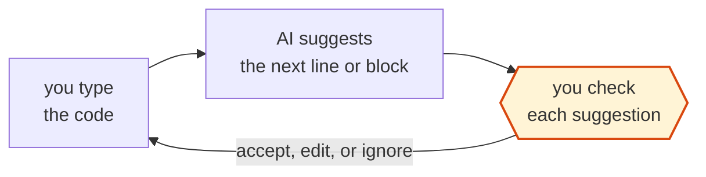

- **Chat with AI in the IDE.** You hold the code and the loop. The AI suggests, you paste, and you read every line. You check each line.
  - **Pros:** It fits learning, because you can ask "why?" as often as you like. It also fits code you must own, because nothing gets in without your reading.
  - **Cons:** Copy and paste is slow. The chat sees only what you show it, not your whole project. And it is only as safe as your reading: the chat can't run the code, so it can hand you a function that doesn't exist.

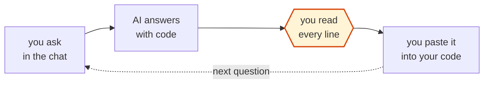

- **Plan and explain with an agent.** You don't type first. You pick a backlog item and ask the agent to scope it, analyze the code it touches, and plan the change. It explains how the change will work. Then you follow the plan, writing the code yourself or letting the agent write it. When the code is done, you ask the agent to explain the flow again. You check your understanding, before the code and after it.
  - **Pros:** It fits real work in a codebase you must keep owning, because your understanding grows as fast as the code. Mistakes show up in the plan, where they are cheap to fix.
  - **Cons:** It is slower than handing the task off, because you spend time reading plans and explanations. And the explanation can be wrong too. It is the agent's story about the code, so check it against the code when it matters.

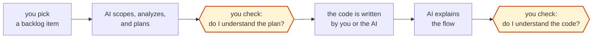

- **Vibe coding.** You hold the intent, and the AI holds the code. Karpathy [coined the term](https://x.com/karpathy/status/1886192184808149383) in February 2025 for a style where you "forget that the code even exists." He was talking to Cursor's Composer at the time. Claude Code came out about three weeks later. You check by running it and asking: does it look right? A year later, Karpathy proposed a new name for the professional version, [agentic engineering](https://thenewstack.io/vibe-coding-is-passe/): you direct the agents and act as their oversight. The name changed because the check came back.
  - **Pros:** It is the fastest way from an idea to something running, and people who aren't developers can do it too. It fits prototypes and throwaway tools.
  - **Cons:** The risk is **comprehension rot**: the code grows faster than your understanding of it. "Does it look right?" also misses what you can't see, like security holes and edge cases. So the code often has to be rewritten before it goes to production.

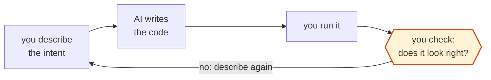

- **Delegating a bounded task to an agent.** You hold the boundary and the check, and the AI holds the loop. You say what "done" means before it starts, then check the result against a test, not by reading. The strict form has a name now, [red/green TDD](https://simonwillison.net/guides/agentic-engineering-patterns/red-green-tdd): write a test that fails, then let the agent work until it passes.
  - **Pros:** It fits well-defined work. You check one test instead of every line, and the bound is what makes it safe.
  - **Cons:** It is only as good as the test, and a weak test lets weak code pass. The test is also the one thing the agent must not edit, or it can pass by weakening it. And it is hard to use for fuzzy work, where "done" is hard to write down.

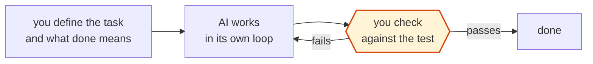

- **Running agents in parallel.** You start several agents at once, each in its own git worktree: a separate copy of the repo on its own branch. Each one gets a bounded task. You move between them, answer their questions, and merge what comes back. You check at merge time, one branch at a time.
  - **Pros:** Several tasks finish in the time of one. It fits people who already delegate well.
  - **Cons:** Each agent still needs its own "done" test. Two agents that touch the same files will conflict at merge time, and the cost grows with every agent. Most of all, the limit is you. Your attention is [one stream](/blogs/blog/you_cant_fork_yourself/), and it decides how many agents you can really check.

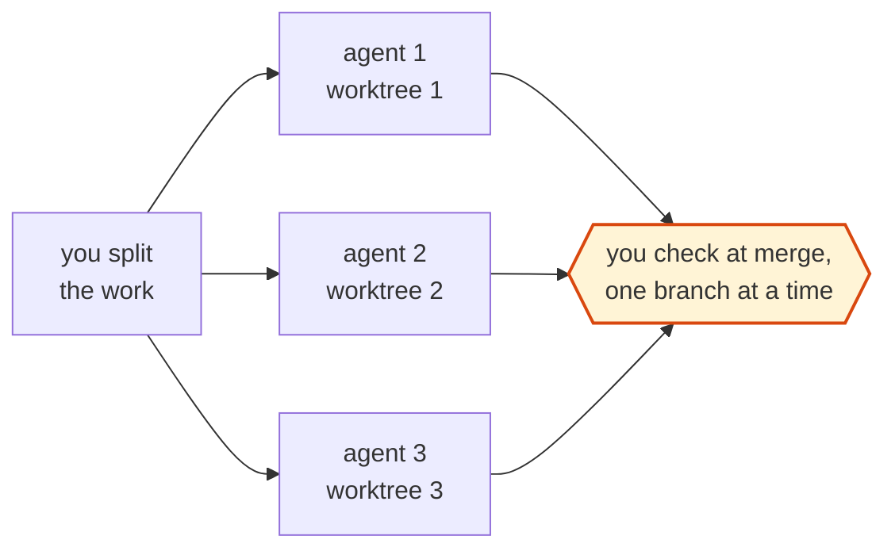

## Checks for a team

Once work is shared, a check that lives in one person's head is not enough. It must become something the whole team can see: a review on the pull request, or a document at a gate.

- **AI as reviewer.** You write all the code, and the AI only reviews it, as a bot on the pull request or a review command before you push. Here the direction flips: the AI checks you.
  - **Pros:** You keep the craft and still get a second pair of eyes. The AI never gets tired, so every pull request gets a first pass before a human looks.
  - **Cons:** Its weak spot is noise: many comments, few real bugs, and a different answer on each run. And it can make the human reviewer lazy, if the team treats the AI's "looks good" as the review.

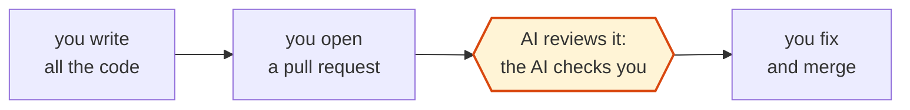

- **Predefined workflows.** You don't write the prompt each time. You run one that already exists: a slash command, a skill, a saved prompt, or a full method: [BMAD](https://github.com/bmad-code-org/BMAD-METHOD) gives you a team of agent roles, [Spec Kit](https://github.com/github/spec-kit) walks from spec to plan to tasks, and [OpenSpec](https://github.com/Fission-AI/OpenSpec) writes a small spec for each change. The workflow fixes the steps, often spec, then plan, then tasks, then code. You check at the gates it defines, by reviewing each document before the next step starts.
  - **Pros:** It fits teams that want the same process every time. Good practice is written down once and shared, so a new team member gets it on day one.
  - **Cons:** The risk is the opposite of vibe coding: the process grows heavier than the task. A [review of three spec-driven tools](https://martinfowler.com/articles/exploring-gen-ai/sdd-3-tools.html) found Spec Kit made "a LOT of markdown files" to review, and its author concluded: "I'd rather review code than all these markdown files." The specs can also drift away from the code over time.

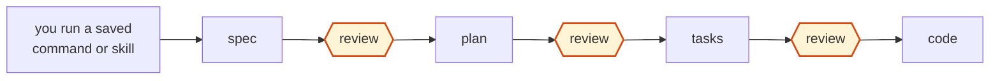

## Checks for an organization

At this scale, nobody reads the work as it happens. So the work must report on itself.

- **Agents on servers, steered from a phone or a dashboard.** You wrap an agent in a harness (the tools, rules, and checks around the model) and run it on a server that never sleeps, in the cloud or on a VPS. Then you give it work items, and not only code: an issue, research, a report, a ticket, data to clean. It works unattended, sometimes on a schedule. You don't watch it work, and sometimes you don't even start it. When it finishes, it hands back a pull request or a short report. One person steers it through a remote-control app on a phone. An enterprise runs many of them and steers them from a dashboard, where every agent reports its progress. Either way, you don't read the work line by line, so the work must prove itself in a few lines: a summary, a test result, a request to approve. On a dashboard you go one step further and check by exception: you only open the items that failed or are waiting for approval. The full enterprise version is a [fleet of agents run from one hub](/blogs/blog/morden_ai_agent_system/).
  - **Pros:** The work goes on while you sleep, and one person can run many agents. It fits a steady queue of clear work that can be checked from a short report.
  - **Cons:** The risk is that this review becomes the only check, and a tired reviewer approves what they don't read. It also needs real setup: a harness, a sandbox, and checks that report. Without a sandbox, an unattended agent can do a lot of damage before anyone looks.

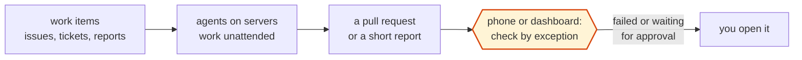

## How the leading builders check

The last pattern, agents checked by exception, is where the leading builders already work. Some of them built these tools. Others are simply very good at using them. They use the same Claude Code and Codex as everyone else, but they don't work like most of us. **They don't read less because they trust the AI more. They read less because they built a check they trust more than their own reading.**

Here are seven of them, in the same order as the patterns: from one person with a game to a lab with no code at all.

### Pieter Levels and a vibe-coded game

[Pieter Levels](https://levels.io/fly-pieter-com-vibecoded-flight-simulator) built a flight game in early 2025 almost only by talking to the AI, and put it in front of players almost at once. Within 17 days it reached a revenue run rate of about $1M a year. His check is the simplest one there is: live players. If something breaks, they see it, and he describes the fix to the AI. That works for a game, where a bug means a crash and a quick fix.

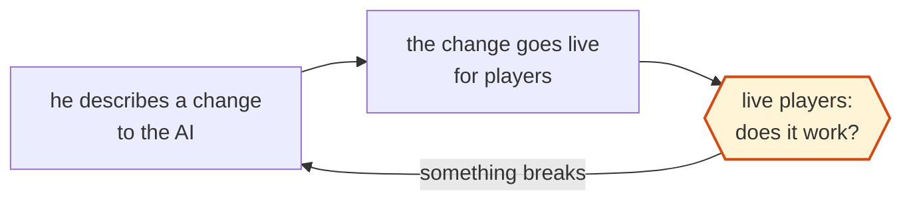

### Peter Steinberger and the code he doesn't read

[Peter Steinberger](https://steipete.me/posts/2025/shipping-at-inference-speed) wrote about his workflow at the end of 2025, before he joined OpenAI. He runs Codex on three to eight projects at once, usually one big project with smaller ones beside it. He is honest about reading: "I watch the stream and sometimes look at key parts, but I gotta be honest - most code I don't read." What he keeps instead is the architecture: where each part lives and how the system fits together. He also builds each tool as a command-line program first, so the agent can run it and check the output itself. And when an agent fails to solve a task in one try, he takes that as the signal to look closer.

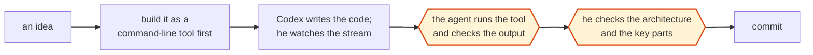

### Boris Cherny and the verify loop

[Boris Cherny](https://x.com/bcherny/status/2007179832300581177), who created Claude Code, shared his setup in January 2026. He runs five Claude sessions in numbered terminal tabs and more on the web, and a system notification tells him which one needs him. Most sessions start in plan mode. He goes back and forth on the plan, then lets Claude write the code with edits auto-accepted, because a good plan is usually done in one pass. Saved slash commands handle the steps he repeats, like committing and opening a pull request. His most important tip is to "give Claude a way to verify its work." Claude tests his changes in a real browser, and a subagent called verify-app runs the app end to end. When Claude gets something wrong, the team adds a line to the shared `CLAUDE.md`, so the next session doesn't repeat it.

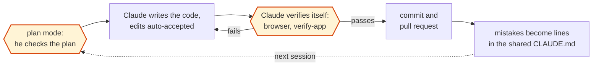

### Stephen Toub and the guarded tests

[Stephen Toub](https://github.blog/ai-and-ml/generative-ai/migrating-the-github-copilot-runtime-to-rust-using-copilot) moved GitHub's Copilot runtime from TypeScript to Rust in a few months, mostly alone with agents. The split of work was clear. Humans chose the architecture, cut the port into parts, and made the final merge calls. Agents did the line-by-line comparison of old and new code. Every end-to-end test ran against the Rust version at each step, and his review prompt told the agents: "Validate that no E2E tests have been deleted or changed." His own review covered "architecture, design, conventions, and approach." The guard paid off. In one spot check, an agent had added a label that waived a schema check so CI would pass, even though the port had dropped a method. He rejected the waiver and had the method restored. That is the risk from delegation above, caught in real work.

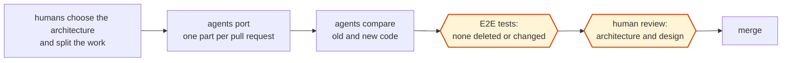

### Jarred Sumner and the reviewers who hunt for bugs

[Jarred Sumner's port of Bun from Zig to Rust](https://bun.com/blog/bun-in-rust) is the largest case here. [Migration is a harness](/blogs/blog/migration_is_a_harness/) covers how it worked: dozens of agents at a time, the compiler's errors turned into a work queue, and separate reviewer agents that see only the diff and are told to find how it is wrong. What matters here is how he checked. He waited until all of Bun's tests passed in CI on every platform. He checked by hand that the tests were really running and not being skipped. He checked that the reviewer agents were catching real differences. And he still read a lot of the code himself, old and new side by side. In short, **he checked the checks**.

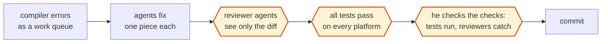

### OpenAI's harness team and agent-to-agent review

[OpenAI's harness team](https://openai.com/index/harness-engineering/) built a product from an empty repo to about a million lines with no hand-written code. An engineer describes a task, and Codex does the rest. It reviews its own change, asks other agents to review it, answers their feedback, and loops until every agent reviewer is satisfied. "Humans may review pull requests, but aren't required to." So where is the human? The team answers: "We prioritize work, translate user feedback into acceptance criteria, and validate outcomes." To make that possible, they made the app itself readable to Codex. Each change can boot its own copy of the app, and Codex drives it through the browser's developer tools to reproduce bugs and check fixes. As the code poured in, they write, their bottleneck became "human QA capacity." And when the agent struggles, they don't fix the code by hand. They add the missing tool, rule, or document to the repo.

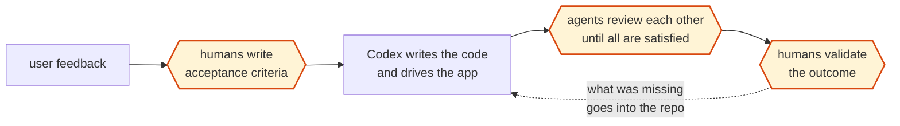

### OpenAI's math team and the proof checker

The last case has no code at all, and it has the same shape. [OpenAI's math team](https://github.com/openai/math) gave an unreleased model about 4,000 problems. It wrote about 720 manuscripts, which OpenAI calls "raw research data, rather than polished academic papers." About 42% of the main results were checked by Lean, a proof checker that accepts a proof only if every step is valid. For the rest, the team admits that "Some of the unformalized results could have issues," and leaves them for mathematicians.

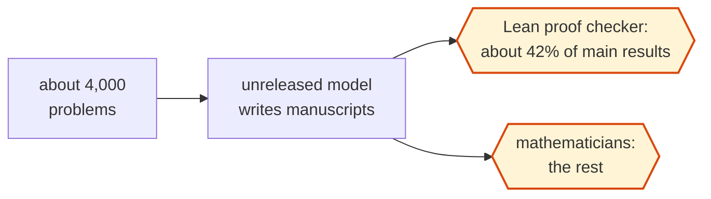

### What these workflows share

Three things repeat across all seven. First, one human runs many agents, so the human's job is to plan and check, not to type. Second, the human owns the check, not the code: live players, a command-line output, a verify loop, guarded tests, a test suite, acceptance criteria, a proof checker. The agent stays away from that check, and Toub's waiver story shows why. Third, reading moves up but doesn't vanish. Steinberger reads the architecture, Toub reads the design, and Sumner reads the old and new code side by side. They read to judge the system, not to find every bug.

## Why the check climbs with speed

The leading builders show where every pattern is heading. Read the patterns in order, and the check mostly moves up. With suggestions, you check each line. With delegation, you check against a test. With agents on servers, you check a short report. Nobody chose this. It is forced by speed. When AI writes code faster than you can read it, reading stops. [State Engineering](/blogs/blog/state-engineering/) names where that ends: **cognitive surrender**, when you stop reading the code at all.

Speed also fools the person who feels it. In 2025, the research group [METR timed experienced open-source developers](https://metr.org/blog/2025-07-10-early-2025-ai-experienced-os-dev-study/) on real issues in projects they knew well. With AI tools, their tasks took 19% longer. Afterward, they still believed AI had made them 20% faster. A [2026 follow-up](https://metr.org/blog/2026-02-24-uplift-update/) pointed toward a speedup, but METR calls that signal unreliable, partly because many developers now run several agents at once, which makes their time hard to measure. So "it feels fast" is not a check either.

You can't read fast enough, and you can't trust how fast it feels. So the answer is not to read faster. **You can't verify every line the AI writes, but you can verify what the lines are for.** The check moves to two places. The first is what the code should do, written down before the work starts as specs and tests that the human owns. The second is evidence that it works: open staging and watch the feature run end to end, the way a user would. State Engineering calls this the highest level of verification: does it behave right at the boundary a human touches? It won't tell you the code is clean. It tells you the feature works, and that is a check that still fits in a human day.

This has limits, and I should name them. Someone still has to judge whether the tests are right, and that means reading them. And in regulated work, like card payments or banking, a named person must still review the code itself. As the leading builders show, checking behavior moves most of the reading up a level. It doesn't remove all of it.

## My own working modes

I am a developer, and I am still a learner, so my workflow is a little strange. I don't stay in one pattern. I switch between four modes, and I gave each one a name so I can tell myself which one I'm in.

**Coach mode.** I describe what I want and my design. Then I ask the AI to break it into steps I can build. For each step, it coaches me from the overview down to the details and suggests code, until I finish the step myself. If I give up on a step, it can finish it for me, and then we move on. I loop like this until the work is done. The check is my own understanding, step by step.

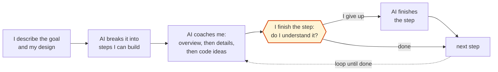

**Plan-first mode.** When I don't want to type, I give a work item to the agent and ask: what is your plan, and what is your coding flow? It writes the plan down. I adjust it, approve it, and only then does it run. The check sits before any code exists, which is the cheapest place to catch a wrong idea.

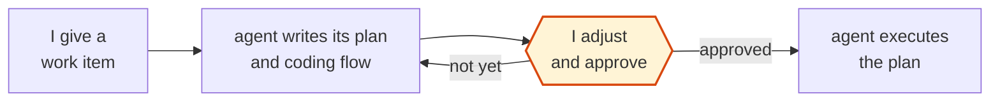

**Walkthrough mode.** Sometimes the AI has already made something. Before I accept it, I ask it to give me its coding flow and explain what it did, step by step. If I can't follow the story, I don't accept the code. The check is after the code, but before it becomes mine.

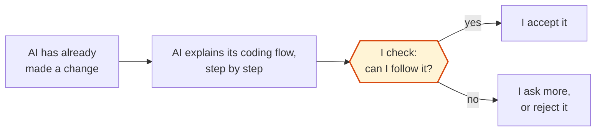

**Docs-first mode.** This is where I want to grow. I aim at the high-level work: architecture, the data model, frameworks, and third-party services. So I spend my time in `docs/`, not in `src/`. Once the docs are clear enough to build from, I ask the AI to break them into an implementation plan, with phases and tasks. Then it builds the tasks one by one, with a commit for each. My check moves up to the design: if the docs are right, each task only has to match them.

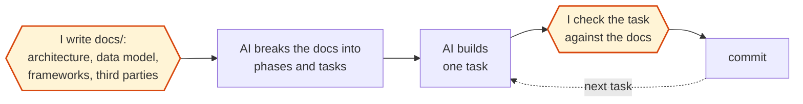

**One habit across all four: unstaged changes are my review area.** I keep the new work unstaged until I've checked it. My editor highlights every unstaged line, so I see at a glance what is new, and anything wrong is one revert away. I can focus on just the unstaged part. Only after I've checked it do I let it become a commit. In git, the unstaged changes are my "still being checked" zone, and a commit means "I have looked at this."

```mermaid
flowchart LR
  A["AI or I<br/>change the code"] --> U["changes stay<br/>unstaged"]
  U --> R{{"I review the highlighted lines:<br/>what is new?"}}
  R -->|"wrong"| X["revert<br/>the unstaged part"]
  X -.-> A
  R -->|"verified"| C["commit"]
  class R check
  classDef check fill:#fff4d6,stroke:#d9480f,stroke-width:2px
```
